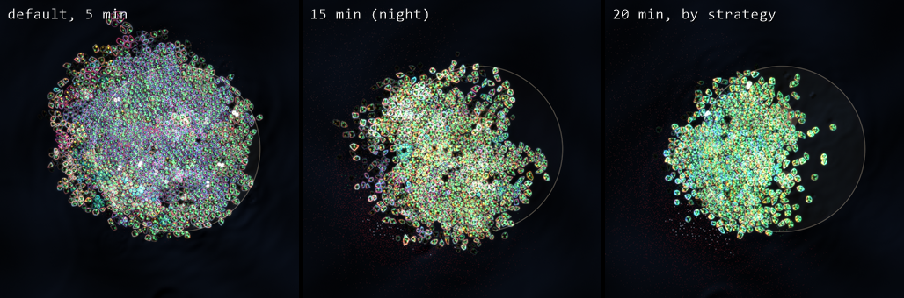
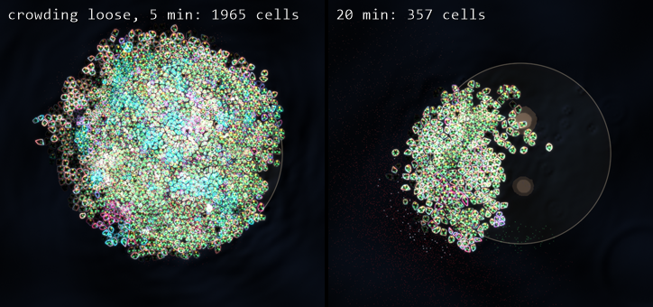
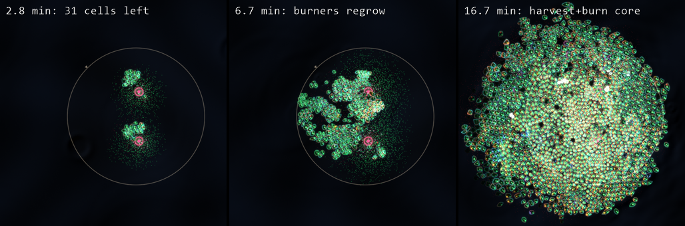
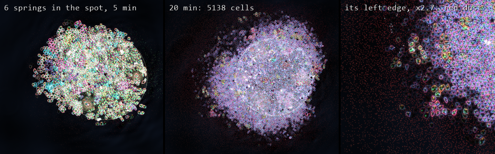
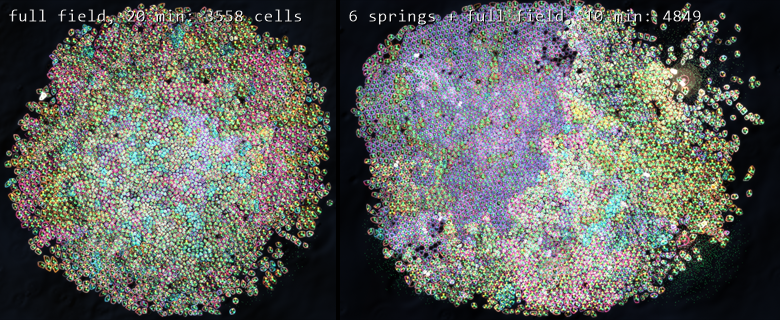
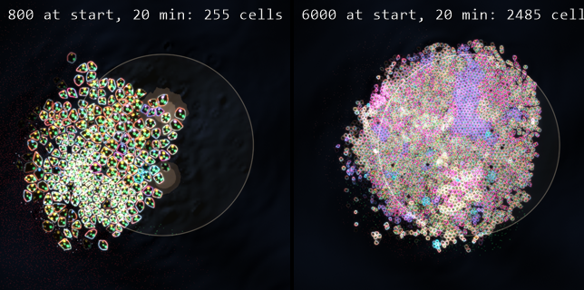
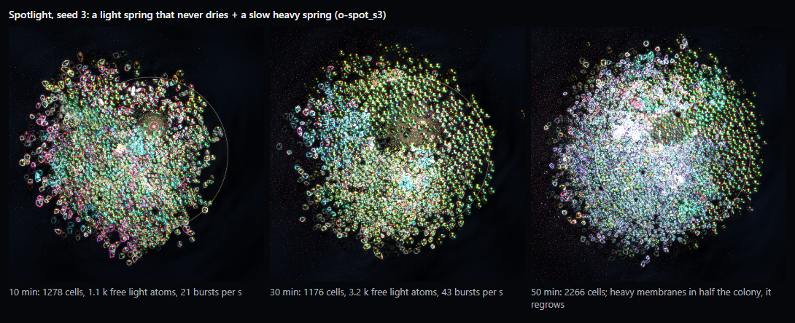
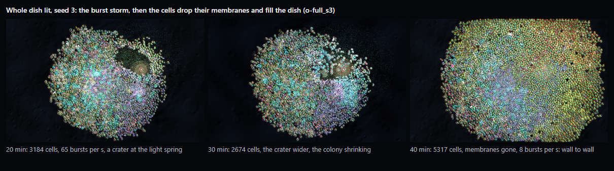
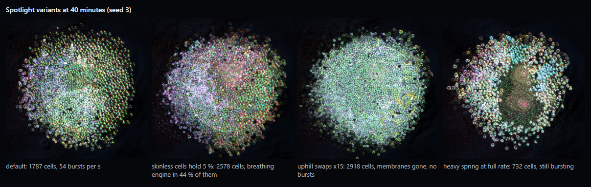

# General experiments: what the dish does

The experiments phase (CLAUDE.md, "EXPERIMENTS"): the whole simulation as it stands after step C9 (cells eat, engines in
the genome, charge, honeycomb membranes, dipoles, pumps, catalysts, hard light, division), run under different conditions,
watched in pictures and in the numbers of the entropy panel. A separate series looks at tissues alone (TISSUE.md).

**How.** 47 runs (45 plus two picture reruns) of 10 to 40 simulated minutes, headless Chrome on the GTX 1650 at MAX
speed, timed by simulated time (`tools/experiment.py`; the GPU was shared with other experiment series, so the runs
reached ×0.3 to ×4). Every condition is a file in `experiments/conditions/general/` (one batch file per series); each
run's numbers every 10 or 20 s are in `experiments/runs/g-*/samples.csv` (with `meta.json`: the exact URL, commit,
speed). Seeds 3 and 7 where a comparison mattered, seed 3 alone otherwise. Runs are not bit-repeatable, so a single run
tells a story, not a measurement: two copies of the very same default dish and seed (`g-light-spot_s3`,
`g-pump-on_s3`) ended at 538 and 663 cells, 15.4 and 16.5 M of entropy, and with seed 7 at 434 cells. Differences
smaller than about ±150 cells or ±1.5 M of entropy at 20 minutes are noise.

**Words used.** *Entropy* = all heat that has left the dish so far (the panel's ENTROPY line; M = millions of energy
units); *entropy rate* = heat leaving per second. *ORDER* = how bunched up the dish's substances are (1 = all in one
spot, 0 = evenly smeared). *Burner* = a cell whose engines only burn fuel; *harvest + burn* ("both") = a cell with a
pigment that makes fuel from light AND a burner (the gold-and-green split cells in the strategy view); *breather* = a cell
with an engine that uses free light atoms to break rich fuel. *Free light atoms* = loose g and t atoms in the dish (the
reactive "vandals", drawn as red dust). The default dish: 2000 cells, a spotlight on the right, a light and a heavy
spring that drip for the first 4 minutes, day and night every 4 minutes, division on.

## What we found

1. **Evolution re-invents "harvest and burn" in minutes.** Starting from 2000 cells that can only burn fuel, the first
   cell with a light-catching pigment appears by mutation within a minute; its lineage stays a handful for several
   minutes, then sweeps through the colony from the lit side: 1 of 1727 cells at 40 s, 142 of 982 at 4.7 min, 1471 of
   1661 at 10 min, 97 % at 20 min (seed 3; seed 7 the same, the sweep 2 minutes later; a rerun for the pictures had it
   at 8.7 to 11.7 min). Look for the gold-and-green split cells spreading through a green crowd.
   

2. **Whatever you start with, the spotlit dish ends in the same place.** After 20 minutes the default dish holds 400 to
   800 cells, 95 to 99 % of them harvest + burn, ORDER 0.21 to 0.23 and an entropy of 15 to 18 M, whether the founders
   were all burners, all harvesters or the usual mix, with mutation off or tripled, with division cheap or costly. Even
   800 or 6000 starting cells (smaller cells, so 255 or 2485 of them fit) end at 15 to 18 M. The light decides: the
   whole dish lit makes 55 M (and 3600 cells), no night 25.5 M, darkness 1 M (everything dead by 4 minutes).
   

3. **Loose brakes give boom and bust.** Let packed cells keep dividing (crowding limit loose) and the colony shoots up to
   2145 cells at 6 minutes, fills the whole spot, eats the fuel faster than the light remakes it, and falls to 357 at 20
   minutes, the lowest of all lit runs; with a tight crowding limit it never passes 1100 and still holds 778 at the end.
   Removing the night does the same (2398 at 11 min, 659 at 20). A low division threshold makes a baby boom before the
   first tick (2000 to 3092 cells) and a famine a minute later (78 starvations per second, down to 495).
   

4. **Near-extinction and a comeback on heavy food.** With only heavy springs (no light atoms at all) the culture crashes
   to 31 to 68 cells by 3 minutes: two little huddles of burners, one beside each spring. They regrow for 10 minutes as
   burners; then a harvest + burn lineage appears (its pigment can only be making heavy fuel: there are no light atoms)
   and takes the colony over in about 3 minutes (126 to 1980 cells between 11.5 and 14.5 min), ending at 2858 cells and still rising, with a gold core in
   the light and a rim of green burners. Seen twice (run and rerun). These cells also lose their membranes (integrity
   0.00): a membrane is built from light linkers, and there are none.
   

5. **A dish-wide poison haze, answered by dropping the skin.** Springs that never dry up fill the dish with free light
   atoms (red dust everywhere: 2 to 7 thousand of them at 20 min, 7.3 thousand at 40 min, against about 480 at the
   defaults). Light atoms bite membranes made of light linkers, so a wave of bursts follows (25 to 43 bursting cells per
   second around 5 min). Then the membrane gene swings to "heavy" (from 25 % of the cells to 84 to 97 %), but in these
   dishes there is little or no heavy linker to build with, so the cells simply stop having a whole membrane: whole
   membranes fall from about 1000 to 30 to 80, their mean integrity from 0.4 to 0.02 to 0.06. A cell without a whole
   membrane cannot burst (it only leaks: it holds 30 % of its stock), and the bursts stop. Where heavy atoms are around
   (the default dish, with its heavy spring) the same gene builds real heavy membranes (integrity back to 0.47).
   The oxygen-like story did not happen: the build-up and the poisoning did, but breathing did not follow. In the
   40-minute light-spring run of seed 3 the cells *carrying* a breathing engine rose from 90 to 983 (40 % of the
   colony), but with no heavy atoms in the dish that engine has nothing to run on (swaps inside cells: 0): a passenger
   gene riding with a winning lineage, not a response. Seed 7 stayed under 90.
   

6. **Cells make about a third of the dish's entropy.** In the spotlit dish, of the 12.3 k heat units leaving per second (a
   day's average at 20 min) 1.2 k is the dish's own warmth, 6.7 k light simply absorbed, 3.4 k the cells' crawling
   (drag) and 0.7 k their engines; with the whole dish lit the heat made per second is 41 k from absorbed light, 14 k
   from crawling, 3.9 k from engines (the heat leaving lags a little behind while the colony grows). Biggest entropy of
   all: six springs spread over a fully lit dish, 6000 cells (the capacity) from 14 min, 79 M at 20 min, 92 k per
   second.
   

7. **Heat tolerance evolves up.** Founders with a low tolerance (6 instead of 10 to 20) lose up to 13 cells per second
   to heat at the first noon; the survivors' tolerance then climbs steadily: 6.0, 8.6 (4 min), 16.3 (8 min), 24.1 at 20
   min. The default dish climbs too, more slowly (14.5 to 22.1).

8. **The books stay exact.** Atoms and charge rounding were exactly 0 in every run (47 runs, up to 40 minutes, up to
   6000 cells); the energy's rounding stayed within ±0.43 in up to 135 M. No free entropy from numerical error.

## The runs, condition by condition

All numbers at 20 simulated minutes unless said. The sections keep the numbers of the plan's list and come in order of
priority (light, division, the oxygen story, springs, founders, mutation, then the rest). The master table (every run)
is at the end.

### 1. Light: spotlight, whole dish, darkness, no night

Files: `g-light-spot.json` (the default page), `g-light-full.json` (`?light=full`), `g-light-dark.json`
(`?light=off`, 10 min), `g-light-noday.json` (`?day=0`); batch `batch-light.json`, seeds 3 and 7.
Plots: `experiments/summaries/general-light/` (count, entropy, entropy rate, ORDER).

- **Spotlight (default).** The story of step C9: the dark part of the starting blob starves and fades out by 2.5
  minutes, a colony grows from the spot, peaks (1406 at 5 min in seed 3, 1972 at 12 min in seed 7), and then shrinks as
  the springs' atoms run out (they stop at 4 min): at 20 min 538 and 434 cells. Over the 20 minutes the colony also
  slides toward the dish centre: by the end it sits on the inner half of the spot and the outer half is empty
  (probably the gentle pull toward the dish centre from step 3, which nothing in the light pushes back against; not
  tested). Strategies: burners rise first (941 of 1406 at 5 min, while the springs feed them), then fall to 1 to 4 %;
  harvest + burn ends at 96 to 98 %.
- **Whole dish lit.** A round colony grows outward in every direction to 3558 and 3626 cells, still slowly rising, a
  disc filling most of the dish's height: packed honeycomb, a mosaic of fates (pink and amber rim, cyan islands in the
  middle). 55 M of entropy, 62 to 65 k per second.
- **Darkness.** Nothing makes fuel; all cells are dead by 4 to 5 minutes. Afterwards the entropy rate is the dish's warmth
  alone (1.2 k per second) and ORDER keeps falling (0.25 to 0.21) as the dead cells' atoms spread: the baseline of a
  dish without life.
- **No night.** More light per day, so a bigger boom (2398 at 11 min; 1.7 k at 7 min in seed 7) and the same bust
  (659, 693): constant light does not make a constant colony, it makes it overshoot. At the peak the colony is a
  violet core of neurons in the light, ringed by amber and green; at 20 minutes a loose patchwork on the inner half of
  the spot.

  

| run | cells 5 / 10 / 20 min | entropy | rate /s | ORDER |
|---|---|---|---|---|
| spot s3 / s7 | 1406, 1268, 538 / 1306, 1659, 434 | 15.4 / 16.9 M | 13.7 / 11.4 k | 0.21 / 0.21 |
| whole dish s3 / s7 | 1279, 2425, 3558 / 1049, 2048, 3626 | 54.7 / 54.8 M | 62 / 65 k | 0.27 / 0.27 |
| darkness s3 / s7 (10 min) | 0 / 0 | 1.04 / 1.08 M | 1.2 / 1.2 k | 0.21 / 0.22 |
| no night s3 / s7 | 1486, 2316, 659 / 1419, 1636, 693 | 25.5 / 25.9 M | 16.6 / 16.4 k | 0.19 / 0.22 |

### 6. Division: cost, threshold, starvation, crowding, turnover

Files: `g-div-*.json`, batch `batch-division.json` (seed 3) and `batch-division-s7.json` (turnover, seed 7). The
default (`g-light-spot_s3`) for comparison. Plots: `experiments/summaries/general-division/` and
`general-division-crowd/` (count over time).

| run | knob | cells 5 / 10 / 20 min (peak) | entropy | rate /s |
|---|---|---|---|---|
| default | cost 0.4, threshold 60 %, starve 30 s, crowd 0.6 | 1406 / 1268 / 538 (1.5 k) | 15.4 M | 13.7 k |
| turnover (s3 / s7) | `?divide=0`, fixed 2000 | 2000 always | 16.6 / 18.2 M | 18.5 / 20.1 k |
| cheap | `?divcost=0.1` | 1304 / 1757 / 572 (1.8 k) | 15.4 M | 12.7 k |
| costly | `?divcost=1.5` | 1009 / 1264 / 611 (1.3 k) | 15.5 M | 13.9 k |
| threshold low | `?divat=0.3` | 1253 / 1434 / 778 (3092 at the start) | 17.6 M | 14.3 k |
| threshold high | `?divat=0.9` | 920 / 1285 / 734 (1.3 k) | 15.7 M | 13.6 k |
| starve short | `?starve=8` | 1240 / 1246 / 785 (1.3 k) | 15.1 M | 15.5 k |
| starve long | `?starve=120` | 1310 / 2146 / 1387 (2.1 k) | 18.9 M | 19.2 k |
| crowd loose | `?crowd=1.5` | 1965 / 1481 / 357 (2145 at 6 min) | 16.7 M | 10.6 k |
| crowd tight | `?crowd=0.2` | 719 / 1040 / 778 (1.1 k) | 14.8 M | 15.4 k |

- **Count over time:** every division run but turnover has the same shape: a collapse to 300 to 900 by the first night,
  a rise while the fuel lasts, a peak at 5 to 12 minutes and a slow fall. The day shows as small steps (births by day,
  stalls at night), not as an oscillation of its own. The brakes set the overshoot: crowd loose has the highest peak
  and the deepest fall; crowd tight the flattest curve (picture in finding 3).
- **The cost barely matters** (cheap and costly end within the noise of the default). The threshold matters only at the
  start: at 30 % every cell with its starter charge divides at once (3092 cells before the first sample), the halves
  starve together a minute later.
- **Long starvation keeps more cells**: the dark part of the blob fades slowly (1532 still alive at 2 min), and the
  colony peaks at 2146 and holds 1387 at 20 min; starving cells wait out the night instead of dying.
- **Turnover against division.** With a fixed count the strategies stay mixed (at 20 min 64 % harvest + burn, 28 %
  burners, 8 % harvesters only, against 96 to 98 % harvest + burn with division in every run), free light atoms stay
  low (148 against about 480), and the entropy rate is higher (18.5 k: 2000 cells crawl). Division turns selection up:
  the fed cells copy themselves, the others vanish. Seed 7 the same: with turnover 64 % harvest + burn, 22 % burners,
  9 % "other", and 322 cells carrying a breathing engine, most of them in the dark; 18.2 M. With division: 98 % harvest
  + burn.

### 10. The oxygen-like story

Files: `g-oxy-upswap.json` (whole dish lit, `moire.matter.chem.kUpSwap = 0.3`: light-driven uphill swaps in the open
15 times faster, the knob step C6 found closest; 40 min; seeds 3 and 7), `g-oxy-control.json` (the same at the default
0.02; seed 3). Batch `batch-oxygen.json`. Plots: `experiments/summaries/general-oxygen/`.

| run | cells 10 / 20 / 40 min | free g + t at 40 min | breathers in the light 10 / 20 / 40 min | swaps in the open /s | entropy at 40 min |
|---|---|---|---|---|---|
| control s3 (0.02) | 2363 / 3925 / 4393 | 73 | 102 / 187 / 140 | about 2 | 133 M |
| uphill swaps x15, s3 | 2435 / 3612 / 4215 | 87 | 183 / 171 / 101 | about 20 | 127 M |
| uphill swaps x15, s7 | 2238 / 3790 / 4671 | 84 | 55 / 110 / 331 | about 20 | 135 M |

- **No build-up under the whole-dish light.** Speeding up the uphill swaps does what it should in the chemistry (ten times
  more swaps in the open, about 20 per second against 2), but the free light atoms they release do not pile up: about 40
  g and 40 t at any time in all three runs, against 480 in the spotlit default. A colony of 4000 cells covering most of
  the dish takes them up as fast as they appear.
- **Breathers stay a small minority** (2 to 7 % of the cells, in the light), with and without the faster swaps. Only
  seed 7 shows a late rise (110 at 20 min to 331 at 40 min), while the free light atoms stayed flat; seed 3 with the
  same setting went the other way (171 to 101). No "great oxidation" moment.
- **The colonies themselves are the sight of the series**: after 40 minutes both whole-dish colonies have a pale violet
  core (neurons), cyan islands, and a broad rim of amber and green, like a target; the rims of seed 7 are wider and
  more even.

**Second try, light springs for 40 minutes** (`g-oxy-lightsprings.json`, seeds 3 and 7: the two springs of the default
place, both light, never drying). Here the build-up does happen: free light atoms climb all the way, 3.7 thousand g and
3.7 thousand t at 40 min, red dust over the whole dish. The cells answer by dropping their membranes (finding 5). Seed 3
then shows what looks like the story's last act, the cells carrying a breathing engine rising from 88 (24 min) to 983
(40 min), while the membranes partly come back (integrity 0.12 to 0.29) and the bursts return (11.6 per s); but the
breathing engines in this dish have nothing to work on (no heavy atoms: every breathing swap needs a heavy fuel), so it
is a passenger gene, not breathing. Seed 7: breathers stay under 90, the membranes stay gone (integrity 0.05).
Lesson for the census: "breathers" counts cells carrying the engine, not cells using it; the swap rates inside cells
(`cells.rate.inSwap`, 0 here) tell which.

| run | cells 10 / 20 / 40 min | free g + t at 40 min | carrying a breathing engine 10 / 20 / 40 min | membrane integrity 20 / 40 min | entropy at 40 min |
|---|---|---|---|---|---|
| light springs s3 | 2159 / 2272 / 2432 | 7.3 k | 114 / 76 / 983 | 0.12 / 0.29 | 43.5 M |
| light springs s7 | 2150 / 2199 / 2134 | 6.9 k | 84 / 54 / 48 | 0.11 / 0.05 | 51.3 M |

### 2. Springs that never dry up

Files: `g-spr-*.json`, batch `batch-springs.json`, seed 3; every spring set to drip for the whole run (an eval
`s.life = 1e9`). Plots: `experiments/summaries/general-springs/` (count, free light atoms, membrane mix, entropy rate).

| run | springs | cells (peak) | free g + t | membrane gene "heavy" | entropy | rate /s |
|---|---|---|---|---|---|---|
| both | default two, never drying | 2243 (2305) | 2.1 k | 87 % | 17.7 M | 22.8 k |
| light only | two light springs | 2457 (2940 at 14 min) | 4.5 k | 84 % | 21.4 M | 26.8 k |
| heavy only | two heavy springs | 2858 (rising; 31 to 68 at 3 min) | 0 | 17 % (no membranes at all) | 17.4 M | 31.7 k |
| many | six in a ring inside the spot | 5138 (rising) | 6.7 k | 97 % | 27.5 M | 42.4 k |
| spread | six over the dish, whole dish lit | 6000 (the capacity, from 14 min) | 2.2 k | 68 % | 78.6 M | 91.8 k |

- With food that never stops the colony does not shrink after 10 minutes; it keeps growing.
- **Burners and harvest + burn coexist** with the default springs never drying (49 % burners, 50 % both at 20 min); in
  every dish where the springs dry up the burners vanish. The springs feed burners; the light feeds the others.
- **Light springs: poison, then no skin** (finding 5): the burst wave at 5 minutes (25 per s with two light springs, 43
  with six), then the membrane gene turns "heavy" with no heavy material to build from, and the membranes vanish.
- **Heavy springs: near-extinction and comeback** (finding 4).
- **Spread springs, whole dish lit:** the colony covers the dish wall to wall (picture in finding 6). At 10 minutes it
  shows large territories of one fate each, as big as a quarter of the dish (violet on the left, amber-green on the
  right, cyan in the middle), the clearest large-scale pattern of the series.

### 9. Founders: all burners against all harvesters

Files: `g-found-burners.json`, `g-found-harvesters.json` (an eval sets every cell's engines at t = 0 with
`moire.genome.setAll`: burners burn gt and gT; harvesters have the "pigments" set: gt by visible 1, gT by visible 2,
a small gt burner); batch `batch-founders.json`, seeds 3 and 7. Picture rerun `g-img-burners.json`. Plots:
`experiments/summaries/general-founders/`.

| run | cells 2 / 5 / 10 / 20 min | burners at 20 min | harvest + burn at 20 min | entropy |
|---|---|---|---|---|
| default s3 / s7 | 822, 1406, 1268, 538 / 623, 1306, 1659, 434 | 4 % / 2 % | 96 % / 98 % | 15.4 / 16.9 M |
| all burners s3 / s7 | 378, 1132, 1661, 662 / 476, 1153, 1181, 428 | 3 % / 2 % | 97 % / 98 % | 15.7 / 15.2 M |
| all harvesters s3 / s7 | 726, 1100, 1519, 590 / 614, 1023, 1729, 586 | 1 % / 0 % | 97 % / 98 % | 17.1 / 16.5 M |

- All-burner dishes lose more at the first night (378 and 476 left, against 623 to 822): nobody makes fuel. Then the
  sweep of finding 1.
- All-harvester dishes heat themselves at noon (12 heat deaths per second at 4 minutes): a dense patch of busy cells in
  the spot is a hot spot. They stay harvest + burn all the way.

### 4. Mutation

Files: `g-mut-off.json` (`?mut=0`), `g-mut-high.json` (mutSize 3, mutJump 0.1, engine and pump slot jumps 0.12),
`g-mut-nohard.json` (`?hardmut=0`); batch `batch-mutation.json`, seed 3.

| run | cells 5 / 10 / 20 min | strategies at 20 min | heavy membranes | entropy |
|---|---|---|---|---|
| default | 1406 / 1268 / 538 | 96 % both | 83 % | 15.4 M |
| off | 1173 / 1503 / 653 | 98 % both | 10 % | 15.3 M |
| high | 1001 / 1102 / 516 | 90 % both, 6 % burn, 5 % harvest | 27 % | 16.4 M |
| hard light does not mutate | 929 / 1385 / 1071 | 99 % both | 2 % | 15.2 M |

- Without mutation the end is the same: the founders already include harvest + burn lineages, and selection alone picks
  them. High mutation keeps a few more of the other strategies around (mutants keep appearing).
- Hard light mutation off kept twice the cells at 20 min (1071 against 538): the default's hard light raises the
  mutation of lit parents about 4 times, and most mutations cost. One seed only.
- Heavy membranes: a "both" lineage with a heavy membrane needs a mutation (no founder has both), so with mutation off
  or hard light mutation off they stay rare.

### 3. Trace and the cofactor

Files: `g-trace-none.json` (the heavy spring's 4 % trace given to G, T and L instead, by an eval on the spring table),
`g-trace-nocofactor.json` (`?cofactor=0`); batch `batch-trace.json`, seed 3.

| run | cells (peak) | engines' speed | entropy |
|---|---|---|---|
| no trace | 395 (1.0 k) | 35 % | 14.5 M |
| default | 538 (1.5 k) | 62 % | 15.4 M |
| cofactor off | 1084 (1.9 k at 14 min) | 100 % | 18.6 M |

The cofactor is still a pure cost over 20 minutes with division: switching it off doubles the colony. Trace works as a
vitamin as designed (no trace, slower engines, fewer cells), but nothing in the dish pays the cells back for needing it.

### 5. Heat tolerance low

`g-tol-low.json` (an eval sets every cell's tolerance gene to 6 at t = 0), seed 3. 13 heat deaths per second at the
first noon (4 min), then the tolerance climbs (finding 7) and the colony ends at 756 cells, as many as the default.

### 7. Charge off, dipoles off

`g-charge-off.json` (`?charge=0`), `g-dipoles-off.json` (`?dipoles=0`), seed 3: 563 and 525 cells, 16.5 and 15.9 M,
no visible difference at the scale of the dish. (Null result: the charge and the dipoles shape small things, see
TISSUE.md and steps C6b and C6d, but not the colony's fate.)

### 8. Starting number: 800, 2000, 6000 cells

`g-cells-800.json`, `g-cells-6000.json` (`?cells=`; capacity 3 times), seed 3. Cells are smaller when there are more of
them, so the spot holds more: 255, 538 and 2485 cells at 20 min (peaks 649, 1.5 k, 3.2 k). The entropy hardly changes
(17.8, 15.4, 14.9 M): the light, not the number, sets it. 6000 cells crash harder (378 at 3 minutes: from 6000, most are in the dark) and then
rebuild to 3.2 k; their colony at 20 min shows clear fate territories (a violet island in a pink and cream
sheet). Speed: ×2.9 for 800 cells and ×0.65 for 6000 (both on the shared GPU).

### 11. Membrane bites ×5

`g-bites-high.json` (`moire.membrane.params.kBite = 0.25`), seed 3: heavy membranes rise faster (85 % of the cells by
6.7 min, against 55 % in the default); the end is the same (83 %, 674 cells), and these are real heavy membranes (the
heavy spring gives the material: heavy linkers in the membranes 31 against 25 light at 20 min, integrity 0.28). Note
that the heavy share is noisy between runs of the same seed (9 to 96 % at 20 min across the seed-3 runs above): the
gene rides along with whichever lineage wins, except where light atoms are plentiful (light or many springs: 84 to 97 %
every time, but there it means no membrane, finding 5).

### 12. Pumps

Files: `g-pump-on.json` (the default again, a second copy of the default dish), `g-pump-nocontact.json`
(`?pumpcontact=0`: pumps work only with the dish, never with a touching neighbour); batch `batch-pumps.json`, seed 3,
20 min (the planned 30 min were cut: the shared GPU ran at ×0.5 to ×0.8).

- **Pumps are selected.** A third of the founders carry one weak pump (16 % of the starting cells in seed 3, 33 % in
  seed 7). With mutation the share of cells with a working pump rises steadily: to 100 % (default, seed 3), 80 %
  (seed 7), 85 % (the second copy) and 69 % (contact pumping off) at 20 min; with mutation off only to 32 %.
- **Which pump wins depends on the winning lineage:** "pump the light fuel gt IN" in the default seed-3 run (96 % of the
  pumps), "pump light linkers IN" (membrane material, 66 %) in its second copy, gt IN again without contact pumping
  (47 %). Importers win; exporters stay rare (light linkers OUT 31 % and heavy linkers OUT 21 % as second pumps in the
  default run).
- **Contact pumping makes no visible difference** (762 cells without it, 663 and 538 with it; 17.2 against 16.5 and
  15.4 M). Pumping across contact moved 12 to 31 units per s in the default runs, so neighbours do take from each other,
  but the colony's fate does not hang on it. Null result for "stealing".
- Membrane voltage stayed near 0 everywhere (1 to 12 cells above 0.1).

## Master table

Every run at 20 minutes (darkness at 10 min, the picture reruns at their end; the 40-minute runs at 20 min here, their
ends in section 10). "Peak" = the
most cells after the first 150 s. Rounding: the largest |value| over the run (energy / atoms / charge).

| run | cells (peak after 150 s) | entropy | entropy rate /s | ORDER | both / burn / harvest % | free g+t | heavy membr. % | rounding E / atoms / charge |
|---|---|---|---|---|---|---|---|---|
| g-bites-high_s3 @ 1200 s | 674 (1.6 k at 560 s) | 16.5 M | 13 k | 0.217 | 97 / 2 / 1 | 482 | 83 | 0.094 / 0 / 0 |
| g-cells-6000_s3 @ 1200 s | 2.5 k (3.2 k at 1060 s) | 14.9 M | 18 k | 0.288 | 98 / 1 / 1 | 405 | 87 | 0.33 / 0 / 0 |
| g-cells-800_s3 @ 1200 s | 255 (649 at 360 s) | 17.8 M | 13 k | 0.212 | 96 / 2 / 2 | 271 | 42 | 0.067 / 0 / 0 |
| g-charge-off_s3 @ 1200 s | 563 (1.6 k at 600 s) | 16.5 M | 13 k | 0.216 | 98 / 1 / 1 | 483 | 64 | 0.051 / 0 / 0 |
| g-dipoles-off_s3 @ 1200 s | 525 (1.5 k at 620 s) | 15.9 M | 13 k | 0.216 | 98 / 1 / 1 | 486 | 66 | 0.16 / 0 / 0 |
| g-div-cheap_s3 @ 1200 s | 572 (1.8 k at 620 s) | 15.4 M | 13 k | 0.223 | 98 / 1 / 1 | 457 | 82 | 0.032 / 0 / 0 |
| g-div-costly_s3 @ 1200 s | 611 (1.3 k at 620 s) | 15.5 M | 14 k | 0.220 | 98 / 1 / 0 | 471 | 19 | 0.076 / 0 / 0 |
| g-div-crowdloose_s3 @ 1200 s | 357 (2.1 k at 360 s) | 16.7 M | 11 k | 0.222 | 97 / 2 / 1 | 469 | 52 | 0.1 / 0 / 0 |
| g-div-crowdtight_s3 @ 1200 s | 778 (1.1 k at 660 s) | 14.8 M | 15 k | 0.225 | 96 / 2 / 1 | 461 | 42 | 0.096 / 0 / 0 |
| g-div-starvelong_s3 @ 1200 s | 1.4 k (2.1 k at 600 s) | 18.9 M | 19 k | 0.225 | 98 / 2 / 0 | 473 | 96 | 0.051 / 0 / 0 |
| g-div-starveshort_s3 @ 1200 s | 785 (1.3 k at 340 s) | 15.1 M | 15 k | 0.219 | 98 / 2 / 1 | 448 | 31 | 0.046 / 0 / 0 |
| g-div-thrhigh_s3 @ 1200 s | 734 (1.3 k at 480 s) | 15.7 M | 14 k | 0.228 | 97 / 2 / 1 | 468 | 46 | 0.05 / 0 / 0 |
| g-div-thrlow_s3 @ 1200 s | 778 (1.4 k at 660 s) | 17.6 M | 14 k | 0.226 | 99 / 1 / 1 | 520 | 43 | 0.13 / 0 / 0 |
| g-div-turnover_s3 @ 1200 s | 2.0 k (2.0 k at 160 s) | 16.6 M | 18 k | 0.248 | 64 / 28 / 8 | 148 | 31 | 0.073 / 0 / 0 |
| g-div-turnover_s7 @ 1200 s | 2.0 k (2.0 k at 160 s) | 18.2 M | 20 k | 0.246 | 64 / 22 / 5 | 153 | 51 | 0.17 / 0 / 0 |
| g-found-burners_s3 @ 1200 s | 662 (1.7 k at 620 s) | 15.7 M | 14 k | 0.223 | 97 / 3 / 1 | 475 | 9 | 0.046 / 0 / 0 |
| g-found-burners_s7 @ 1200 s | 428 (1.2 k at 600 s) | 15.2 M | 12 k | 0.210 | 98 / 2 / 0 | 472 | 46 | 0.07 / 0 / 0 |
| g-found-harvesters_s3 @ 1200 s | 590 (1.6 k at 640 s) | 17.1 M | 14 k | 0.218 | 97 / 1 / 1 | 475 | 27 | 0.13 / 0 / 0 |
| g-found-harvesters_s7 @ 1200 s | 586 (1.8 k at 560 s) | 16.5 M | 13 k | 0.213 | 98 / 0 / 2 | 451 | 21 | 0.049 / 0 / 0 |
| g-img-burners @ 700 s | 1.4 k (1.4 k at 620 s) | 8.4 M | 16 k | 0.259 | 79 / 21 / 0 | 474 | 84 | 0.083 / 0 / 0 |
| g-img-heavy @ 1000 s | 1.7 k (1.7 k at 1000 s) | 10.1 M | 29 k | 0.325 | 67 / 32 / 1 | 0 | 7 | 0.042 / 0 / 0 |
| g-light-dark_s3 @ 600 s | 0 (43 at 150 s) | 1.0 M | 1.2 k | 0.209 | 0 / 0 / 0 | 803 | 0 | 0.016 / 0 / 0 |
| g-light-dark_s7 @ 600 s | 0 (3 at 150 s) | 1.1 M | 1.2 k | 0.216 | 0 / 0 / 0 | 803 | 0 | 0.024 / 0 / 0 |
| g-light-full_s3 @ 1200 s | 3.6 k (3.6 k at 1100 s) | 54.7 M | 62 k | 0.265 | 97 / 2 / 0 | 73 | 16 | 0.099 / 0 / 0 |
| g-light-full_s7 @ 1200 s | 3.6 k (3.6 k at 1200 s) | 54.8 M | 65 k | 0.266 | 97 / 3 / 0 | 76 | 15 | 0.055 / 0 / 0 |
| g-light-noday_s3 @ 1200 s | 659 (2.4 k at 680 s) | 25.5 M | 17 k | 0.193 | 95 / 3 / 2 | 505 | 42 | 0.096 / 0 / 0 |
| g-light-noday_s7 @ 1200 s | 693 (1.7 k at 430 s) | 25.9 M | 16 k | 0.215 | 96 / 2 / 2 | 519 | 50 | 0.17 / 0 / 0 |
| g-light-spot_s3 @ 1200 s | 538 (1.5 k at 320 s) | 15.4 M | 14 k | 0.212 | 96 / 4 / 0 | 482 | 83 | 0.1 / 0 / 0 |
| g-light-spot_s7 @ 1200 s | 434 (2.0 k at 720 s) | 16.9 M | 11 k | 0.213 | 98 / 2 / 0 | 446 | 24 | 0.074 / 0 / 0 |
| g-mut-high_s3 @ 1200 s | 516 (1.2 k at 480 s) | 16.4 M | 13 k | 0.214 | 90 / 6 / 5 | 452 | 27 | 0.076 / 0 / 0 |
| g-mut-nohard_s3 @ 1200 s | 1.1 k (1.4 k at 660 s) | 15.2 M | 17 k | 0.242 | 99 / 1 / 0 | 447 | 2 | 0.079 / 0 / 0 |
| g-mut-off_s3 @ 1200 s | 653 (1.5 k at 580 s) | 15.3 M | 13 k | 0.225 | 98 / 0 / 1 | 457 | 10 | 0.1 / 0 / 0 |
| g-oxy-control_s3 @ 1200 s | 3.9 k (3.9 k at 1200 s) | 57.7 M | 66 k | 0.266 | 97 / 3 / 0 | 75 | 16 | 0.11 / 0 / 0 |
| g-oxy-lightsprings_s3 @ 1200 s | 2.3 k (2.4 k at 1080 s) | 19.0 M | 23 k | 0.219 | 8 / 92 / 0 | 4.7 k | 84 | 0.23 / 0 / 0 |
| g-oxy-lightsprings_s7 @ 1200 s | 2.2 k (2.4 k at 1060 s) | 23.1 M | 28 k | 0.226 | 92 / 7 / 1 | 4.3 k | 69 | 0.15 / 0 / 0 |
| g-oxy-upswap_s3 @ 1200 s | 3.6 k (3.6 k at 1200 s) | 55.4 M | 61 k | 0.267 | 96 / 3 / 0 | 79 | 24 | 0.098 / 0 / 0 |
| g-oxy-upswap_s7 @ 1200 s | 3.8 k (3.8 k at 1200 s) | 56.9 M | 68 k | 0.271 | 97 / 3 / 0 | 79 | 56 | 0.065 / 0 / 0 |
| g-pump-nocontact_s3 @ 1200 s | 762 (1.6 k at 640 s) | 17.2 M | 16 k | 0.221 | 97 / 1 / 2 | 484 | 43 | 0.087 / 0 / 0 |
| g-pump-on_s3 @ 1200 s | 663 (1.4 k at 380 s) | 16.5 M | 15 k | 0.215 | 99 / 1 / 0 | 496 | 9 | 0.047 / 0 / 0 |
| g-spr-both_s3 @ 1200 s | 2.2 k (2.3 k at 1070 s) | 17.7 M | 23 k | 0.282 | 50 / 49 / 1 | 2.1 k | 87 | 0.072 / 0 / 0 |
| g-spr-heavy_s3 @ 1200 s | 2.9 k (2.9 k at 1200 s) | 17.4 M | 32 k | 0.301 | 98 / 2 / 1 | 0 | 17 | 0.077 / 0 / 0 |
| g-spr-light_s3 @ 1200 s | 2.5 k (2.9 k at 830 s) | 21.4 M | 27 k | 0.224 | 97 / 2 / 1 | 4.5 k | 84 | 0.22 / 0 / 0 |
| g-spr-many_s3 @ 1200 s | 5.1 k (5.1 k at 1200 s) | 27.5 M | 42 k | 0.214 | 99 / 0 / 1 | 6.7 k | 97 | 0.048 / 0 / 0 |
| g-spr-spread_s3 @ 1200 s | 6.0 k (6.0 k at 840 s) | 78.6 M | 92 k | 0.248 | 87 / 12 / 0 | 2.2 k | 68 | 0.16 / 0 / 0 |
| g-tol-low_s3 @ 1200 s | 756 (1.2 k at 700 s) | 16.3 M | 16 k | 0.218 | 96 / 3 / 1 | 466 | 44 | 0.13 / 0 / 0 |
| g-trace-nocofactor_s3 @ 1200 s | 1.1 k (1.9 k at 820 s) | 18.6 M | 17 k | 0.231 | 99 / 0 / 1 | 525 | 79 | 0.15 / 0 / 0 |
| g-trace-none_s3 @ 1200 s | 395 (1.0 k at 740 s) | 14.5 M | 12 k | 0.215 | 97 / 2 / 1 | 438 | 63 | 0.087 / 0 / 0 |

## What to run next

- **The oxygen story with something to breathe** (done: see "Oxygen retry" below). Breathing swaps need heavy fuel, and the light-spring dishes had none.
  A dish with a light spring that never dries AND a slow heavy spring (heavy fuel to break), 40 to 60 minutes, under
  the spot: the haze builds up, and a breathing engine would then really run (watch `cells.rate.inSwap`, not only the
  count of carriers). Making a missing membrane costlier (a lower `hold`) would close the "no skin" escape.
- **A dish that never runs out.** Most spotlit runs end in a slow decline because the springs dry up at 4 minutes. A
  slow trickle (one spring that drips at a tenth of the rate for ever) might give a steady colony, where the day's
  rhythm and the lineages' sectors could be watched for an hour.
- **The heavy-spring comeback, several seeds.** It happened twice in seed 3; how often does the dish die out instead,
  and is it always a harvest + burn lineage that wins?
- **Clips.** The sweeps (burners to harvest + burn, the heavy-spring takeover) and the burst wave of the light springs
  are the moments worth a short timelapse video in the strategy view.
- **The colony's drift to the dish centre** (it leaves the outer half of the spot): switch the centre pull off and see
  whether the colony fills the spot.
- **Repeats.** Most conditions ran once; the run-to-run noise (about ±150 cells at 20 minutes) is as big as several of
  the differences above. Hard light mutation off (twice the cells) and cofactor off (twice the cells) deserve a second
  seed first.

# Oxygen retry

The "what to run next" above, run (CLAUDE.md, OXYGEN RETRY): does the oxygen-like story happen when the dish has both a
haze of free light atoms AND heavy atoms to breathe on? The hoped-for sequence (never written as a rule): the light
atoms thrown away by the harvesters build up, first caught by free takers (an "iron" sink), then everywhere; they poison
cells (membrane bites, bursts); then BREATHERS (cells whose downhill swap engine, t + gT -> gt + T and the like, really
runs) rise and live on them.

**How.** Ten runs, headless Chrome on the GTX 1650 at MAX speed, timed by simulated time (`tools/experiment.py`), on a
GPU shared with another worker and up to four runs side by side (×0.34 to ×1.9). Commit 8e51206 (step C10, patterned
walls, is in; the general series above ran before it). Every condition is a file in `experiments/conditions/oxygen/`;
the numbers every 20 s in `experiments/runs/o-*/samples.csv`; screenshots every 10 minutes (clean view and strategy
view) and grid snapshots stayed local (ignored by git), the best are in `experiments/keep/oxygen/`.

- **The springs.** At t = 0 the default scene's springs are removed and put back at the same places (1280 x 800
  window): a LIGHT spring at (875, 328) that never dries (`moire.matter.addSpring(875, 328, 'light', 1e9)`), and a
  SLOW HEAVY spring at (875, 472). The drip rate is one knob for all springs (`moire.matter.params.rate`, 6 atoms per
  s), so "slow" is a duty cycle: an eval re-drops a heavy spring that lives 2 s every 20 s, a tenth of a spring
  (0.6 heavy atoms per s against 6 light ones). A spring dries up when its age passes its life (`params.life`, 60 s;
  the default scene uses 240 s); a life of 1e9 s never runs out.
- **Core runs** (50 min, seeds 3 and 7): `o-spot.json` (the default spotlight, batch `batch-spot.json`) and `o-full.json`
  (`?light=full`, the whole dish lit, batch `batch-full.json`).
- **Variants** (40 min, seed 3): `o-spot-hold.json` and `o-full-hold.json` (`moire.membrane.params.hold = 0.05`: a cell
  without a whole membrane keeps only 5 % of its stock instead of 30 %, to close the "no skin" escape of the general
  series), `o-spot-upswap.json` (`moire.matter.chem.kUpSwap = 0.3`: uphill swaps in the open ×15, more light-atom
  waste), `o-spot-heavyfast.json` (the heavy spring dripping for ever at the full rate: plenty to breathe on). Batches
  `batch-var-a.json`, `batch-var-b.json`. A slower heavy spring and high mutation were planned and dropped for time.
- **The clip:** `o-full-clip.json` loads the whole-dish seed-3 run's snapshot at 30 min and records sim minutes
  33 to 40 (the skin drop and the boom) as a .webm at MAX (×4.6, 87 s of video, 89 MB, kept locally only:
  `experiments/runs/o-full-clip/clips/full_s3_skin-drop_2000-2400.webm`). From the snapshot the story repeated (4752
  cells at 40 min against 5317 in the original run).
- **What "breathing" means in the numbers.** `engines.breath.*` counts cells CARRYING a downhill swap engine;
  `cells.rate2.eSwap` is how many swaps those engines really make per second (breathing that runs). Not to be mixed up
  with `cells.rate.inSwap`: the same swaps happening inside cells by themselves, driven by heat (the vandals at work:
  the energy goes to heat, not to the battery).

Plots: `experiments/summaries/oxygen/` (core) and `experiments/summaries/oxygen-variants/`, one line per run for
cells, free light atoms, bursts, whole membranes, breathing carriers, breathing rate, entropy, entropy rate and ORDER,
and one STACKED picture per run (`stack_<run>.svg`): eleven measures on one shared time axis, so a phase sequence would
show as steps lining up from panel to panel.

## What we found

1. **The haze builds up, everywhere, all the time.** Free light atoms climb steadily through the whole run and never
   level off: 1.1 thousand at 10 min, 2 thousand at 20, 4.4 to 4.6 thousand at 50 min under the spot; under the whole
   dish half as many (2.1 to 2.3 thousand), as the bigger colony takes more up. On the screen it is a fine red dust
   over the whole black dish, thickest around the light spring.
2. **No iron sink.** The free takers that could catch the light givers do not: free light takers (t) and givers (g)
   rise together, one for one (charge keeps them paired), and the free HEAVY atoms (G, T) pile up too (400 to 800 at
   50 min, 7 thousand with the heavy spring at full rate) instead of binding the light atoms. Making heavy fuel from
   them in the open needs the second visible band and is slow, so heavy fuel stays scarce (100 to 200 in the dish).
3. **The poisoning is real, and much stronger than in any earlier run.** Bursting cells (light atoms bite light
   membranes until they fail) rise from the 5th minute to 35 to 90 per second and stay there, in both seeds, both
   lights (the general series peaked at 37 per second, mostly 1 to 7). A colony of 1000 to 2000 cells loses and
   rebuilds itself every half minute to a minute: births and bursts both about 45 per second. The clearest sight is
   the **crater**: at the light spring, where the haze is thickest, the colony leaves a dark hole full of glowing green
   fuel dust (fuel made by light that no cell lives long enough to eat), ringed by a crust of survivors.

   

4. **Two ways out, and neither is breathing.**
   - **Under the spotlight: armour.** The membrane gene swings toward heavy linkers (heavy membranes in 19 to 25 % of
     the cells at 10 min, 48 to 70 % at 50 min; the slow heavy spring now gives the material, unlike the light-spring
     runs of the general series). Heavy membranes are not bitten by light atoms, and from about 40 minutes the
     colony regrows (1000 to 1200 cells between 20 and 35 min, then 2266 and 2022 at 50 min) while the bursts ease (to 33
     and 45 per second).

     

   - **Under the whole dish: no skin.** The colony grows to 3000 to 3300 cells, the burst storm holds it there and then
     shrinks it (3339 to 2406 between 16 and 32 min in seed 3), and then the cells stop keeping whole membranes (whole
     membranes from 3170 to 614, mean integrity 0.5 to 0.06): a cell with no whole membrane cannot burst. The bursts
     stop (65 per second to 2), and the colony explodes to the 6000-cell capacity in about 10 minutes and fills the
     dish wall to wall, a packed honeycomb of green-cored cells. Seed 7 took the same exit early (at 13 min, before the
     haze was thick) and went straight to 6000. This is finding 5 of the general series again, now with heavy atoms
     around: in seed 7 the membrane gene even went heavy (78 % of the cells) and the membranes still vanished. The clip
     shows this turn.

     

5. **Breathing never runs.** In every run the swap engines make 0.01 to 0.5 swaps per second, against 100 to 800
   burned fuel per second by the burn engines: breathing is 0.006 to 0.06 % of the cells' engine work. Meanwhile the
   same swaps happen 15 to 60 times more often inside the cells by themselves (heat-driven vandalism, 1 to 9 per
   second), their energy wasted as heat. The CARRIERS of a breathing engine do rise and fall in waves (seed 3 spot: 15
   to 620 cells, 31 % of the colony at 42 min, then back to 85; skinless-hold variant: 1140 cells, 44 %, at 40 min),
   and the breathing rate wiggles up with them (to 0.43 per second), but these are passengers riding with a lineage,
   as in the general series.
6. **Why, probably: in this chemistry breathing can never beat burning.** Free atoms carry no energy (they are the
   zero of the table), so "breathing" a rich fuel with a light atom, t + gT -> gt + T, releases only the difference
   between the two fuels (0.75), while burning the same gT outright releases 2.25; breathing and then burning the gt
   gives the same 2.25 in two steps. A light atom is never food, only a key that unlocks a third of a fuel. On Earth
   it is the other way round: oxygen makes respiration richer than fermentation. The only thing a breather gains is
   catching the energy of a swap that would happen inside it anyway (as heat), and that is too little to select for.
7. **The variants.**
   - *Skinless cells hold 5 %* (`hold 0.05`): did not close the escape under the whole dish (skin dropped at 22 min,
     5800 cells by 30 min, as without it). Under the spot it slowed the bursts (16 per second on average against 35)
     and gave the biggest wave of breathing carriers (44 %), still with no breathing running (0.17 per second).
   - *Uphill swaps ×15*: more swap harvesters early (285 carriers at 16 min), then the membranes went at 12 minutes,
     bursts fell to nothing and the spot colony grew to 2900 to 3300 cells: a pale, packed disc.
   - *Heavy spring at full rate*: the only run that never recovered. Heavy atoms bite heavy membranes as light atoms
     bite light ones, so with both rows around no membrane is safe: the colony shrank from 1814 cells (10 min) to 732
     (40 min), bursting 45 per second to the end, with a crater spanning both springs. Seven thousand free heavy atoms
     and a thousand heavy fuel units in the dish, and still breathing at 0.2 per second.

     

8. **Entropy.** The spotlit dishes made 55 to 61 M of entropy in 50 minutes (23 to 24 k per second on the last day),
   the whole dish 191 and 253 M (91 and 109 k per second, the colony at capacity). The burst storm does not show as
   its own signal in the entropy rate; the colony's size and the light set it. ORDER fell from 0.44 to 0.24 to 0.25
   in the spot dishes and to 0.27 to 0.28 under the whole dish in the first 20 minutes and then stayed flat: the haze
   is smeared evenly, not patterned. The books stayed exact: atoms and charge rounding 0 in every run, energy within
   ±0.27.

| run | cells 10 / 20 / 30 / 40 / 50 min | free g + t 10 / 30 / 50 min | bursts per s 10 / 30 / 50 min | whole membranes at 50 min | breathing carriers (peak after 5 min) | breathing runs, swaps per s (peak) | entropy at 50 min |
|---|---|---|---|---|---|---|---|
| spot s3 | 1278 / 1108 / 1176 / 1787 / 2266 | 1.1 k / 3.2 k / 4.6 k | 21 / 43 / 33 | 2266 (heavy 48 %) | 620 at 42 min | 0.43 | 60.7 M |
| spot s7 | 1196 / 1041 / 970 / 1266 / 2022 | 1.1 k / 3.0 k / 4.4 k | 20 / 35 / 45 | 2022 (heavy 70 %) | 248 at 44 min | 0.22 | 55.4 M |
| whole dish s3 | 2947 / 3184 / 2674 / 5317 / 6000 | 0.7 k / 1.9 k / 2.3 k | 58 / 55 / 2 | 614 (skin dropped at 37 min) | 198 | 0.07 | 191 M |
| whole dish s7 | 3019 / 4809 / 5513 / 6000 / 6000 | 0.4 k / 1.4 k / 2.1 k | 13 / 2.5 / 0.5 | 64 (skin dropped at 13 min) | 308 | 0.15 | 253 M |

| variant (seed 3) | cells 10 / 20 / 30 / 40 min | free g + t 10 / 30 / 40 min | bursts per s 10 / 20 / 30 / 40 min | whole membranes 10 / 40 min | breathing carriers (peak) | breathing runs (peak) | entropy at 40 min |
|---|---|---|---|---|---|---|---|
| spot, hold 5 % | 1082 / 2150 / 2785 / 2578 | 1.1 k / 3.3 k / 3.6 k | 21 / 15 / 16 / 16 | 1065 / 1232 | 1140 at 40 min (44 %) | 0.17 | 51.6 M |
| whole dish, hold 5 % | 1829 / 2922 / 5805 / 5999 | 0.7 k / 2.0 k / 2.3 k | 37 / 25 / 3.4 / 1.5 | 1822 / 369 | 269 | 0.16 | 165 M |
| spot, uphill swaps ×15 | 2033 / 2682 / 3050 / 2918 | 1.1 k / 3.1 k / 3.3 k | 4.5 / 1.5 / 1.0 / 1.5 | 1594 / 56 | 91 | 0.08 | 53.1 M |
| spot, heavy spring full | 1813 / 1273 / 1015 / 732 | 1.0 k / 2.8 k / 2.6 k | 25 / 32 / 32 / 47 | 1813 / 732 | 231 | 0.54 | 42.7 M |
| (spot s3 at 40 min, for comparison) | 1278 / 1108 / 1176 / 1787 | 1.1 k / 3.2 k / 3.6 k | 21 / 47 / 43 / 54 | 1278 / 1787 | 620 | 0.43 | 45.7 M |

**Verdict.** Half of the story happens, more strongly than before: the haze builds up dish-wide and steadily, and it
poisons the leaky cells (a burst storm of 35 to 90 cells per second, a crater at the light spring). The other half does
not: no iron sink (free takers do not catch the light atoms), and no breathers living on the haze. Breathing engines
are carried by up to 44 % of the cells at times, but they run at well under a thousandth of the burners' pace. The
colonies escape the poison by armour (heavy membranes, under the spot) or by giving up the skin (under the whole dish),
not by breathing. The reason is probably built into the energy table (finding 6), not a matter of run length or seed.

## What to try next (oxygen)

- **Give the haze energy.** For breathing to pay, a free light atom must carry energy, as oxygen does. For example,
  let the uphill swap store part of the photon in the freed light atom (a "charged" or excited light giver, row 1 but
  energy above zero) that relaxes by itself slowly (heat) or quickly inside a breathing engine (battery). Then
  breathing beats burning and the story has a reason to happen. This is a change to the table (a design decision for
  the user), not a knob.
- **Make the skinless escape costly in a way that matters.** `hold 0.05` did not. Losing the membrane could cost what
  the membrane protects: no smell, no pumps, a crawl cost, or bites reaching the stock directly.
- **A slower heavy spring and high mutation** (planned, not run), and seeds beyond 3 and 7.
- **The crater** is the most striking sight of the series and worth a look of its own: a poison spring makes a hole
  ringed by survivors; with two spring kinds it spans both. A clip in the strategy view at the crater's rim would show
  who survives there.

# Oxygen with excited waste

The oxygen retry above ended on a reason, not a run length: free light atoms carried no energy, so breathing could never beat
burning. Step C12c (README "Step C12c: excited waste") gives the light-made waste energy: a light giver or taker freed by light
(the uphill swaps, in the open and in harvesting cells, and hard light breaking a fuel) leaves EXCITED, holding E* = 0.625 (half
the photon's surplus); it fades by itself (life 30 s, faster when hot); an engine that uses it banks E* into the battery,
anything else dumps it as heat. Breathing gT with an excited t now gives 1.375 + the gt left to burn (1.5) = 2.875, against 2.25
for burning the gT. Here the oxygen conditions are run again, excited waste on and off, to see whether that is enough.

**How.** `experiments/conditions/c12c/` (made by `make.py` from `experiments/conditions/oxygen/`): the same springs as the oxygen
retry (a never-drying light spring at (875, 328), a heavy one at (875, 472) re-dropped for 2 s of every 20 s), 1280 x 800,
headless Chrome on the GTX 1650 at MAX, one run at a time (×3 to ×5). Commit 60f684c and later (C12b with the grazing supply fix
is on in every run). **40 minutes instead of 50, and the whole dish with seed 3 only**: GPU time (four runs side by side ran at
×0.7 each; one at a time ×3 to ×5). Runs: spotlight seeds 3 and 7, on and off; spotlight with the uphill swaps in the open ×15
(`kUpSwap 0.3`, more light-made waste) seed 3, on and off; the whole dish lit, seed 3, on and off. Numbers every 20 s in
`experiments/runs/c12c-*/samples.csv`; `analyse.py` prints the table below; `summarise.sh` makes the plots and the stacked phase
pictures in `experiments/summaries/c12c/` (`stack_<run>.svg`: cells, the ground haze, the excited haze, excited made, excitation
into batteries, breathing that runs, breathing carriers, uphill-swap carriers, bursts, entropy rate and ORDER on one time axis).
The yardsticks are the oxygen retry's: breathing that RUNS = `cells.rate2.eSwap` (swap engine events per s); the energy it banks
= `excited.rate.eBreath`; the excitation any engine banked = `excited.rate.eEngine`; burning = `excited.rate.eBurn`.

| run | cells 10 / 20 / 30 / 40 min | free g + t (ground) | excited in the dish | excited made per s (light + pigments) | breathing that runs, swaps per s (peak) | energy banked by breathing per s | excitation into batteries per s | burning into batteries per s | breathing carriers | uphill-swap carriers | bursts per s | ENTROPY 40 min | ORDER | books: energy / atoms / charge |
|---|---|---|---|---|---|---|---|---|---|---|---|---|---|---|
| c12c-spot-on_s3 | 1812 / 2510 / 2528 / 2598 | 1018 / 2094 / 2951 / 3367 | 1.45 / 2.03 / 1.58 / 1.67 | 1.18 + 0.37 | 0.016 (peak 0.05) | 0.009 | 0.277 | 185 | 46 / 66 / 134 / 162 | 239 / 376 / 68 / 108 | 0 / 0 / 0 / 2 | 47.5 M | 0.268 | -0.01..+0.28 / 0 / 0 |
| c12c-spot-off_s3 | 2243 / 2461 / 2423 / 2403 | 943 / 2094 / 2998 / 3406 | 0.00 / 0.00 / 0.00 / 0.00 | 0.00 + 0.00 | 0.035 (peak 0.20) | 0.020 | 0.000 | 179 | 58 / 63 / 35 / 28 | 47 / 288 / 52 / 31 | 0 / 3 / 0 / 0 | 48.5 M | 0.270 | -0.10..+0.02 / 0 / 0 |
| c12c-spot-on_s7 | 1801 / 2596 / 2673 / 2540 | 972 / 2092 / 2923 / 3159 | 1.30 / 1.81 / 1.16 / 1.76 | 1.11 + 0.29 | 0.027 (peak 0.09) | 0.015 | 0.238 | 182 | 64 / 60 / 75 / 38 | 149 / 398 / 263 / 41 | 0 / 0 / 0 / 0 | 51.0 M | 0.275 | -0.10..+0.18 / 0 / 0 |
| c12c-spot-off_s7 | 2015 / 2232 / 2973 / 2753 | 1005 / 2055 / 2881 / 3093 | 0.00 / 0.00 / 0.00 / 0.00 | 0.00 + 0.00 | 0.055 (peak 0.22) | 0.031 | 0.000 | 198 | 89 / 1128 / 2333 / 1794 | 82 / 123 / 70 / 307 | 0 / 0 / 2 / 1 | 48.6 M | 0.270 | -0.09..+0.08 / 0 / 0 |
| c12c-upswap-on_s3 | 2216 / 2615 / 2497 / 2694 | 1019 / 2127 / 2966 / 3345 | 4.81 / 5.48 / 4.32 / 4.37 | 5.44 + 0.17 | 0.063 (peak 0.26) | 0.037 | 1.103 | 183 | 59 / 38 / 52 / 510 | 92 / 50 / 107 / 743 | 0 / 1 / 0 / 1 | 48.0 M | 0.266 | -0.01..+0.18 / 0 / 0 |
| c12c-upswap-off_s3 | 2179 / 2286 / 2520 / 2279 | 996 / 2154 / 2979 / 3204 | 0.00 / 0.00 / 0.00 / 0.00 | 0.00 + 0.00 | 0.054 (peak 0.18) | 0.030 | 0.000 | 211 | 99 / 488 / 165 / 47 | 119 / 46 / 31 / 35 | 0 / 1 / 1 / 0 | 46.5 M | 0.269 | -0.14..+0.01 / 0 / 0 |
| c12c-full-on_s3 | 3489 / 4937 / 5453 / 5997 | 531 / 608 / 1100 / 1247 | 3.83 / 6.75 / 8.57 / 11.94 | 3.63 + 3.24 | 0.086 (peak 0.25) | 0.050 | 1.417 | 465 | 84 / 204 / 223 / 291 | 1396 / 2510 / 2921 / 3133 | 0 / 0 / 0 / 1 | 179.1 M | 0.299 | -0.12..+0.17 / 0 / 0 |
| c12c-full-off_s3 | 3134 / 4763 / 5934 / 6000 | 572 / 750 / 1241 / 1168 | 0.00 / 0.00 / 0.00 / 0.00 | 0.00 + 0.00 | 0.040 (peak 0.10) | 0.022 | 0.000 | 472 | 73 / 151 / 163 / 305 | 174 / 308 / 279 / 152 | 0 / 1 / 0 / 1 | 173.5 M | 0.295 | -0.01..+0.16 / 0 / 0 |

(Columns at 10 / 20 / 30 / 40 min, or means from 5 min on: excited made, breathing, energies. "Breathing carriers": cells with a
downhill swap engine; "uphill-swap carriers": cells with a light-driven swap engine, the harvesters whose waste is excited.
Bursts: per s; the C12b membranes are rarely whole, so almost nothing bursts.)

Pictures (`experiments/keep/c12c/`): `haze-sparkle-on.jpg` and `haze-sparkle-off.jpg` (the excited haze around a light and a heavy
spring in an empty corner of the lit dish, close up, with the sparkle drawn and not: a sparse glitter of orange-red flecks among
the green fuel dust), `spot-on-40min.jpg` (spotlight, seed 3, 40 min: the colony over the springs, the ground haze as fine red dust
over the dark dish, soap and oil films at the colony's left rim), `full-on-light-spring-40min.jpg` (whole dish, seed 3, 40 min,
the light spring close up: a packed honeycomb of harvest + burn cells, gold pigment discs; the haze is under the cells).

## What we found

1. **The excited haze is thin.** Under the spot 1.2 to 2 units of g* + t* in the dish against 1000 to 3400 units of ground free
   light atoms (0.07 %); inside the cells 0.03 %. With the uphill swaps x15, 4 to 5.5 units (0.2 %); under the whole dish, where
   the harvesting cells make half of it, 4 to 12 (0.8 %). Light makes 1.1 to 1.6 excited atoms per s under the spot, 5.6 with the
   swaps x15, 6.9 under the whole dish. On the screen: a few orange flecks around the light spring, mostly under the cells.
2. **Where the excited atoms go:** 37 to 47 % into reactions in the open (mostly the dish's own light making fuel from them: their
   energy becomes heat), 34 to 42 % into cells' engines (the battery), 13 to 19 % fade, under 1 % bite membranes, under 1 % react
   loose inside cells. The engines that take them are the fuel-making harvest engines (g + t -> gt by a pigment), not the breathing
   swaps: those use 0.01 to 0.04 per s.
3. **Breathing still does not run.** The swap engines make 0.016 to 0.086 swaps per s with the excited waste on, 0.035 to 0.055 with
   it off (peaks 0.05 to 0.26 against 0.10 to 0.22): no change. The energy breathing banks is 0.009 to 0.05 per s against 180 to 470
   per s from burning (about a 10 000th). All the excitation any engine banks, 0.24 to 1.4 per s, is 0.1 to 0.3 % of burning.
4. **Breathers did not rise.** Breathing carriers end at 162 and 38 cells (spotlight on, seeds 3 and 7) against 28 and 1794 (off; seed 7
   off had a wave of 2333 carriers at 30 min), 510 against 47 (swaps x15), 291 against 305 (whole dish): waves of passengers, as in
   the oxygen retry, with no sign that the excited waste drives them.
5. **One difference is large: the harvesters whose waste is excited.** Under the whole dish the cells carrying a light-driven uphill
   swap (gT + G -> GT + g* and the like) rose to 1396 by 10 minutes and 3133 by 40 (52 % of the colony) with the excited waste on,
   against 174 and 152 (2.5 %) with it off. A plausible reason, derived and not written: such a cell's own fuel-making engine takes
   its excited waste from the pool and banks it, so with the excited waste on, light reaches the battery in two steps (photon ->
   excited atom -> engine -> battery). But the energy is small (the batteries gained 1.4 per s from all excitation in that run, 465
   from burning; the mean battery of the dominant harvest + burn cells was 0.80 against 0.86 with it off), it appeared within the
   first 10 minutes (a lineage winning early can carry it), and it is one seed. Under the spot the end counts were higher with the
   excited waste in two of three pairs (108 against 31; 743 against 35 with the swaps x15) and lower in one (41 against 307).
   Worth a whole-dish run with seed 7 and a longer one.
6. **No poison story to see.** The oxygen retry's burst storm (35 to 90 per s) came from the C6c linker weave, bitten through by the
   haze. With the C12b lipid membranes almost no membrane is whole, so almost nothing bursts (0 to 3 per s, on and off), and the
   excited haze's extra heat (0.4 to 1.7 energy units per s from loose reactions and bites) is lost in the colony's heat. Armour
   against breathing could not be asked.
7. **Entropy, ORDER, cells:** the same within the run-to-run swing (ENTROPY at 40 min 47.5 to 51 M on, 46.5 to 48.6 M off under the
   spot; 179 M against 174 M under the whole dish; ORDER 0.266 to 0.299 in all). The books: atoms and charge rounding exactly 0 in every
   sample of every run; energy within -0.14 and +0.28 while 47 to 180 M left as heat.

**Why breathing still does not pay, in numbers.** Per event it now does: a breather that swaps an EXCITED light atom into gT banks
1.375 and leaves gt worth 1.5, 2.875 per gT against 2.25 for burning it. But a breathing engine takes its light atoms from the pool in
the cell, and 99.75 to 99.97 % of them are ground: the haze is not the harvesters' light-made waste. Its free light atoms come from
the never-drying light spring (4 ground light atoms per s) and from every burner's exhaust (each fuel burned frees its atoms, ground:
the burners bank 180 to 470 energy units per s, so hundreds of ground light atoms per s), against 1 to 7 per s made excited by light.
So a breathing event carries E* about once in a thousand: its expected gain is 0.75 + 0.0006, still a third of burning the same fuel.
The fix made the light's waste rich, but the waste the dish is full of is not the light's.

## What to try next (oxygen)

- **A haze that is the light's.** For breathing to pay on average, most free light atoms must be light-made: no light-atom spring
  (light atoms only from fuel that light breaks or swaps: e.g. a heavy spring and a spring of light fuel gt), so the burners'
  exhaust and the haze are the same atoms the light freed. A condition, not a rule.
- **A longer-lived, richer haze** (`?exlife=300`, `?exshare=1`: E* = 1.25): more of it, but the ground atoms would still dominate.
- **The whole-dish harvesters** (finding 5): seed 7 and 60 minutes, and a census of which engines eat the excited atoms (the fuel
  makers inside the harvesters, or their neighbours).
- **Membranes that can burst again** (README "C12b supply: cells graze crust": co-location and bites keep the bilayers at integrity
  about 0.1): without whole membranes the excited haze has nothing to poison.
