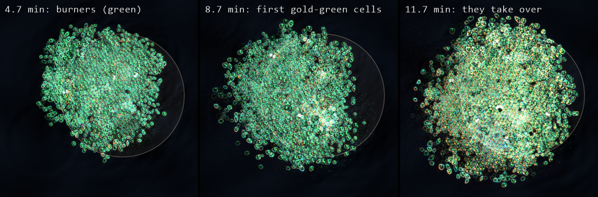
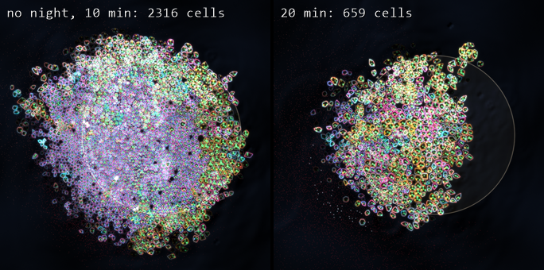
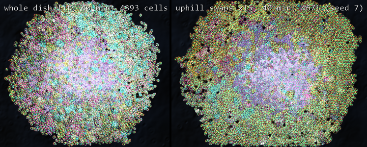
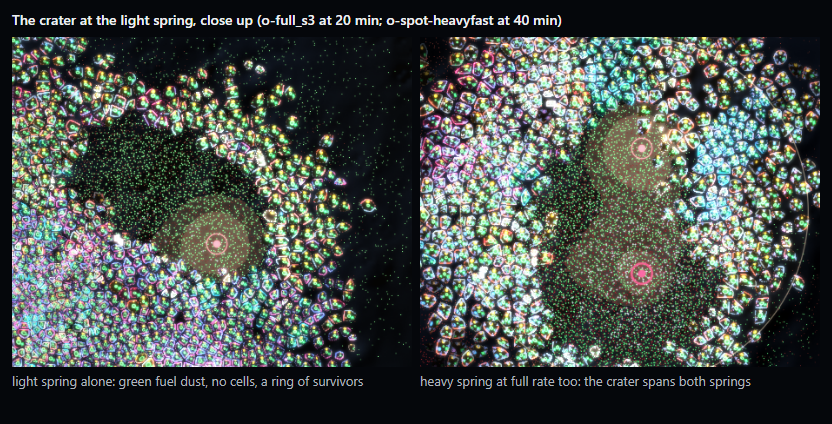

# General experiments: what the dish does

The experiments phase (CLAUDE.md, "EXPERIMENTS"): the whole simulation as it stands after step C9 (cells eat, engines in
the genome, charge, honeycomb membranes, dipoles, pumps, catalysts, hard light, division), run under different conditions,
watched in pictures and in the numbers of the entropy panel. A separate series looks at tissues alone (TISSUE.md).

**How.** 47 runs (45 plus two picture reruns) of 10 to 40 simulated minutes, headless Chrome on the GTX 1650 at MAX
speed, timed by simulated time (`tools/experiment.py`; the GPU was shared with other experiment series, so the runs
reached ×0.3 to ×4). Every condition is a file in `experiments/conditions/general/` (one batch file per series); each
run's numbers every 10 or 20 s are in `experiments/runs/g-*/samples.csv` (with `meta.json`: the exact URL, commit,
speed). Seeds 3 and 7 where a comparison mattered, seed 3 alone otherwise. Runs are not bit-repeatable, so a single run
tells a story, not a measurement: two copies of the very same default dish and seed (`g-light-spot_s3`,
`g-pump-on_s3`) ended at 538 and 663 cells, 15.4 and 16.5 M of entropy, and with seed 7 at 434 cells. Differences
smaller than about ±150 cells or ±1.5 M of entropy at 20 minutes are noise.

**Words used.** *Entropy* = all heat that has left the dish so far (the panel's ENTROPY line; M = millions of energy
units); *entropy rate* = heat leaving per second. *ORDER* = how bunched up the dish's substances are (1 = all in one
spot, 0 = evenly smeared). *Burner* = a cell whose engines only burn fuel; *harvest + burn* ("both") = a cell with a
pigment that makes fuel from light AND a burner (the gold-and-green split cells in the strategy view); *breather* = a cell
with an engine that uses free light atoms to break rich fuel. *Free light atoms* = loose g and t atoms in the dish (the
reactive "vandals", drawn as red dust). The default dish: 2000 cells, a spotlight on the right, a light and a heavy
spring that drip for the first 4 minutes, day and night every 4 minutes, division on.

## What we found

1. **Evolution re-invents "harvest and burn" in minutes.** Starting from 2000 cells that can only burn fuel, the first
   cell with a light-catching pigment appears by mutation within a minute; its lineage stays a handful for several
   minutes, then sweeps through the colony from the lit side: 1 of 1727 cells at 40 s, 142 of 982 at 4.7 min, 1471 of
   1661 at 10 min, 97 % at 20 min (seed 3; seed 7 the same, the sweep 2 minutes later; a rerun for the pictures had it
   at 8.7 to 11.7 min). Look for the gold-and-green split cells spreading through a green crowd.
   

2. **Whatever you start with, the spotlit dish ends in the same place.** After 20 minutes the default dish holds 400 to
   800 cells, 95 to 99 % of them harvest + burn, ORDER 0.21 to 0.23 and an entropy of 15 to 18 M, whether the founders
   were all burners, all harvesters or the usual mix, with mutation off or tripled, with division cheap or costly. Even
   800 or 6000 starting cells (smaller cells, so 255 or 2485 of them fit) end at 15 to 18 M. The light decides: the
   whole dish lit makes 55 M (and 3600 cells), no night 25.5 M, darkness 1 M (everything dead by 4 minutes).
   

3. **Loose brakes give boom and bust.** Let packed cells keep dividing (crowding limit loose) and the colony shoots up to
   2145 cells at 6 minutes, fills the whole spot, eats the fuel faster than the light remakes it, and falls to 357 at 20
   minutes, the lowest of all lit runs; with a tight crowding limit it never passes 1100 and still holds 778 at the end.
   Removing the night does the same (2398 at 11 min, 659 at 20). A low division threshold makes a baby boom before the
   first tick (2000 to 3092 cells) and a famine a minute later (78 starvations per second, down to 495).
   

4. **Near-extinction and a comeback on heavy food.** With only heavy springs (no light atoms at all) the culture crashes
   to 31 to 68 cells by 3 minutes: two little huddles of burners, one beside each spring. They regrow for 10 minutes as
   burners; then a harvest + burn lineage appears (its pigment can only be making heavy fuel: there are no light atoms)
   and takes the colony over in about 3 minutes (126 to 1980 cells between 11.5 and 14.5 min), ending at 2858 cells and still rising, with a gold core in
   the light and a rim of green burners. Seen twice (run and rerun). These cells also lose their membranes (integrity
   0.00): a membrane is built from light linkers, and there are none.
   

5. **A dish-wide poison haze, answered by dropping the skin.** Springs that never dry up fill the dish with free light
   atoms (red dust everywhere: 2 to 7 thousand of them at 20 min, 7.3 thousand at 40 min, against about 480 at the
   defaults). Light atoms bite membranes made of light linkers, so a wave of bursts follows (25 to 43 bursting cells per
   second around 5 min). Then the membrane gene swings to "heavy" (from 25 % of the cells to 84 to 97 %), but in these
   dishes there is little or no heavy linker to build with, so the cells simply stop having a whole membrane: whole
   membranes fall from about 1000 to 30 to 80, their mean integrity from 0.4 to 0.02 to 0.06. A cell without a whole
   membrane cannot burst (it only leaks: it holds 30 % of its stock), and the bursts stop. Where heavy atoms are around
   (the default dish, with its heavy spring) the same gene builds real heavy membranes (integrity back to 0.47).
   The oxygen-like story did not happen: the build-up and the poisoning did, but breathing did not follow. In the
   40-minute light-spring run of seed 3 the cells *carrying* a breathing engine rose from 90 to 983 (40 % of the
   colony), but with no heavy atoms in the dish that engine has nothing to run on (swaps inside cells: 0): a passenger
   gene riding with a winning lineage, not a response. Seed 7 stayed under 90.
   

6. **Cells make about a third of the dish's entropy.** In the spotlit dish, of the 12.3 k heat units leaving per second (a
   day's average at 20 min) 1.2 k is the dish's own warmth, 6.7 k light simply absorbed, 3.4 k the cells' crawling
   (drag) and 0.7 k their engines; with the whole dish lit the heat made per second is 41 k from absorbed light, 14 k
   from crawling, 3.9 k from engines (the heat leaving lags a little behind while the colony grows). Biggest entropy of
   all: six springs spread over a fully lit dish, 6000 cells (the capacity) from 14 min, 79 M at 20 min, 92 k per
   second.
   

7. **Heat tolerance evolves up.** Founders with a low tolerance (6 instead of 10 to 20) lose up to 13 cells per second
   to heat at the first noon; the survivors' tolerance then climbs steadily: 6.0, 8.6 (4 min), 16.3 (8 min), 24.1 at 20
   min. The default dish climbs too, more slowly (14.5 to 22.1).

8. **The books stay exact.** Atoms and charge rounding were exactly 0 in every run (47 runs, up to 40 minutes, up to
   6000 cells); the energy's rounding stayed within ±0.43 in up to 135 M. No free entropy from numerical error.

## The runs, condition by condition

All numbers at 20 simulated minutes unless said. The sections keep the numbers of the plan's list and come in order of
priority (light, division, the oxygen story, springs, founders, mutation, then the rest). The master table (every run)
is at the end.

### 1. Light: spotlight, whole dish, darkness, no night

Files: `g-light-spot.json` (the default page), `g-light-full.json` (`?light=full`), `g-light-dark.json`
(`?light=off`, 10 min), `g-light-noday.json` (`?day=0`); batch `batch-light.json`, seeds 3 and 7.
Plots: `experiments/summaries/general-light/` (count, entropy, entropy rate, ORDER).

- **Spotlight (default).** The story of step C9: the dark part of the starting blob starves and fades out by 2.5
  minutes, a colony grows from the spot, peaks (1406 at 5 min in seed 3, 1972 at 12 min in seed 7), and then shrinks as
  the springs' atoms run out (they stop at 4 min): at 20 min 538 and 434 cells. Over the 20 minutes the colony also
  slides toward the dish centre: by the end it sits on the inner half of the spot and the outer half is empty
  (probably the gentle pull toward the dish centre from step 3, which nothing in the light pushes back against; not
  tested). Strategies: burners rise first (941 of 1406 at 5 min, while the springs feed them), then fall to 1 to 4 %;
  harvest + burn ends at 96 to 98 %.
- **Whole dish lit.** A round colony grows outward in every direction to 3558 and 3626 cells, still slowly rising, a
  disc filling most of the dish's height: packed honeycomb, a mosaic of fates (pink and amber rim, cyan islands in the
  middle). 55 M of entropy, 62 to 65 k per second.
- **Darkness.** Nothing makes fuel; all cells are dead by 4 to 5 minutes. Afterwards the entropy rate is the dish's warmth
  alone (1.2 k per second) and ORDER keeps falling (0.25 to 0.21) as the dead cells' atoms spread: the baseline of a
  dish without life.
- **No night.** More light per day, so a bigger boom (2398 at 11 min; 1.7 k at 7 min in seed 7) and the same bust
  (659, 693): constant light does not make a constant colony, it makes it overshoot. At the peak the colony is a
  violet core of neurons in the light, ringed by amber and green; at 20 minutes a loose patchwork on the inner half of
  the spot.

  

| run | cells 5 / 10 / 20 min | entropy | rate /s | ORDER |
|---|---|---|---|---|
| spot s3 / s7 | 1406, 1268, 538 / 1306, 1659, 434 | 15.4 / 16.9 M | 13.7 / 11.4 k | 0.21 / 0.21 |
| whole dish s3 / s7 | 1279, 2425, 3558 / 1049, 2048, 3626 | 54.7 / 54.8 M | 62 / 65 k | 0.27 / 0.27 |
| darkness s3 / s7 (10 min) | 0 / 0 | 1.04 / 1.08 M | 1.2 / 1.2 k | 0.21 / 0.22 |
| no night s3 / s7 | 1486, 2316, 659 / 1419, 1636, 693 | 25.5 / 25.9 M | 16.6 / 16.4 k | 0.19 / 0.22 |

### 6. Division: cost, threshold, starvation, crowding, turnover

Files: `g-div-*.json`, batch `batch-division.json` (seed 3) and `batch-division-s7.json` (turnover, seed 7). The
default (`g-light-spot_s3`) for comparison. Plots: `experiments/summaries/general-division/` and
`general-division-crowd/` (count over time).

| run | knob | cells 5 / 10 / 20 min (peak) | entropy | rate /s |
|---|---|---|---|---|
| default | cost 0.4, threshold 60 %, starve 30 s, crowd 0.6 | 1406 / 1268 / 538 (1.5 k) | 15.4 M | 13.7 k |
| turnover (s3 / s7) | `?divide=0`, fixed 2000 | 2000 always | 16.6 / 18.2 M | 18.5 / 20.1 k |
| cheap | `?divcost=0.1` | 1304 / 1757 / 572 (1.8 k) | 15.4 M | 12.7 k |
| costly | `?divcost=1.5` | 1009 / 1264 / 611 (1.3 k) | 15.5 M | 13.9 k |
| threshold low | `?divat=0.3` | 1253 / 1434 / 778 (3092 at the start) | 17.6 M | 14.3 k |
| threshold high | `?divat=0.9` | 920 / 1285 / 734 (1.3 k) | 15.7 M | 13.6 k |
| starve short | `?starve=8` | 1240 / 1246 / 785 (1.3 k) | 15.1 M | 15.5 k |
| starve long | `?starve=120` | 1310 / 2146 / 1387 (2.1 k) | 18.9 M | 19.2 k |
| crowd loose | `?crowd=1.5` | 1965 / 1481 / 357 (2145 at 6 min) | 16.7 M | 10.6 k |
| crowd tight | `?crowd=0.2` | 719 / 1040 / 778 (1.1 k) | 14.8 M | 15.4 k |

- **Count over time:** every division run but turnover has the same shape: a collapse to 300 to 900 by the first night,
  a rise while the fuel lasts, a peak at 5 to 12 minutes and a slow fall. The day shows as small steps (births by day,
  stalls at night), not as an oscillation of its own. The brakes set the overshoot: crowd loose has the highest peak
  and the deepest fall; crowd tight the flattest curve (picture in finding 3).
- **The cost barely matters** (cheap and costly end within the noise of the default). The threshold matters only at the
  start: at 30 % every cell with its starter charge divides at once (3092 cells before the first sample), the halves
  starve together a minute later.
- **Long starvation keeps more cells**: the dark part of the blob fades slowly (1532 still alive at 2 min), and the
  colony peaks at 2146 and holds 1387 at 20 min; starving cells wait out the night instead of dying.
- **Turnover against division.** With a fixed count the strategies stay mixed (at 20 min 64 % harvest + burn, 28 %
  burners, 8 % harvesters only, against 96 to 98 % harvest + burn with division in every run), free light atoms stay
  low (148 against about 480), and the entropy rate is higher (18.5 k: 2000 cells crawl). Division turns selection up:
  the fed cells copy themselves, the others vanish. Seed 7 the same: with turnover 64 % harvest + burn, 22 % burners,
  9 % "other", and 322 cells carrying a breathing engine, most of them in the dark; 18.2 M. With division: 98 % harvest
  + burn.

### 10. The oxygen-like story

Files: `g-oxy-upswap.json` (whole dish lit, `moire.matter.chem.kUpSwap = 0.3`: light-driven uphill swaps in the open
15 times faster, the knob step C6 found closest; 40 min; seeds 3 and 7), `g-oxy-control.json` (the same at the default
0.02; seed 3). Batch `batch-oxygen.json`. Plots: `experiments/summaries/general-oxygen/`.

| run | cells 10 / 20 / 40 min | free g + t at 40 min | breathers in the light 10 / 20 / 40 min | swaps in the open /s | entropy at 40 min |
|---|---|---|---|---|---|
| control s3 (0.02) | 2363 / 3925 / 4393 | 73 | 102 / 187 / 140 | about 2 | 133 M |
| uphill swaps x15, s3 | 2435 / 3612 / 4215 | 87 | 183 / 171 / 101 | about 20 | 127 M |
| uphill swaps x15, s7 | 2238 / 3790 / 4671 | 84 | 55 / 110 / 331 | about 20 | 135 M |

- **No build-up under the whole-dish light.** Speeding up the uphill swaps does what it should in the chemistry (ten times
  more swaps in the open, about 20 per second against 2), but the free light atoms they release do not pile up: about 40
  g and 40 t at any time in all three runs, against 480 in the spotlit default. A colony of 4000 cells covering most of
  the dish takes them up as fast as they appear.
- **Breathers stay a small minority** (2 to 7 % of the cells, in the light), with and without the faster swaps. Only
  seed 7 shows a late rise (110 at 20 min to 331 at 40 min), while the free light atoms stayed flat; seed 3 with the
  same setting went the other way (171 to 101). No "great oxidation" moment.
- **The colonies themselves are the sight of the series**: after 40 minutes both whole-dish colonies have a pale violet
  core (neurons), cyan islands, and a broad rim of amber and green, like a target; the rims of seed 7 are wider and
  more even.

**Second try, light springs for 40 minutes** (`g-oxy-lightsprings.json`, seeds 3 and 7: the two springs of the default
place, both light, never drying). Here the build-up does happen: free light atoms climb all the way, 3.7 thousand g and
3.7 thousand t at 40 min, red dust over the whole dish. The cells answer by dropping their membranes (finding 5). Seed 3
then shows what looks like the story's last act, the cells carrying a breathing engine rising from 88 (24 min) to 983
(40 min), while the membranes partly come back (integrity 0.12 to 0.29) and the bursts return (11.6 per s); but the
breathing engines in this dish have nothing to work on (no heavy atoms: every breathing swap needs a heavy fuel), so it
is a passenger gene, not breathing. Seed 7: breathers stay under 90, the membranes stay gone (integrity 0.05).
Lesson for the census: "breathers" counts cells carrying the engine, not cells using it; the swap rates inside cells
(`cells.rate.inSwap`, 0 here) tell which.

| run | cells 10 / 20 / 40 min | free g + t at 40 min | carrying a breathing engine 10 / 20 / 40 min | membrane integrity 20 / 40 min | entropy at 40 min |
|---|---|---|---|---|---|
| light springs s3 | 2159 / 2272 / 2432 | 7.3 k | 114 / 76 / 983 | 0.12 / 0.29 | 43.5 M |
| light springs s7 | 2150 / 2199 / 2134 | 6.9 k | 84 / 54 / 48 | 0.11 / 0.05 | 51.3 M |

### 2. Springs that never dry up

Files: `g-spr-*.json`, batch `batch-springs.json`, seed 3; every spring set to drip for the whole run (an eval
`s.life = 1e9`). Plots: `experiments/summaries/general-springs/` (count, free light atoms, membrane mix, entropy rate).

| run | springs | cells (peak) | free g + t | membrane gene "heavy" | entropy | rate /s |
|---|---|---|---|---|---|---|
| both | default two, never drying | 2243 (2305) | 2.1 k | 87 % | 17.7 M | 22.8 k |
| light only | two light springs | 2457 (2940 at 14 min) | 4.5 k | 84 % | 21.4 M | 26.8 k |
| heavy only | two heavy springs | 2858 (rising; 31 to 68 at 3 min) | 0 | 17 % (no membranes at all) | 17.4 M | 31.7 k |
| many | six in a ring inside the spot | 5138 (rising) | 6.7 k | 97 % | 27.5 M | 42.4 k |
| spread | six over the dish, whole dish lit | 6000 (the capacity, from 14 min) | 2.2 k | 68 % | 78.6 M | 91.8 k |

- With food that never stops the colony does not shrink after 10 minutes; it keeps growing.
- **Burners and harvest + burn coexist** with the default springs never drying (49 % burners, 50 % both at 20 min); in
  every dish where the springs dry up the burners vanish. The springs feed burners; the light feeds the others.
- **Light springs: poison, then no skin** (finding 5): the burst wave at 5 minutes (25 per s with two light springs, 43
  with six), then the membrane gene turns "heavy" with no heavy material to build from, and the membranes vanish.
- **Heavy springs: near-extinction and comeback** (finding 4).
- **Spread springs, whole dish lit:** the colony covers the dish wall to wall (picture in finding 6). At 10 minutes it
  shows large territories of one fate each, as big as a quarter of the dish (violet on the left, amber-green on the
  right, cyan in the middle), the clearest large-scale pattern of the series.

### 9. Founders: all burners against all harvesters

Files: `g-found-burners.json`, `g-found-harvesters.json` (an eval sets every cell's engines at t = 0 with
`moire.genome.setAll`: burners burn gt and gT; harvesters have the "pigments" set: gt by visible 1, gT by visible 2,
a small gt burner); batch `batch-founders.json`, seeds 3 and 7. Picture rerun `g-img-burners.json`. Plots:
`experiments/summaries/general-founders/`.

| run | cells 2 / 5 / 10 / 20 min | burners at 20 min | harvest + burn at 20 min | entropy |
|---|---|---|---|---|
| default s3 / s7 | 822, 1406, 1268, 538 / 623, 1306, 1659, 434 | 4 % / 2 % | 96 % / 98 % | 15.4 / 16.9 M |
| all burners s3 / s7 | 378, 1132, 1661, 662 / 476, 1153, 1181, 428 | 3 % / 2 % | 97 % / 98 % | 15.7 / 15.2 M |
| all harvesters s3 / s7 | 726, 1100, 1519, 590 / 614, 1023, 1729, 586 | 1 % / 0 % | 97 % / 98 % | 17.1 / 16.5 M |

- All-burner dishes lose more at the first night (378 and 476 left, against 623 to 822): nobody makes fuel. Then the
  sweep of finding 1.
- All-harvester dishes heat themselves at noon (12 heat deaths per second at 4 minutes): a dense patch of busy cells in
  the spot is a hot spot. They stay harvest + burn all the way.

### 4. Mutation

Files: `g-mut-off.json` (`?mut=0`), `g-mut-high.json` (mutSize 3, mutJump 0.1, engine and pump slot jumps 0.12),
`g-mut-nohard.json` (`?hardmut=0`); batch `batch-mutation.json`, seed 3.

| run | cells 5 / 10 / 20 min | strategies at 20 min | heavy membranes | entropy |
|---|---|---|---|---|
| default | 1406 / 1268 / 538 | 96 % both | 83 % | 15.4 M |
| off | 1173 / 1503 / 653 | 98 % both | 10 % | 15.3 M |
| high | 1001 / 1102 / 516 | 90 % both, 6 % burn, 5 % harvest | 27 % | 16.4 M |
| hard light does not mutate | 929 / 1385 / 1071 | 99 % both | 2 % | 15.2 M |

- Without mutation the end is the same: the founders already include harvest + burn lineages, and selection alone picks
  them. High mutation keeps a few more of the other strategies around (mutants keep appearing).
- Hard light mutation off kept twice the cells at 20 min (1071 against 538): the default's hard light raises the
  mutation of lit parents about 4 times, and most mutations cost. One seed only.
- Heavy membranes: a "both" lineage with a heavy membrane needs a mutation (no founder has both), so with mutation off
  or hard light mutation off they stay rare.

### 3. Trace and the cofactor

Files: `g-trace-none.json` (the heavy spring's 4 % trace given to G, T and L instead, by an eval on the spring table),
`g-trace-nocofactor.json` (`?cofactor=0`); batch `batch-trace.json`, seed 3.

| run | cells (peak) | engines' speed | entropy |
|---|---|---|---|
| no trace | 395 (1.0 k) | 35 % | 14.5 M |
| default | 538 (1.5 k) | 62 % | 15.4 M |
| cofactor off | 1084 (1.9 k at 14 min) | 100 % | 18.6 M |

The cofactor is still a pure cost over 20 minutes with division: switching it off doubles the colony. Trace works as a
vitamin as designed (no trace, slower engines, fewer cells), but nothing in the dish pays the cells back for needing it.

### 5. Heat tolerance low

`g-tol-low.json` (an eval sets every cell's tolerance gene to 6 at t = 0), seed 3. 13 heat deaths per second at the
first noon (4 min), then the tolerance climbs (finding 7) and the colony ends at 756 cells, as many as the default.

### 7. Charge off, dipoles off

`g-charge-off.json` (`?charge=0`), `g-dipoles-off.json` (`?dipoles=0`), seed 3: 563 and 525 cells, 16.5 and 15.9 M,
no visible difference at the scale of the dish. (Null result: the charge and the dipoles shape small things, see
TISSUE.md and steps C6b and C6d, but not the colony's fate.)

### 8. Starting number: 800, 2000, 6000 cells

`g-cells-800.json`, `g-cells-6000.json` (`?cells=`; capacity 3 times), seed 3. Cells are smaller when there are more of
them, so the spot holds more: 255, 538 and 2485 cells at 20 min (peaks 649, 1.5 k, 3.2 k). The entropy hardly changes
(17.8, 15.4, 14.9 M): the light, not the number, sets it. 6000 cells crash harder (378 at 3 minutes: from 6000, most are in the dark) and then
rebuild to 3.2 k; their colony at 20 min shows clear fate territories (a violet island in a pink and cream
sheet). Speed: ×2.9 for 800 cells and ×0.65 for 6000 (both on the shared GPU).

### 11. Membrane bites ×5

`g-bites-high.json` (`moire.membrane.params.kBite = 0.25`), seed 3: heavy membranes rise faster (85 % of the cells by
6.7 min, against 55 % in the default); the end is the same (83 %, 674 cells), and these are real heavy membranes (the
heavy spring gives the material: heavy linkers in the membranes 31 against 25 light at 20 min, integrity 0.28). Note
that the heavy share is noisy between runs of the same seed (9 to 96 % at 20 min across the seed-3 runs above): the
gene rides along with whichever lineage wins, except where light atoms are plentiful (light or many springs: 84 to 97 %
every time, but there it means no membrane, finding 5).

### 12. Pumps

Files: `g-pump-on.json` (the default again, a second copy of the default dish), `g-pump-nocontact.json`
(`?pumpcontact=0`: pumps work only with the dish, never with a touching neighbour); batch `batch-pumps.json`, seed 3,
20 min (the planned 30 min were cut: the shared GPU ran at ×0.5 to ×0.8).

- **Pumps are selected.** A third of the founders carry one weak pump (16 % of the starting cells in seed 3, 33 % in
  seed 7). With mutation the share of cells with a working pump rises steadily: to 100 % (default, seed 3), 80 %
  (seed 7), 85 % (the second copy) and 69 % (contact pumping off) at 20 min; with mutation off only to 32 %.
- **Which pump wins depends on the winning lineage:** "pump the light fuel gt IN" in the default seed-3 run (96 % of the
  pumps), "pump light linkers IN" (membrane material, 66 %) in its second copy, gt IN again without contact pumping
  (47 %). Importers win; exporters stay rare (light linkers OUT 31 % and heavy linkers OUT 21 % as second pumps in the
  default run).
- **Contact pumping makes no visible difference** (762 cells without it, 663 and 538 with it; 17.2 against 16.5 and
  15.4 M). Pumping across contact moved 12 to 31 units per s in the default runs, so neighbours do take from each other,
  but the colony's fate does not hang on it. Null result for "stealing".
- Membrane voltage stayed near 0 everywhere (1 to 12 cells above 0.1).

## Master table

Every run at 20 minutes (darkness at 10 min, the picture reruns at their end; the 40-minute runs at 20 min here, their
ends in section 10). "Peak" = the
most cells after the first 150 s. Rounding: the largest |value| over the run (energy / atoms / charge).

| run | cells (peak after 150 s) | entropy | entropy rate /s | ORDER | both / burn / harvest % | free g+t | heavy membr. % | rounding E / atoms / charge |
|---|---|---|---|---|---|---|---|---|
| g-bites-high_s3 @ 1200 s | 674 (1.6 k at 560 s) | 16.5 M | 13 k | 0.217 | 97 / 2 / 1 | 482 | 83 | 0.094 / 0 / 0 |
| g-cells-6000_s3 @ 1200 s | 2.5 k (3.2 k at 1060 s) | 14.9 M | 18 k | 0.288 | 98 / 1 / 1 | 405 | 87 | 0.33 / 0 / 0 |
| g-cells-800_s3 @ 1200 s | 255 (649 at 360 s) | 17.8 M | 13 k | 0.212 | 96 / 2 / 2 | 271 | 42 | 0.067 / 0 / 0 |
| g-charge-off_s3 @ 1200 s | 563 (1.6 k at 600 s) | 16.5 M | 13 k | 0.216 | 98 / 1 / 1 | 483 | 64 | 0.051 / 0 / 0 |
| g-dipoles-off_s3 @ 1200 s | 525 (1.5 k at 620 s) | 15.9 M | 13 k | 0.216 | 98 / 1 / 1 | 486 | 66 | 0.16 / 0 / 0 |
| g-div-cheap_s3 @ 1200 s | 572 (1.8 k at 620 s) | 15.4 M | 13 k | 0.223 | 98 / 1 / 1 | 457 | 82 | 0.032 / 0 / 0 |
| g-div-costly_s3 @ 1200 s | 611 (1.3 k at 620 s) | 15.5 M | 14 k | 0.220 | 98 / 1 / 0 | 471 | 19 | 0.076 / 0 / 0 |
| g-div-crowdloose_s3 @ 1200 s | 357 (2.1 k at 360 s) | 16.7 M | 11 k | 0.222 | 97 / 2 / 1 | 469 | 52 | 0.1 / 0 / 0 |
| g-div-crowdtight_s3 @ 1200 s | 778 (1.1 k at 660 s) | 14.8 M | 15 k | 0.225 | 96 / 2 / 1 | 461 | 42 | 0.096 / 0 / 0 |
| g-div-starvelong_s3 @ 1200 s | 1.4 k (2.1 k at 600 s) | 18.9 M | 19 k | 0.225 | 98 / 2 / 0 | 473 | 96 | 0.051 / 0 / 0 |
| g-div-starveshort_s3 @ 1200 s | 785 (1.3 k at 340 s) | 15.1 M | 15 k | 0.219 | 98 / 2 / 1 | 448 | 31 | 0.046 / 0 / 0 |
| g-div-thrhigh_s3 @ 1200 s | 734 (1.3 k at 480 s) | 15.7 M | 14 k | 0.228 | 97 / 2 / 1 | 468 | 46 | 0.05 / 0 / 0 |
| g-div-thrlow_s3 @ 1200 s | 778 (1.4 k at 660 s) | 17.6 M | 14 k | 0.226 | 99 / 1 / 1 | 520 | 43 | 0.13 / 0 / 0 |
| g-div-turnover_s3 @ 1200 s | 2.0 k (2.0 k at 160 s) | 16.6 M | 18 k | 0.248 | 64 / 28 / 8 | 148 | 31 | 0.073 / 0 / 0 |
| g-div-turnover_s7 @ 1200 s | 2.0 k (2.0 k at 160 s) | 18.2 M | 20 k | 0.246 | 64 / 22 / 5 | 153 | 51 | 0.17 / 0 / 0 |
| g-found-burners_s3 @ 1200 s | 662 (1.7 k at 620 s) | 15.7 M | 14 k | 0.223 | 97 / 3 / 1 | 475 | 9 | 0.046 / 0 / 0 |
| g-found-burners_s7 @ 1200 s | 428 (1.2 k at 600 s) | 15.2 M | 12 k | 0.210 | 98 / 2 / 0 | 472 | 46 | 0.07 / 0 / 0 |
| g-found-harvesters_s3 @ 1200 s | 590 (1.6 k at 640 s) | 17.1 M | 14 k | 0.218 | 97 / 1 / 1 | 475 | 27 | 0.13 / 0 / 0 |
| g-found-harvesters_s7 @ 1200 s | 586 (1.8 k at 560 s) | 16.5 M | 13 k | 0.213 | 98 / 0 / 2 | 451 | 21 | 0.049 / 0 / 0 |
| g-img-burners @ 700 s | 1.4 k (1.4 k at 620 s) | 8.4 M | 16 k | 0.259 | 79 / 21 / 0 | 474 | 84 | 0.083 / 0 / 0 |
| g-img-heavy @ 1000 s | 1.7 k (1.7 k at 1000 s) | 10.1 M | 29 k | 0.325 | 67 / 32 / 1 | 0 | 7 | 0.042 / 0 / 0 |
| g-light-dark_s3 @ 600 s | 0 (43 at 150 s) | 1.0 M | 1.2 k | 0.209 | 0 / 0 / 0 | 803 | 0 | 0.016 / 0 / 0 |
| g-light-dark_s7 @ 600 s | 0 (3 at 150 s) | 1.1 M | 1.2 k | 0.216 | 0 / 0 / 0 | 803 | 0 | 0.024 / 0 / 0 |
| g-light-full_s3 @ 1200 s | 3.6 k (3.6 k at 1100 s) | 54.7 M | 62 k | 0.265 | 97 / 2 / 0 | 73 | 16 | 0.099 / 0 / 0 |
| g-light-full_s7 @ 1200 s | 3.6 k (3.6 k at 1200 s) | 54.8 M | 65 k | 0.266 | 97 / 3 / 0 | 76 | 15 | 0.055 / 0 / 0 |
| g-light-noday_s3 @ 1200 s | 659 (2.4 k at 680 s) | 25.5 M | 17 k | 0.193 | 95 / 3 / 2 | 505 | 42 | 0.096 / 0 / 0 |
| g-light-noday_s7 @ 1200 s | 693 (1.7 k at 430 s) | 25.9 M | 16 k | 0.215 | 96 / 2 / 2 | 519 | 50 | 0.17 / 0 / 0 |
| g-light-spot_s3 @ 1200 s | 538 (1.5 k at 320 s) | 15.4 M | 14 k | 0.212 | 96 / 4 / 0 | 482 | 83 | 0.1 / 0 / 0 |
| g-light-spot_s7 @ 1200 s | 434 (2.0 k at 720 s) | 16.9 M | 11 k | 0.213 | 98 / 2 / 0 | 446 | 24 | 0.074 / 0 / 0 |
| g-mut-high_s3 @ 1200 s | 516 (1.2 k at 480 s) | 16.4 M | 13 k | 0.214 | 90 / 6 / 5 | 452 | 27 | 0.076 / 0 / 0 |
| g-mut-nohard_s3 @ 1200 s | 1.1 k (1.4 k at 660 s) | 15.2 M | 17 k | 0.242 | 99 / 1 / 0 | 447 | 2 | 0.079 / 0 / 0 |
| g-mut-off_s3 @ 1200 s | 653 (1.5 k at 580 s) | 15.3 M | 13 k | 0.225 | 98 / 0 / 1 | 457 | 10 | 0.1 / 0 / 0 |
| g-oxy-control_s3 @ 1200 s | 3.9 k (3.9 k at 1200 s) | 57.7 M | 66 k | 0.266 | 97 / 3 / 0 | 75 | 16 | 0.11 / 0 / 0 |
| g-oxy-lightsprings_s3 @ 1200 s | 2.3 k (2.4 k at 1080 s) | 19.0 M | 23 k | 0.219 | 8 / 92 / 0 | 4.7 k | 84 | 0.23 / 0 / 0 |
| g-oxy-lightsprings_s7 @ 1200 s | 2.2 k (2.4 k at 1060 s) | 23.1 M | 28 k | 0.226 | 92 / 7 / 1 | 4.3 k | 69 | 0.15 / 0 / 0 |
| g-oxy-upswap_s3 @ 1200 s | 3.6 k (3.6 k at 1200 s) | 55.4 M | 61 k | 0.267 | 96 / 3 / 0 | 79 | 24 | 0.098 / 0 / 0 |
| g-oxy-upswap_s7 @ 1200 s | 3.8 k (3.8 k at 1200 s) | 56.9 M | 68 k | 0.271 | 97 / 3 / 0 | 79 | 56 | 0.065 / 0 / 0 |
| g-pump-nocontact_s3 @ 1200 s | 762 (1.6 k at 640 s) | 17.2 M | 16 k | 0.221 | 97 / 1 / 2 | 484 | 43 | 0.087 / 0 / 0 |
| g-pump-on_s3 @ 1200 s | 663 (1.4 k at 380 s) | 16.5 M | 15 k | 0.215 | 99 / 1 / 0 | 496 | 9 | 0.047 / 0 / 0 |
| g-spr-both_s3 @ 1200 s | 2.2 k (2.3 k at 1070 s) | 17.7 M | 23 k | 0.282 | 50 / 49 / 1 | 2.1 k | 87 | 0.072 / 0 / 0 |
| g-spr-heavy_s3 @ 1200 s | 2.9 k (2.9 k at 1200 s) | 17.4 M | 32 k | 0.301 | 98 / 2 / 1 | 0 | 17 | 0.077 / 0 / 0 |
| g-spr-light_s3 @ 1200 s | 2.5 k (2.9 k at 830 s) | 21.4 M | 27 k | 0.224 | 97 / 2 / 1 | 4.5 k | 84 | 0.22 / 0 / 0 |
| g-spr-many_s3 @ 1200 s | 5.1 k (5.1 k at 1200 s) | 27.5 M | 42 k | 0.214 | 99 / 0 / 1 | 6.7 k | 97 | 0.048 / 0 / 0 |
| g-spr-spread_s3 @ 1200 s | 6.0 k (6.0 k at 840 s) | 78.6 M | 92 k | 0.248 | 87 / 12 / 0 | 2.2 k | 68 | 0.16 / 0 / 0 |
| g-tol-low_s3 @ 1200 s | 756 (1.2 k at 700 s) | 16.3 M | 16 k | 0.218 | 96 / 3 / 1 | 466 | 44 | 0.13 / 0 / 0 |
| g-trace-nocofactor_s3 @ 1200 s | 1.1 k (1.9 k at 820 s) | 18.6 M | 17 k | 0.231 | 99 / 0 / 1 | 525 | 79 | 0.15 / 0 / 0 |
| g-trace-none_s3 @ 1200 s | 395 (1.0 k at 740 s) | 14.5 M | 12 k | 0.215 | 97 / 2 / 1 | 438 | 63 | 0.087 / 0 / 0 |

## What to run next

- **The oxygen story with something to breathe** (done: see "Oxygen retry" below). Breathing swaps need heavy fuel, and the light-spring dishes had none.
  A dish with a light spring that never dries AND a slow heavy spring (heavy fuel to break), 40 to 60 minutes, under
  the spot: the haze builds up, and a breathing engine would then really run (watch `cells.rate.inSwap`, not only the
  count of carriers). Making a missing membrane costlier (a lower `hold`) would close the "no skin" escape.
- **A dish that never runs out.** Most spotlit runs end in a slow decline because the springs dry up at 4 minutes. A
  slow trickle (one spring that drips at a tenth of the rate for ever) might give a steady colony, where the day's
  rhythm and the lineages' sectors could be watched for an hour.
- **The heavy-spring comeback, several seeds.** It happened twice in seed 3; how often does the dish die out instead,
  and is it always a harvest + burn lineage that wins?
- **Clips.** The sweeps (burners to harvest + burn, the heavy-spring takeover) and the burst wave of the light springs
  are the moments worth a short timelapse video in the strategy view.
- **The colony's drift to the dish centre** (it leaves the outer half of the spot): switch the centre pull off and see
  whether the colony fills the spot.
- **Repeats.** Most conditions ran once; the run-to-run noise (about ±150 cells at 20 minutes) is as big as several of
  the differences above. Hard light mutation off (twice the cells) and cofactor off (twice the cells) deserve a second
  seed first.

# Oxygen retry

The "what to run next" above, run (CLAUDE.md, OXYGEN RETRY): does the oxygen-like story happen when the dish has both a
haze of free light atoms AND heavy atoms to breathe on? The hoped-for sequence (never written as a rule): the light
atoms thrown away by the harvesters build up, first caught by free takers (an "iron" sink), then everywhere; they poison
cells (membrane bites, bursts); then BREATHERS (cells whose downhill swap engine, t + gT -> gt + T and the like, really
runs) rise and live on them.

**How.** Ten runs, headless Chrome on the GTX 1650 at MAX speed, timed by simulated time (`tools/experiment.py`), on a
GPU shared with another worker and up to four runs side by side (×0.34 to ×1.9). Commit 8e51206 (step C10, patterned
walls, is in; the general series above ran before it). Every condition is a file in `experiments/conditions/oxygen/`;
the numbers every 20 s in `experiments/runs/o-*/samples.csv`; screenshots every 10 minutes (clean view and strategy
view) and grid snapshots stayed local (ignored by git), the best are in `experiments/keep/oxygen/`.

- **The springs.** At t = 0 the default scene's springs are removed and put back at the same places (1280 x 800
  window): a LIGHT spring at (875, 328) that never dries (`moire.matter.addSpring(875, 328, 'light', 1e9)`), and a
  SLOW HEAVY spring at (875, 472). The drip rate is one knob for all springs (`moire.matter.params.rate`, 6 atoms per
  s), so "slow" is a duty cycle: an eval re-drops a heavy spring that lives 2 s every 20 s, a tenth of a spring
  (0.6 heavy atoms per s against 6 light ones). A spring dries up when its age passes its life (`params.life`, 60 s;
  the default scene uses 240 s); a life of 1e9 s never runs out.
- **Core runs** (50 min, seeds 3 and 7): `o-spot.json` (the default spotlight, batch `batch-spot.json`) and `o-full.json`
  (`?light=full`, the whole dish lit, batch `batch-full.json`).
- **Variants** (40 min, seed 3): `o-spot-hold.json` and `o-full-hold.json` (`moire.membrane.params.hold = 0.05`: a cell
  without a whole membrane keeps only 5 % of its stock instead of 30 %, to close the "no skin" escape of the general
  series), `o-spot-upswap.json` (`moire.matter.chem.kUpSwap = 0.3`: uphill swaps in the open ×15, more light-atom
  waste), `o-spot-heavyfast.json` (the heavy spring dripping for ever at the full rate: plenty to breathe on). Batches
  `batch-var-a.json`, `batch-var-b.json`. A slower heavy spring and high mutation were planned and dropped for time.
- **The clip:** `o-full-clip.json` loads the whole-dish seed-3 run's snapshot at 30 min and records sim minutes
  33 to 40 (the skin drop and the boom) as a .webm at MAX (×4.6, 87 s of video, 89 MB, kept locally only:
  `experiments/runs/o-full-clip/clips/full_s3_skin-drop_2000-2400.webm`). From the snapshot the story repeated (4752
  cells at 40 min against 5317 in the original run).
- **What "breathing" means in the numbers.** `engines.breath.*` counts cells CARRYING a downhill swap engine;
  `cells.rate2.eSwap` is how many swaps those engines really make per second (breathing that runs). Not to be mixed up
  with `cells.rate.inSwap`: the same swaps happening inside cells by themselves, driven by heat (the vandals at work:
  the energy goes to heat, not to the battery).

Plots: `experiments/summaries/oxygen/` (core) and `experiments/summaries/oxygen-variants/`, one line per run for
cells, free light atoms, bursts, whole membranes, breathing carriers, breathing rate, entropy, entropy rate and ORDER,
and one STACKED picture per run (`stack_<run>.svg`): eleven measures on one shared time axis, so a phase sequence would
show as steps lining up from panel to panel.

## What we found

1. **The haze builds up, everywhere, all the time.** Free light atoms climb steadily through the whole run and never
   level off: 1.1 thousand at 10 min, 2 thousand at 20, 4.4 to 4.6 thousand at 50 min under the spot; under the whole
   dish half as many (2.1 to 2.3 thousand), as the bigger colony takes more up. On the screen it is a fine red dust
   over the whole black dish, thickest around the light spring.
2. **No iron sink.** The free takers that could catch the light givers do not: free light takers (t) and givers (g)
   rise together, one for one (charge keeps them paired), and the free HEAVY atoms (G, T) pile up too (400 to 800 at
   50 min, 7 thousand with the heavy spring at full rate) instead of binding the light atoms. Making heavy fuel from
   them in the open needs the second visible band and is slow, so heavy fuel stays scarce (100 to 200 in the dish).
3. **The poisoning is real, and much stronger than in any earlier run.** Bursting cells (light atoms bite light
   membranes until they fail) rise from the 5th minute to 35 to 90 per second and stay there, in both seeds, both
   lights (the general series peaked at 37 per second, mostly 1 to 7). A colony of 1000 to 2000 cells loses and
   rebuilds itself every half minute to a minute: births and bursts both about 45 per second. The clearest sight is
   the **crater**: at the light spring, where the haze is thickest, the colony leaves a dark hole full of glowing green
   fuel dust (fuel made by light that no cell lives long enough to eat), ringed by a crust of survivors.

   

4. **Two ways out, and neither is breathing.**
   - **Under the spotlight: armour.** The membrane gene swings toward heavy linkers (heavy membranes in 19 to 25 % of
     the cells at 10 min, 48 to 70 % at 50 min; the slow heavy spring now gives the material, unlike the light-spring
     runs of the general series). Heavy membranes are not bitten by light atoms, and from about 40 minutes the
     colony regrows (1000 to 1200 cells between 20 and 35 min, then 2266 and 2022 at 50 min) while the bursts ease (to 33
     and 45 per second).

     

   - **Under the whole dish: no skin.** The colony grows to 3000 to 3300 cells, the burst storm holds it there and then
     shrinks it (3339 to 2406 between 16 and 32 min in seed 3), and then the cells stop keeping whole membranes (whole
     membranes from 3170 to 614, mean integrity 0.5 to 0.06): a cell with no whole membrane cannot burst. The bursts
     stop (65 per second to 2), and the colony explodes to the 6000-cell capacity in about 10 minutes and fills the
     dish wall to wall, a packed honeycomb of green-cored cells. Seed 7 took the same exit early (at 13 min, before the
     haze was thick) and went straight to 6000. This is finding 5 of the general series again, now with heavy atoms
     around: in seed 7 the membrane gene even went heavy (78 % of the cells) and the membranes still vanished. The clip
     shows this turn.

     

5. **Breathing never runs.** In every run the swap engines make 0.01 to 0.5 swaps per second, against 100 to 800
   burned fuel per second by the burn engines: breathing is 0.006 to 0.06 % of the cells' engine work. Meanwhile the
   same swaps happen 15 to 60 times more often inside the cells by themselves (heat-driven vandalism, 1 to 9 per
   second), their energy wasted as heat. The CARRIERS of a breathing engine do rise and fall in waves (seed 3 spot: 15
   to 620 cells, 31 % of the colony at 42 min, then back to 85; skinless-hold variant: 1140 cells, 44 %, at 40 min),
   and the breathing rate wiggles up with them (to 0.43 per second), but these are passengers riding with a lineage,
   as in the general series.
6. **Why, probably: in this chemistry breathing can never beat burning.** Free atoms carry no energy (they are the
   zero of the table), so "breathing" a rich fuel with a light atom, t + gT -> gt + T, releases only the difference
   between the two fuels (0.75), while burning the same gT outright releases 2.25; breathing and then burning the gt
   gives the same 2.25 in two steps. A light atom is never food, only a key that unlocks a third of a fuel. On Earth
   it is the other way round: oxygen makes respiration richer than fermentation. The only thing a breather gains is
   catching the energy of a swap that would happen inside it anyway (as heat), and that is too little to select for.
7. **The variants.**
   - *Skinless cells hold 5 %* (`hold 0.05`): did not close the escape under the whole dish (skin dropped at 22 min,
     5800 cells by 30 min, as without it). Under the spot it slowed the bursts (16 per second on average against 35)
     and gave the biggest wave of breathing carriers (44 %), still with no breathing running (0.17 per second).
   - *Uphill swaps ×15*: more swap harvesters early (285 carriers at 16 min), then the membranes went at 12 minutes,
     bursts fell to nothing and the spot colony grew to 2900 to 3300 cells: a pale, packed disc.
   - *Heavy spring at full rate*: the only run that never recovered. Heavy atoms bite heavy membranes as light atoms
     bite light ones, so with both rows around no membrane is safe: the colony shrank from 1814 cells (10 min) to 732
     (40 min), bursting 45 per second to the end, with a crater spanning both springs. Seven thousand free heavy atoms
     and a thousand heavy fuel units in the dish, and still breathing at 0.2 per second.

     

8. **Entropy.** The spotlit dishes made 55 to 61 M of entropy in 50 minutes (23 to 24 k per second on the last day),
   the whole dish 191 and 253 M (91 and 109 k per second, the colony at capacity). The burst storm does not show as
   its own signal in the entropy rate; the colony's size and the light set it. ORDER fell from 0.44 to 0.24 to 0.25
   in the spot dishes and to 0.27 to 0.28 under the whole dish in the first 20 minutes and then stayed flat: the haze
   is smeared evenly, not patterned. The books stayed exact: atoms and charge rounding 0 in every run, energy within
   ±0.27.

| run | cells 10 / 20 / 30 / 40 / 50 min | free g + t 10 / 30 / 50 min | bursts per s 10 / 30 / 50 min | whole membranes at 50 min | breathing carriers (peak after 5 min) | breathing runs, swaps per s (peak) | entropy at 50 min |
|---|---|---|---|---|---|---|---|
| spot s3 | 1278 / 1108 / 1176 / 1787 / 2266 | 1.1 k / 3.2 k / 4.6 k | 21 / 43 / 33 | 2266 (heavy 48 %) | 620 at 42 min | 0.43 | 60.7 M |
| spot s7 | 1196 / 1041 / 970 / 1266 / 2022 | 1.1 k / 3.0 k / 4.4 k | 20 / 35 / 45 | 2022 (heavy 70 %) | 248 at 44 min | 0.22 | 55.4 M |
| whole dish s3 | 2947 / 3184 / 2674 / 5317 / 6000 | 0.7 k / 1.9 k / 2.3 k | 58 / 55 / 2 | 614 (skin dropped at 37 min) | 198 | 0.07 | 191 M |
| whole dish s7 | 3019 / 4809 / 5513 / 6000 / 6000 | 0.4 k / 1.4 k / 2.1 k | 13 / 2.5 / 0.5 | 64 (skin dropped at 13 min) | 308 | 0.15 | 253 M |

| variant (seed 3) | cells 10 / 20 / 30 / 40 min | free g + t 10 / 30 / 40 min | bursts per s 10 / 20 / 30 / 40 min | whole membranes 10 / 40 min | breathing carriers (peak) | breathing runs (peak) | entropy at 40 min |
|---|---|---|---|---|---|---|---|
| spot, hold 5 % | 1082 / 2150 / 2785 / 2578 | 1.1 k / 3.3 k / 3.6 k | 21 / 15 / 16 / 16 | 1065 / 1232 | 1140 at 40 min (44 %) | 0.17 | 51.6 M |
| whole dish, hold 5 % | 1829 / 2922 / 5805 / 5999 | 0.7 k / 2.0 k / 2.3 k | 37 / 25 / 3.4 / 1.5 | 1822 / 369 | 269 | 0.16 | 165 M |
| spot, uphill swaps ×15 | 2033 / 2682 / 3050 / 2918 | 1.1 k / 3.1 k / 3.3 k | 4.5 / 1.5 / 1.0 / 1.5 | 1594 / 56 | 91 | 0.08 | 53.1 M |
| spot, heavy spring full | 1813 / 1273 / 1015 / 732 | 1.0 k / 2.8 k / 2.6 k | 25 / 32 / 32 / 47 | 1813 / 732 | 231 | 0.54 | 42.7 M |
| (spot s3 at 40 min, for comparison) | 1278 / 1108 / 1176 / 1787 | 1.1 k / 3.2 k / 3.6 k | 21 / 47 / 43 / 54 | 1278 / 1787 | 620 | 0.43 | 45.7 M |

**Verdict.** Half of the story happens, more strongly than before: the haze builds up dish-wide and steadily, and it
poisons the leaky cells (a burst storm of 35 to 90 cells per second, a crater at the light spring). The other half does
not: no iron sink (free takers do not catch the light atoms), and no breathers living on the haze. Breathing engines
are carried by up to 44 % of the cells at times, but they run at well under a thousandth of the burners' pace. The
colonies escape the poison by armour (heavy membranes, under the spot) or by giving up the skin (under the whole dish),
not by breathing. The reason is probably built into the energy table (finding 6), not a matter of run length or seed.

## What to try next (oxygen)

- **Give the haze energy.** For breathing to pay, a free light atom must carry energy, as oxygen does. For example,
  let the uphill swap store part of the photon in the freed light atom (a "charged" or excited light giver, row 1 but
  energy above zero) that relaxes by itself slowly (heat) or quickly inside a breathing engine (battery). Then
  breathing beats burning and the story has a reason to happen. This is a change to the table (a design decision for
  the user), not a knob.
- **Make the skinless escape costly in a way that matters.** `hold 0.05` did not. Losing the membrane could cost what
  the membrane protects: no smell, no pumps, a crawl cost, or bites reaching the stock directly.
- **A slower heavy spring and high mutation** (planned, not run), and seeds beyond 3 and 7.
- **The crater** is the most striking sight of the series and worth a look of its own: a poison spring makes a hole
  ringed by survivors; with two spring kinds it spans both. A clip in the strategy view at the crater's rim would show
  who survives there.

# Oxygen with excited waste

The oxygen retry above ended on a reason, not a run length: free light atoms carried no energy, so breathing could never beat
burning. Step C12c (README "Step C12c: excited waste") gives the light-made waste energy: a light giver or taker freed by light
(the uphill swaps, in the open and in harvesting cells, and hard light breaking a fuel) leaves EXCITED, holding E* = 0.625 (half
the photon's surplus); it fades by itself (life 30 s, faster when hot); an engine that uses it banks E* into the battery,
anything else dumps it as heat. Breathing gT with an excited t now gives 1.375 + the gt left to burn (1.5) = 2.875, against 2.25
for burning the gT. Here the oxygen conditions are run again, excited waste on and off, to see whether that is enough.

**How.** `experiments/conditions/c12c/` (made by `make.py` from `experiments/conditions/oxygen/`): the same springs as the oxygen
retry (a never-drying light spring at (875, 328), a heavy one at (875, 472) re-dropped for 2 s of every 20 s), 1280 x 800,
headless Chrome on the GTX 1650 at MAX, one run at a time (×3 to ×5). Commit 60f684c and later (C12b with the grazing supply fix
is on in every run). **40 minutes instead of 50, and the whole dish with seed 3 only**: GPU time (four runs side by side ran at
×0.7 each; one at a time ×3 to ×5). Runs: spotlight seeds 3 and 7, on and off; spotlight with the uphill swaps in the open ×15
(`kUpSwap 0.3`, more light-made waste) seed 3, on and off; the whole dish lit, seed 3, on and off. Numbers every 20 s in
`experiments/runs/c12c-*/samples.csv`; `analyse.py` prints the table below; `summarise.sh` makes the plots and the stacked phase
pictures in `experiments/summaries/c12c/` (`stack_<run>.svg`: cells, the ground haze, the excited haze, excited made, excitation
into batteries, breathing that runs, breathing carriers, uphill-swap carriers, bursts, entropy rate and ORDER on one time axis).
The yardsticks are the oxygen retry's: breathing that RUNS = `cells.rate2.eSwap` (swap engine events per s); the energy it banks
= `excited.rate.eBreath`; the excitation any engine banked = `excited.rate.eEngine`; burning = `excited.rate.eBurn`.

| run | cells 10 / 20 / 30 / 40 min | free g + t (ground) | excited in the dish | excited made per s (light + pigments) | breathing that runs, swaps per s (peak) | energy banked by breathing per s | excitation into batteries per s | burning into batteries per s | breathing carriers | uphill-swap carriers | bursts per s | ENTROPY 40 min | ORDER | books: energy / atoms / charge |
|---|---|---|---|---|---|---|---|---|---|---|---|---|---|---|
| c12c-spot-on_s3 | 1812 / 2510 / 2528 / 2598 | 1018 / 2094 / 2951 / 3367 | 1.45 / 2.03 / 1.58 / 1.67 | 1.18 + 0.37 | 0.016 (peak 0.05) | 0.009 | 0.277 | 185 | 46 / 66 / 134 / 162 | 239 / 376 / 68 / 108 | 0 / 0 / 0 / 2 | 47.5 M | 0.268 | -0.01..+0.28 / 0 / 0 |
| c12c-spot-off_s3 | 2243 / 2461 / 2423 / 2403 | 943 / 2094 / 2998 / 3406 | 0.00 / 0.00 / 0.00 / 0.00 | 0.00 + 0.00 | 0.035 (peak 0.20) | 0.020 | 0.000 | 179 | 58 / 63 / 35 / 28 | 47 / 288 / 52 / 31 | 0 / 3 / 0 / 0 | 48.5 M | 0.270 | -0.10..+0.02 / 0 / 0 |
| c12c-spot-on_s7 | 1801 / 2596 / 2673 / 2540 | 972 / 2092 / 2923 / 3159 | 1.30 / 1.81 / 1.16 / 1.76 | 1.11 + 0.29 | 0.027 (peak 0.09) | 0.015 | 0.238 | 182 | 64 / 60 / 75 / 38 | 149 / 398 / 263 / 41 | 0 / 0 / 0 / 0 | 51.0 M | 0.275 | -0.10..+0.18 / 0 / 0 |
| c12c-spot-off_s7 | 2015 / 2232 / 2973 / 2753 | 1005 / 2055 / 2881 / 3093 | 0.00 / 0.00 / 0.00 / 0.00 | 0.00 + 0.00 | 0.055 (peak 0.22) | 0.031 | 0.000 | 198 | 89 / 1128 / 2333 / 1794 | 82 / 123 / 70 / 307 | 0 / 0 / 2 / 1 | 48.6 M | 0.270 | -0.09..+0.08 / 0 / 0 |
| c12c-upswap-on_s3 | 2216 / 2615 / 2497 / 2694 | 1019 / 2127 / 2966 / 3345 | 4.81 / 5.48 / 4.32 / 4.37 | 5.44 + 0.17 | 0.063 (peak 0.26) | 0.037 | 1.103 | 183 | 59 / 38 / 52 / 510 | 92 / 50 / 107 / 743 | 0 / 1 / 0 / 1 | 48.0 M | 0.266 | -0.01..+0.18 / 0 / 0 |
| c12c-upswap-off_s3 | 2179 / 2286 / 2520 / 2279 | 996 / 2154 / 2979 / 3204 | 0.00 / 0.00 / 0.00 / 0.00 | 0.00 + 0.00 | 0.054 (peak 0.18) | 0.030 | 0.000 | 211 | 99 / 488 / 165 / 47 | 119 / 46 / 31 / 35 | 0 / 1 / 1 / 0 | 46.5 M | 0.269 | -0.14..+0.01 / 0 / 0 |
| c12c-full-on_s3 | 3489 / 4937 / 5453 / 5997 | 531 / 608 / 1100 / 1247 | 3.83 / 6.75 / 8.57 / 11.94 | 3.63 + 3.24 | 0.086 (peak 0.25) | 0.050 | 1.417 | 465 | 84 / 204 / 223 / 291 | 1396 / 2510 / 2921 / 3133 | 0 / 0 / 0 / 1 | 179.1 M | 0.299 | -0.12..+0.17 / 0 / 0 |
| c12c-full-off_s3 | 3134 / 4763 / 5934 / 6000 | 572 / 750 / 1241 / 1168 | 0.00 / 0.00 / 0.00 / 0.00 | 0.00 + 0.00 | 0.040 (peak 0.10) | 0.022 | 0.000 | 472 | 73 / 151 / 163 / 305 | 174 / 308 / 279 / 152 | 0 / 1 / 0 / 1 | 173.5 M | 0.295 | -0.01..+0.16 / 0 / 0 |

(Columns at 10 / 20 / 30 / 40 min, or means from 5 min on: excited made, breathing, energies. "Breathing carriers": cells with a
downhill swap engine; "uphill-swap carriers": cells with a light-driven swap engine, the harvesters whose waste is excited.
Bursts: per s; the C12b membranes are rarely whole, so almost nothing bursts.)

Pictures (`experiments/keep/c12c/`): `haze-sparkle-on.jpg` and `haze-sparkle-off.jpg` (the excited haze around a light and a heavy
spring in an empty corner of the lit dish, close up, with the sparkle drawn and not: a sparse glitter of orange-red flecks among
the green fuel dust), `spot-on-40min.jpg` (spotlight, seed 3, 40 min: the colony over the springs, the ground haze as fine red dust
over the dark dish, soap and oil films at the colony's left rim), `full-on-light-spring-40min.jpg` (whole dish, seed 3, 40 min,
the light spring close up: a packed honeycomb of harvest + burn cells, gold pigment discs; the haze is under the cells).

## What we found

1. **The excited haze is thin.** Under the spot 1.2 to 2 units of g* + t* in the dish against 1000 to 3400 units of ground free
   light atoms (0.07 %); inside the cells 0.03 %. With the uphill swaps x15, 4 to 5.5 units (0.2 %); under the whole dish, where
   the harvesting cells make half of it, 4 to 12 (0.8 %). Light makes 1.1 to 1.6 excited atoms per s under the spot, 5.6 with the
   swaps x15, 6.9 under the whole dish. On the screen: a few orange flecks around the light spring, mostly under the cells.
2. **Where the excited atoms go:** 37 to 47 % into reactions in the open (mostly the dish's own light making fuel from them: their
   energy becomes heat), 34 to 42 % into cells' engines (the battery), 13 to 19 % fade, under 1 % bite membranes, under 1 % react
   loose inside cells. The engines that take them are the fuel-making harvest engines (g + t -> gt by a pigment), not the breathing
   swaps: those use 0.01 to 0.04 per s.
3. **Breathing still does not run.** The swap engines make 0.016 to 0.086 swaps per s with the excited waste on, 0.035 to 0.055 with
   it off (peaks 0.05 to 0.26 against 0.10 to 0.22): no change. The energy breathing banks is 0.009 to 0.05 per s against 180 to 470
   per s from burning (about a 10 000th). All the excitation any engine banks, 0.24 to 1.4 per s, is 0.1 to 0.3 % of burning.
4. **Breathers did not rise.** Breathing carriers end at 162 and 38 cells (spotlight on, seeds 3 and 7) against 28 and 1794 (off; seed 7
   off had a wave of 2333 carriers at 30 min), 510 against 47 (swaps x15), 291 against 305 (whole dish): waves of passengers, as in
   the oxygen retry, with no sign that the excited waste drives them.
5. **One difference is large: the harvesters whose waste is excited.** Under the whole dish the cells carrying a light-driven uphill
   swap (gT + G -> GT + g* and the like) rose to 1396 by 10 minutes and 3133 by 40 (52 % of the colony) with the excited waste on,
   against 174 and 152 (2.5 %) with it off. A plausible reason, derived and not written: such a cell's own fuel-making engine takes
   its excited waste from the pool and banks it, so with the excited waste on, light reaches the battery in two steps (photon ->
   excited atom -> engine -> battery). But the energy is small (the batteries gained 1.4 per s from all excitation in that run, 465
   from burning; the mean battery of the dominant harvest + burn cells was 0.80 against 0.86 with it off), it appeared within the
   first 10 minutes (a lineage winning early can carry it), and it is one seed. Under the spot the end counts were higher with the
   excited waste in two of three pairs (108 against 31; 743 against 35 with the swaps x15) and lower in one (41 against 307).
   Worth a whole-dish run with seed 7 and a longer one.
6. **No poison story to see.** The oxygen retry's burst storm (35 to 90 per s) came from the C6c linker weave, bitten through by the
   haze. With the C12b lipid membranes almost no membrane is whole, so almost nothing bursts (0 to 3 per s, on and off), and the
   excited haze's extra heat (0.4 to 1.7 energy units per s from loose reactions and bites) is lost in the colony's heat. Armour
   against breathing could not be asked.
7. **Entropy, ORDER, cells:** the same within the run-to-run swing (ENTROPY at 40 min 47.5 to 51 M on, 46.5 to 48.6 M off under the
   spot; 179 M against 174 M under the whole dish; ORDER 0.266 to 0.299 in all). The books: atoms and charge rounding exactly 0 in every
   sample of every run; energy within -0.14 and +0.28 while 47 to 180 M left as heat.

**Why breathing still does not pay, in numbers.** Per event it now does: a breather that swaps an EXCITED light atom into gT banks
1.375 and leaves gt worth 1.5, 2.875 per gT against 2.25 for burning it. But a breathing engine takes its light atoms from the pool in
the cell, and 99.75 to 99.97 % of them are ground: the haze is not the harvesters' light-made waste. Its free light atoms come from
the never-drying light spring (4 ground light atoms per s) and from every burner's exhaust (each fuel burned frees its atoms, ground:
the burners bank 180 to 470 energy units per s, so hundreds of ground light atoms per s), against 1 to 7 per s made excited by light.
So a breathing event carries E* about once in a thousand: its expected gain is 0.75 + 0.0006, still a third of burning the same fuel.
The fix made the light's waste rich, but the waste the dish is full of is not the light's.

## What to try next (oxygen)

- **A haze that is the light's.** For breathing to pay on average, most free light atoms must be light-made: no light-atom spring
  (light atoms only from fuel that light breaks or swaps: e.g. a heavy spring and a spring of light fuel gt), so the burners'
  exhaust and the haze are the same atoms the light freed. A condition, not a rule.
- **A longer-lived, richer haze** (`?exlife=300`, `?exshare=1`: E* = 1.25): more of it, but the ground atoms would still dominate.
- **The whole-dish harvesters** (finding 5): seed 7 and 60 minutes, and a census of which engines eat the excited atoms (the fuel
  makers inside the harvesters, or their neighbours).
- **Membranes that can burst again** (README "C12b supply: cells graze crust": co-location and bites keep the bilayers at integrity
  about 0.1): without whole membranes the excited haze has nothing to poison.

# Electrons

Step C12d (README "Step C12d: electrons") rebuilt the bonds around electrons: givers give, takers take, every bond RELEASES energy,
free atoms are the high, restless state, light pushes electrons back up (absorbed only where a photon matches a gap), and an
excited substance reacts, fluoresces or warms. The springs drip minerals (water-like gt and linkers) and a vent (gT, GT, free heavy
givers G, trace), never free light atoms. Past numbers (the oxygen retry, C12c) are not comparable (the user accepted).

**How.** `experiments/conditions/c12d/` (`make.py` writes them; `analyse.py` prints the tables below; `engines.py` counts the engines
a colony carries from its final snapshot; `summarise.sh` makes `experiments/summaries/c12d-default/` and `c12d-oxygen/`, with one
stacked phase picture per oxygen run: `stack_<run>.svg`). Headless Chrome on the GTX 1650 at MAX, one run at a time, commit 9c55eb9
and later, 1280 x 800.

## 1. The substrate alone

`substrate.json`: one cell (it divided to three), the whole dish lit, a never-drying mineral spring (left) and a never-drying vent
(right) side by side, 6 min.

**What it looks like** (`experiments/keep/c12d/substrate-springs-glow-6min.jpg`, `substrate-dish-glow-6min.jpg`). The whole dish fills
with a fine **starfield of steady tiny lights**: sky blue (hard light re-emitted as visible 2 by the minerals gt and Gt and the minus
soap tlL) and gold (visible 2 re-emitted as visible 1 by the fuel GT and by free light takers t), sparse and quiet, like a
fluorescence image of a smear. Around the vent: a dense cloud of green fuel dust (GT, gT) studded with gold lights and silver trace
sparks. At the mineral spring: an oil droplet forms at once (the spring's l and L chain into oil lL faster than into crust) with its
iridescent rim, ringed by a brown crust halo (ll, LL), the slate mineral dust around it.

**What forms** (amounts in the dish at 1 / 3 / 6 min): free g 113 / 359 / 543, free t (oxygen) 49 / 157 / 207, free T 34 / 146 / 199,
G 42 / 146 / 146; fuel GT 97 / 246 / 568, gT 5 / 19 / 52; minerals gt 54 / 124 / 283, rust Gt 4 / 40 / 148; crust ll + LL 57 / 185 /
376; oil 6 / 16 / 42; soap glL 0.1 / 0.1 / 0.5, tlL 0.4 / 0.2 / 1.3. ORDER 0.36 -> 0.24 (the matter spreads).

**Where free light takers appear.** Without life, light makes them: hard light splits the water-like mineral (gt -> g + t) and the
heavy photons excite the rest; photochemistry 15 to 175 events per s. In the cold dark dish they are frozen (g + t -> gt needs its
spark from heat), so free t piles up to 207 units in 6 min: **abiotic oxygen**, made by hard light. The sink works: rust Gt grows
from 0 to 148 where the vent's free G meets t (G + t -> Gt, 4.875), the most settled compound, quiet rust dust. Fluorescence leaves the
dish at 50 to 450 energy per s (gold 70 %, blue 25 %, warm the rest); excited states 480 per s at the end: 25 % react, 30 %
fluoresce, 45 % heat.

## 2. The default scene, electrons on and off

`default-on.json`, `default-off.json` (`?electrons=0`), seeds 3 and 7, 20 min (the default springs dry up at 4 min).

| run | cells 5 / 10 / 15 / 20 min | eat / harvest / both / other at 20 min | into batteries per s (mean from 5 min) | breathing / fermenting into batteries per s | free t / G / rust / fuel at 20 min | births per s | ENTROPY 20 min, rate | ORDER | books: energy / atoms / charge |
|---|---|---|---|---|---|---|---|---|---|
| c12d-default-on_s3 | 558 / 534 / 1709 / 1135 | 1% / 0% / 99% / 0% | 106.2 | 31.85 / 74.23 | 13 / 24 / 119 / 375 | 16.16 | 16.5 M, 14.4 k/s | 0.197 | -0.03..+0.02 / 0 / 0 |
| c12d-default-on_s7 | 306 / 1176 / 1169 / 1766 | 1% / 0% / 98% / 0% | 113.0 | 74.08 / 38.92 | 9 / 35 / 109 / 346 | 12.48 | 18.4 M, 16.7 k/s | 0.202 | -0.06..+0.01 / 0 / 0 |
| c12d-default-off_s3 | 1343 / 1672 / 1040 / 623 | 2% / 1% / 97% / 0% | 105.2 | - | (free t 195: the old light atom) | 11.48 | 18.2 M, 15.9 k/s | 0.204 | -0.01..+0.08 / 0 / 0 |
| c12d-default-off_s7 | 1622 / 1460 / 646 / 559 | 2% / 2% / 96% / 0% | 70.6 | - | (free t 219) | 10.56 | 20.4 M, 17.5 k/s | 0.225 | -0.03..+0.05 / 0 / 0 |

(The census's "eat" is any engine that feeds the battery, fermenting or breathing; "both" a pigment engine and an eating one.)

**Seen.** With electrons the colony **crashes harder at first** (300 to 560 cells at 5 min against 1300 to 1600 with the old table:
the founders have no oxygen and little to ferment) and then **recovers to 1100 to 1800** at 20 min while the old table's colony keeps
falling (560 to 620). Both tables end with the same habit: almost every cell is "both", a pigment plus an eater. With electrons
that is a cell splitting the water-like mineral with its pigment (gt -> g + t) and burning the pieces back (g + t -> gt): light
made into free atoms and burned in one cell (HARVESTERS MUST BURN holds: the photon only pays the split, the battery is filled by the
burn). The batteries' income is the same size (70 to 113 per s); with electrons it moves from breathing (g + t, 114 per s at 5 min)
toward fermenting (70 to 106 per s at 15 to 20 min). Free t in the dish stays low (9 to 28, against 195 to 219 free light takers in
the old dish, where they were the springs' atoms); rust builds to 110 to 120. Entropy 16.5 to 18.4 M against 18.2 to 20.4 M,
ORDER the same (0.20). Pictures: `experiments/keep/c12d/default-on-s3-20min.jpg` (the colony under the spot, green battery cores,
the fuel dust drifting left).

## 3. The oxygen story (no spring of free atoms)

`oxy-spot.json`, `oxy-full.json`: a never-drying mineral spring at (875, 328) (gt + linkers) and a slow vent at (875, 472) dripping
2 s of every 20 s; the spotlight and the whole dish lit; seeds 3 and 7; 40 min.

| run | cells 10 / 20 / 30 / 40 min | free t (oxygen) | rust Gt | free G (the sink) | made by light in the open, photochemistry per s | harvesters (eat+harvest / harvest only) | breathing carriers | breathing: events / energy per s | fermenting energy per s | bursts per s | ENTROPY 40 min | ORDER | books |
|---|---|---|---|---|---|---|---|---|---|---|---|---|---|
| c12d-oxy-full_s3 | 4974 / 5999 / 6000 / 6000 | 115 / 223 / 340 / 522 | 32 / 87 / 134 / 190 | 15 / 15 / 10 / 13 | 27.7 | 3235+24 / 4565+12 / 4797+25 / 5207+13 | 4877 / 5968 / 5951 / 5982 | 158.96 / 536.35 | 1.87 | 2.5 / 1.5 / 0.0 / 2.4 | 188.2 M | 0.327 | -0.03..+0.51 / 0 / 0 |
| c12d-oxy-full_s7 | 4869 / 6000 / 6000 / 5999 | 179 / 347 / 381 / 506 | 30 / 78 / 128 / 179 | 11 / 16 / 12 / 14 | 25.8 | 4419+56 / 5772+18 / 5812+47 / 5809+20 | 4784 / 5969 / 5937 / 5975 | 198.76 / 670.72 | 1.41 | 0.0 / 2.0 / 0.0 / 1.0 | 234.7 M | 0.334 | -0.04..+0.14 / 0 / 0 |
| c12d-oxy-spot_s3 | 2036 / 2003 / 2248 / 2777 | 62 / 87 / 53 / 69 | 42 / 113 / 150 / 170 | 22 / 32 / 16 / 16 | 6.1 | 1598+21 / 1905+9 / 2183+20 / 2735+6 | 2003 / 1989 / 2219 / 2770 | 98.74 / 333.26 | 0.10 | 1.4 / 0.9 / 1.4 / 1.5 | 71.1 M | 0.278 | -0.15..+0.02 / 0 / 0 |
| c12d-oxy-spot_s7 | 2060 / 2419 / 2692 / 2583 | 65 / 92 / 64 / 88 | 40 / 115 / 174 / 249 | 6 / 7 / 5 / 6 | 9.0 | 1862+8 / 2350+3 / 2583+2 / 2499+3 | 2027 / 2407 / 2683 / 2579 | 58.67 / 197.06 | 0.41 | 1.8 / 2.1 / 1.0 / 6.4 | 59.1 M | 0.288 | -0.19..+0.03 / 0 / 0 |

(Columns at 10 / 20 / 30 / 40 min, or means from 5 min on. "Breathing" = the engines that use a free light taker t: g + t -> gt,
G + t -> Gt, t + gT -> gt + T, t + GT -> Gt + T; `cells.rate2.eSwap` counts their events, `electrons.rate.eBreath` the energy they put
into batteries.)

Which engines the colonies carry at 40 min (`engines.py`, slots with a positive rate; a cell has three):

| run | the top engines (cells carrying it) |
|---|---|
| oxy-spot_s3 | g + t -> gt 4373 slots in 2777 cells · gt -> g + t with a visible 2 pigment 1762, with a hard one 965 · t + GT -> Gt + T 41 · t + gT -> gt + T 19 |
| oxy-spot_s7 | g + t -> gt 2778 · gt -> g + t hard 2462 · **t + gT -> gt + T 1425** (low rates: 1663 in all) · GT -> G + T storer 71 |
| oxy-full_s3 | g + t -> gt 6000 · gt -> g + t hard 4526, visible 2 600 · l + l -> ll 1922 · G + t -> Gt 1230 |
| oxy-full_s7 | g + t -> gt 6098 · gt -> g + t hard 5170, visible 2 586 · G + T -> GT 577 · t + GT -> Gt + T 55 |

**The story, in order** (`experiments/summaries/c12d-oxygen/stack_*.svg`):
1. **Harvesters split minerals and throw out free light takers.** From the first minutes nearly the whole colony splits water-like
   gt with a pigment (gt -> g + t). Selection moved the pigment from visible 2 (the founders') to **HARD** light: hard photons (5) pay
   the whole split (4.5), a visible 2 photon (3) leaves 1.5 for the battery to pay. By 40 min 2462 to 5170 cells carry a hard pigment.
2. **But they burn their own oxygen.** The same cells carry g + t -> gt (often in two slots): the t they make is burned back inside,
   with the g it came with, at 4.5 per event (0.75 of it after ineff into the battery). This is what "breathing" counts: 60 to 180
   events and 200 to 670 energy per s into batteries, **thousands of times the C12c runs' 0.02 to 0.09 events per s**. Breathing now
   pays: a free light taker releases more with anything than any other route (check c). But it is a closed loop in one cell
   (photosynthesis and respiration in the same body), not a separate breather living on someone else's waste.
3. **The haze.** Only what leaks out reaches the dish: under the spot free t stays at 50 to 90 units for 40 min (no build-up); under
   the whole dish it **builds steadily**, 115 -> 223 -> 340 -> 522 (seed 3) and 179 -> 506 (seed 7), with free g alongside (685 to 707):
   with the dish full of cells (6000, the capacity) the pieces leak faster than the cold dark parts can rebond them.
4. **The sinks.** Rust Gt grows all the time, 30 -> 190 (whole dish), 40 -> 250 (spot): the vent's free G catching t (G + t -> Gt, the
   most settled compound) keeps free G low (5 to 30). A second sink nobody wrote: **oxygen makes soap**. t + lL -> tlL (3.25) caught
   t on the oil at the mineral spring: tlL rose to 72 to 85 (whole dish) and 156 to 322 (spot), the minus soap (a pearly film at the
   oil's rim) now the commonest soap in the dish.
5. **Damage.** Bursts 0 to 6 per s (seed 7 under the spot at 40 min: 6.4); most membranes are thin (mean integrity 0.15 to 0.22), so
   there is little to burst. No crash: the colonies grew throughout.
6. **Breathers of fuel.** The true breather (t + gT -> gt + T, 3.0: living on fuel and someone else's oxygen) is carried by 19 cells
   (spot s3) and **1425 cells (spot s7)** at 40 min, but at small rates (the fuel gT in the dish is 55 to 120 units): passengers more
   than a lineage that lives on it. Fermenting stays tiny (0.1 to 1.9 energy per s).

**Honestly:** the oxygen story did not take off as a sequence of strangers (harvesters -> haze -> breathers). What took off is one
body doing both: every cell splits water with hard light and burns the pieces. Why, in numbers: a cell that keeps its t gets 4.5 x
0.75 = 3.4 into the battery per event from its own split, while a breather of fuel gets 3.0 x 0.75 = 2.25 per t it can find, and
the t in the dish under the spot is 50 to 90 units spread over the whole dish (0.01 to 0.02 per R²) against what the harvester has
inside. With the whole dish lit and full, the haze does build (500 units by 40 min, rising), so a longer run there is the place to
look for outside breathers.

Pictures (`experiments/keep/c12d/`): `oxygen-spot-s7-40min.jpg` (the spotlight colony, dense, its centre glowing white-green, an oil
slick with an iridescent rim at its left edge), `oxygen-full-s3-40min.jpg` (the whole dish full: 6000 cells, warm orange-rimmed cells
on the left, teal in the middle, where the light-split pieces are).

## 4. The books and the checks

- `check.json` (seed 5, the whole dish, 420 s at MAX): springs of every kind (soap, oil, emulsion, linker, ions, mineral, vent), N
  (60 s), a wash (100 s), a resize to 1000 x 700 (150 s), G (200 s), a resize back (220 s), new springs (240 s), fluorescence off and
  on, photochemistry off with the glow not drawn, the depth x5 and the shares 0.9, grazing, lipids, the membrane chemistry, the
  engines (and "everyone burns", not available with electrons) and the chemistry off and on at runtime, the spotlight and back
  (250 to 345 s), a snapshot saved and loaded at once (380 s: exact). Atoms and charge rounding exactly 0 in every sample except the
  two taken in the same paused instant as each resize (the old grid not yet drained, as in steps C10 to C12c); energy within -0.05
  and +0.002 while 15.7 M came in.
- Every long run: atoms and charge 0 in every sample; energy within -0.19 and +0.51 of 59 to 235 M.
- The substrate run shows a few one-sample spikes of the energy rounding (-9.2, +3.1, +4.6) that vanish at the next sample: they are
  multiples of 1.53 (a cell's battery-sized amount) with one to three cells in the dish, so most likely a sample taken while the
  cells' ledger belonged to another read-back (the heat's books then miss the cells' batteries for that one sample); they do not
  accumulate (the rounding is back to 0.0004 at the end).
- Old snapshots: the C11 lab configuration (`experiments/tissue/configs/c11-pol-lb-t1-100`) opened by `?snap=` on an electrons page
  (`reload-old.json`): the page reloads itself with `?electrons=0`, loads it ("saved before step C12b / C12c / C13 ... as it ran"),
  runs 40 s with atoms and charge 0.

# Waste must leave

Step C12e (README "Step C12e: waste must leave"): SATURATION (every reaction inside a cell slows as its own products pile up,
x (1 - Q/K), K from the table's release over theta T) and OSMOSIS ON THE IONS (free ions inside minus outside swell a cell against
its membrane's stiffness; stretch opens channels and past a tolerance tears), with the two stretch genes, and `?photolysis=0` (light
frees no atoms in the open: any free t is made by life). The question (the user's): does a cell that keeps its waste clog and swell,
so that dumpers win, the haze builds from life and breathers living on OUTSIDE t rise?

**How.** `experiments/conditions/c12e/` (`make.py` writes them, `analyse.py` the tables below, `cells.py` a colony cell by cell from its
final snapshot, `summarise.sh` the plots and one stacked phase picture per run in `experiments/summaries/c12e-oxygen/` and
`c12e-single/`). The C12d oxygen conditions unchanged: no spring of free atoms, a never-drying mineral spring at (875, 328), a slow
vent at (875, 472) (2 s of every 20 s), the spotlight or the whole dish, seeds 3 and 7, 40 min; then the same with `?photolysis=0`;
each rule alone (the whole dish, seed 3, 20 min: shortened because the GPU was shared with two other workers' runs); a control for
the photolysis runs with both new rules off (`np-control`, the spotlight, seeds 3 and 7, 10 min). Headless Chrome on the GTX 1650 at
MAX, commit 2dbb2bd. kOsm = 10 (a first pilot at 1 showed no swelling at all: `c12e-pilot`; at 10, `c12e-pilot-k10`, the loaded tenth
of the cells swell or shrink by 3 to 25 % of their area). Runs are not bit-repeatable: one run is a story, not a measurement.

| run | cells 10 / 20 / 30 / 40 min | free t (oxygen) | rust Gt | photochemistry in the open per s | breathing into batteries per s | lost to saturation | swollen / shrunk (>10 %) at 40 min | torn, bursts per s | ENTROPY 40 min | ORDER | books: energy / atoms / charge |
|---|---|---|---|---|---|---|---|---|---|---|---|
| c12d-oxy-spot_s3 | 2036 / 2003 / 2248 / 2777 | 62 / 87 / 53 / 69 | 42 / 113 / 150 / 170 | 6.1 | 333 | - | - | -, 0.90 | 71.1 M | 0.278 | -0.15..+0.02 / 0 / 0 |
| c12d-oxy-spot_s7 | 2060 / 2419 / 2692 / 2583 | 65 / 92 / 64 / 88 | 40 / 115 / 174 / 249 | 9.0 | 197 | - | - | -, 1.77 | 59.1 M | 0.288 | -0.19..+0.03 / 0 / 0 |
| c12d-oxy-full_s3 | 4974 / 5999 / 6000 / 6000 | 115 / 223 / 340 / 522 | 32 / 87 / 134 / 190 | 27.7 | 536 | - | - | -, 3.27 | 188.2 M | 0.327 | -0.03..+0.51 / 0 / 0 |
| c12d-oxy-full_s7 | 4869 / 6000 / 6000 / 5999 | 179 / 347 / 381 / 506 | 30 / 78 / 128 / 179 | 25.8 | 671 | - | - | -, 1.28 | 234.7 M | 0.334 | -0.04..+0.14 / 0 / 0 |
| c12e-oxy-spot_s3 | 1811 / 1956 / 2094 / 1955 | 57 / 90 / 92 / 110 | 31 / 96 / 170 / 261 | 8.1 | 181 | 6% | 12 / 42 | 0.20, 1.46 | 53.2 M | 0.291 | -0.10..+0.09 / 0 / 0 |
| c12e-oxy-spot_s7 | 1822 / 1955 / 2293 / 1924 | 57 / 96 / 74 / 114 | 41 / 113 / 180 / 247 | 8.0 | 216 | 7% | 23 / 47 | 0.04, 1.20 | 50.2 M | 0.290 | -0.00..+0.19 / 0 / 0 |
| c12e-oxy-full_s3 | 2409 / 5998 / 6000 / 6000 | 88 / 255 / 336 / 485 | 41 / 92 / 143 / 202 | 30.3 | 677 | 9% | 183 / 472 | 0.13, 1.82 | 211.4 M | 0.327 | -0.08..+0.28 / 0 / 0 |
| c12e-oxy-full_s7 | 5778 / 6000 / 5999 / 5999 | 130 / 302 / 395 / 503 | 34 / 91 / 146 / 211 | 24.7 | 467 | 4% | 116 / 250 | 0.33, 0.92 | 180.7 M | 0.334 | -0.05..+0.51 / 0 / 0 |
| c12e-oxy-spot-np_s3 | 0 / 0 / 0 / 0 | 5 / 4 / 3 / 3 | 119 / 216 / 352 / 423 | 7.6 | 0 | 0% | 0 / 0 | 0.00, 0.00 | 16.4 M | 0.273 | -0.01..+0.02 / 0 / 0 |
| c12e-oxy-spot-np_s7 | 1122 / 1172 / 1359 / 1198 | 63 / 102 / 35 / 55 | 60 / 145 / 179 / 238 | 2.0 | 212 | 9% | 39 / 6 | 0.09, 19.94 | 44.0 M | 0.275 | -0.12..+0.02 / 0 / 0 |
| c12e-oxy-full-np_s3 | 2 / 0 / 0 / 0 | 13 / 4 / 2 / 1 | 122 / 238 / 357 / 467 | 5.7 | 0 | 0% | 0 / 0 | 0.00, 0.00 | 67.6 M | 0.272 | -0.01..+0.00 / 0 / 0 |
| c12e-oxy-full-np_s7 | 1160 / 6000 / 5999 / 6000 | 91 / 333 / 420 / 495 | 95 / 93 / 158 / 202 | 2.8 | 910 | 7% | 258 / 96 | 0.29, 3.43 | 217.0 M | 0.342 | -0.06..+0.11 / 0 / 0 |
| c12e-sat-only | 3658 / 6000 / 6000 / 6000 | 128 / 322 / 322 / 322 | 36 / 88 / 88 / 88 | 14.6 | 632 | 13% | 0 / 0 | 0.00, 0.76 | 82.0 M | 0.346 | -0.08..+0.11 / 0 / 0 |
| c12e-osm-only | 5946 / 5999 / 5999 / 5999 | 180 / 338 / 338 / 338 | 29 / 97 / 97 / 97 | 13.9 | 776 | 0% | 136 / 182 | 0.06, 2.05 | 87.9 M | 0.325 | -0.05..+0.06 / 0 / 0 |

(Columns at 10 / 20 / 30 / 40 min or means from 5 min on; "breathing" = engines that use a free t, `electrons.rate.eBreath`; "lost to
saturation" = the share of the reaction events the cells' reactions would run without it; torn = bursts by overstretch per s, bursts
= all bursts per s. sat-only and osm-only ran 20 min: their 30 / 40 min columns repeat the 20 min value.)

| run | free t made inside / taken in / put out per s (mean 5..40 min) | breathers on OUTSIDE t / on their OWN t (10 / 20 / 30 / 40 min) | net importers / exporters of t at 40 min | pumps at 40 min: t OUT / t IN / gt OUT / T OUT / g OUT | gene stretch channels (mean ± sd) 10 / 40 min | gene stretch tolerance 10 / 40 min | pressure, swelling (mean 5..40 min) |
|---|---|---|---|---|---|---|---|
| c12e-oxy-spot_s3 | 82.9 / 12.2 / 21.7 | 211/965 / 151/1084 / 144/1260 / 154/1212 | 240 / 460 | 18 / 35 / 75 / 39 / 41 | -0.02±0.73 → +0.47±0.77 | -0.82±0.68 → -1.07±0.91 | -0.0004, -0.0021 |
| c12e-oxy-spot_s7 | 93.7 / 10.3 / 18.7 | 125/1054 / 117/1171 / 202/1301 / 222/1127 | 307 / 392 | 3 / 17 / 12 / 66 / 32 | +0.34±0.75 → +0.39±1.21 | +0.24±0.73 → +0.50±0.69 | -0.0001, +0.0001 |
| c12e-oxy-full_s3 | 276.2 / 31.6 / 55.1 | 816/679 / 1144/4080 / 664/4448 / 614/4807 | 980 / 1771 | 103 / 544 / 319 / 149 / 91 | +0.04±0.73 → -0.77±1.03 | -0.25±0.62 → +0.47±0.80 | -0.0013, -0.0107 |
| c12e-oxy-full_s7 | 227.0 / 27.2 / 55.1 | 421/3993 / 401/4885 / 235/4992 / 254/5123 | 587 / 1759 | 713 / 119 / 144 / 76 / 72 | -0.08±0.60 → -0.58±0.92 | -0.42±0.57 → -0.68±0.71 | -0.0004, -0.0033 |
| c12e-oxy-spot-np_s3 | 0.0 / 0.0 / 0.0 | 0/0 / 0/0 / 0/0 / 0/0 | 0 / 0 | 0 / 0 / 0 / 0 / 0 | +0.00±0.00 → +0.00±0.00 | +0.00±0.00 → +0.00±0.00 | -0.0000, -0.0001 |
| c12e-oxy-spot-np_s7 | 73.7 / 9.5 / 13.0 | 107/637 / 184/673 / 242/629 / 170/532 | 227 / 123 | 3 / 7 / 0 / 70 / 3 | -0.17±0.79 → +1.40±0.66 | +0.78±0.58 → +0.17±0.76 | +0.0004, +0.0029 |
| c12e-oxy-full-np_s3 | 0.0 / 0.0 / 0.0 | 1/1 / 0/0 / 0/0 / 0/0 | 0 / 0 | 0 / 0 / 0 / 0 / 0 | -0.11±0.11 → +0.00±0.00 | -0.04±0.04 → +0.00±0.00 | +0.0000, +0.0001 |
| c12e-oxy-full-np_s7 | 403.1 / 16.9 / 62.1 | 25/684 / 332/5010 / 202/4997 / 201/5097 | 561 / 1851 | 49 / 323 / 83 / 134 / 73 | -0.02±0.74 → +0.45±0.98 | +0.15±0.45 → -0.35±0.95 | +0.0013, +0.0053 |
| c12e-sat-only | 230.1 / 23.4 / 34.3 | 616/2046 / 539/4859 / 539/4859 / 539/4859 | 842 / 1252 | 28 / 58 / 547 / 152 / 124 | +0.08±0.64 → -0.16±0.79 | +0.30±0.54 → +0.60±0.71 | -0.0011, +0.0000 |
| c12e-osm-only | 299.5 / 23.6 / 43.8 | 495/4289 / 370/5069 / 370/5069 / 370/5069 | 550 / 1144 | 30 / 217 / 27 / 58 / 48 | +0.03±0.51 → -0.07±0.72 | +0.24±0.57 → +0.41±0.77 | -0.0006, -0.0021 |

("Breathers" = cells with an engine that uses a free t; on OUTSIDE t = took in more than one unit of t since birth and more than they
made; on their OWN = made more than one unit and at least what they took in. The pumps: cells carrying a slot of that gene at rate >= 0.05.)

**What it looks like.** Mostly as in C12d: the whole-dish colony fills the dish, the spot colony sits under the spot, green battery
cores, gold and sky-blue fluorescence specks. The new thing is the SIZE of the cells: in a close-up the tiling is no longer even; a few
cells in a hundred are puffed up to one and a half or twice the area of their neighbours, round and glossy, pressing the others into
smaller hexagons, and a few are shrunk to small tight cells, mostly near the vent and in the oxygen-rich middle of the whole dish where
the ions outside outnumber those inside (`experiments/keep/c12e/swelling-full-s3-40min-close.jpg`). It reads like a tissue under the
microscope with turgid and plasmolysed cells side by side. The mean swelling stays near 0 (-1 % to +0.5 %): it is the spread, not the
mean, that changed.

**What happened, plainly.**
1. **The self-burn loop holds.** As in C12d nearly every cell splits water-like gt with a (mostly hard-light) pigment and burns g + t
   back. At 40 min about 60 to 85 % of all cells are breathers on their OWN t (1127 to 1212 under the spot, 4807 to 5123 in the whole dish);
   breathers on OUTSIDE t are 4 to 12 % (150 to 600 cells) and do not rise: in the whole dish they peak at 10 to 20 min (816 to 1144,
   seed 3) and then fall. No lineage living on someone else's oxygen took off.
2. **Waste does leave, a little.** Cells make 74 to 403 units of free t per s, put out 13 to 62 per s (a sixth to a quarter) and take in 10 to
   32 per s. The haze is the same size as in C12d: 110 to 114 under the spot (C12d 69 to 88), 485 to 503 in the whole dish (C12d 506 to
   522). Rust grows as before (200 to 260).
3. **Saturation costs 4 to 13 % of the reactions inside** (mean over 5 to 40 min; up to a quarter during the first crash), mostly the
   small-release ones (fermenting swaps, trades, storers, photosynthesis with visible light). The big ones that make the loop never
   clog: the burn g + t (release 4.5) has K = e^18, and the hard-light split (drive 0.75) clogs only in a cell stuffed with g and t. So
   saturation, derived from the table, does not push the loop's t out: the loop consumes its own product.
4. **Osmosis acts on a minority.** 2 to 8 % of the cells are swollen or shrunk by more than 10 % at 40 min; the pressure is near 0 for
   most because free ions pass the membrane quickly (the passive exchange equalises them) and most membranes are thin (median
   integrity 0 to 0.5: a leaky membrane holds no pressure). Overstretch tears 0.04 to 0.33 cells per s, a small share of all bursts
   (0.9 to 3.4 per s; 20 per s in the photolysis-off spot colony, mostly bites).
5. **Pumps.** In one run (`oxy-full_s7`) carriers of "OUT t" (pumping free t out) rose from 84 at 20 min to 713 at 40 min (12 % of the
   cells, nearly all of them harvesters), while "IN t" fell from 249 to 119 and the t put out rose from 60 to 91 per s: the "dumpers
   win" picture, in one run. In the other runs OUT t stayed at 3 to 103 carriers. A difference from C12d in the other direction: "IN t"
   carriers rose in 3 of 4 C12d runs to 630 to 1725 at 40 min (the spot runs 1725 and 763), but reached only 544, 119, 35 and 17 with
   C12e (the spot runs 35 and 17). Pulling ions in now swells the cell and opens its channels; this may be why. Two seeds per light,
   so suggestive, not shown. OUT gt (water out) and OUT T carriers stay at 12 to 547 and 39 to 152, no trend.
6. **Photolysis off: oxygen from life only.** Seed 3 died out under both lights within 7 minutes (the founders' first crash, with no
   light-made t to restart on). The control with BOTH new rules off died the same way (seed 3: 0 cells by 10 min; seed 7: hanging on
   at 16 to 32 cells), so this is photolysis alone, not saturation or osmosis. Seed 7 squeezed through a bottleneck of about 40 cells
   (spot) and recovered: under the spot 1100 to 1360 cells with a haze of 35 to 102 free t; in the whole dish 6000 cells and a haze
   of **495 free t at 40 min, as much as with photolysis on**, all of it made by the cells' pigments (photochemistry in the open 2.8 per
   s: only the trade and the glow are left). So the oxygen in the dish comes from life just as well; the cells still burn most of it
   themselves (5097 own-t breathers of 6000) and put out 62 per s (`experiments/keep/c12e/nophotolysis-full-s7-40min.jpg`: a dish full
   of cells, a teal-white glow in the middle; `nophotolysis-spot-s7-40min-close.jpg`: pink-and-teal cells at the colony's edge, the
   blue specks of the water-like mineral outside).
7. **Each rule alone** (the whole dish, seed 3, 20 min; both on: `oxy-full_s3`; C12d: `c12d-oxy-full_s3`). Saturation alone: 13 % of
   the reactions lost, no swelling, free t 322 at 20 min (C12d 223, both on 255), breathing 632 per s. Osmosis alone: no reaction lost,
   136 swollen and 182 shrunk cells at 20 min, free t 338, breathing 776 per s, 0.06 tears per s. With both on, seed 3 crashed deeper
   first (2409 cells at 10 min against 3658 and 5946) and recovered to 6000 by 20 min. Nothing here separates clearly from run-to-run
   noise except the swelling (only with osmosis) and the lost share (only with saturation).
8. **The stretch genes drift like the neutral control.** In the neutral control (`sat-only`: osmosis off, the genes drift without
   effect) the stretch channels gene went to -0.16 ± 0.79 and the tolerance to +0.60 ± 0.71 in 20 min. With osmosis on, at 20 min the
   means were -0.54 to +0.42 (channels) and -0.52 to +0.71 (tolerance), the same range; at 40 min +0.47, +0.39, -0.77, -0.58, +0.45 and
   +1.40 (channels) and -1.07, +0.50, +0.47, -0.68, -0.35, +0.17 (tolerance): both signs, spreads 0.7 to 1.2. Even the pilot with no
   swelling at all moved them to -0.45 and +0.49 in 10 min. The colonies pass through a bottleneck of a few hundred cells in their
   first crash, and the genes ride on whichever lineages survive it. The one outlier is the photolysis-off spot colony (seed 7):
   channels +1.40 ± 0.66 at 40 min (from -0.17 at 10 min), in a colony with more swollen than shrunk cells (39 / 6) and many bursts;
   one run, and the control ran only 20 min, so it is not shown to be selection.

**Honestly:** the waste pressures are in and visible (the cells' sizes), but the story the user hoped for did not appear in 40 minutes:
the self-burn loop recycles its own t, so neither clogging nor swelling pushes much of it out; the haze is as big as before; breathers
on outside t stay a few percent. Two hints worth a longer look: the OUT t pumps spreading in one whole-dish run, and fewer IN t pumps
than in C12d. The clearest new result is from the photolysis switch: life alone makes as much oxygen haze as light did.

**Books.** Every run: atoms and charge rounding 0 in every sample; energy within -0.12 and +0.51 of 16 to 217 M. The check (`check.json`,
seed 5, the whole dish, 420 s: N, a wash, resizes, G, every C12e switch and knob off and on at runtime, a swelling of kOsm 80 with a
tolerance of 0.1, photolysis off and on, membranes and lipids off and on, a snapshot saved and loaded at once): atoms and charge 0 except
the paused instant of each resize (as before); energy between +0.001 and +0.066 while 15.5 M came in (C12d's check: -0.05 .. +0.002);
the snapshot loaded exact. A C12d snapshot (`c12d-oxy-spot_s7` at 40 min, cells of 84 words) loaded on the C12e page (`reload-c12d.json`)
widens, runs with saturation and osmosis off, atoms and charge 0.

**What to try next** (if wanted): 2-hour runs of the whole dish (the OUT t pumps of seed 7); a membrane that passes ions slower than
water (a lower permeability for ions only), so osmosis has something to hold; founders without the hard-light self-burn (a harvester
with only photosynthesis and a separate breather), so the loop has to be split between bodies.

# Vents in the dark

Step C12f (README "Step C12f: vents in the dark"): the vent can be HOT (free givers G and g, a little fuel, trace, and heat), the SEA
tops up the free heavy taker T everywhere, and by the electron table G + T -> GT (2.375) and g + T -> gT (1.5) are a REDOX GRADIENT a
cell's engine can eat in total darkness. The hope (never written as a rule): RINGS of life round the vents, where giver and taker meet
cold, beyond the zone where the vent's heat burns them by itself.

**How.** `experiments/conditions/c12f/` (`make.py` writes the conditions; `analyse.py` the radial profiles from each run's snapshots:
cells per 100 R² of dish in rings of distance from the NEAREST vent, their batteries, the temperature and free G, g, T and the fuels per
R² in the same rings, and the engine census; `percell.py` each cell's inside against the dish just outside it; `summarise.sh` the plots
and one stacked phase picture per run in `experiments/summaries/c12f-vents/` and `c12f-controls/`). The Deep vents preset as shipped:
total darkness, hot vents, the sea on (0.02 per R² per s toward 0.5 per R²), three vents at 40 atoms per s (10 energy per atom) with a
mineral seep beside each, 600 founders of random genomes in three colonies on the vents, starter 0.55 of the battery. Headless Chrome on
the GTX 1650 at MAX (x10 to x21), 40 minutes, seeds 3 and 7; controls once each (seed 3). Before the conditions: a diagnosis of the old
dark vent (`diag-dark`, `diag-dim`) and about thirty short pilots (`pilot*`, `mx-*`, `why-*`, `thr-*`: the vent's rate and heat, the
sea's rate and level, the starter charge, and existing rules switched off one at a time) to find what limits life; their numbers are in
`experiments/runs/c12f-*` and quoted below where they decided something.

| run | cells 1 / 2 / 5 / 10 / 20 / 30 / 40 min | gradient into batteries per s (2 / 10 / 40 min) | where the cells are (R from the nearest vent) | engines of the survivors | books: energy / atoms / charge |
|---|---|---|---|---|---|
| dark_s3 | 462 / 193 / 10 / 3 / 0 / 0 / 0 | 10.7 / 0.10 / 0 | 2 min: 30 to 60 R (109 of 193 at 40 to 60 R) | 2 min: g + T in 175 of 193; 5 min: all 10 | -0.007..+0.016 / 0 / 0 |
| dark_s7 | 454 / 196 / 18 / 8 / 0 / 0 / 0 | 7.8 / 0.3 / 0 | 2 min: 25 to 60 R (114 at 40 to 60 R) | 2 min: g + T in 190 of 196 | -0.026..+0.003 / 0 / 0 |
| dark, `?membrane=0` | 413 / 239 / 113 / 8 / 23 / 48 / 81 | 17.2 / 0.4 / 2.2 | 40 to 60 R and beyond, never inside 30 R | 30 and 40 min: g + T in every cell, the useless g + t lost | -0.023..+0.013 / 0 / 0 |
| dim (`&light=full`, 0.3 of the power) | 414 / 123 / 55 / 24 / 19 / 45 / 0 | 5.4 / 0.7 / 0 | 40 to 60 R | g + T in all | -0.016..+0.004 / 0 / 0 |
| late: 150 cells with g + T placed in the food ring (12 to 20 R) at 5 min | 456 / 190 / 161 / 29 / 2 / 0 / - | 2.7 at 6 min / 0.9 / - | pushed out of the ring to 30 to 60 R within minutes | - | 0 / 0 |
| late, `?qfeel=0` (cells do not feel the charge field) | 431 / 59 / 150 / 0 / 0 / 0 / - | 0.1 / 0 / - | stayed in the ring and starved there in 100 s | - | 0 / 0 |
| oldvent (`?hotvent=0&sea=0`: as before C12f) | 400 / 12 / 0 | 0 | - | - | 0 / 0 |
| default scene, hot vent (`?hotvent=1`) | 1584 / 172 / 334 / 139 / 170 (20 min) | all engines: 12.6 / 10.9 / 9.5 | - | - | -0.024..+0.014 / 0 / 0 |
| default scene, C12d vent (as shipped) | 1979 / 864 at 1.5 min / 225 at 3 min / 1006 at 7.5 min / 1011 to 1447 at 15 to 20 min | all engines: 15 to 224 | - | - | 0 / 0 |

(Every sample of every run: atoms and charge rounding exactly 0. "Gradient" = `vents.rate.gradE`, the energy the gradient engines, g + T
and G + T, put into batteries per s, for the whole culture.)

**What it looks like** (`experiments/keep/c12f/`). At two minutes (`dark-s3-2min.jpg`): three soft clouds of green dust round the vents
(the vents' fuel and the hot core's "ash", mostly GT) in a three-lobed fan, each vent with its mineral seep beside it (a pale blue
ring, a white oil droplet growing); the cells are NOT at the vents: they hang in loose crowds in the four corners of the dish and along
its bottom edge, neon tubes with green battery cores. In the harmonic look (`dark-s3-2min-harmonic.jpg`) the same dish is a dark violet
mottled haze (the fuel) with three bright orange-gold fibrous knots where the seeps' linkers chain into crust, and the cells as thin
green rims scattered along the dish's edges. By 10 minutes the dish is empty; the seeps have grown big oil lenses with iridescent rims.
With the membrane chemistry off (`dark-nomembrane-s3-40min.jpg`, 40 min): the whole dish carpeted with green fuel dust, three huge glassy
oil lenses round the seeps, and a thin living string of cells along the right edge of the dish, about 80 cells, booming and busting.

**The radial profile, plainly** (`analyse.py`, `dark_s3` at 5 min; per R²; temperature = heat per R²):

| ring | temperature | free G | free g | T (sea) | fuel gT | ash GT | cells |
|---|---|---|---|---|---|---|---|
| 0-3 R | 6.4 | 1.08 | 0.16 | 0.004 | 0.002 | 21.4 | 0 |
| 3-6 R | 2.7 | 0.49 | 0.10 | 0.05 | 0.003 | 11.3 | 0 |
| 9-12 R | 0.66 | 0.58 | 0.27 | 0.48 | 0.14 | 2.6 | 0 |
| 16-20 R | 0.21 | 0.51 | 0.32 | 0.48 | 0.21 | 0.33 | 0 |
| 25-30 R | 0.11 | 0.32 | 0.38 | 0.46 | 0.12 | 0.02 | 0 |
| 40-60 R | 0.11 | 0.008 | 0.56 | 0.42 | 0.15 | 0 | 5 |

So the chemistry made exactly the picture hoped for: a HOT CORE (6 per R² at the vent, 2.7 at 3 to 6 R) where the vent's heat burns
the gradient away by itself (the sea's T is gone there, 0.004, and GT ash piles up to 21 per R²), and round it a COLD RING, 9 to 30 R,
where free G (0.3 to 0.6), free g (0.3) and the sea's T (0.5) sit side by side, unburned: the richest food in the dish. **But no cell
lives in it.** In every run the cells were somewhere else: 40 to 60 R and beyond, between the vents and the dish's edge, where only the
light, fast g reaches (G stays within 30 R). Over 40 minutes the ash front (GT) creeps outward and eats into the ring (free G at 12 to
16 R fell from 0.58 to 0 by 40 min in the membrane-off run).

**Who eats what (the census).** The founders are random: at 1 minute a third to a half carry a gradient engine (g + T or G + T; 152 to
211 of about 450), almost all carry the useless g + t (no free t in the dark), a third a pigment, a quarter a fermenter. By 2 minutes 175
to 223 of the 190 to 240 survivors carry g + T, and from 5 minutes on every survivor does: SELECTION for eating the gradient, strong and
fast, in every run. Almost all eat g + T, not G + T (they live where only g reaches). In the membrane-off run the useless g + t
disappeared by 30 minutes (48 of 48 survivors without it) and the permeability gene rose (survivors at 5 to 10 against the founders'
1.5 to 6). Breathers (t) and fermenters (G + gT) play no part. No harvesters survive the dark (the dim run keeps a few storers).

**Why the ring stays empty, and why life starves anyway** (the pilots and `percell.py`; all from rules that existed before this step):
1. **The vent's charge pushes the cells out.** The hot vent drips mostly free givers, which are +1 ions (step C6b), at 28 per s per
   vent: the screened charge field is strongly positive round each vent. A cell full of g (light, it floods in) is positive and feels
   the field at the saturating speed (1 R per s, faster than it crawls), so it is pushed out through the ring to 40 to 60 R within the
   first minute (`why-nocharge`: with the field off the cells stay on the vents). With more of the sea's T inside, a cell turns NEGATIVE
   and is pulled INTO the hot core instead (`pilot-lvl1`, sea level 1), where its insides burn the gradient as heat and it starves.
   Cells placed straight into the ring at 5 minutes (`late`) were pushed out of it within minutes.
2. **A cell's stock fills up with the wrong things.** Inflow is scaled by the room left in the stock (step C5), and the room is small
   (step C6c: a cell holds 0.3 + 0.7 x membrane integrity of its capacity, and the membranes here are about 0.08 whole; osmosis shrinks
   the cells by 7 to 40 % in the ion-rich sea). The light giver g pours in fast and the product gT leaves slowly (a heavy molecule), so
   the stock is full of g and gT and the scarce heavy T cannot get in: inside a typical cell at 40 to 60 R, g 0.5 to 0.9 units, gT 0.3
   to 0.9, T 0.05, against 0.3 per R² of T just outside. Cells placed in the ring with `?qfeel=0` (so the field cannot push them) took in
   22 units of G and 55 of g but only 0.7 of T and starved in 100 s. With the membrane chemistry off (full capacity) the culture
   survives the 40 minutes at 8 to 100 cells.
3. **Little cofactor out there.** Trace barely moves (row 3), so far from the vents the engines run at the cofactor floor (0.35 of
   their rate).
4. **The budget** (per cell per s, `dark_s3`): at 2 minutes income 0.055 against costs 0.04 (upkeep 0.014, crawling 0.018, division,
   tolerance): positive, the colony divides; then the g at the edge is eaten faster than it arrives, the stocks clog, and by 5 minutes
   the colony has crashed from 193 to 10. With the membrane off, at 30 minutes: income 0.034, costs 0.027: a thin margin, boom and bust.

**Dim light** (`dim`): the faint light warms the whole dish (dark matter catches warm light) to 8 to 11 per R², so the vent gradient
burns everywhere (free G falls to 0.03 per R²), the cells live at 40 to 60 R on g + T, and after a second wave (45 cells at 30 min) the
culture dies at 36 minutes. The light did not rescue it.

**The default scene** (no sea): with a HOT vent the colony crashed to 140 to 330 cells and stayed there (20 min), against 1000 to 1450
with the C12d vent: the default colony lives on the old vent's fuel. So the hot vent is OFF by default (`?hotvent=1`; on in the Deep
vents preset only), and every other scene runs as before.

**Honestly:** the redox chemistry works and makes the ring (a hot core that burns the gradient, a cold ring where it waits), and
selection for eating it is fast and total; but with every existing rule on, life does not persist in the dark: both seeds die by 16 to
20 minutes (the old vent: by 3 minutes). The ring stays empty because the vent's positive charge pushes positively loaded cells out of
it, and the cells starve because their stocks fill with the plentiful partner (g) and their own product (gT), so the scarce one (T)
cannot get in. Both are things membranes decide in real cells: which ions pass. That is step C12g's subject (CLAUDE.md: the bilayer
blocks ions, channel genes), and the Deep vents preset is a good test for it.

**What to try next.** After C12g, rerun `batch-dark.json` unchanged: if channel genes let T in and keep g out, cells should lose their
charge and their clog together, and the ring is where they would sit. Without C12g: the membrane-off run for 2 hours (does the belt at 40
to 60 R move inward as the cells evolve?).

# Ion flow, charge field off

Step C12g (README "Step C12g: ion flow"): the lipid BILAYER blocks free ions by its integrity (its intact share passes them at 1/20
of a neutral molecule's rate plus its channels; holes pass them freely; the crust wall is porous); a cation and an anion CHANNEL as
genes (a level gene x the old selectivity gene as their balance); the stretch channels a non-selective path; a tight bilayer holds its
voltage; an optional voltage push (off). Decided with the user in the middle of the step: the dish-wide CHARGE FIELD is OFF by default
(no drift of free atoms in it, cells do not feel it, dipoles off), field B's charge comes from the cells' field genes instead of the
stock (README "The charge field off by default"). So every run below has BOTH changes unless its name says `qfield` (the charge field
and dipoles back on, `?chargefield=1&dipoles=1`) or `null` (`?channels=0`: the channels at the base level for every cell, the channel
genes drifting without effect: the neutral control).

**How.** `experiments/conditions/c12g/` (`make.py` writes the conditions, `analyse.py` the tables, `summarise.sh` the plots and the
stacked phase pictures in `experiments/summaries/c12g-oxygen/` and `c12g-dark-default/`; the C12f `analyse.py` and `percell.py` for
the vents' radial profiles). The C12d/C12e oxygen conditions unchanged (no spring of free atoms: a never-drying mineral spring and a
slow vent; spotlight or whole dish; 40 min); the C12f Deep vents preset in total darkness (40 min); the default scene (20 min).
Headless Chrome on the GTX 1650 at MAX, commits cec9cab (ion flow) and e3a1796 (charge field off). The GPU was shared with the N1
worker's runs all the time (x1.3 to x2.7 for the oxygen runs). The first dark runs and a pilot were made between the two commits
(ion flow on, charge field still on): they are the dark `qfield` comparison. Runs are not bit-repeatable; one or two seeds per
condition, so every difference below is a story, not a measurement.

## 1. The oxygen conditions

| run | cells 10 / 20 / 30 / 40 min | free t (oxygen) 10 / 20 / 30 / 40 min | breathing into batteries per s | swollen / shrunk (>10 %) at 40 min | torn, all bursts per s | mean integrity | books: energy / atoms / charge |
|---|---|---|---|---|---|---|---|
| C12e spot s3 (before) | 1811 / 1956 / 2094 / 1955 | 57 / 90 / 92 / 110 | 181 | 12 / 42 | 0.20, 1.46 | 0.23 | -0.10..+0.09 / 0 / 0 |
| C12e spot s7 (before) | 1822 / 1955 / 2293 / 1924 | 57 / 96 / 74 / 114 | 216 | 23 / 47 | 0.04, 1.20 | 0.25 | -0.00..+0.19 / 0 / 0 |
| C12e whole s3 (before) | 2409 / 5998 / 6000 / 6000 | 88 / 255 / 336 / 485 | 677 | 183 / 472 | 0.13, 1.82 | 0.16 | -0.08..+0.28 / 0 / 0 |
| C12e whole s7 (before) | 5778 / 6000 / 5999 / 5999 | 130 / 302 / 395 / 503 | 467 | 116 / 250 | 0.33, 0.92 | 0.15 | -0.05..+0.51 / 0 / 0 |
| spot s3 | 2493 / 2183 / 2344 / 2208 | 45 / 95 / 74 / 105 | 176 | 19 / 29 | 0.01, 3.03 | 0.25 | -0.07..+0.17 / 0 / 0 |
| spot s7 | 2096 / 2080 / 2028 / 1875 | 72 / 104 / 99 / 117 | 167 | 42 / 43 | 0.02, 0.52 | 0.09 | +0.00..+0.32 / 0 / 0 |
| whole s3 | 4416 / 5998 / 5999 / 5999 | 203 / 328 / 392 / 521 | 828 | 47 / 448 | 0.03, 0.57 | 0.16 | -0.06..+0.33 / 0 / 0 |
| whole s7 | 4679 / 6000 / 6000 / 6000 | 177 / 363 / 381 / 474 | 793 | 186 / 314 | 0.53, 1.03 | 0.17 | -0.19..+0.08 / 0 / 0 |
| spot s3 `qfield` | 2036 / 2271 / 2655 / 2416 | 64 / 96 / 71 / 107 | 161 | 127 / 76 | 0.39, 3.64 | 0.23 | -0.09..+0.09 / 0 / 0 |
| spot s3 `null` | 2511 / 3073 / 4263 / 3308 | 58 / 67 / 29 / 86 | 263 | 6 / 6 | 0.02, 2.33 | 0.05 | -0.03..+0.30 / 0 / 0 |
| whole s3 `null` (20 min) | 4406 / 5898 | 189 / 354 | 653 | 52 / 88 | 0.00, 0.07 | 0.11 | +0.01..+0.18 / 0 / 0 |
| C12e spot s7 no photolysis (before) | 1122 / 1172 / 1359 / 1198 | 63 / 102 / 35 / 55 | 212 | 39 / 6 | 0.09, 19.94 | 0.54 | -0.12..+0.02 / 0 / 0 |
| C12e whole s7 no photolysis (before) | 1160 / 6000 / 5999 / 6000 | 91 / 333 / 420 / 495 | 910 | 258 / 96 | 0.29, 3.43 | 0.15 | -0.06..+0.11 / 0 / 0 |
| spot s7 no photolysis | 2097 / 2552 / 2492 / 2663 | 67 / 92 / 113 / 113 | 341 | 74 / 3 | 0.09, 0.98 | 0.08 | -0.05..+0.30 / 0 / 0 |
| whole s7 no photolysis | 4551 / 6000 / 6000 / 6000 | 183 / 309 / 364 / 510 | 732 | 123 / 85 | 0.12, 0.83 | 0.16 | -0.05..+0.21 / 0 / 0 |

| run | ion flow held back by the bilayer (mean 5..40 min) | membranes pass + / − of a neutral's rate (40 min) | tight cells (40 min) | channel LEVEL gene 10 → 40 min | channel BALANCE gene 10 → 40 min | channels + / − (40 min) | cation-only / anion-only cells (40 min) |
|---|---|---|---|---|---|---|---|
| spot s3 | 19 % | 0.97 / 0.87 | 13 of 2208 | +0.37 ± 0.79 → +1.04 ± 0.63 | +0.04 ± 0.34 → +0.48 ± 0.30 | 0.98 / 0.36 | 1568 / 6 |
| spot s7 | 16 % | 0.94 / 0.94 | 88 of 1875 | −0.58 ± 0.68 → −2.80 ± 0.62 | +0.20 ± 0.33 → +0.06 ± 0.50 | 0.01 / 0.02 | 738 / 655 |
| whole s3 | 19 % | 0.91 / 0.93 | 209 of 5999 | +0.53 ± 0.73 → +0.56 ± 0.83 | −0.10 ± 0.34 → −0.01 ± 0.52 | 0.47 / 0.49 | 1891 / 1856 |
| whole s7 | 25 % | 0.88 / 0.88 | 627 of 6000 | +0.15 ± 0.59 → −0.91 ± 1.46 | +0.05 ± 0.31 → −0.21 ± 0.42 | 0.18 / 0.27 | 668 / 2610 |
| spot s3 `qfield` | 20 % | 0.90 / 0.89 | 76 of 2416 | +0.43 ± 0.57 → +0.60 ± 0.92 | −0.04 ± 0.26 → +0.03 ± 0.58 | 0.51 / 0.54 | 926 / 932 |
| spot s3 `null` | 17 % | 0.96 / 0.96 | 102 of 3308 | +0.02 ± 0.97 → −0.54 ± 0.35 (no effect) | +0.07 ± 0.53 → +0.08 ± 0.19 (no effect) | 0.20 / 0.20 (fixed) | 446 / 45 |
| whole s3 `null` (20 min) | 22 % | 0.92 / 0.92 | 504 of 5898 | +0.14 ± 0.68 → +0.00 ± 0.87 (no effect) | −0.19 ± 0.29 → −0.23 ± 0.38 (no effect) | 0.20 / 0.20 (fixed) | 463 / 2441 |
| spot s7 no photolysis | 12 % | 0.96 / 1.00 | 0 of 2663 | −0.06 ± 0.79 → +1.53 ± 0.45 | +0.10 ± 0.30 → −0.53 ± 0.36 | 0.45 / 1.55 | 42 / 2033 |
| whole s7 no photolysis | 22 % | 0.92 / 0.92 | 192 of 6000 | +0.19 ± 0.62 → +0.54 ± 0.85 | +0.19 ± 0.34 → +0.04 ± 0.54 | 0.46 / 0.50 | 1985 / 1711 |

| run | free t made inside / taken in / put out per s (mean 5..40 min) | breathers on OUTSIDE t / on their OWN t (10 / 20 / 30 / 40 min) | pumps at 40 min: t OUT / t IN / g OUT / T OUT | stretch channels gene 10 → 40 min |
|---|---|---|---|---|
| C12e spot s3 | 82.9 / 12.2 / 21.7 | 211/965 / 151/1084 / 144/1260 / 154/1212 | 18 / 35 / 41 / 39 | −0.02 → +0.47 |
| C12e whole s3 | 276.2 / 31.6 / 55.1 | 816/679 / 1144/4080 / 664/4448 / 614/4807 | 103 / 544 / 91 / 149 | +0.04 → −0.77 |
| C12e whole s7 | 227.0 / 27.2 / 55.1 | 421/3993 / 401/4885 / 235/4992 / 254/5123 | 713 / 119 / 72 / 76 | −0.08 → −0.58 |
| spot s3 | 76.0 / 8.8 / 16.5 | 162/1313 / 53/1356 / 85/1286 / 73/1296 | 35 / 13 / 43 / 31 | +0.70 → +1.34 |
| spot s7 | 76.1 / 7.3 / 15.3 | 174/1110 / 95/1233 / 43/1156 / 28/1125 | 7 / 30 / 0 / 4 | +0.01 → +1.54 |
| whole s3 | 344.1 / 86.6 / 117.6 | 293/3287 / 646/4662 / 538/4831 / 594/4988 | 67 / 1382 / 46 / 305 | +0.29 → +0.62 |
| whole s7 | 354.1 / 24.5 / 61.5 | 670/3052 / 653/4717 / 318/4915 / 225/5181 | 76 / 553 / 107 / 242 | +0.21 → +0.47 |
| spot s3 `qfield` | 75.4 / 9.6 / 17.9 | 230/997 / 109/1368 / 121/1612 / 88/1617 | 13 / 44 / 13 / 34 | −0.17 → −0.79 |
| spot s3 `null` | 92.8 / 13.7 / 18.6 | 140/1398 / 51/1799 / 79/2247 / 22/1953 | 476 / 1276 / 23 / 20 | −0.02 → −1.06 |
| spot s7 no photolysis | 127.6 / 5.3 / 13.0 | 98/1230 / 78/1730 / 31/1694 / 18/1904 | 8 / 47 / 12 / 17 | +0.22 → −1.24 |
| whole s7 no photolysis | 328.1 / 39.9 / 79.2 | 256/3382 / 430/4858 / 413/4799 / 520/4856 | 58 / 1112 / 71 / 63 | −0.29 → −0.45 |

**What it looks like.** Much as in C12e: the whole-dish colony fills the dish with a mosaic of pink, cyan, amber and violet cells,
each with its green battery core; the spot colony sits under the spot. In a close-up of the whole dish at 40 minutes (seed 7,
`experiments/keep/c12g/oxy-full-s7-40min-close.jpg`) the tiling is uneven, as in C12e: here and there a cell puffed round and glossy
next to small tight ones, and amber-walled cells scattered through the pink. Nothing new is drawn for the ions: the block is invisible
except through the swelling.

**What happened, plainly.**
1. **The block bites only where a membrane is whole, and few are.** The bilayer held back 12 to 25 % of the ion flow the same cells
   would pass with no block. Mean integrity stayed at 0.08 to 0.25, as before, so most of each membrane is "holes" and passes ions
   freely; on average a cell's membrane passed 88 to 100 % of a neutral molecule's rate for each sign. Cells whose membrane passes ions
   at less than half: 0 to 627 of thousands (at most 10 %, whole dish seed 7).
2. **Trapped oxygen does not swell cells more.** Swollen / shrunk cells at 40 min: 19 to 186 / 29 to 448, the same range as C12e (12 to
   183 / 42 to 472). Mean pressure stays near 0. Overstretch tears 0.01 to 0.53 cells per s (C12e 0.04 to 0.33).
3. **The haze builds as before** (105 to 117 free t under the spot, 474 to 521 in the whole dish; C12e 110 to 114 and 485 to 503).
4. **More t changes hands in the whole dish.** Cells made 344 to 354 free t per s (C12e 227 to 276), put out 61 to 118 per s (C12e 55)
   and took in 24 to 87 (C12e 27 to 32); breathing put 793 to 828 per s into batteries (C12e 467 to 677). Pumping t IN is common at 40
   min (553 and 1382 carriers; C12e 544 and 119). But breathers living on OUTSIDE t still do not rise as a lineage: 225 to 594 cells
   (4 to 10 %) at 40 min, falling after 20 min in most runs, while 85 to 90 % burn their own t. The C12d self-burn loop holds.
5. **The channel genes wander further than in the neutral control, but in a different direction in every run.** In the spot null
   (40 min, the genes without effect) the level gene went to −0.54 ± 0.35 and the balance stayed at +0.08 ± 0.19; with the genes acting
   the level ended at +1.04, −2.80 (spot), +0.56, −0.91 (whole dish), +1.53 and +0.54 (no photolysis), the balance at +0.48 (spot s3:
   1568 of 2208 cells pass only cations), −0.21 (whole s7: 2610 of 6000 pass only anions), −0.53 (spot s7 no photolysis: 2033 of 2663
   anion-only, with the anion channel wide open, 1.55 of a neutral's rate). The spot seed 7 colony nearly SHUT its channels (level
   −2.80: 0.01 and 0.02 of a neutral's rate) and lived as well as the others: with integrity 0.09 its membranes are mostly holes, so
   its channels hardly matter. So the genes are not plainly neutral (they wander 2 to 5 times further than in the null), but there is
   no common answer: each colony's winning lineage carries its own channels, and the cells that would need channels (whole membranes)
   are too few to show a rule. The hoped-for "anion channels let t out" appears once (spot s7 without photolysis: open anion
   channels), but that colony put out 13 free t per s, the same as C12e's.
6. **Photolysis off, seed 7**: the spot colony was twice as large as in C12e (2663 against 1198 cells at 40 min) with far fewer bursts
   (0.98 against 19.9 per s) and thinner membranes (integrity 0.08 against 0.54); the whole dish as before (6000 cells, haze 510). This
   run has both changes (ions and charge), so which one helped is not known.
7. **The charge field alone (spot s3 with `qfield`)**: the same colony size and haze; more swollen and shrunk cells (127 / 76 against
   19 / 29), more tears (0.39 against 0.01 per s) and the pumps' voltage work five times higher (3.4 against 0.6 energy per s). The
   channel genes stayed balanced (926 cation-only, 932 anion-only). In the oxygen dish the charge field matters little.
8. **Pumps still move ions through the block** (the active route): e.g. spot s3 at 40 min, light atoms (g, t) pumped out into the dish
   0.15 per s, taken from it 0.06, pushed into neighbours 1.19, pulled from them 0.56.

## 2. The dark vents (C12f's Deep vents preset)

| run | cells 1 / 2 / 5 / 10 min | all dead at | gradient into batteries per s at 2 min | where the cells are at 1 min (R from the nearest vent) | cells + / − at 1 min | integrity at 1 min, ion flow held back |
|---|---|---|---|---|---|---|
| C12f s3 (before) | 462 / 193 / 10 / 3 | 16 min | 10.7 | 16 to 60 R (pushed out) | 340 / 118 | 0.09, - |
| C12f s7 (before) | 454 / 196 / 18 / 8 | 19 min | 7.8 | 16 to 60 R | 360 / 89 | 0.12, - |
| ion flow, `qfield` s3 | 464 / 187 / 28 / 3 | 13 min | 9.6 | 16 to 40 R | 362 / 98 | 0.10, 9 % |
| ion flow, `qfield` s7 | 456 / 197 / 9 / 0 | 7 min | 9.8 | 16 to 40 R | 344 / 111 | 0.12, 10 % |
| ion flow, `qfield`, `null` s3 | 465 / 227 / 20 / 6 | 15 min | 10.6 | - | 360 / 101 | 0.11, 10 % |
| ion flow + charge field off s3 | 396 / 41 / 0 / 0 | 3.7 min | 0.25 | 0 to 25 R (on and round the vents) | 188 / 208 | 0.11, 22 % |
| ion flow + charge field off s7 | 386 / 44 / 0 / 0 | 4.3 min | 0.25 | 0 to 25 R | 194 / 191 | 0.14, 20 % |
| + soap springs in the rings, s3 | 388 / 48 / 0 / 0 | 5.5 min | 0.42 | - | - | 0.17 → 1.0 (survivors), 32 to 77 % |

**The ion flow alone (with the charge field still on) changed nothing in the dark**: the cells' membranes are 5 to 12 % whole, the
block holds back 3 to 10 % of the ions, the cells still flood with g, turn positive (344 to 362 of about 460 cells are + at 1 min) and
are pushed out of the food ring to the dish's edges and corners (`experiments/keep/c12g/dark-s3-2min-field-on.jpg`: the vents' green
fuel clouds in the middle, the cells in loose crowds in the four corners), then starve (dead at 7 to 15 min, as C12f's 16 to 19).

**With the charge field off the picture changes, and life dies faster.** Without the drift, the vents' free givers are no longer
spread wide by their mutual repulsion: they pile up at the vents (free G 12 per R² and g 3.7 per R² in the hot core at 1 min, against
0.9 and 0.16 with the field) and reach only about 16 R out, while the sea's T is burnt away inside 6 R. The cells are no longer charged
(188 + / 208 − at 1 min) and no longer pushed: at 1 minute they sit IN the vent zone and the cold ring, 0 to 25 R from the vents
(`dark-s3-2min-field-off.jpg`: the few survivors at 2 minutes scattered in the space between the three vents, none in the corners).
But the food zone is now narrow: near the vents a cell holds plenty of g and no T (inside g 1.2 to 1.9 units, T 0; outside T 0 to 0.1
per R²), further out T and little g (`percell.py`), and only about a third of the random founders carry a gradient engine. The
gradient earned 0.25 per s at 2 minutes against about 10 with the field, and the colony was gone by 4 minutes (both seeds). So in this
toy the charge field was what spread the vents' givers into the sea and made a broad zone where giver and taker meet; with realistic
screening that zone is a thin shell round each vent, and the random founders do not find it in time.

**Whole membranes do not save them either** (one run: a never-drying soap spring in each vent's cold ring): the survivors fused soap
membranes up to integrity 1, the bilayer then held back 30 to 77 % of the ion flow, and the colony still died by 5.5 minutes, earning
0.4 per s from the gradient.

## 3. The default scene

| run | cells 2 / 4 / 6 / 8 / 10 / 12 / 14 / 16 / 18 / 20 min | ENTROPY 20 min | ORDER | free t | ion flow held back | channel balance gene at 20 min | books |
|---|---|---|---|---|---|---|---|
| C12f (before; the C12d vent) | 262 / 388 / 656 / 1315 / 1374 / 1317 / 1325 / 1373 / 1338 / 1149 | 21.1 M | 0.185 | 14 | - | - | -0.07..+0.03 / 0 / 0 |
| ion flow, charge field off | 276 / 256 / 620 / 1397 / 1559 / 1556 / 1367 / 1192 / 940 / 664 | 15.4 M | 0.189 | 28 | 15 % | −0.74 (620 of 664 anion-only) | -0.04..+0.04 / 0 / 0 |
| ion flow, `qfield` | 250 / 395 / 1030 / 1029 / 1084 / 1153 / 1164 / 1220 / 1200 / 1136 | 19.3 M | 0.194 | 14 | 10 % | −0.65 (1041 of 1136 anion-only) | -0.13..-0.00 / 0 / 0 |

**Nothing broke.** The founders' crash, the recovery under the spot and the books are as before. With the charge field off the colony
peaked a little higher (1559 at 10 min) and then shrank to 664 by 20 min, against about 1100 to 1150 with the field (one run each: the
default scene swings by this much between seeds). **Visibly** (`default-s3-20min-field-off.jpg` against `default-s3-20min-field-on.jpg`):
with the field off the colony is smaller and looser, the cells pinker and more spread apart with dark gaps between little groups; with
the field on it is a larger, denser, whiter disc. The channel balance gene went anion-only in both (−0.74, −0.65): the winning seed-3
lineage carries it, with and without the field. Before the field-B charge was scaled (qGene 1 instead of 0.15), the same scene broke
into crumbs of 2 to 6 cells within 30 s (like repels like with every founder carrying the same sign); at 0.15 it holds.

## 4. The books and the checks

The books check (`check.json`, 420 s, every new switch and knob at runtime, membranes and lipids off and on, a snapshot saved and loaded)
ran with the charge field on and again with the new defaults: atoms and charge rounding exactly 0 except the paused instant of each
resize (as before), energy within −0.023 and +0.025 of 14.9 M; the snapshot loaded exact. Every experiment run: atoms and charge 0 in
every sample, energy within −0.19 and +0.33. A C12f snapshot reloads with the block off, the channel genes off and its charge field on.

**Honestly:** the bilayer's ion block is in and acts, but only as far as membranes are whole, and in these dishes they mostly are not,
so the ion-flow change on its own moved little: no extra swelling, the same haze, the self-burn loop intact, breathers on outside t still
a few percent; channel genes wander (more than the neutral control) without a common direction. The bigger change came from switching the
dish-wide charge field off: little difference in the oxygen dishes, a looser colony in the default scene, and in the dark vents the cells
are no longer pushed out of the food ring but the food ring itself shrinks to a thin shell round each vent, and life dies faster.

**What to try next** (if wanted): give the vent preset a broader meeting zone without the field (a slower sea burn near the vents, a
wider vent plume, or founders carrying the gradient engine); a scene where membranes can be whole (a soap supply, or the T1 "inside":
contact sides sheltered), where channels would matter; a run with the voltage push on.

# Nutrient landscape

Step N1 (README "Step N1: nutrient landscape"). The user, 2026-11-16: "I think light is fueling them too easily. We might need to make the
nutrient landscape more interesting." Five parts, each with its own switch, all on by default: LIGHT NEEDS MATTER (a pigment built from
a trace atom and two light linkers, wearing out; photosynthesis saturates; too much light bleaches it), ONE SCARCE NUTRIENT (trace only
from a few oases that wander, pulse, dry up and rise elsewhere; trace settles into the floor), CAUSTIC LIGHT (the water's surface
focuses the light into a moving net, which the cells and the chemistry receive), CURRENTS (slow eddies from the medium's moire beat
plus a basin-wide gyre carry every dissolved substance; cells drift a little) and two presets, Oases and Plumes.

**How.** `experiments/conditions/n1/`: `diag.json` (the diagnosis, 15 min, before the change), `main.json` (the default scene and the
Oases preset, seeds 3 and 7, 20 min), `plumes.json` (the Plumes preset, 15 min), `check.json` (the books), `reload-old.json` (a
snapshot from before N1), `speed.json`; `analyse.py` (means over a window of samples: the batteries' income and the share LIGHT made
of it, the photons the pigments caught and why the unused ones were not used, pigment, trace, the engine census), `where.py` (from a
run's last snapshot: the share of the cells within 15 R of an oasis against the share of the dish there, their batteries and pigment,
the trace under them). Headless Chrome on the GTX 1650 at MAX; the GPU was shared with another worker's runs the whole time (speeds x0.6
to x3). Not bit-repeatable, one run per seed.

## 1. Diagnosis: light made all of the income, and most photons went unused

Before anything changed (`n1-diag-*`: the light as it was, `?pigmatter=0&pigsat=0&inhib=0`, the new counters only; 15 min; means over
2 to 15 min):

| run | cells (mean, end) | batteries' income per s | made by light | photons caught, used | idle: no trace / no material / clogged / battery | engines' speed |
|---|---|---|---|---|---|---|
| default s3 | 542, 1165 | 76 | 101 % | 138 units/s, 20 % | 40 / 22 / 16 / 2 % | 51 % |
| default s7 | 1221, 1192 | 138 | 105 % | 336, 13 % | 44 / 41 / 1 / 1 % | 53 % |
| shallows s3 | 4935, 6000 (cap) | 679 | 116 % | 950, 25 % | 65 / 8 / 2 / 0 % | 35 % |
| shallows s7 | 5298, 6000 | 1018 | 129 % | 1828, 21 % | 65 / 11 / 2 / 0 % | 35 % |

"Made by light" = the energy the pigments' photons stored uphill x 0.75 (what burning it back returns), over the batteries' income;
above 100 % because some of it stays stored or leaves as fuel. So: (a) everything the cells lived on was light; (b) raw materials DID
limit locally (no trace for the cofactor: 40 to 65 % of the caught photons; no water-like gt left in the cell to split: 8 to 41 %),
yet (c) the fifth of the photons that WAS used fed the sunlit shallows to the dish's capacity (6000 cells) in under 10 minutes. The
light was simply too plentiful and too free.

## 2. The default scene: thinner, all in the light, trace near the cells

`n1-default_s3/_s7` (every N1 part on), against the diagnosis runs of the same seeds (the old light):

| | cells 2 / 5 / 10 / 15 / 20 min | income per s (5 to 15 min) | made by light | entropy at 15 min, rate | ORDER at 15 min |
|---|---|---|---|---|---|
| old light s3 | 276 / 487 / 482 / 1165 / - | 71 | 97 % | 12.0 M, 13.6 k/s | 0.218 |
| N1 s3 | 323 / 761 / 321 / 177 / 99 | 47 | 88 % | 10.0 M, 10.4 k/s | 0.137 |
| old light s7 | 465 / 1541 / 1219 / 1192 / - | 128 | 102 % | 19.4 M, 23.5 k/s | 0.203 |
| N1 s7 | 368 / 763 / 883 / 646 / 712 | 68 | 96 % | 16.6 M, 20.6 k/s | 0.132 |

Between 10 and 20 minutes (`analyse.py --from 600`):
- s3: 191 cells on average (99 at the end, still falling), income 27 per s, light made 88 % of it; of the photons caught 33 % used,
  33 % past saturation, 12 % no trace, 20 % no material; pigment in 182 cells; engines at 83 % (trace no longer short inside); deaths
  mostly bursts (membranes) and starving.
- s7: 766 cells, income 55 per s, light 97 %; photons used 19 %, saturated 33 %, no trace 17 %, no material 29 %; pigment in about
  720 cells; engines at 75 %; strategies 97 % harvest + burn.
- WHERE (`where.py`, 20 min): 23 % of the cells within 15 R of an oasis, on 6 % of the dish (x4), their batteries 1.6 against 1.3
  (s3) and 1.64 against 1.25 (s7), twice the pigment per cell near an oasis in s7. But the default's lasting oasis sits in the spot,
  where the cells are anyway, so this mostly says the colony hugs the light; the two roaming oases wandered over empty dish.
- Light still made nearly all of the income: in this scene there is nothing else to live on (the vent and the mineral spring dry up at
  4 minutes; what fermenting and the gradient give is under 2 % of it). What changed is the AMOUNT: the batteries got 40 to 50 % less
  (47 and 68 per s against 71 and 128), the colony is a third to a twelfth of the old size, and the seeds now diverge (s7 holds 700,
  s3 dwindles to 100).
- The milder knobs (`n1-tune-a_s3`: `?isat=1.5&bury=0.0033`, 12 min) brought s3 back to 540 to 600 cells and an income of 78 per s,
  as the old light: the tuning sits between "as before" and "thin"; the shipped defaults (isat 1, bury 1/150) are the harder side.

**What it looks like** (`experiments/keep/n1/default-s7-5min.jpg`; the machinery view `default-s7-machinery-2.5min.jpg`: the teal
streamlines of the eddies, the oases' trace as silver halftone drawn out along them). The spot now carries a faint warm net of
thin bright lines that drifts slowly over the colony; the dish round it is dark, with the old ripple background barely moved by the
swell. Three silver rings (the oases) leave trails of fine silver specks where the eddies carry their trace; the roaming ones wander off
into the dark and the specks fade within a few eddies. The colony crowds into the spot and stays there: at 20 minutes a dense disc of
neon cells exactly the spot's size, the cells outside it few and dim.

## 3. The Oases preset: geography at the start, a full dish later

`n1-oases_s3/_s7` (the preset as first built: the whole dish lit at the usual power, three mineral springs at the usual rate, a slow
vent, four roaming oases, cells scattered):

| | cells 2 / 5 / 10 / 15 / 20 min | income per s (5 to 15 min) | made by light | photons used (10 to 20 min) | within 15 R of an oasis (20 min) |
|---|---|---|---|---|---|
| s3 | 491 / 2045 / 5999 / 6000 / 6000 | 790 | 114 % | 34 % (saturated 31, no trace 15, no material 17) | 10 % of the cells on 12 % of the dish |
| s7 | 466 / 2988 / 6000 / 6000 / 5999 | 841 | 114 % | 38 % (31, 15, 13) | 12 % on 11 % |
| shallows, old light (s3, s7) | 1050 / 4414 / 6000 ... and 1192 / 6000 ... | 820, 1112 | 119, 133 % | 21 to 25 % | (no oases) |

At two minutes the scattered founders crashed to under 500 (no pigment without trace); at five minutes the survivors made THREE big
colonies (`oases-s3-5min-old-tuning.jpg`): but round the three MINERAL springs (the water-like gt they split), not round the oases.
By ten minutes the dish was full (6000, the capacity), as the old shallows. The reason, measured: trace is never used up, only
recycled (a worn or bleached pigment gives its trace back to the stock, a dying cell to the dish under it, a dividing one half to its
daughter), so once a lineage holds trace it carries it along as it grows: at 20 minutes the CELLS held 460 to 510 units of trace and the
dish only 350 to 380. The oases decide where life starts, not where it stays. The preset was retuned (half the light, the mineral
springs at a third of their rate; below).

**The retuned Oases preset** (`n1-oases2`, seed 3, 15 min; half the light, the mineral springs at 2 atoms per s): the founders crash
harder (1495 at 1 min, 129 at 2 min, 160 at 5 min) and the dish fills slowly again (1102 at 10 min, 2400 at 15 min, still rising).
Between 5 and 15 minutes the income was 104 per s, light made 75 % of it (the eaters, 38 % of the cells at the end, live on the vent and
the minerals), the pigments used 56 % of the photons they caught (saturated 15 %, no trace 19 %, no material 9 %). The picture at 10
minutes (`oases-s3-10min.jpg`) is the most "geographic" of all the runs: a patchwork of small colonies, crust patches round the mineral
springs, silver oases with their specks drifting off in the eddies, a faint net of light over all of it. But measured at 15 minutes the
cells are NOT closer to the oases than chance (9 % of the cells within 15 R of one, on 11 % of the dish), for the reason above.

In the harmonic look (`oases-s3-harmonic-2.5min.jpg`, the retuned preset during its crash) the survivors are green rims in small groups
near the mineral springs, the springs' crust orange fibrous patches, the vent's fuel a violet haze; the oases and the springs are quiet
grey rings, the caustic net all but invisible (deliberately: light has no channel in that look).

## 4. The Plumes preset

`n1-plumes` (seed 3, 15 min; the full light, a strong current: eddies 0.5 R/s, the gyre 0.9 R/s, two fixed oases and a vent upstream):
1590 cells at 1 min, 86 at 2 min, 430 at 5 min, 3088 at 10 min, 5289 at 15 min (income 286 per s at 5 to 15 min, light 79 %); the colonies grew from the mineral springs and the
fixed oases and were swept round the basin by the gyre (`plumes-s3-7min.jpg`: two big crowds on opposite sides of the dish, a long
loose stream of cells between them along the current, the vent's green dust and the oases' silver drawn out in long curving tails).
The cells within 15 R of an oasis had 1.85 battery against 1.19 elsewhere and three times the pigment (0.040 against 0.0135 per cell),
on 1.6 x their share of the dish: here the oases, fixed and upstream, did mark where life is richest. Like the first Oases preset, the
full light fills the dish in the end.

## 5. Caustic light and currents, measured

From `moire.water.stats()` at 10 minutes (the same in every run, as they do not depend on life): the light on the floor has mean 0.99
(the swell's net only moves light around), median 0.53, a tenth of the floor below 0.12 of the mean and a tenth above 2.7, the
brightest lines 4.0 to 4.3 x the mean; a quarter of the floor gets more than 1.5 x the mean. The currents: mean speed 0.39 R/s, at most
1.17 R/s (where an eddy and the gyre add up), the eddies 19.4 R across. In the cells' books: 15 to 40 % of the photons the pigments
caught in the spot and in the full light were past saturation (on a bright line, or the spot's near side), and photoinhibition bleached
0.01 to 0.75 pigment units per s (3 to 18 % of what was built). Shade between the lines was worth having, but no lineage visibly
avoided the bright lines: the net moves faster (the waves run at 0.3 to 0.5 R/s) than a colony grows.

## 6. Entropy and ORDER

| run | entropy (heat out) at 15 min | rate (5 to 15 min) | ORDER at 15 min |
|---|---|---|---|
| default, old light s3 / s7 | 12.0 M / 19.4 M | 13.6 / 23.5 k/s | 0.218 / 0.203 |
| default, N1 s3 / s7 | 10.0 M / 16.6 M | 10.4 / 20.6 k/s | 0.137 / 0.132 |
| shallows, old light s3 / s7 | 64.4 M / 81.6 M | 84 / 106 k/s | 0.249 / 0.251 |
| Oases (first tuning) s3 / s7 | 62.9 M / 70.5 M | 84 / 95 k/s | 0.216 / 0.211 |
| Oases (retuned) s3 | 21.0 M | 25.5 k/s | 0.141 |
| Plumes s3 | 54.3 M | 72 k/s | 0.232 |

Less life, less heat out: the entropy rate follows the living mass (the light absorbed by the dish itself is the same). ORDER fell
with the currents (0.13 to 0.14 against 0.20 to 0.22 in the default scene): the eddies and the gyre smear the springs' matter over the
dish, so it is less concentrated. In the full-light presets the crusts round the springs keep ORDER near 0.21.

## 7. The books and the checks

- `n1-check` (seed 5, the whole dish lit, 420 s at MAX): N, 40 cells placed, a wash, a resize and back, every N1 switch off and on at
  runtime (pigments free, no saturation, no bleaching, caustics off, currents off, currents x 6, trace everywhere, oases fixed and 6,
  roaming with 20 s lives and 2, back), G, a snapshot saved and loaded at once (exact, rounding unchanged): atoms and charge rounding 0
  in every sample but the paused instant of each resize (the old grid not yet drained, as in every step before); energy within -0.032
  and +0.016 while 16.3 M came in.
- Every experiment run: atoms and charge 0 in every sample; energy within -0.09 and +0.17.
- `n1-reload-old`: a snapshot made by the code before step N1 (5c7b944) loads with every N1 part off (pigments free, no caustics, no
  currents, no oases, trace from every spring) and runs on with atoms and charge 0.

## What to try next

- Make trace LEAVE life too: trace that a dying or bursting cell spills settles where it falls (it is buried as the dish's is), or cells
  must excrete some with their waste; then a lineage cannot carry its trace for ever and the oases would keep deciding where life stays.
- A smell for the nutrient (the cells' smell weighs only fuel today), so cells can climb a trace plume to its oasis.
- The harmonic look of a crowded full-light dish shows the caustic net only faintly by design (no channel for light); a view that
  colours cells by the light they caught would show the net in the colony.

# Merge: C12g + N1

After merging step C12g (ion flow, the charge field off) and step N1 (nutrient landscape), with two follow-ups on: TRACE LEAVES LIFE (a
worn or bleached pigment's trace goes to the dish under the cell) and the founders' MIXED field-B sign (README "Merge: C12g + N1").

**How.** `experiments/conditions/merge-n1/`: `main.json` (the default scene and the Oases preset, seeds 3 and 7, 20 min; the Oases
preset again with `?pigshed=0` as the control), `bury.json` (a knob probe), `check.json` / `check-ab.json` (the books), `reload.json`
(old snapshots), `speed.json`. Numbers by `experiments/conditions/n1/analyse.py --from 600` (means over 10..20 min) and `where.py`
(from the snapshots at 10 and 20 min). Headless Chrome, GTX 1650, MAX, the GPU free. One run per seed.

| run | cells 2 / 5 / 10 / 15 / 20 min | income per s, light made (10..20 min) | photons used (saturated, no trace, no material) | within 15 R of an oasis, 10 / 20 min | trace dish / cells (20 min) | heat out 15 min, ORDER 20 min |
|---|---|---|---|---|---|---|
| default s3 | 358 / 1037 / 909 / 555 / 623 | 76, 94 % | 20 % (33, 15, 30) | x2.3 / x2.7 (22 % on 8 %) | 308 / 94 | 11.0 M, 0.141 |
| default s7 | 306 / 1054 / 897 / 524 / 498 | 67, 92 % | 21 % (33, 15, 29) | x2.5 / x3.1 (27 % on 9 %) | 321 / 64 | 10.4 M, 0.147 |
| Oases s3 | 135 / 79 / 644 / 1990 / 4581 | 267, 92 % | 45 % (14, 26, 13) | x1.0 / x0.9 | 396 / 266 | 18.6 M, 0.147 |
| Oases s7 | 82 / 124 / 2599 / 5811 / 6000 | 611, 100 % | 39 % (15, 26, 18) | x1.3 / x1.0 | 353 / 484 | 25.7 M, 0.164 |
| Oases s3, shed off | 104 / 105 / 1384 / 3485 / 6000 | 421, 97 % | 46 % (14, 25, 13) | x0.6 / x1.0 | 371 / 425 | 21.0 M, 0.161 |
| Oases s7, shed off | 80 / 191 / 3837 / 5999 / 5999 | 585, 105 % | 41 % (15, 19, 23) | x1.1 / x1.0 | 391 / 505 | 30.0 M, 0.158 |
| probe: Oases s3, bury x5 | 126 / 58 / 289 / 892 / 1160 | 44, 12 % | 29 % (13, 43, 13) | x3.1 / x1.1 | 111 / 21 | 17.2 M, 0.136 |

What it looks like:
- **Default scene** (`experiments/keep/merge-n1/default-s3-20min.jpg`): one dense round colony of neon cells filling the spotlight, its
  edge spilling a little into the dark; the lasting oasis's silver ring is inside the colony at the spot's edge; the two roaming oases
  are small silver rings out in the dark half, each trailing a loose cloud of silver specks drawn out by the eddies, with nobody near
  them. In the harmonic look (`default-s7-harmonic-20min.jpg`) the colony is a green honeycomb of rims with violet insides, orange
  fibrous crust where the springs were, beside the colony.
- **Oases preset at 10 minutes** (`oases-s3-10min.jpg`, harmonic `oases-s3-harmonic-10min.jpg`): a patchwork of small colonies and
  chains scattered over the whole dish between brown-orange crust patches, cyan and violet clusters among cream ones; the oases are
  pale rings among them, no crowd round them. By 15 to 20 minutes the dish fills to the capacity (6000) in seed 7 and nearly in seed 3.
- Light still makes 92 to 100 % of the income wherever there is light (as in N1).

Findings:
- **The merged default scene is healthier than N1 alone** (seed 3 holds 500 to 900 cells instead of dwindling to 99), most likely
  C12g's charge field off (N1's runs had it on).
- **Trace leaves life**: with the shed the default colonies hold a fifth to a third of the dish's trace (N1 alone: the cells held more
  than the dish); in the Oases preset the shed lowered the cells' trace (266 against 425, seed 3) and slowed the filling.
- **But the oases still do not decide where life stays in a lit dish**: with or without the shed the cells sit at the oases no more
  than chance (x0.9 to x1.0 at 20 min). The currents carry the trace over the whole dish before it settles (plumes ~50 R, dish ~100 x 60
  R), so the trace under the cells equals the dish's mean; light and the mineral springs decide, then the dish fills.
- **The probe** with trace settling 5 x faster (plumes ~20 R) gave the geography for a while (x3.1 at 10 min, trace under the cells 2.6
  x the mean) but made trace so scarce that light stopped paying (12 % of the income; two thirds of the cells became eaters on the
  mineral springs), and the eaters spread (x1.1 at 20 min). The wanted dish sits between the two settings.
- **Founders' B sign**: starts mixed (mean +-0.3, spread 0.95); in the default scene one sign takes over within 5 minutes (s3 -, s7 +),
  in the Oases preset both persist. No visible change in the colonies' shape (qGene 0.15).
- **Entropy**: less life, less heat out (the shed: 18.6 and 25.7 M at 15 min against 21.0 and 30.0 M without it); ORDER 0.14 to 0.16.
- **Books**: atoms and charge 0 in every sample of every run (but the paused resize instants of the check), energy within -0.11 and
  +0.30. Speed (GPU free): 2000 cells x7.45 neon / x8.13 harmonic, 10 000 cells x1.84 / x2.06 (before: x7.39 / x7.75, x1.75 / x1.92).

**What to try next**: plumes between the two settings (bury about 1/60, or slower currents in the Oases preset), a smell for trace so
cells can climb a plume, and the shed-off control in the default scene.

# Whole membranes

Step M1 (README "Step M1: whole membranes"): membranes were mostly holes (mean integrity 0.05 to 0.25 in the C12g runs). First the
membrane material's budget was counted, then two derived fixes went in: HEAD ON OIL (a cell short of soap puts a head from its stock on
oil: the table's own reaction) and BITES THROUGH THE BLOCK (the biting atoms are ions, so an intact bilayer is bitten only at its holes
and at its own small ion leak). Plus Task B (the dark vents, charge field off) and Task C (the Oases preset's geography).

**How.** `experiments/conditions/m1/`: `make.py` writes every condition; `budget.py` (the budget from the samples' `whole.*` counters),
`memb.py` (each cell from a snapshot: its membrane, stock and the dish under it), `down.py` (the downstream effects), and the older
`c12f/analyse.py` (radial profiles round the vents), `c12f/percell.py`, `n1/where.py`, `n1/analyse.py`. Headless Chrome on the GTX 1650
at MAX, one seed (3) per condition unless said; pictures in `experiments/keep/m1/`.

## 1. Diagnosis: the membrane material budget (before the fixes)

Runs `m1-diag-*_s3` (`batch-diag.json`: every M1 fix off, the new counters on, 10 min, seed 3), numbers by `budget.py --from 120`
(means over 2..10 min, the whole dish, molecule units per s), and `memb.py` (each cell's membrane, stock and the dish under it, from
the snapshots; also on the older 20..40 min runs `merge-n1-default_s3`, `c12g-oxy-spot_s3`, `c12g-oxy-full_s3`).

| scene | cells | integrity, whole (>= 0.6) / holes (< 0.2) | fused soap / oil | made soap / oil | bitten soap / oil | shed oil | spilled at deaths | builder short of L / l | stocks holding L |
|---|---|---|---|---|---|---|---|---|---|
| default | 637 | 0.46, 34 % / 25 % | 1.41 / 3.14 | 0.05 / 0.03 | 1.26 / 0.46 | 2.61 | 0.26 | 64 / 33 % | 1 % |
| Oases | 162 | 0.83, 80 % / 6 % | 0.02 / 0.94 | 0.12 / 0.07 | 0.01 / 0.00 | 0.94 | 0.08 | 97 / 2 % | 61 % |
| shallows | 4431 | 0.34, 25 % / 54 % | 2.77 / 31.9 | 0.50 / 0.20 | 2.13 / 1.00 | 30.7 | 0.93 | 72 / 28 % | 6 % |
| oxygen, spot | 395 | 0.56, 43 % / 11 % | 0.58 / 2.01 | 0.13 / 0.04 | 0.37 / 0.15 | 1.78 | 0.38 | 86 / 11 % | 4 % |
| oxygen, whole dish | 490 | 0.55, 49 % / 28 % | 0.26 / 8.44 | 0.09 / 0.05 | 0.19 / 0.17 | 8.20 | 0.13 | 81 / 17 % | 6 % |

(units: molecules of 4096 counts per s, the whole dish; "builder short of": when the C12b builder wanted soap and could not make it,
which input was missing first.) Cell by cell (`memb.py` on the 20..40 min snapshots of the C12g/N1 runs, mean integrity 0.16 to 0.25):

| run (snapshot) | integrity 10/50/90 % | holey (< 0.2) cells: stock L, l, head; dish under them: soap, oil, free l, crust | whole (> 0.6) cells: dish under them |
|---|---|---|---|
| merge-n1-default_s3 (20 min) | 0.00 / 0.04 / 0.81 | 70 %: L none in any, l in 22 %, heads in 97 %; under: soap 0, oil 0.004, l 0.003, LL 0.02 per R² | soap 0.005, oil 0.006, ll 0.09, LL 0.04 |
| c12g-oxy-spot_s3 (40 min) | 0.00 / 0.01 / 0.94 | 64 %: L none, l none, heads 100 %; under: nothing at all | soap 0.07, oil 0.12, ll 1.09, LL 1.05 |
| c12g-oxy-full_s3 (40 min) | 0.00 / 0.00 / 0.82 | 79 %: L none, l 1 %, heads 100 %; under: nothing; thickness gene 0.036 (wants 2.6 x the whole cells') | soap 0.04, oil 0.06, ll 0.43, LL 0.41 |

What the diagnosis says, plainly: the heavy linker L is the bottleneck (every soap and oil needs one; the builder lacks it first in 64
to 97 % of its shortfalls; 1 to 6 % of the stocks hold any); the linkers sit where the springs were, under a few % of the cells, while
the holey cells live in the light with nothing to build from; the biggest flow of all was OIL fused and shed again at once (oil is soap
without its head, but a cell used it only between its soap's tails); and bites took soap out as fast as fusion brought it where the free
light atoms are. Spills, newborns' shares, wear and tearing were small. Batteries and heads were not the limit.

## 2. The fixes, scene by scene

Both fixes on (`batch-fix12.json`, 10 min) against the diagnosis; then records (`batch-final.json`: default 20 min, oxygen spot and whole
dish 40 min) and controls on the same code with the fixes off (`batch-off.json`: default 20, spot 40, whole dish 20 min). Mean
integrity; whole (>= 0.6) / holes (< 0.2):

| run | fixes off | fixes on |
|---|---|---|
| default, 2..10 min | 0.46; 34 % / 25 % | 0.49; 40 % / 33 % |
| default, 10..20 min | 0.27; 16 % / 56 % | 0.32; 22 % / 53 % (0.24 at 20 min) |
| Oases, 2..10 min | 0.83; 80 % / 6 % | 0.92; 92 % / 3 % |
| shallows, 2..10 min | 0.34; 25 % / 54 % | 0.55; 47 % / 26 % |
| oxygen spot, 2..10 min | 0.56; 43 % / 11 % | 0.72; 66 % / 7 % |
| oxygen spot, 20..40 min | 0.77; 74 % / 6 % | 0.94; 94 % / 0 % (99 % whole at 40 min) |
| oxygen whole dish, 2..10 min | 0.55; 49 % / 28 % | 0.67; 61 % / 18 % |
| oxygen whole dish, 10..20 min | 0.27; 20 % / 63 % | 0.65; 53 % / 5 % |
| oxygen whole dish, 20..40 min | - | 0.77; 70 % / 2 % (6000 cells, 82 % whole at 40 min) |

Per s with the fixes on, the oil fused-and-shed fell from 2 to 32 to 0.3 to 6 units, 0.1 to 0.45 soap was made by putting heads on oil,
and soap bites fell 3 to 6 times (spot: 0.37 -> 0.06).

What it looks like: in the oxygen dishes the colony is a crowd of full, bright neon tubes (`oxy-spot-40min-close-whole.jpg`: nearly
every outline a closed bright tube with its green core inside); in the harmonic look the whole dish's tissue turns from thin green rims
round dark insides (fixes off, 20 min, `oxy-full-fixes-off-20min-close-harmonic.jpg`) to thick bright green rims, many cells small and
filled (fixes on, 40 min, `oxy-full-fixes-on-40min-close-harmonic.jpg`). In the default scene at 20 minutes the colony's edge mixes
bright rims (whole) with faint ones (holey) (`default-20min-close-harmonic.jpg`).

Findings:
- Where linkers keep coming (a never-drying mineral spring, the Oases' and shallows' springs), most cells now hold whole membranes.
- In the default scene the springs dry at 4 minutes: integrity falls from 0.5 to 0.24 by 20 minutes as births dilute what the colony
  holds, fixes or not. A linker-starved dish, honestly.
- **Cells evolve thin membranes**: in the oxygen dishes the thickness gene fell from 0.012..0.017 to 0.005 in 40 minutes, with the fixes
  and without (off control 0.0055): a thin bilayer is whole with a third of the material. Part of every long run's rise is this
  selection (the spot dish without the fixes also climbed from 0.41 at 10 min to 0.77 at 30..40 min). In the default scene, where
  nothing seals for long, the gene drifts up (0.017 -> 0.033 without the fixes).
- The holey cells that remain belong to lineages that want thick membranes or sit away from the springs; bursts rise with whole
  membranes (only a whole membrane can burst): 10 to 12.5 per s in the whole dish.

## 3. Downstream: the ion block, osmosis, channel genes, oxygen

| | oxygen spot 20..40 min, off / on | oxygen whole dish 10..20 min, off / on / on with `?channels=0` | default 10..20 min, off / on |
|---|---|---|---|
| ion flow held back | 68 % / 41 % | 29 % / 41 % / 66 % | 26 % / 28 % |
| tight cells (< half a neutral's rate) | 58 % / 3 % | 6 % / 19 % / 68 % | 10 % / 8 % |
| channel level gene (spread) | +0.08 (0.92) / +1.61 (0.40) | +0.46 (0.73) / +0.87 (0.82) / +0.43 (0.82, drifting) | +0.29 / +0.38 |
| balance (cation-only / anion-only cells) | +0.23 (575 / 135) / -0.31 (65 / 475) | +0.13 / -0.19 / +0.33 | -0.35 / -0.39 |
| puffed / shrunk cells | 2 / 58 vs 0 / 52 | 7 / 35 vs 7 / 36 vs 7 / 76 | 0 / 10 vs 0 / 3 |
| free t made / in / out per s | 11.6 / 8.4 / 1.0 vs 0.65 / 9.3 / 0.11 | 136 / 25 / 19 vs 66 / 19 / 9 vs 29 / 19 / 4 | 17 / 1.7 / 1.0 both |
| self-burners / outside-breathers | 290 / 205 vs 14 / 409 | 2236 / 372 vs 1206 / 434 vs 499 / 801 | ~420 / ~3 both |
| bursts per s | 0.84 vs 0.32 | 1.57 vs 9.93 vs 4.24 | 1.11 both |
| ENTROPY at the end, ORDER | 31.2 M, 0.219 vs 36.5 M, 0.209 | 58.6 M, 0.249 vs 48.1 M, 0.226 vs 53.4 M, 0.214 | 13.9 M, 0.143 vs 13.6 M, 0.142 |

- The block holds back 41 to 52 % of the ion flow where membranes are whole (19 to 20 % in C12g's runs). With the channels fixed at the
  base level (`?channels=0`) whole membranes make two thirds of the cells tight; with the channel genes on, the lineages opened their
  channels instead (spot +1.61 with a narrow spread, 5 x the founders' level; whole dish +0.87), anion-leaning (the takers), so few cells
  stay tight. The spot lineage's level lies far outside the neutral drift (+0.43 +- 0.82); the whole dish's does not. One seed.
- Osmosis: no visible change; cells shrink a little in the ion-rich dish, a few puff. Whole membranes did not make it bite: the cells
  opened channels.
- Oxygen: in the spot dish with whole membranes the self-burn loop nearly vanished (14 cells burning their own t against 290) and cells
  breathing OUTSIDE t doubled (409 of 912 against 205): the haze is eaten from outside, as step C12e hoped. In the whole dish the loop
  stays. With channels fixed (`?channels=0`) outside-breathers outnumbered self-burners (801 against 499). One seed each: worth a second
  look.

## 4. Task B: the dark vents (charge field off)

Pilots (`batch-ventpilot*.json`, 5 min, seed 3; cells at 1 / 2 / 3 / 5 min; "gradient" = energy into batteries from g + T and G + T per s
at 1 min):

| pilot | cells 1 / 2 / 3 / 5 min | gradient at 1 min |
|---|---|---|
| v0 as shipped (founders on the vents) | 389 / 40 / 9 / 0 | 1.7 |
| v1 vent heat 2 | 411 / 37 / 5 / 0 | 2.0 |
| v2 vents 10 atoms/s | 418 / 45 / 15 / 0 | 2.0 |
| v3 vents 10, heat 2, sea level 1 | 423 / 54 / 19 / 6 | 1.7 |
| v4 vents 15, heat 3, sea level 1 at 0.05 | 416 / 23 / 5 / 0 | 0.8 |
| v5 = v3 + starter 0.9 | 792 / 26 / 7 / 0 | 1.6 |
| w0 founders on a ring 8..20 R round each vent | 398 / 49 / 7 / 0 | 2.9 |
| w1 ring + starter 0.9 | 766 / 44 / 5 / 0 | 2.9 |
| w2 ring 10..24, sea level 1 | 406 / 49 / 7 / 0 | 2.4 |
| w3 ring, vents 20, heat 5 | 413 / 56 / 12 / 0 | 3.4 |
| w4 ring, M1 fixes off | 385 / 34 / 8 / 1 | 2.0 |
| w5 ring, ion block off | 405 / 39 / 3 / 1 | 2.3 |
| x1 ring 10..24, vents 80, heat 5, starter 0.9 | 748 / 45 / 11 / 0 | 2.9 |
| x2 sea level 2 at 0.1, starter 0.9 | 761 / 0 / 0 / 0 | 0.3 |
| x3 = x1 + sea level 2 at 0.1 | 750 / 5 / 0 / 0 | 0.2 |
| y1 ring, every founder only g + T -> gT (rate 2) | 470 / 234 / 53 / 14 | 9.0 |
| y2 ring, only g + T (rate 1), starter 0.9 | 887 / 428 / 124 / 10 | 12.6 |
| y3 ring, G + T and g + T (rate 1 each) | 435 / 208 / 42 / 12 | 8.4 |

Then 40 minutes in total darkness, seeds 3 and 7 (`batch-dark.json`): the preset as retuned (founders on the ring) dies by 4.5 and 7 min
(47 and 53 cells at 2 min); the probe with every founder a gradient eater (`dark-eaters`) by 6 and 8 min (230 to 240 at 2 min). Atoms
and charge 0 in every sample.

What it looks like (`dark-vents-rings-1min.jpg`, `dark-eaters_s3` at 1 min): three green fuel clouds round the vents, and round each a
loose ring of dim green-cored cells 6 to 25 R out. The radial profile at 1 min (`dark_s3`): the hot core (0..6 R: 3.7 to 7.4 heat per
R², G 1.8 to 6.7, g 1.9 to 3.2, the sea's T burnt to 0.002 to 0.05), then the cold ring 6..20 R with g 1.0 -> 0.18, G 0.40 -> 0.04 and T
0.23 -> 0.43 per R²; by 5 minutes g and G reach 20 to 30 R at 0.7 to 1.6 and 0.2 to 0.5 with T 0.4. Cells sat in it (6 to 25 R), but
starved there: random founders earn 0.006 per cell per s from the gradient at 30 s against 0.025 of upkeep and crawling; gradient-eating
founders 0.023 against 0.028, and their income falls four times in 90 s as they eat the g near them faster than the vents' slow
spreading brings more. Life does not hold in the dark with the preset's options: an economy problem now, not a geography one.

## 5. Task C: the oases' geography

| run (Oases preset, 20 min, M1 on) | cells 5 / 10 / 20 min | within 15 R of an oasis 10 / 20 min | light made 10..20 min | strategies at 20 min (eat / both) |
|---|---|---|---|---|
| as shipped (bury 1/150, currents 0.35, oases 1 atom/s) | 76 / 726 / 6000 | x1.8 / x1.0 | 98 % | 2 / 97 % |
| bury 1/60 | 58 / 243 / 996 | x0.9 / x0.4 | 10 % | 59 / 41 % |
| bury 1/60, currents 0.2 | 107 / 886 / 1455 | x0.7 / x1.6 | 58 % | 30 / 69 % |
| bury 1/60, oases 2 atoms/s | 65 / 562 / 4414 | x0.7 / x1.1 | 92 % | 6 / 93 % |

No setting gives the geography: where trace settles fast enough to stay near the oases, light stops paying and eaters on the mineral
springs take over; where light pays, the cells sit near the oases no more than chance by 20 minutes. The pictures show colonies centred
on the MINERAL springs (`oases-10min.jpg`), which now matter twice: food, and the heavy linker every membrane needs. The preset is left as
shipped. Membranes in the Oases preset are the wholest of all (integrity 0.66 to 0.92 at 20 min).

## 6. The books and the checks

`check.json` (seed 5, the whole dish lit, 420 s): atoms and charge rounding exactly 0 but at the two paused resize instants (as before),
energy within -0.061 and 0 elsewhere in 14.4 M; every M1 switch off and on at runtime; a snapshot saved and loaded exact. `reload.json`: a
snapshot from before M1 loads with both fixes off. Every run above: atoms and charge 0, energy within -0.06 and +0.18.

## What to try next

- A lasting linker source in the default scene (a mineral spring that does not dry), or T1's kin channels to share membrane stuff
  through a colony.
- A second seed of the oxygen spot dish (the self-burn loop's collapse and the open anion channels).
- The dark vents' economy (upkeep only for engines that ran; vent water that carries its givers further).
- A smell for trace (Task C).

# Tissues 1: inside, kin, marker

Step T1a (BUILD QUEUE 3, 2026-11-17; README "Step T1a"): an inside, kin channels, the self marker as a membrane landscape, the lineage
(marker) view, wild / blank founders, a lasting mineral spring in the default scene, a smell for trace. Conditions in
`experiments/conditions/t1a/` (`make.py` writes them); numbers by `summary.py` (the panel's TISSUES numbers over time, from samples.csv)
and `analyse.py` (cell by cell from the snapshots: lineages, contacts, kinship by founder, free sides); oases by
`experiments/conditions/n1/where.py`; the oxygen dish by `experiments/conditions/m1/down.py`. Pictures in `experiments/keep/t1a/`.
Headless Chrome, GTX 1650, 1280 x 800, MAX speed.

## 0. Pilots and the wild founders

- Default scene, 5 min, seed 3, the inside on against off (`pilot-default`, `pilot-default-noin`): both crash from 2000 founders to about
  200 to 250 cells by 2.5 min and regrow (459 and 794 at 5 min: one seed, the regrowth is noisy). With the inside the enclosed cells kept
  whole membranes (integrity 0.73 against 0.52 with it off) but emptier batteries (0.33 against 0.53): sheltered from the bites, cut off
  from the dish's food.
- The marker clock at its first size (1) made kin within a lineage only 0.5 alike after 5 minutes of crash and regrowth (the angle spread
  0.10 to 0.14 rad): too fast for a 30-minute story, so the default became 0.4 (within a lineage the marker angle then spreads 0.06 to 0.15 rad in 30
  min; the kinship between touching relatives, display included, is 0.13 to 0.58 at 30 min, below).
- Wild founders, first version, seed 3: all six colonies died by 2 minutes. A diagnosis with every gene group drawn wild but one, and with
  one group alone (`batch-wildx`, 2 min, seed 3; `?wild=` picks the groups): every one of the 16 runs lived (126 to 644 cells at 2 min),
  and so did the final all-groups version on seeds 3, 7 and 11 (376, 146, 142 cells at 3 min). No gene group kills a colony by itself;
  the first version's founders were an unlucky draw (the order of the wild draws changed since). Wild stays over the full ranges.

## 1. Random colonies: six founders, wild or blank (30 min, seeds 3 and 7)

`?spread=colonies&colonies=6`, founders `wild` or `blank`, the default scene or the Oases preset (`batch-col.json`); the same with the kin
channels' neutral control `?kinnull=1` (`batch-null.json`). Cells at 2 / 5 / 10 / 20 / 30 min, then the kin genes at 1 min -> 30 min:

| run | cells 2 / 5 / 10 / 20 / 30 min | kin channel gene (sd) | display | tolerance | kinship over contacts 5 -> 30 min | fuel shared /s (30 min) |
|---|---|---|---|---|---|---|
| wild, default, s3 | 565 / 698 / 1117 / 1948 / 1979 | 0.21 -> 0.23 (0.21) | 0.77 -> 0.47 | 0.56 -> 0.50 | 0.56 -> 0.22 | 0.67 |
| wild, default, s7 | 120 / 70 / 963 / 1413 / 1324 | 0.26 -> 0.57 (0.32) | 0.53 -> 0.72 | 0.45 -> 0.65 | 0.19 -> 0.45 | 2.31 |
| wild, Oases, s3 | 195 / 103 / 2224 / 5084 / 5998 | 0.19 -> 0.49 (0.33) | 0.72 -> 0.69 | 0.57 -> 0.46 | 0.63 -> 0.23 | 3.53 |
| wild, Oases, s7 | 38 / 4 / 164 / 1852 / 6000 | 0.28 -> 0.37 (0.28) | 0.51 -> 0.37 | 0.44 -> 0.65 | 0.21 -> 0.16 | 5.63 |
| blank, default, s3 | 190 / 574 / 1319 / 1413 / 1479 | 0 -> 0.31 (0.26) | 1 -> 0.75 | 0.50 -> 0.73 | 0.56 -> 0.38 | 2.74 |
| blank, default, s7 | 195 / 584 / 1144 / 1253 / 1224 | 0 -> 0.28 (0.27) | 1 -> 0.44 | 0.50 -> 0.35 | 0.70 -> 0.13 | 0.06 |
| blank, Oases, s3 | 76 / 23 / 36 / 2443 / 5999 | 0 -> 0.27 (0.25) | 1 -> 0.81 | 0.50 -> 0.37 | 0.87 -> 0.37 | 3.17 |
| blank, Oases, s7 | 22 / 25 / 433 / 3579 / 6000 | 0 -> 0.23 (0.21) | 1 -> 0.84 | 0.50 -> 0.41 | 0.84 -> 0.58 | 4.58 |
| NULL wild, default, s3 | 584 / 700 / 1036 / 1427 / 1460 | 0.21 -> 0.31 (0.28) | 0.77 -> 0.71 | 0.56 -> 0.38 | 0.58 -> 0.34 | 0 (null) |
| NULL wild, default, s7 | 165 / 130 / 954 / 1209 / 1417 | 0.26 -> 0.36 (0.29) | 0.52 -> 0.56 | 0.45 -> 0.29 | 0.10 -> 0.26 | 0 |
| NULL wild, Oases, s3 | 207 / 189 / 1831 / 4999 / 5997 | 0.19 -> 0.35 (0.30) | 0.72 -> 0.64 | 0.58 -> 0.59 | 0.69 -> 0.22 | 0 |
| NULL wild, Oases, s7 | 33 / 4 / 70 / 1679 / 5999 | 0.28 -> 0.45 (0.32) | 0.51 -> 0.35 | 0.44 -> 0.50 | - -> 0.14 | 0 |
| NULL blank, default, s3 | 209 / 558 / 1156 / 1499 / 1536 | 0 -> 0.24 (0.25) | 1 -> 0.62 | 0.50 -> 0.35 | 0.67 -> 0.26 | 0 |
| NULL blank, default, s7 | 187 / 960 / 1029 / 1629 / 1441 | 0 -> 0.29 (0.21) | 1 -> 0.88 | 0.50 -> 0.32 | 0.63 -> 0.70 | 0 |
| NULL blank, Oases, s3 | 82 / 11 / 34 / 3024 / 6000 | 0 -> 0.21 (0.20) | 1 -> 0.79 | 0.50 -> 0.49 | 0.95 -> 0.42 | 0 |
| NULL blank, Oases, s7 | 20 / 40 / 1032 / 3713 / 6000 | 0 -> 0.29 (0.26) | 1 -> 0.80 | 0.50 -> 0.27 | 0.92 -> 0.52 | 0 |

(wild: the gene's value at 1 min is the survivors' mean of the founders' random draws.)

**Do colonies stay distinct?** They hardly meet. Every run crashes in the first 2 to 5 minutes (from 2000 founders to 4 .. 700 cells: the
founders' crash every scene has had since C12d), and in every one of the 8 runs a SINGLE colony survives it and fills the dish alone (the
analysis counts lineages by founder id: 1 at 30 min in 7 runs; in blank Oases s3 a second lineage of 44 cells at the edge). In the default
lighting the survivor is always colony 1, the one whose blob lies in the spotlight: geography, not genes, picks it. Where two lineages did
touch (blank Oases s3, 110 contacts at 30 min) their kinship was 0.01: total strangers, and their hues in the lineage view stay apart.
Within the surviving lineage the marker clock shows: the lineage view goes from one hue to a spread of neighbouring hues (yellow-green to
green, or rose to magenta) as sub-lineages drift (the angle's spread inside a lineage 0.06 to 0.15 rad at 30 min), and the kinship between
touching relatives falls from 0.6 to 0.9 at 5 minutes to 0.13 to 0.58 at 30 min (with display, below).

**Do kin channels spread?** Not beyond drift. In the blank runs the gene starts at 0 and rises to 0.23 .. 0.31 by 30 minutes (40 to 53 %
of the cells above 0.25), and the neutral control (the genes drift, the channels move nothing) rises just as far (0.21 .. 0.29). In the wild
runs the survivors' gene ends at 0.23 .. 0.57 with the channels working and 0.31 .. 0.45 in the control: means 0.42 against 0.39, within
the spread between seeds. The channels do work when open (up to 3 to 9 fuel units per s shared over a full dish, 0.1 to 0.9 linker units,
0.3 trace), but in these dishes sharing with kin neither pays nor costs enough to move the gene: an honest null, as for the C13 gates. One
reason is plain from the colonies: a single lineage fills the dish, so every neighbour is kin anyway and there is nobody to tell apart.

**Does the display gene move?** Yes, a lot, and in different directions per run: from 1 (blank) down to 0.44 .. 0.84; wild from a mean of
0.5 to 0.7 among the first survivors to 0.37 .. 0.72. Since display multiplies kinship for both cells, the lineages where it fell (blank
default s7: display 0.44, tolerance 0.35) effectively closed their own kin channels: kinship 0.13, both-kin 3 %, fuel shared 0.06 per s
against 2.7 in the other seed. The neutral control moves display as much (0.35 .. 0.88 at 30 min, mean 0.67 against 0.64 with the channels on), and tolerance
wanders too (0.27 .. 0.73 in both). Drift, not selection, with one lineage per dish and no predators yet: P1's kin sparing is what should
give the marker a job.

## 2. An inside: rim cells and inner cells

Cells by their free sides at 30 min (`analyse.py`; enclosed = no free side), battery share and membrane integrity:

(share of the cells: their battery share, mean membrane integrity, free t in the stock in units; "INSIDE OFF" = `batch-noin.json`, ?inside=0,
the same founders and seed)

| run (30 min) | enclosed | 1-2 free | 3-4 free | 5-6 free |
|---|---|---|---|---|
| wild-default_s3 | 20%: bat 0.47, integ 0.74, t 0.045 | 47%: bat 0.33, integ 0.86, t 0.013 | 22%: bat 0.15, integ 0.98, t 0.003 | 11%: bat 0.05, integ 1.00, t 0.001 |
| INSIDE OFF: wild-default_s3 | 9%: bat 0.44, integ 0.67, t 0.021 | 41%: bat 0.34, integ 0.76, t 0.013 | 28%: bat 0.23, integ 0.88, t 0.008 | 22%: bat 0.08, integ 0.97, t 0.002 |
| wild-default_s7 | 2%: bat 0.30, integ 0.84, t 0.033 | 20%: bat 0.36, integ 0.75, t 0.018 | 39%: bat 0.30, integ 0.79, t 0.008 | 40%: bat 0.17, integ 0.91, t 0.003 |
| blank-default_s3 | 18%: bat 0.46, integ 0.63, t 0.089 | 48%: bat 0.31, integ 0.71, t 0.026 | 22%: bat 0.16, integ 0.83, t 0.007 | 12%: bat 0.03, integ 0.97, t 0.007 |
| blank-default_s7 | 1%: bat 0.41, integ 0.80, t 0.010 | 29%: bat 0.34, integ 0.59, t 0.012 | 46%: bat 0.29, integ 0.63, t 0.007 | 23%: bat 0.16, integ 0.85, t 0.003 |
| wild-oases_s3 | 15%: bat 0.59, integ 0.55, t 0.046 | 59%: bat 0.55, integ 0.60, t 0.028 | 22%: bat 0.63, integ 0.76, t 0.034 | 4%: bat 0.72, integ 0.92, t 0.038 |
| INSIDE OFF: wild-oases_s3 | 13%: bat 0.77, integ 0.67, t 0.048 | 56%: bat 0.68, integ 0.65, t 0.035 | 25%: bat 0.75, integ 0.80, t 0.049 | 7%: bat 0.87, integ 0.95, t 0.055 |
| wild-oases_s7 | 50%: bat 0.55, integ 0.17, t 0.035 | 46%: bat 0.64, integ 0.17, t 0.035 | 4%: bat 0.71, integ 0.22, t 0.018 | 0%: bat 0.71, integ 0.27, t 0.013 |
| blank-oases_s3 | 17%: bat 0.51, integ 0.67, t 0.013 | 67%: bat 0.46, integ 0.69, t 0.010 | 15%: bat 0.43, integ 0.77, t 0.008 | 1%: bat 0.42, integ 0.91, t 0.008 |
| blank-oases_s7 | 21%: bat 0.60, integ 0.73, t 0.023 | 68%: bat 0.61, integ 0.75, t 0.021 | 10%: bat 0.56, integ 0.76, t 0.016 | 1%: bat 0.49, integ 0.83, t 0.011 |

Plainly:
- **Inner cells are richer in the default scene, poorer in membrane, and keep their own oxygen.** In the default lighting enclosed cells hold
  0.30 to 0.47 of a battery against 0.03 to 0.17 for cells with 5 or 6 free sides; their membranes are less whole (0.63 to 0.84 against 0.85
  to 1.00) and they hold 3 to 13 times more free t (oxygen-like) in the stock. In the full-dish Oases preset the battery gradient turns
  over (the rim a little richer: 0.42 to 0.72 against 0.51 to 0.60) and the membrane and oxygen gradients stay.
- **But most of that is GEOGRAPHY, not the inside.** The controls with the inside off (same founders, same seed) show the same gradients:
  enclosed 0.44 against rim 0.08 battery, integrity 0.67 against 0.97 (default); 0.77 against 0.87, 0.67 against 0.95 (Oases). A colony's
  core sits deeper in the spot and further from the springs' soap and crust whatever the membrane does. What the inside itself adds: the
  enclosed cells keep about twice the free t (0.045 against 0.021 in the default pair: they cannot vent it to the dish), and slightly
  emptier batteries in the Oases pair (0.59 against 0.77). The haze-sheltering it was built for barely shows, because with whole membranes
  (M1) the haze reaches few cells anyway (ions are blocked, bites go through the block).
- Packed share: with the inside on, 15 to 50 % of the cells end enclosed in a full dish; one pair (default) had more enclosed cells with it
  on (20 % against 9 %), the Oases pair the same (15 % against 13 %).

## 3. The smell for trace (Oases preset, 30 min, seeds 3 and 7)

`batch-oases.json`, std founders, the smell for trace on (`smell1`) against off (`smell0`); the share of cells within 15 R of an oasis
against the share of the dish there (`where.py`):

| run | 10 min | 20 min | 30 min |
|---|---|---|---|
| smell on, s3 | 22 % on 9 % (x2.5) | 5 % on 6 % (x0.8) | 9 % on 9 % (x1.0) |
| smell on, s7 | 27 % on 12 % (x2.3) | 11 % on 9 % (x1.3) | 7 % on 8 % (x0.9) |
| smell off, s3 | 0 % on 11 % (x0.0) | 16 % on 11 % (x1.4) | 12 % on 11 % (x1.1) |
| smell off, s7 | 14 % on 9 % (x1.6) | 9 % on 8 % (x1.0) | 8 % on 8 % (x1.0) |

At 10 minutes, with the smell, cells gather round the oases (x2.3 to x2.5; the trace under them twice the dish's mean) where without it
they sit no closer than chance or by luck (x0.0, x1.6). Once the dish fills (6000 cells, the capacity, by 20 to 25 min) every pixel is
under a cell and the share is the area's again. So the smell gives the early geography the N1 / M1 runs could not, but a full dish erases
it: life does not stay at the oases because there is no room left elsewhere to leave. Batteries near oases end a little higher (2.6 to
3.3 against 2.6 to 2.9).

## 4. The oxygen spot dish, second seed (40 min, seed 7)

The M1 oxygen spot condition (never-drying mineral spring, a slow vent re-dropped; `oxy-spot`), now with T1a on, seed 7, against M1's
seed 3 (T1a did not exist then), means over 20..40 min (`down.py`):

| | M1, seed 3 | T1a, seed 7 |
|---|---|---|
| cells | 934 | 933 |
| integrity; whole | 0.94; 94 % | 0.95; 96 % |
| cells burning their own t / breathing outside t (of the breathers) | 14 / 410 (of 913) | 51 / 384 (of 920) |
| free t made inside / taken in / put out per s | 0.64 / 9.19 / 0.11 | 3.17 / 8.32 / 0.13 |
| free t in the dish | 44 | 68 |
| channel level gene; balance (cation-only / anion-only cells) | +1.61; -0.31 (62 / 470) | +1.71; +0.20 (341 / 75) |
| ions held back by the block | 41 % | 27 % |

The M1 finding holds on a second seed: with whole membranes the self-burn loop nearly vanishes (51 of 920 breathers burn their own t)
and the colony lives by breathing the haze's t from outside (384); the channels open wide again (+1.71), but this time toward CATIONS
(balance +0.20; 341 cation-only cells) where seed 3 went toward anions: the direction is lineage luck, the opening is repeatable.
The same dish with the kin channels' neutral control (`oxy-spot-null`, seed 7) agrees again: 23 self-burners against 429 outside
breathers of 960, integrity 0.95. In this dish the kin channel gene climbed the most of all runs, 0.69 (sd 0.29, 90 % carriers) by 40
min, but the neutral control climbed nearly as far (0.63, 84 %): drift again.

## 5. Pictures (`experiments/keep/t1a/`)

- `lineage-view-oases-30min.jpg` (wild founders, Oases preset, 30 min, the lineage view): one lineage fills the whole dish (6000 cells):
  one family of hues, salmon to rose, mottled where sub-lineages drifted apart; a few dark gaps.
- `blank-oases-15min-lineage.jpg` (blank founders, Oases, 15 min): the surviving lineage spreading as loose rafts and small sheets in
  yellow-green, brown crust patches between them.
- `lineage-view-close-default.jpg` (wild, default scene, 30 min, zoom x5, lineage view): a packed honeycomb, every cell filled in its
  marker's green; the slightly yellower and darker cells are drifted relatives; the striped tubes are the markers.
- `marker-texture-close-neon.jpg` (wild, Oases, 30 min, zoom x5, neon): each warm-white tube is broken into fine regular dashes, the marker's
  stripes, a different spacing and slant on different cells; a few cells (low display) have smooth tubes.
- `marker-texture-close-harmonic.jpg` (the same, harmonic look): the green rims of the honeycomb are dotted like an immunostained surface,
  violet batteries inside, orange fibrous streaks in stretched cells, a crust patch below.
- `oxy-spot-s7-40min-neon.jpg` (the oxygen spot dish, seed 7, 40 min): a round colony of pink and cream cells under the spot, brown crust
  at its edge.

## 6. The books and the checks

`check.json` (seed 5, the whole dish lit, 420 s at MAX): springs, N, 40 cells placed with the add-cell tool, a wash, two resizes, the
inside, kin channels, blind, null, clock, smell for trace, seal 0.5 and kinK 20 switched at runtime (170..260 s), G and N with WILD founders
(300, 320 s), a snapshot saved and loaded at once (360 s, exact): atoms and charge rounding exactly 0 in every sample but the two paused
resize instants (150 s, 220 s: the old grid not yet drained, as in every step since C3); energy within -0.041 and 0 elsewhere while
14.7 M came in. `reload.json`: the M1 default snapshot at 10 min (saved before T1a) loads with the inside, kin channels, clock and smell off,
and its genomes widened (marker and kin genes 0: one marker for all, hidden), and runs 60 s with atoms and charge 0. Every run above:
atoms and charge 0 in every sample, energy within -0.17 and +0.37.

## What to try next

- Colonies that actually MEET: the founders' crash leaves one colony per dish (in the default scene always the one in the spot). Start the
  colonies closer together, give each a lasting spring, or start from fewer, fed cells, so lineages share borders for a long time.
- A reason to know kin: P1's engulfing and kin sparing (the kinship per contact is ready for it).
- The inside matters little while membranes are whole (M1); it may matter more in the oxygen whole-dish or hard-light dishes, or with
  P1's predators nibbling rims.
- The smell for trace gives the oases' geography at 10 minutes; a dish that does not fill (capacity, starvation) would show whether it lasts.

# Tissues 2: gene network

Step T1b (BUILD QUEUE 4, 2026-11-17; README "Step T1b: gene network"): every cell runs a gene regulatory network of 8 regulators
whose expression (inherited) turns 16 of its genes up or down; the reporter view; the Colonies preset. Conditions in
`experiments/conditions/t1b/` (`make.py` writes them); numbers over time by `summary.py` (samples.csv and the census the evals saved),
cell types from the saved snapshots by `analyse.mjs` (Node 18+, the page's own census code: k-means expression clusters per lineage,
where they sit, whether they sit together), side by side by `compare.py`. Pictures in `experiments/keep/t1b/`. Headless Chrome,
GTX 1650, 1280 x 800, MAX speed.

## 0. Pilots: the Colonies preset

Five colonies of wild founders under a whole-dish light, each round its own lasting mineral spring and a slow vent (8 min, seeds 3
and 7): with the founders' habits mixed (burners, harvesters, ...) all but one lineage starved in the founders' crash (60..90 s,
everyone's starter battery empty). With every founder of the 'both' habit (light + burn) and 1000 cells, springs at rate 4 / 1 left one or
two lineages; at 8 / 2, two or three persist past 5 min (seed 3: 1212 and 910 cells at 5 min). A starter charge of 0.9 did not help. The
preset uses 'both', 1000 cells, springs 8 / 2. Wild founders' markers are turned a golden angle apart, so survivors show distinct hues.

## 1. Colonies, network on vs its neutral control (40 min, seeds 3, 7, 11)

`?preset=colonies` (`batch-col.json`), with `?grnnull=1` (the network runs and mutates, its outputs do nothing). Cells and lineages
(>= 20 cells; their sizes) over time:

| run | 1 min | 2 min | 5 min | 10 min | 20 min | 40 min |
|---|---|---|---|---|---|---|
| on, seed 3 | 477: 5 | 589: 3 (294/137/48) | 2293: 2 (1140/1041) | 3000: 2 (1972/1028) | 2 (2579/421) | 2 (2915/85) |
| null, seed 3 | 558: 5 | 570: 4 | 2208: 2 (1101/983) | 2999: 2 (2257/742) | 2 (2704/296) | 2 (2902/98) |
| on, seed 7 | 592: 5 | 296: 3 | 1241: 2 (1019/96) | 2622: 1 | 1 | 1 |
| null, seed 7 | 492: 5 | 304: 3 | 881: 2 (654/105) | 2629: 1 | 1 | 1 |
| on, seed 11 | 231: 5 | 65: 1 | 164: 1 | 2106: 1 | 1 | 1 |
| null, seed 11 | 415: 5 | 356: 3 | 1188: 2 (1044/37) | 2495: 1 | 1 | 1 |

The dish fills to its capacity (3000) by 10 to 20 min. Same seed, same winner, on or null: who wins is the founders' other genes.

Cell types from the snapshots (`node experiments/conditions/t1b/analyse.mjs ... --table`):

| run | t | lineages (sizes) | types per lineage | same-type neighbours (chance) | spread | inputs/reg, outputs/cell | outputs that differ between the biggest lineage's types |
|---|---|---|---|---|---|---|---|
| on s3 | 20 min | 2 (2579/421) | 5/6 | 0.47 (0.24) / 0.32 (0.22) | 0.23 | 1.68, 4.5 | display x2.1, motility x1.7, emit A x1.6 |
| on s3 | 40 min | 2 (2915/85) | 6/6 | 0.37 (0.22) / 0.63 (0.21) | 0.25 | 1.69, 4.3 | display x2.0, division x1.5 |
| on s7 | 20 min | 1 | 6 | 0.37 (0.20) | 0.27 | 2.19, 7.5 | wall x3.5, emit B x2.0, thickness x1.8 |
| on s7 | 40 min | 1 | 6 | 0.34 (0.18) | 0.30 | 2.31, 8.7 | engine 1 x3.7, pigment x3.2, division x2.9, channels x2.5 |
| on s11 | 20 min | 1 | 6 | 0.51 (0.27) | 0.29 | 2.17, 6.6 | display x2.7, wall x2.2, emit B x1.9 |
| on s11 | 40 min | 1 | 5 | 0.51 (0.31) | 0.33 | 2.27, 7.1 | display x5.7, division x3.5, emit B x2.5, engine 3 x2.3 |
| null s3 | 40 min | 2 (2902/98) | 6/6 | 0.39 (0.18) / 0.30 (0.19) | 0.26 | 1.74, 4.7 | motility x2.1, display x1.9, division x1.7 |
| null s7 | 40 min | 1 | 6 | 0.26 (0.18) | 0.27 | 2.03, 7.7 | wall x2.4, engine 1 x2.2, display x2.1 |
| null s11 | 40 min | 1 | 6 | 0.32 (0.17) | 0.31 | 2.07, 7.4 | emit B x2.6, motility x2.6, wall x2.5 |

Where the types sit: in every run the biggest lineage's types (each >= 5 %) differ by at most 0.15 in sides pressed (0.71 .. 0.89),
0.08 in light (0.22 .. 0.30) and 12 R in distance to the nearest spring (16 .. 28 R); none keeps to the rim, the springs, the light or
the border. In plain words:
- Five or six cell types per lineage, really different in what they express (engines, pigment, division readiness x3 to x4 between
  them), sitting in PATCHES about twice as often next to their own kind as chance: a mosaic of clones, as the reporter pictures show.
- The neutral control is the same: as many types, as patchy, outputs differing as much. The types are inherited states spreading as
  clones, and nothing yet selects them into places. An honest NULL for "types in positions" and for "the network decides who wins".
- The network grew a little more where it acts in two seeds of three (inputs per regulator +0.31 and +0.45 against +0.02 and +0.24 in the
  control; seed 3 +0.05 against +0.10): a hint at most.
- The seed-3 border: the losing lineage shrinks to the cells along the border (at 30 min 78 % of them touch the winner, at 40 min all 85).
- One 6-minute pilot (`t1b-look-col`, seed 7) showed the reporter (its most varied regulator) OFF on the springs' crust rings and ON
  further out: a position-dependent state early on, not seen at 40 minutes.

## 2. Dark vents (40 min, seeds 3 and 7)

The Deep vents preset with a random network on std founders (`?founders=wild&wild=grn`) and its control (`?grnnull=1`): every dish
dies, by 5 min (seed 3), 8 min (seed 7), 4 and 5 min (the controls), as in M1. Diagnosis (`vent-dark.json`, 12 min): std founders plain vs
the same with every cell given a hand-wired DARK SWITCH at 1 s (regulator 0 = sigmoid(4 - 8 light), the pigment output reading it at
gain -8): the switch works (pigment factor 0.000 in every cell) but the culture's upkeep fell only from 3.62 to 3.46 per s at 1 min,
against 1.6 .. 2.0 per s earned from the vent's gradient; both died by 4 to 5 min. Idle pigments are not the dark vents' problem: the
gradient engines' own upkeep is larger than what they earn there.

## 3. The default scene (20 min, seed 3)

Std founders (no network at the start): the usual crash to 607 cells at 5 min and regrowth to 1632 at 20 min, membranes whole
(integrity 0.76), books exact. Mutation alone grows a network: 0.04 inputs per regulator and 0.3 outputs per cell at 5 min, 0.25 and
2.0 at 15 min; 3 types in the surviving lineage. Nothing broken; the default culture's phenotype drifts a little more than before.

## 4. Pictures (`experiments/keep/t1b/`)

- `reporter-close-neon-s7-40min.jpg` (Colonies, seed 7, 40 min, zoom x3, reporter view, regulator r3): a mosaic of green-lit cells,
  bigger and rounder, filled green with a bright nucleus-like centre, among smaller dark cells whose engine parts show.
- `reporter-close-harmonic-s7-40min.jpg` (the same, harmonic look): a green membrane honeycomb, red nucleus-like spots in the expressing
  cells, empty dark insides in the rest, orange fibrous streaks through stretched cells.
- `reporter-mosaic-neon-s7-40min.jpg` (the whole dish): green patches a few to a few dozen cells across among dark ones.
- `harmonic-reporter-dish-s11-40min.jpg` (seed 11, 40 min, harmonic): the whole dish as a red-spotted honeycomb, yellow crust rings round
  the five springs.
- `harmonic-reporter-colonies-6min.jpg` (seed 7, 6 min): the reporter off on the springs' crust rings, on further out.
- `lineage-border-s3-10min.jpg` (seed 3, 10 min, lineage view): a pink lineage and a yellow one meeting along a ragged, interdigitated
  border.

## 5. The books and the checks

`check.json` (seed 5, whole dish lit, 420 s): springs, N, the add-cell tool, a wash, two resizes, G with wild founders (random networks),
every network switch toggled at runtime, a fast tau (0.5 s) with heavy rewiring and duplication, the reporter view in both looks, G and N
with wild founders, a snapshot saved and loaded (exact): atoms and charge 0 in every sample but the two paused resize instants. A first
version had G at the same instant as a resize: atoms rounding +665 for good; T1a's code does the same (+651), an old edge case.
`reload.json`: a T1a snapshot loads with the network off and runs 60 s with atoms and charge 0. `same.json`: a zero network gives output
factors of exactly 1 and the same dish within the run-to-run spread. Every experiment run: atoms and charge 0, energy -0.11 .. +0.34.
Speed: README "Step T1b", Checked.

## What to try next

- A reason to differ: nothing rewards a cell for expressing differently from its neighbour yet. P1's predators (a clump with a tough rim)
  or T1c's designed tissues (light-eaters inside, a walled rim) may make positional types pay.
- Colonies that stay apart longer: in 2 of 3 seeds one lineage takes the dish by 10 min. Springs further apart, a lower capacity, or
  borders that cost (P1) could keep several lineages meeting for the whole run.
- The dark vents need a cheaper gradient engine (or a richer gradient), not idle-engine savings.

# Predators

Step P1 (BUILD QUEUE 5, 2026-11-17; README "Step P1: predators"): an ENGULF gene and a KIN SPARING gene, a cell that wraps and digests a
smaller neighbour it out-pulls (its drive against the prey's glue to its other neighbours and its armour), and a hand-made predator. The
questions: is predation the missing PRESSURE TO LINK (a clump acts as one big cell)? Does cannibalism select itself off (the user)? Do
predator-prey patterns appear? Conditions `experiments/conditions/p1/` (`make.py`; tables by `summary.py` and `compare.py`), runs
`experiments/runs/p1-*`, every table in `experiments/summaries/p1-predators/summary.md`, pictures in `experiments/keep/p1/`. Headless Chrome,
GTX 1650, at MAX; the census every 15 s (genes, meals, clusters: cells joined by mutual contact).

## 0. Pilots

- Default scene, 20 predators dropped at 1 min at random over the dish (`p1-pilot`): most landed in the dark and starved; meals rose to 2
  per s by 6 min, the engulf gene from 0 to 0.22 (38 % carriers) in the residents. The drops in section 2 put the predators in the light.
- Colonies preset, 8 min, seeds 3 and 7 (`p1-pilot-col`): wild founders now start with engulf and kin sparing anywhere in 0..1, so most
  colonies are predators from the start; 7 to 13 meals per s by 8 min, the dish still filling (2 840 and 1 630 cells).

## 1. Colonies: on, the neutral control, kin sparing's control (40 min)

`?preset=colonies` (`batch-col.json`, seeds 3, 7, 11; `batch-colk.json`, seeds 3, 7). At 40 min (on / null / kinship ignored):

| | seed 3 | seed 7 | seed 11 |
|---|---|---|---|
| cells | 2909 / 3000 / 2908 | 2878 / 3000 / 2906 | 2943 / 3000 / - |
| meals per s (meals in all) | 12.5 (30 008) / 0 / 12.1 | 16.2 (34 369) / 0 / 13.7 | 7.3 (7 252) / 0 / - |
| engulf gene (carriers >= 0.25) | 0.53 (77 %) / 0.63 (85 %) / 0.63 (85 %) | 0.41 (60 %) / 0.57 (81 %) / 0.35 (54 %) | 0.25 (40 %) / 0.63 (84 %) / - |
| kin sparing gene | 0.44 / 0.38 / 0.37 | 0.60 / 0.51 / 0.53 | 0.60 / 0.58 / - |
| contacts' kinship (marker match) | 0.05 / 0.03 / 0.01 | 0.04 / 0.03 / 0.14 | 0.07 / 0.17 / - |
| the meals' kinship | 0.03 / - / 0.00 | 0.01 / - / 0.08 | 0.07 / - / - |
| single cells among the prey (in the dish) | 15 % (0 %) / - / 25 % (0 %) | 20 % (0 %) / - / 26 % (0 %) | 17 % (0 %) / - / - |
| membrane genes' stiffness | 3.66 / 2.44 / 3.36 | 3.34 / 1.47 / 3.34 | 2.67 / 2.05 / - |
| thickness gene | 0.08 / 0.04 / 0.07 | 0.03 / 0.02 / 0.06 | 0.02 / 0.01 / - |
| the cells' hold | 2.04 / 1.40 / 1.62 | 1.48 / 0.61 / 1.76 | 1.71 / 1.72 / - |
| glue gene a0 | 0.47 / 0.63 / 0.40 | 0.46 / 0.35 / 0.35 | 0.52 / 0.38 / - |
| crust wall gene | 0.56 / 0.38 / 0.35 | 0.54 / 0.45 / 0.63 | 0.57 / 0.59 / - |
| cells in clusters >= 8 | 100 % / 100 % / 100 % | 100 % / 99 % / 100 % | 100 % / 100 % / - |

Every dish ends as one lineage at its capacity (3000), on or off. In plain words:
- Predation runs the whole time, steady: no waves, spirals or crashes. About one wrap in five ends in a meal (seed 3: 167 446 wraps,
  110 586 escapes "held", 24 600 "lost", 987 "poor"). The tissue shows small dark holes where cells were eaten.
- Loners are eaten about ten times more than their share (15 to 26 % of the prey, 0 % of the cells): the hold works. But the dishes are
  one clump already (100 % in clusters of 8 and more), so linking has nothing left to gain: the glue gene goes either way.
- ARMOUR is selected: the membrane genes' stiffness and the thickness gene end higher with predation in every seed, and so the cells' hold.
- The ENGULF gene ends lower with predation than in the neutral control in all three seeds (and in the kin control's seed 7): eating the
  neighbours, who are all one's own lineage, does not pay here. KIN SPARING does not rise beyond its controls. Kin sparing cannot work
  because kin RECOGNITION has gone: within a lineage the contacts' marker match falls to 0.03 .. 0.17 within 10 to 20 minutes (wild display
  genes near 0.5, which multiply, the marker clock, and hard light's extra mutation under the whole-dish light), so relatives look like strangers;
  the meals' kinship is the contacts'. Cannibalism "selects itself off" by the engulf gene falling, not by sparing.

## 2. Hand-made predators dropped at 5 min (30 min)

`batch-drop.json`: 20 predators (engulf 1, kin sparing 0, size gene 1.25, little glue, burn + breathe + ferment engines) placed in the
spotlight (default scene) or over the dish (Sunlit shallows) at 5 min, seeds 3 and 7, each with its neutral control (they cannot engulf).
At 30 min (on / null):

| | default s3 | default s7 | shallows s3 | shallows s7 |
|---|---|---|---|---|
| cells | 1407 / 1625 | 1281 / 1561 | 5913 / 5999 | 5851 / 6000 |
| meals per s (in all) | 2.9 (2 326) / 0 | 4.4 (3 681) / 0 | 12.2 (20 536) / 0 | 21.0 (27 738) / 0 |
| marker-kin meals | 49 % | 13 % | 12 % | 17 % |
| engulf gene (carriers) | 0.59 (84 %) / 0.23 (37 %) | 0.55 (85 %) / 0.40 (64 %) | 0.42 (67 %) / 0.35 (60 %) | 0.44 (63 %) / 0.27 (42 %) |
| kin sparing gene | 0.42 / 0.37 | 0.46 / 0.45 | 0.29 / 0.25 | 0.37 / 0.31 |
| membrane genes' stiffness | 3.81 / 2.08 | 1.69 / 1.57 | 2.94 / 1.57 | 3.43 / 2.62 |
| glue gene a0 | 0.28 / 0.21 | 0.23 / 0.31 | 0.62 / 0.49 | 0.33 / 0.36 |
| cells in clusters >= 8 | 92 % / 95 % | 91 % / 93 % | 98 % / 99 % | 100 % / 97 % |

- The dropped predators themselves never built a lineage of 20 cells (empty stock, a starter charge, and the colony's own engulfers around
  them); predation spread through the RESIDENTS' engulf genes, which drift up from 0 (the controls reach 0.23 .. 0.40) and, with predation,
  higher in all four pairs. In this scene (std founders, full display) predation pays for the residents, unlike in the colonies.
- The default dish keeps 15 % fewer cells; the shallows, full at 6000, do not notice.
- The same armour signal (stiffness higher in 4 of 4), no linking signal (glue, clusters alike).
- The default scene's kinship stays readable longer in seed 3 (contacts 0.25 .. 0.66), where half the meals are marker kin; in seed 7 it
  falls to 0.09 by 30 min, as in the colonies.

## 3. Pictures (`experiments/keep/p1/`)

`batch-pics.json`: the default scene, seed 7, 20 predators in the spot at 5 min, the view centred (`moire.predators.focus`) on the
furthest wrap and the freshest meal at zoom x6, at device pixel ratio 2:
- `wrap-close-neon-s7.jpg`: a white-hot arc reaching round a small cell from its big neighbour's side, among neon honeycomb tissue.
- `phagosome-close-neon-s7.jpg`: a glowing pale ghost off-centre in a cell, a fresh meal (a stem cell's warm white).
- `wrap-close-harmonic-s7.jpg`: thin green arcs round two prey in the green honeycomb, and a violet vacuole in a dark ring in a third cell.
- `phagosome-close-harmonic-s7.jpg`: two cells each holding a round violet glow in a dark ring with a faint green rim.
- `lineage-colonies-s11-10min-holes.jpg`: one yellow lineage filling the dish, dark holes in it where cells were eaten.
- `lineage-drop-default-s3-15min.jpg`: a pink and a green lineage interleaved in the spot, ten minutes after the predators came.
- `engulfment-clip-s7.webm` (local only: `*.webm` is ignored): 12 s at 1x, zoom x5, a wrap closing and a meal fading.

## 4. The books and the checks

`check.json` (480 s, every switch at runtime, resizes, G at the instant of a resize, easy engulfing with hundreds of meals on both
membrane paths, a snapshot saved and loaded with 56 meals in digestion): atoms and charge 0 in every sample but the paused resize instant;
the old G-at-resize leak is fixed. `reload.json`: a T1b snapshot loads with engulfing off. Every run: atoms and charge 0. Speed: README.

## What to try next

- Give kin sparing something to read: a slower marker clock, the display at 1 for wild founders, or a marker that drifts per lineage
  rather than per birth. Then repeat the colonies: does sparing beat its control once relatives look like relatives?
- Dishes that are not one clump already: a lower capacity or scattered founders under predators, to see whether the glue gene answers.
- Predators that are not cannibals by default (the macrophages of P2): an in-body type that eats strangers only.

# Error correction

Step G1 (BUILD QUEUE 6b, 2026-11-17; README "Step G1: error correction"): a FIDELITY gene, proofreading. In a real cell the copying enzyme
re-reads what it wrote and cuts out wrong letters, at an energy cost; here a careful lineage's daughters get smaller and rarer mutations
(every gene, the gene network, the self marker's clock), and each birth costs the parent battery. QUICK CHECKS only: the user said
experiments are not valid until more changes land, so no long batteries. Conditions `experiments/conditions/g1/` (`make.py`; the table by
`summary.py`), runs `experiments/runs/g1-*`, the table in `experiments/summaries/g1-fidelity/summary.md`. Headless Chrome, GTX 1650, at
MAX, but the GPU was shared with other workers' batches the whole time (x0.1 to x0.45), so every pair is compared at 20 minutes (the
colonies' "on" runs were stopped at 1230 s; their meta.json says so).

## 1. Does the gene move? (20 min, on against the neutral control, seeds 3 and 7)

F is the gene (a log factor: daughters' copying errors x e^-F; founders 0; F 1 = a third of the errors). "Control" = `?fidelitynull=1`, the
gene drifting with no effect and no cost.

| scene, seed | F on | F control | above the founders on / control | cost on (energy / s) | cells on / control |
|---|---|---|---|---|---|
| Colonies, 3 | +0.69 ± 1.03 | +0.21 ± 1.14 | 68 % / 52 % | 7.8 | 2 897 / 2 907 |
| Colonies, 7 | +0.40 ± 0.84 | -0.85 ± 1.14 | 62 % / 19 % | 3.8 | 2 916 / 2 568 |
| Spotlight (default scene), 3 | +1.36 ± 0.90 | +0.96 ± 1.09 | 90 % / 75 % | 7.5 | 1 169 / 907 |
| Spotlight (default scene), 7 | +1.09 ± 1.20 | +0.86 ± 1.35 | 73 % / 75 % | 9.1 | 823 / 1 272 |

What it looks like in numbers: careful copying ends HIGHER than its control in all four pairs (by 0.2 to 1.2), and it is paid for (0.3 to
0.45 energy units a birth). But the controls wander just as far (-0.85 .. +0.96): each dish ends as one or two lineages, and the winners'
F is whatever they carried. A hint, not a result.

Where: no clear place. Light and shade within 0.15 of each other (the spotlight dishes a little higher in the light both times, but the
controls show such gaps too); nearly every cell sits inside a tissue (loners 0 to 30 of thousands), so tissue against loner cannot be
read. Hard light dominates the mutation in both scenes (x4 per birth at the founders' care) and half of it lies beyond proofreading, so the
per-birth mutation stays between x2 and x4 with care or without.

## 2. Does kinship last longer?

Within each dish, touching relatives that BOTH copy carefully match their self markers better than pairs that both copy sloppily, in all
four "on" runs (0.66 / 0.59, 0.53 / 0.41, 0.89 / 0.75, 0.70 / 0.61), and not in the controls (0.59 / 0.64, 0.57 / 0.51, 0.63 / 0.82,
0.67 / 0.82): the marker's clock really slows in careful lineages. Dish-wide, after 20 minutes, the marker match within lineages and the
TISSUES line's contact kinship do not differ consistently between on and control (match 0.58 / 0.55, 0.44 / 0.45, 0.87 / 0.62, 0.56 / 0.65).

## 3. The books and the checks

`check.json` (420 s, every G1 switch and knob at runtime, a resize with G, sloppy and careful extremes, key M, turnover mode, a snapshot
saved and loaded): atoms and charge 0 in every sample but the paused resize instant; F 3 at five times the cost starved the dish (a harsh
setting; the books stayed exact). `reload.json`: P1's colonies snapshot loads with every cell at the founders' value. Every run: atoms and
charge 0.

## What to try next

- More seeds and longer runs once the rules settle (and on a free GPU): the controls' wander (±1) needs four or more seeds per side.
- A dish where mutation hurts more than it helps: a stable scene in the dark (no hard light, so proofreading reaches all of the
  mutation), and one where the world keeps changing (wandering springs, a day cycle) where sloppy "mutator" lineages might win.
- With `beyond` lower, careful lineages could escape hard light: do they gather under the spotlight?
- Kin sparing (P1) against careful lineages: does a slower clock let sparing work?

# Waves after a resize

The user, 2026-11-17: they let a dish evolve full screen, then made the window about 5x smaller; afterwards "amazing waves of cells are
forming and going across the dish, reaching criticality and starting again". Their pictures (a wide, short window, neon, 16x): a DENSE
FRONT of tightly packed bright cells moving left into an older, looser tissue; behind it a beige haze with thin white film lines and dark
holes, a few springs, few cells; far behind, small clumps regrowing; minutes later the front loosened and scattered as it reached the old
tissue. Their guess: "we need to calculate the density of energy we want to have based on the grid size".

Conditions: `experiments/conditions/dish/` (`make.py` writes the batches; `kymo.py` draws kymographs). The resizes ran on the code as it
was before the fix (a frozen copy of main, plus the fix for a crash the resize itself caused, below); the treatments one at a time ran on
the new code with `?dishfollow=1` (the old window-is-the-dish behaviour, kept as a switch) from a snapshot taken just before the resize,
so every treatment starts from the same evolved culture. Seed 3, default scene (spotlight, a mineral spring, a vent, oases). The GPU was
shared with up to nine other experiment runs, so these are few and short (x0.2 to x0.7 of real time); one seed.

Words used below: KYMOGRAPH = a picture with time going down and the dish's width going across, each row the cells counted along the
width at one moment (a front shows as a slanted bright edge). R = the cells' radius, the unit everything in the dish should be measured in.

## 1. What a resize did (the audit, README "Dish size and densities")

The dish WAS the window. Shrinking 1920 x 1080 to 1152 x 360 with 2000 starting cells:
- the cells' radius went from 8.75 to 2.92 px (R comes from the window's shorter side), but every cell stayed where it was in px;
- the medium lattice stayed 9 px: from 1.03 R to 3.09 R, every moire beat three times longer in cell units;
- the light stayed 33 per 100 px²: from 25 to 2.8 per cell area, a cell caught 9x less;
- a NEW substrate grid was made and the old one DRAINED: every atom and all the heat counted as gone;
- the dish in cell units grew (27 000 -> 49 000 R²) while the capacity stayed 6000 cells;
- 956 of the 1101 cells were now OUTSIDE the window, and the soft walls (stiffness 2 per s, 3 R in from the edge) shoved them in.

## 2. The resize, reproduced (`batch-repro3`, `diag-*`)

- **1920 x 1080 for 10 min, then 1152 x 360 in one step** (`dish-fhd-shrinkwide_s3`). Within 2 s the culture lies as a dense, bright,
  pink-and-cream band along the bottom and right walls (`t0602.png`), the rest of the window empty. Within 20 s most cells are dead
  (1101 -> 426 at +20 s, 124 at +60 s, 3 at +120 s). The entropy panel goes wrong: heat in the dish -10 M, energy rounding -2.1e7, the
  entropy rate jumps from 2e4 to 3.5e5 per s and stays near 2.6e5 per s for the next 20 min. A handful of survivors regrow a colony in
  the spotlight, whose number then swings with the DAY (period 240 s, light per cell 9x lower than before: 182, 120, 243, 81, 360, 148,
  310, 130, 346 cells at 2-min steps). No further travelling waves in this seed: in the kymograph the colony sits still at 220-270 R.
- **Why the books broke: the shove boils the dish.** The walls push a cell 500 px outside at up to ~1000 px per s; drag turns that motion
  into heat, and a single pixel's heat count overflows its 32-bit integer (2.1e9) within half a second and wraps NEGATIVE
  (`dish-diag-follow`: max 3.2e5 counts before, 2.14e9 at +0.5 s; negative pixels 19 at +0.5 s, 47 000 of 195 000 at +40 s). A
  negative temperature then feeds every heat-driven rule (kicks, sparks, heat damage) nonsense, and the leak of a wrapped number is the
  "free entropy" the panel shows. Numerical error, as the user once hoped for, but not one we want.
- **The same shrink as a window DRAGGED** (20 steps over 10 s, `dish-diag-gradual`). No overflow, but a scalding band: up to 4e8 counts
  per pixel (1250x the usual hottest) where the walls pile the cells up. The culture is swept into the bottom-right corner, packed to
  three times its density (0.09 cells per R² across the column against 0.03), then the pile spreads back to the LEFT as a dense front
  at about 1.9 R per s, thinning as it goes (front from 388 to 304 R in 40 s) - the user's "dense front moving left". It dies out in
  the dark corner (no spot there, 9x less light per cell): 0 cells by 160 s.
- **Positions rescaled with R** (`dish-diag-rescaled`: the old resize, but each cell moved toward the new centre by the ratio of the
  radii, so the culture keeps its shape in cell units and nothing is outside): no shove, no overflow (heat at most 15 000 counts), but
  still the famine: 1100 -> 113 cells at 80 s, then a slow regrowth (350 at 230 s).
- **The drain alone** (`dish-diag-drain`: the dish kept, only a new empty grid at 2 s): harmless, 1100 -> 794 at 80 s -> 1602 at 160 s,
  as the undisturbed culture does.
- **The small window from the start** (`dish-small-wide_s3`, old code, 1152 x 360, 2000 cells): no shove, but the same famine: 2000 ->
  46 cells at 4 min, then the day-locked swing (130, 57, 285, 151, 322, 176, 333, 226 at 2-min steps).
- **The same strip dish under the new rules** (`dish-strip-new_s3`: 395 x 123 R, R 2.92 px, but light, medium and capacity per area): the
  usual founders' crash (2000 -> 540 at 2 min) and then a steady colony (1500 at 20 min) in the spotlight: no famine.

## 3. What caused the waves

Three things the window did, together:
1. **The walls closed in on the culture.** Every cell outside the new window was shoved in at once and piled against the walls; the
   pile, packed to several times the tissue's density, spread back into the dish as a DENSE FRONT (about 2 R per s) and loosened as it
   met the looser cells. That is the bright front moving left.
2. **The cells shrank in place.** R fell three times but positions stayed in px, so the old tissue became a loose scatter of small
   cells three times further apart in cell units: the "older, looser tissue" the front ran into.
3. **The world changed under them.** Light per cell fell 9x and the substrate was drained, so most cells starved or burst; the beige
   haze with film lines and holes is most likely what the dying cells spilled (lipids make soap films) and the hot band's chemistry
   (not checked in a picture: the shrunk runs died back too fast to show a haze like the user's). With the light per cell
   so low the population rose and fell with every day: perhaps the "reaching criticality and starting again" (and each further drag
   of the window shoved the culture anew; one seed and one window size here, so the repeat is a guess). And a sudden shrink boiled the dish past the heat counter's range, which made the energy books wrong for good.
None of it was the biology. The fix (README "Dish size and densities") makes the dish keep its size: a resize is only a view.

Measured fronts: 1.9 R per s spreading from the pile (gradual shrink), about 1 R per s while dying (one-step shrink); one front per
shove, travelling 80-90 R before it thins out. Period of the later swings: the day, 240 s. Kymographs: `experiments/keep/dish/
resize-kymograph.png` (the one-step shrink: a short bright smear at the walls, then the faint colony at the spot) and
`drag-kymograph.png` (the dragged window: the culture swept to the right edge, then a bright fan spreading back left and fading).
Pictures: `resize-1..3`, `drag-1..3` (neon; the shrunk dish's cells are 3 px across).

Found and fixed on the way: the resize also crashed a page whose overlay was open ("Buffer grid starts used in submit while destroyed":
the timing probe submitted command buffers recorded before the resize); replaced grid buffers are now destroyed a frame later.
Not fixed (only reachable with `?dishfollow=1`): the heat counter's overflow under an extreme shove.

## 4. The waves on purpose: the Fronts preset

The cause was mechanical (walls closing in), so the clean way to get the fronts is a wall that closes in, without the rest of a resize:
`dish.press` (README "Dish size and densities"), the right wall moving in and out for the cells only. The **Fronts** preset
(`?preset=fronts`): a strip dish 396 x 124 R (R 3.23 px in a 1280 x 800 window), 2000 cells scattered, the whole dish lit, five mineral
springs and a slow vent, the wall pressing in to 0.45 of the width and back every 240 s. Run `dish-fronts` (seed 3, 600 s; pictures in
`experiments/keep/dish/fronts-*.jpg`):
- First press (0-120 s): the scattered cells in the right part are gathered into a thin bright line along the moving wall
  (`t0060`); most of them die there (no springs inside the line's reach), so after the wall's retreat the right third stays empty
  but for gold fuel dust and the springs' haze (`t0240`).
- Meanwhile the colonies round the springs on the left grow together into one tissue (1100 cells at 2-4 min, 2300 at 250 s, 3500
  at 290 s). The second press meets that tissue: it is packed against the wall into a dense, straight, bright edge, cream with cyan
  and violet patches (`t0330`, `t0345`, wall in at 0.38 and 0.43), the user's "dense front"; harmonic look: a green honeycomb packed
  hardest along the wall (`t0360` harmonic).
- When the wall lets go (360-480 s) the packed edge loosens first (`t0390`, `t0420`), then the tissue grows back into the freed space
  as a cream front with a ragged edge running right toward the springs and the fuel there (`t0480`), and the count jumps (4200 at
  440 s, 7400 at 490 s, 9100 at 530 s: the freed, fed space fills).
- Measured (kymograph `experiments/keep/dish/fronts-kymograph.png`: time down, the strip's length across, brightness = cells per
  column of 4 R): the densest column rides on the wall as it comes in (364 -> 304 -> 240 -> 212 R from the left in the first press:
  about 2 R per s, the wall's own speed), packed to 0.14 cells per R² averaged over the strip's height (9 times the scattered start's
  0.016), 0.095 in the second press and 0.19 in the third, when the tissue is full. After each release the packed edge spreads back at
  about 0.5 R per s, and the regrowing tissue's edge reaches 256 R by 450 s and 304 R by 540 s, where the third press meets it.
So the waves come back on purpose: each press packs a front, each release lets a growth front run out again. Not tuned further (one
seed, one period); the press's depth and period, the light and the springs are the knobs.

**The Chip preset** (`?preset=chip`, run `dish-chip`, 360 s; `experiments/keep/dish/chip-*.jpg`): the same strip with fresh medium
flowing in from the left wall at 0.4 R per s and out at the right. Within two minutes every cell beyond ~70 R of the inlet has died
(trace, which pigments need, only comes with the medium), and life grows back FROM the inlet as a front that runs downstream with the
water, fastest down the middle of the channel: by 300 s a dense tissue fills the first 100 R and its edge bulges into a rounded tip in
the middle (the channel's flow profile drawn by the cells), sparse cells ahead of it (4163 cells at 360 s). Harmonic: a green
honeycomb with a warm band along the inlet. Fissure vents: `experiments/keep/dish/vent-fissures-*.jpg` (salmon stadiums round each
fissure, blue rings at the seeps; cells gather along the fissures).

## 5. Checks

- Books across resizes with the fixed dish (`check-quick`: 1280 x 800 -> 900 x 400 -> 1600 x 500 while running): the dish, R (6.48 px),
  the grid (396 x 247) and the medium unchanged, drawn at x0.50 and x0.63, letterboxed; atoms and charge rounding 0 in every sample.
  With `?dishfollow=1` the old behaviour: R 3.24 px and a new grid 556 x 247 after the resize; atoms rounding 433 and charge 25 in the
  sample taken AT the paused resize (the drain is booked on the next frame, as before), 0 after.
- Squeeze and stretch (`check-squeeze`: x0.8, x0.8, x1.25, x1.5625 at 30, 50, 70, 90 s, then a window resize): atoms and charge rounding
  0 in every sample; the energy line's rounding blips at the sample right after each squeeze (-18, -23, 4 028, 10 875) and is back at
  ~0.01 at the next. The cells kept: `check-stretch` reads every cell before and after (1915 alive both, none outside, sizes unchanged).
  (The culture's crash in that run, 1519 -> 1168 between 65 and 70 s, is the default scene's usual founders' crash between 60 and 90 s:
  1656 -> 987 in the C12b runs.)
- Reference dish (`check-ref`): the default scene and the Deep vents preset (600 cells: R 9 px) at 1280 x 800 have supply 1, capacity
  6000 / 1800, medium 9 px and light per pixel exactly as before; the vents drip their 40 and 12 per s.
- The Chip preset (`dish-chip`): atoms and charge rounding 0 with the inlet, the through-flow and the outlet (in = out + kept).
- Firefox (headed, the Deep vents preset with fissures): starts, no console errors, the fissures drawn; the dish chosen at the window
  Firefox opened with (1280 x 800) and drawn x1.25 once it grew to 1600 x 1000. Phone (Chrome, 390 x 844, touch): the dish 78 x 169 R,
  R 4.99 px as before, 3246 slots, 2 oases; tap and panels work.
- Speed: not measured cleanly: the GPU was shared with up to nine other experiment runs the whole time (runs went at x0.05 to x0.7).
  At the default dish the per-frame work is the same as main's but for the springs' capsule test in the matter pass (16 springs at
  most) and the through-flow term in the water pass (only with perfusion).

# Fates removed (step F0, 2026-11-17)

Not an experiment: the same scenes before (main 58d1963) and after removing the fates, to see what changed besides the colours.
`experiments/conditions/f0/pics.json` (seed 3), run from a worktree of main for "before"; pictures in `experiments/keep/f0/`.

| scene | cells before / after | before (fates) | after (jobs: undecided, light, breather, fermenter, gradient, builder, predator) |
|---|---|---|---|
| default, 300 s | 529 / 490 | stem 507, cartilage 20 | 223, 143, 103, 0, 1, 13, 7 |
| Sunlit shallows, 300 s | 3648 / 2783 | stem 2800, epithelium 605, cartilage 137, neuron 86 | 1177, 565, 881, 93, 3, 46, 18 |
| Colonies, 480 s | 2807 / 2819 | stem 1486, epithelium 631, cartilage 318, neuron 233, muscle 139 | 1349, 429, 708, 0, 2, 19, 312 |

- The colonies' and the default scene's numbers follow main's within a few % at every minute (the colonies: 947, 455, 519, 759, 1497,
  1886, 2006, 1914, 2764 against 947, 461, 527, 688, 1351, 1895, 2067, 1918, 2778): the same-fate glue, the fate sign table and the
  fate body traits did not hold these dishes together. The shallows grew slower in this one run (660 / 738 / 1299 / 2581 at 2 / 3 / 4 /
  5 min against 788 / 972 / 1917 / 3443); one seed only, not followed up.
- Look: where the fates painted the dish mostly warm white with cyan and amber sheets that formed by contact, the jobs follow the
  lineages: each lineage's patch in the colour of what its genes run (pigment lineages lime, burners pink, wall builders amber at the
  crust springs, wild founders' engulfers red). A third to a half of the cells stay undecided (warm white): founders that carry a
  pigment and a burner of about equal weight.

# Carbon in the open dish

Step C15a (README "Step C15a: carbon in the open dish"): a carbon-like atom c with four hands, five one-carbon molecules on a LADDER
from methane-like fuel (all four hands hold givers) down to CO2-like exhaust (all four hold takers), and TAR, dead carbon that does not
move. In this first stage only the open dish knows about carbon: the cells are blind to it. Following the C4 lesson (watch the substrate
alone first), these runs ask what the carbon does by itself.

Words used below: the LADDER = the five carbon molecules (cg4 methane-like, cg3t methanol-like, cg2t2 sugar-unit-like, cgt3
formic-like, ct4 CO2-like). TAR = dead carbon, counted as three numbers per place: backbone bonds (carbon holding carbon), fuel hands,
burnt hands. OXIDIZE = an oxygen-like free taker (t) takes a giver's place on a carbon hand (fuel burning, one rung down the ladder).
CONDENSE = a fuel hand and a burnt hand join two carbons into tar and leave a water. REDUCE = hard light puts a giver back on a burnt
hand (fixing carbon). HYDROLYZE = hard light splits a backbone with a water. T = temperature as heat per R^2.

Conditions: `experiments/conditions/c15a/` (`make.py` writes them; `summary.py` prints the tables), seed 3, 10 minutes each, cells
present (2000 in the default scene, 600 in Deep vents) but blind to carbon. The GPU was shared with another worker, so runs went at
x0.5 to x1.1. Pictures: `experiments/keep/c15a/`.

## 1. What it looks like

- DEEP VENTS IN THE DARK (`vent-dark_*.jpg`, `zoom_fissure_*.jpg`). Each hot fissure grows a RIM OF TAR along its length within the
  first minute: a dull brown band, a few R wide, lighter amber along its core, hugging the line (under the fissure's marker). In the
  harmonic look the rim is a bright tangle of orange fibres, swirling round the fissure and the mineral seep beside it, on the violet haze
  of the vents' fuel. The rest of the dish fills slowly with CO2-like carbon (slate dust, hard to see under the green fuel dust of gT and GT)
  and stays black. The cells died out by 4 minutes, as in every dark-vent run since C12f (carbon has nothing to do with it: they ignore it).
- DEEP VENTS UNDER A DIM LIGHT (`vent-dim_*.jpg`). The tar is no longer a thin rim but a fat amber BLOB at each fissure, a quarter of the
  way to the next one, sprinkled with tiny sky-blue lights: the burnt hands of the tar FLUORESCING under the hard part of the light (the
  same sky blue as the minerals' glow since C12d). Harmonic: orange fibrous clouds at the three vents, between golden fluorescence. A colony
  of 1300 cells regrew over two of them by 10 minutes (on the vents' iron and fuel, not on carbon).
- THE DEFAULT SCENE WITH ONE CELL: THE SUBSTRATE ALONE, WHOLE DISH LIT (`substrate-alone_neon.jpg`, `zoom_spring_*.jpg`,
  `zoom_old-vent_tar-button_neon.jpg`). The clearest picture of carbon by itself. Round the mineral spring a TAR MOUND about 40 R across:
  amber in the middle where fresh tar still holds fuel hands, a dull brown fringe where it is burnt, every part dusted with sky-blue
  fluorescence where hard light lands on it. Where the vent dripped its little methane seep during its first minute, a small round amber
  BUTTON of tar is left behind, still holding fuel. Harmonic close-up of the mound: dense swirling orange fibres, wrapped round the springs'
  centres like collagen round a hole, with blue and gold specks of fluorescence (`zoom_spring_harmonic.jpg`: the best picture of the set).
- THE DEFAULT SCENE WITH ITS COLONY (spotlight `default-spot_*.jpg`, whole dish `default-full_harmonic.jpg`): the colony sits on the springs
  (as always) and covers the tar; what shows is a faint orange fibre glow under the cells' green rims in the harmonic look. Carbon is under
  the cells, not beside them.

## 2. The numbers (10 minutes, seed 3)

| run | ladder at 10 min: methane- .. CO2-like | tar carbons (backbone / fuel / burnt hands) | carbon in | oxidize | condense | reduce (light) | hydrolyze (light) |
|---|---|---|---|---|---|---|---|
| default, spotlight | 6.3 / 1.8 / 1.1 / 3.1 / 23.9 | 324 (362 / 49 / 521) | 362 | 504 | 1714 | 813 | 1299 |
| default, whole dish lit | 13.4 / 2.7 / 0.9 / 0.8 / 19.4 | 323 (354 / 61 / 522) | 362 | 569 | 1667 | 917 | 1279 |
| default, ONE cell, whole dish lit | 1.8 / 1.6 / 0.9 / 0.5 / 7.5 | 348 (412 / 41 / 527) | 362 | 1889 | 3141 | 2245 | 2741 |
| Deep vents, dark | 3.8 / 0.1 / 0.2 / 0.4 / 565 | 4 498 (7 224 / 1 / 3 541) | 5 359 | 0 | 7 292 | 0 | 0 |
| Deep vents, dim light | 1.2 / 0.3 / 0.1 / 0.1 / 34 | 5 292 (9 125 / 95 / 2 824) | 5 360 | 666 | 14 746 | 2 722 | 5 502 |

(Events over the 10 minutes, in molecules; carbon in atoms-units. The default scene's vent drips its seep for its first minute only, then
the mineral spring's CO2-like carbon is all that comes in: 0.48 per s.)

In words, against the questions of the brief:

- DOES THE LADDER FILL? Only its bottom. CO2-like carbon is most of the free carbon everywhere (24 of 36 in the default scene, 565 of 570
  in the dark vents). The fuel end stays thin: a seep's methane-like carbon does not last.
- WHERE DOES TAR FORM? Wherever fuel carbon meets burnt carbon somewhere WARM: on the hot fissures (dark vents), round the springs (default
  scene: the mineral spring's CO2-like carbon meeting what light and the vent made). It forms FAST there: 12 condensations a second at the
  dark vents, 25 under a dim light, and almost all the carbon that comes in ends as tar within the 10 minutes (4 500 of 5 360 in the dark,
  5 300 of 5 360 dim). Tar keeps CROSS-LINKING (tar with tar: backbones up, hands down), so old tar is backbone-rich and burnt: 7 224
  backbone bonds for 4 498 carbons at the dark vents. That is the user's "mud": it does not move, and only hard light (hydrolyze) and
  dissolving take it apart again. Mud in QUIET places did not show: tar is where the carbon arrives, not where the water is still.
- DOES FUEL BURN NEAR VENTS AND STAY COLD ELSEWHERE? In the dark there is no oxygen at all (the sea brings T, the heavy taker, and only t
  oxidizes carbon): methane never burns; it CONDENSES with CO2-like carbon into tar at the hot fissure, which is the abiotic version of
  fermenting (0.75 per event, against 7.25 per hand for burning). With light, a little oxygen appears and some fuel burns (oxidize 500 to
  1 900 events in 10 minutes). Away from springs and colonies the dish is cold (T about 0.1, against 8 to 12 under the colony and near hot
  vents) and carbon there is frozen: exp(-16 / T) is e^-160.
- DOES LIGHT MAKE FUEL FROM CO2-LIKE CARBON IN THE OPEN? A little, and it costs a lot: REDUCE ran 800 to 2 700 times in 10 minutes in the
  lit runs, never in the dark. It needs hard light AND free givers g on the spot (from hot vents, and from water split by hard light, as
  C12d already allowed), and hard light is the band that also splits the backbones (hydrolyze, 1 300 to 5 500) and that the tar's burnt
  hands mostly just GLOW away (fluorescence out 5 to 55 energy units a second). Net, the lit default dish fixes a little more than it burns
  (reduce 813 against oxidize 504 with the spotlight), and the methane-like rung is twice as full under the whole dish's light (13 against
  6). But the fuel it makes does not pile up: it condenses into tar next to the CO2-like carbon it came from. So the light turns CO2 into
  tar, by way of a little fuel. Two photons per hand, as designed: the water split and then the hand.
- THE WARMTH OF LIFE (a surprise): carbon chemistry is "slow in the cool open dish" as designed, but the dish is NOT cool where things
  happen. Under a colony the cells' own heat keeps T at 8 to 12, so the carbon spark costs exp(-16 / 10) = 0.2 there, not e^-160: carbon
  reacts inside every colony (and on the hot vents) instead of waiting for enzymes. With one cell and the whole dish lit it still reacted
  round the springs (the temperature there was not measured).

## 3. The books

Every sample of every run: carbon rounding 0 (carbon in = held + lost + gone), the carbon's own energy book 0 (energy in with springs +
light caught = held + out + heat its reactions put down + the water they made), atoms 0 (the carbon's atoms counted with the rest: carbon
reactions move g and t atoms between hands and free atoms), charge 0 (the carbon molecules' booked charge in the charge books). The dish's
whole energy rounding stays at its usual noise (1e-4 to 0.04 of hundreds of thousands to tens of millions in: the cells' motion in f32),
with or without carbon. `books.json`: 20 minutes of the default scene under the whole dish's light with a WASH (Shift+C) at 10 minutes:
all four roundings 0 before, after and at the end; the carbon came back from the springs and tar re-formed (242 carbons by 20 minutes).
Snapshots (`reload.json`): one saved WITHOUT carbon (as every snapshot from before C15a) reloads the page with `?carbon=0` by itself and
runs on (books 0); the books run's snapshot at 900 s (with carbon) loads with its carbon (144.05 carbons one second after the snapshot's
143.98: the springs) and runs 2 minutes with every rounding 0.

## 4. Speed

The default scene, 2000 cells, 150 s at MAX, carbon on against `?carbon=0` (the chemistry before C15a, the same code path otherwise):
on x0.69, x0.95, x0.75; off x0.78, x0.80. The GPU was shared with another worker's runs the whole time, which swings a run's speed by more
than carbon could: no difference shows. What carbon adds per tick: 5 more channels spreading (13 blocks, 52 bytes per pixel) and one
reaction pass that stops at once on pixels with no carbon; a measurement on a free GPU is still to do.

One flake of the runner (not carbon's): twice a run that started right after another in the same process failed at once with "Cannot
read properties of null (reading 'dataset')" (once with `?carbon=0`); rerun, it passed.

## 5. What C15b (cells eat carbon) will need

- The stock: 8 more words per cell (the ladder and tar's three hand counts as storage granules) or the proposal's 20-channel layout;
  exchange of the ladder through the membrane (CO2-like carbon is neutral and small: it should pass; C12g's ion block does not apply).
- The four carbon engines (the proposal's: chain l -> CONDENSE, chain L -> OXIDIZE as breathing, crack ll -> HYDROLYZE as digesting, crack
  LL -> REDUCE as fixing with a pigment), their saturation (C12e: CO2-like carbon clogging the burner unless it leaves), smell (what a free
  t would release from each rung), the census.
- A decision on TAR: it forms fast wherever it is warm, and the colony is warm, so in C15b cells will sit in their own tar unless they
  graze it (as C12b's cells graze crust) or the condense rate comes down (`?cbkcond=`; the spark's crowding factor is the derived knob).
- Sources: the default scene's vent dries after a minute, so its methane seep is a pulse; a lasting seep (or a mineral spring with a
  little sugar-like carbon, the proposal's Q3) will decide whether a lineage can start on carbon fuel.

# Cells eat carbon

Step C15b (README "Step C15b: cells eat carbon"): the cells take part in carbon. The ladder molecules cross membranes, four carbon engines
can sit in the genome (OXIDIZE: breathing on carbon; CONDENSE: storing granules; REDUCE: fixing carbon with a visible 2 pigment; HYDROLYZE:
digesting granules), cells graze tar into granules, and, added half way on the user's direction, GROWTH NEEDS CARBON: every cell has a body
of carbon and divides only with its body full.

Words used below: the LADDER = the five one-carbon molecules, methane-like (fuel) .. CO2-like (exhaust). TAR = dead carbon that does not
move (mud). A GRANULE = tar inside a cell (storage). The BODY = the carbon a cell is built of (it wants 0.05 carbon units per R^2 of its
area). FIX = make fuel carbon from CO2-like carbon with light. The job colours (F0): lime light eater, hot pink breather, amber builder, cyan
gradient eater, warm white undecided.

Conditions: `experiments/conditions/c15b/` (`make.py` explains which files ran; `summary.py` prints the tables from the runs' probes).
The GPU was shared the whole time with another worker's two runs, so runs went at x0.5 to x1.4 and the plan was cut: 10 minutes each (the
default scene, seed 3, 20 minutes), seed 7 only for the default scene, ?carbon=0 for seed 3 only. Two rounds: v1 (`experiments/runs/c15b-v1-*`,
the engines without the body rule) and v2 (the step as committed, with it). Pictures: `experiments/keep/c15b/`.

## 1. What it looks like

- THE DEFAULT SCENE WITH THE BODY RULE (`default-s3-20min_growth_neon.jpg`, `default-s3-5min_growth_tar-flecks_neon.jpg`): after the
  founders' crash (as always, at 1-2 minutes) the dish is scattered with small flat AMBER FLECKS of tar where the dead founders lay: their
  bodies, spilled. The colony that regrows is SPARSE: separate cells and small groups, not the packed disc of before, sitting over and
  beside the flecks, with the fuel seep glowing yellow-green at its edge. Compare `default-s3-20min_no-growth-rule_neon.jpg` (v1) and
  `default-s3-20min_carbon-off_neon.jpg` (?carbon=0): a dense round colony of 900-1000 cells, no flecks.
- GRANULES (`zoom_granules_neon.jpg`, x4): most cells hold one to five small amber dots beside their green battery core (they graze the
  flecks while their body is short); the tar field under the colony is a brown and amber floor. In the harmonic look (`zoom_granules_harmonic.jpg`,
  `zoom_seep-tar-field_harmonic.jpg`) every cell is a green-rimmed dark hexagon with a few BRIGHT ORANGE DOTS inside, like starch granules in a
  second-harmonic image, and the seep sits in a swirl of orange fibres (the tar round it) with a white ring.
- CARBON FIXERS (`carbon-fixers_*.jpg`, `?cbfounder=1`: every eligible founder carries its carbon engines): the colony is lime and pink, the
  fixers (lime tubes) in a loose sheet, each with granule dots; amber flecks round it.
- OXYGEN WORLD (`oxygen-whole-dish_growth_neon.jpg`): a nearly empty dish, a handful of cells left (see the numbers).

## 2. The numbers

Cells alive (5 / 10 / 15 / 20 minutes):

| scene | ?carbon=0 | carbon, engines only (v1) | carbon + growth needs carbon (v2) | v2, ?cbgrow=0 | v2, ?cbfounder=1 |
|---|---|---|---|---|---|
| default, seed 3 | 458 / 792 / 682 / 1023 | 481 / 780 / 568 / 878 | 154 / 189 / 318 / 339 | 599 / 863 | 178 / 184 |
| default, seed 7 | - | 400 / 902 | 125 / 210 | - | - |
| oxygen, spotlight | 83 / 447 | (runner flake, not rerun) | 21 / 2 | - | - |
| oxygen, whole dish | 51 / 272 | 21 / 250 | 28 / 8 | - | - |
| Deep vents, dim light | 18 / 0 | 16 / 1 | 2 / 0 | - | - |
| Deep vents, dark | 0 / 0 | - | - | - | - |

What the carbon does (v2, default scene, seed 3; per s; carbon in carbon units):

| t | breathe (oxidize) | fix by light | graze (hands) | granules | bodies held / wanted, cells short | dish: methane-like .. CO2-like | tar | in cells |
|---|---|---|---|---|---|---|---|---|
| 5 min | 0.18 | 0.19 | 0.54 | 17 | 20 / 22, 101 of 154 | 20 10 12 8 9 | 633 | 38 |
| 10 min | 0.06 | 0.04 | 1.2 | 32 | 27 / 30, 129 of 189 | 33 13 16 9 11 | 822 | 61 |
| 20 min | 0 | 0 | 2.8 | 79 | 57 / 67, 264 of 339 | 27 14 18 9 12 | 1210 | 141 |

In words, against the brief's questions:

- DO CELLS EAT CARBON? Yes, but in the default scene carbon ENGINES stay rare: in v1, 10 to 15 cells in 900 carried one at 20 minutes and
  breathing on carbon ran at 0.03 per s. The founders that got one (a third of the eaters, chain makers and photosynthesisers) were mostly
  lost in the crash, and mutation (4 of 26 slot jumps land on one) did not bring them back within 20 minutes. Their food is there: the
  seep's methane-like carbon piles up (20-35 units) and in the oxygen runs it sits UNBURNT beside 500-1150 free t (the open dish is too cold
  for it to burn by itself): a large untouched store of energy, waiting for a breather on carbon to find it.
- CARBON BREATHERS AND FIXERS: when the founders carry them (?cbfounder=1) they hold their own: 108 of 184 cells at 10 minutes are carbon
  fixers (REDUCE with a visible 2 pigment + OXIDIZE + the g + t bond), fixing 0.9 and breathing 1.0 carbon hands per s: a light-driven
  carbon loop inside each cell (fix a hand with a photon, burn it back for the battery), the C12d self-burn loop again, now on carbon. They
  show lime (light eaters) and pink. Breathers living on outside methane did not appear.
- TAR: cells graze it (hungry cells and the engines' grazers), up to 2.8 hands per s, and keep it as granules: 79 carbons in granules by 20
  minutes. TRAILS THROUGH MUD did not show: the tar is in flecks where bodies fell and in a floor round the seep; the colony sits on it and
  eats it from below, it does not cut paths. The open-dish slowing (only a lump's surface reacts) changed almost nothing: with the substrate
  alone (`surf.json`, one cell, 5 minutes) the mobile share of the carbon was 4.2-4.3 % in the default scene and 1.3-1.5 % at the Deep vents
  for a surface size of 0, 1 and 0.1 alike. Tar forms where TWO MOLECULES MEET in warm water (fuel and CO2-like carbon condensing, 11-25
  per s), not on tar; the surface rule only slows settling. So the derived fix is kept (it is right for thick mud) but it is not what keeps
  carbon mobile; the cells' grazing is.
- GRANULES: yes, in most cells once the body rule is on (125 of 178 cells with ?cbfounder=1, 141 of 184 at 10 minutes). Without it (v1)
  granules stayed tiny (0.1-0.6 carbons in the dish's cells).
- THE CO2-LIKE BUILD-UP: small: 9-25 units of CO2-like carbon in the dish, most of the carbon in TAR (600-1200 carbons). Cells hold
  CO2-like carbon too (v1: 16 of 23 units in cells), taken in by exchange, not made.
- DOES CARBON NOW LIMIT GROWTH? Clearly. With the body rule the default colony regrows to 150-340 cells instead of 800-1000 (?cbgrow=0 on the
  same build: 863 at 10 minutes); 70-80 % of the cells are short of body carbon at any time (they cannot divide), the batteries are not the
  limit. In the oxygen runs and the vents the post-crash survivors (8-30 cells) could not rebuild and the dish emptied, although the oxygen
  dishes held 55-75 units of buildable ladder carbon (methane- to formic-like): they take it in too slowly (a five-atom molecule passes at a
  quarter of a light atom's rate) to divide before they starve. The body's size (0.05 carbon per R^2, `?cbbody=`) is the knob; the rule is
  harsh as set.
- THE BOOKS: every probe of every run: carbon rounding 0, the dish's carbon energy book 0, atoms 0, charge 0; the dish's whole energy
  rounding at its usual noise (at most 0.11 of 3-32 million in).

## 3. Checks

- The merge with main (F0, G0, G1; `merge.json`): the default scene, Deep vents and `?carbon=0` load and run 60 s with every rounding 0 and
  the job census counting; the C15a carbon snapshot and an old C11 tissue snapshot (fates, no carbon flag) load and run.
- Firefox (headed, `browsers.json`): the default scene 30 s, no console error, every rounding 0, bodies held. Phone size (390 x 844 at device
  px 3, Chrome): the page lays out as before (legend, zoom buttons, scale bar), 20 s, roundings 0.
- `?carbon=0`: the carbon code is compiled out (CARBON_ON 0) and the engine table, mutation and job colours are the table's own; its books
  stay 0 (`ab.json`, `watch-off`). At 30 s seed 3 has 1767 cells with `?carbon=0`, with carbon and the cells blind (`?cbcells=0`) and with
  carbon on (before the body rule): the founders' first half minute is the same.

## 4. Speed

GPU shared all along. Over 150 s of the default scene, carbon on (v2) ran at x1.43 / x1.40, ?carbon=0 at x0.61 / x0.62 (each pair side by
side), but that is the body rule's smaller population after the crash, not a cost. Over the first 60 s (2000 cells, before the crash; `speed60.json`), carbon on with the body rule off
(`?cbgrow=0`, same cell count) against `?carbon=0`, side by side in pairs: x0.47 against x0.64, and x0.60 against x0.52: the noise of the shared
GPU (+-15 %) is larger than carbon's cost, which these runs cannot separate (a guess from the work added: a few per cent). A measurement on
a free GPU is still to do.

## 5. What C15c will need

- The recipes (README "Step C15b", the table of parts): membranes from carbon tails + a charged head atom; walls from carbon alone; pigments
  from carbon + a bond whose gap matches a visible band + trace; engines from carbon + the heavy giver G (catalysis); `cb_build` takes them.
- Uptake: if parts cost carbon, fuel carbon must get in faster than a neutral five-atom molecule's rate (the oxygen runs died of it), or the
  body's want must be smaller; a pump channel list with the ladder (C7 pumps) would let evolution choose.
- The founders' crash with the body rule: tools that place cells give them no body; designed tissues and predators will need one.
- Linkers retiring: oil, soap, crust and pigments made from carbon; the C12b lipid builder working from the ladder; the mineral spring's
  linkers replaced by a little sugar-like carbon (the proposal's Q3), else nothing in a lit dish can build a membrane before it can fix.

# Carbon makes the cell

Step C15c (README "Step C15c: carbon makes the cell"): the cells' membranes (soap and oil), walls, pigments, glue and the engines' enzymes are
built from CARBON, each with the element its job needs, and the linkers l, L retire; oxygen damages membranes by oxidising them; plus fixes for
C15b's harshness (a carbon transporter gene, sugar-unit-like carbon at the mineral spring, bodies for placed cells).

Words used below: the LADDER = the five one-carbon molecules, methane-like (fuel) .. CO2-like (exhaust). TAR or MUD = dead carbon that does
not move. A GRANULE = tar inside a cell. The BODY = the carbon a cell is built of. INTEGRITY = how much of the membrane a cell's genes ask for
it holds (0: all holes, 1: whole). REDUCED carbon = carbon holding many fuel hands (methane-like), OXIDISED = many burnt hands (CO2-like);
fat is reduced carbon. The job colours (F0): lime light eater, hot pink breather, violet fermenter, amber builder, warm white undecided.

Conditions: `experiments/conditions/c15c/` (`make.py`: smoke, watch-on/off, pictures; `ab*.json`: the tuning runs; `summary.py` prints the
tables from the runs' probes). The GPU was shared (another worker's runs, and our own two at a time), so runs went at about x0.6 to x1.4 of
real time. Runs: `experiments/runs/c15c-*`. Pictures: `experiments/keep/c15c/`.

## 1. Tuning while building (the default scene, seed 3, 5 to 10 minutes; `experiments/runs/c15c-ab*`, conditions `ab*.json`)

The first build EMPTIED the default dish: 1979 founders, the usual founders' crash at 1-2 minutes, then 142 cells at 3 minutes and 63 at
5.5 minutes, still falling (starvation). With `?carbon=0` the same seed crashes as deep (145 at 2 minutes) and then REGROWS (412 at 5, 827 at
10, 1224 at 20 minutes). Each piece switched off or changed in turn (cells alive; integrity = how whole the membranes are, 0..1):

| variant (the step as it stood then) | 2 min | 5 min | 10 min | integrity at 10 min | what it showed |
|---|---|---|---|---|---|
| `?carbon=0` | 145 | 412 | 827 | 0.73 | the reference |
| first build: no enzymes (`?cbenz=0`) | 74 | 49 | - | - | enzymes were not the killer; without them the founders burn out faster |
| ... no transporter (`?cbtrans=0`), enzymes renewed in place | 857 | 121 | - | - | the transporter's upkeep (0.002/s) drained the batteries in the crash |
| ... `?cblip=0` (C15b's linker membranes + the fixes) | 806 | 183 | - | - | the carbon MEMBRANES make the difference |
| renewed enzymes, transporter 0.0005 | 839 | 113 | - | - | |
| ... hungry grazing 1 instead of 5 | 836 | 112 | - | - | how fast the hungry graze hardly matters |
| + reductions with a water's g, above half the battery | 843 | 120 | 105 | 0.23 | |
| ... the same without reductions (`?cbred=0`) | 847 | 124 | 105 | 0.21 | the builder barely reduces: batteries sit below the floor |
| ... no enzymes | 96 | 83 | 151 | 0.16 | |
| ... `?cblip=0` | 854 | 206 | 195 | 0.76 | linker membranes are whole; carbon ones are not |
| + floor grazing, soap head fallback, reduction floor 1/4 | 851 | 124 | 134 | 0.26 | |
| ... hungry grazing 20 | 852 | 128 | 99 | 0.34 | |
| ... reduction floor 0 | 833 | 130 | - | - | the floor is not what stops fat |
| + the body's want 0.025 (as committed) | 842 | 152 | 153 | 0.28 | carbon per division halved: a third more cells |
| ... seed 7 | 775 | 175 | 210 at 8 min | 0.49 | |

Where the carbon is at 10 minutes (`?cblip=0` and no-enzyme runs alike): MUD (tar) 1069-1281 carbons, the dish's ladder 70-75 units
(methane-like 30, methanol-like 14, sugar-unit-like 17, formic-like 10), the cells 40-75. Ninety per cent of the carbon is mud: the dead
founders' bodies (420-670 carbons at the start) and what the open dish condenses (5-15 hand events per s). Inside the cells the ladder is
almost all SUGAR-UNIT-LIKE (0.62 of 0.76 units at 10 minutes): the colony sits by the mineral spring, the methane-like carbon sits by the
vent's seep. So in words: the dish is not short of carbon, the cells are short of carbon of the RIGHT KIND for fat. A soap needs reduced
carbon (a methane- with a sugar-unit-like molecule, or two methanol-like); from two sugar-unit-like ones the builder must reduce a hand from
the battery (2.75 + a spark, and a water split for its g: 4.5 more), and the batteries (0.9-1.1 energy a cell of 4) rarely allow it. Thin,
holey membranes then hold only part of the stock and leak, the cells earn less, and that slows everything else: the LIEBIG chain of this
dish is "reduced carbon -> membranes -> energy -> growth".

Kept from this (all in the step as committed): enzymes RENEWED in place while the battery pays; the transporter's upkeep 0.0005 per s per
level; hungry cells graze as 5 units with their whole underside; the builder may reduce with a water's g from the battery above a quarter;
a soap head the cell cannot make is made as the other; the body's want 0.025.

## 2. Watching the scenes (seed 3; default and shallows 20 minutes, the others 10: the shared GPU ran at about x0.4)

Batches: `streamA.json`, `streamB.json` (the 20-minute runs), `stage2A.json`, `stage2B.json` (10 minutes), `nobite.json`, `colenz0.json`. The
second seed was dropped for time (the GPU went at x0.4). Every probe (`summary.py`; LIMITED BY = the share of living cells that could not
build some part during that frame, for want of carbon of the right kind / G / trace / a free g or t / battery):

| run | t | alive | jobs (undecided/light/breathe/ferment/gradient/build) | membrane integrity | body short | parts C (memb/wall/pig/glue/enz) | enz short | limited by C / G / trace / g,t / battery | bites/s | rounding C, E, atoms, charge, energy |
|---|---|---|---|---|---|---|---|---|---|---|
| c15c-colonies-enz0_s3 | 60 | 462 | 448/0/3/0/0/3 | 0.05 | 62 | 2.9/0.7/0.2/0.1/0 | 0% | 96% / 0% / 70% / 0% / 18% | 0.053 | 0, 0, 0, 0, 0.003 |
| c15c-colonies-enz0_s3 | 300 | 141 | 91/4/17/0/0/0 | 0.35 | 92 | 3.3/0.5/0.8/0.4/0 | 0% | 82% / 0% / 6% / 0% / 4% | 0.100 | 0, 0, 0, 0, -0.018 |
| c15c-colonies-enz0_s3 | 600 | 1 | 0/0/1/0/0/0 | 0 | 1 | 0/0/0/0/0 | 0% | 100% / 0% / 0% / 0% / 0% | 0 | 0, 0, 0, 0, -0.010 |
| c15c-colonies-nobite_s3 | 60 | 651 | 472/161/7/0/0/2 | 0.11 | 98 | 5.9/1.6/0.3/0.2/72.3 | 4% | 91% / 13% / 76% / 0% / 33% | 0 | 0, 0, 0, 0, -0.005 |
| c15c-colonies-nobite_s3 | 300 | 506 | 356/32/50/0/0/0 | 0.46 | 322 | 13.6/2.8/1.7/0.6/19.4 | 67% | 91% / 24% / 2% / 0% / 7% | 0 | 0, 0, 0, 0, -0.035 |
| c15c-colonies-nobite_s3 | 600 | 50 | 40/5/3/0/0/0 | 0.56 | 25 | 0.9/0.1/0.1/0.1/1.5 | 86% | 80% / 36% / 0% / 0% / 10% | 0 | 0, 0, 0, 0, -0.041 |
| c15c-colonies_s3 | 60 | 637 | 459/159/7/0/0/2 | 0.05 | 88 | 3.7/1.5/0.2/0.2/71.9 | 3% | 88% / 12% / 74% / 0% / 33% | 0.061 | 0, 0, 0, 0, 0.005 |
| c15c-colonies_s3 | 300 | 144 | 97/3/22/0/0/0 | 0.38 | 90 | 4.2/0.4/0.6/0.3/5.9 | 65% | 85% / 19% / 2% / 0% / 6% | 0.064 | 0, 0, 0, 0, 0.006 |
| c15c-colonies_s3 | 600 | 0 | 0/0/0/0/0/0 | 0 | 0 | 0/0/0/0/0 | - | - / - / - / - / - | 0 | 0, 0, 0, 0, 0.010 |
| c15c-default-off_s3 | 60 | 1595 | 924/442/228/1/0/0 | 0.02 | - | - | - | - | - | -, -, 0, 0, -0.014 |
| c15c-default-off_s3 | 300 | 411 | 164/166/57/0/2/10 | 0.70 | - | - | - | - | - | -, -, 0, 0, 0.016 |
| c15c-default-off_s3 | 600 | 831 | 177/523/107/2/7/6 | 0.73 | - | - | - | - | - | -, -, 0, 0, -0.013 |
| c15c-default-off_s3 | 900 | 753 | 206/318/48/0/0/3 | 0.86 | - | - | - | - | - | -, -, 0, 0, -0.023 |
| c15c-default-off_s3 | 1200 | 1224 | 302/799/41/1/0/1 | 0.85 | - | - | - | - | - | -, -, 0, 0, -0.053 |
| c15c-default_s3 | 60 | 1587 | 778/438/225/0/0/146 | 0.02 | 1 | 4.4/0.3/0/0.1/199.8 | 0% | 99% / 4% / 41% / 4% / 5% | 0.004 | 0, 0, 0, 0, -0.010 |
| c15c-default_s3 | 300 | 153 | 82/51/15/4/0/0 | 0.16 | 40 | 4.9/0.4/0.0/0.3/15.5 | 17% | 96% / 7% / 5% / 0% / 17% | 0.017 | 0, 0, 0, 0, -0.043 |
| c15c-default_s3 | 600 | 153 | 73/39/24/16/0/0 | 0.35 | 38 | 11.5/1.2/0.1/0.6/12.1 | 46% | 78% / 12% / 1% / 1% / 22% | 0.001 | 0, 0, 0, 0, -0.036 |
| c15c-default_s3 | 900 | 246 | 102/41/82/11/0/3 | 0.27 | 94 | 17.2/1.8/0.1/0.6/14.5 | 60% | 85% / 2% / 0% / 0% / 13% | 0.000 | 0, 0, 0, 0, -0.005 |
| c15c-default_s3 | 1200 | 289 | 114/41/89/26/0/4 | 0.19 | 157 | 12.9/1.3/0.1/0.6/11.5 | 68% | 92% / 9% / 0% / 0% / 9% | 0.067 | 0, 0, 0, 0, 0.018 |
| c15c-oxy-full-off_s3 | 60 | 1582 | 927/432/223/0/0/0 | 0.02 | - | - | - | - | - | -, -, 0, 0, -0.020 |
| c15c-oxy-full-off_s3 | 300 | 381 | 105/18/252/1/0/4 | 0.49 | - | - | - | - | - | -, -, 0, 0, 0.009 |
| c15c-oxy-full-off_s3 | 600 | 933 | 254/166/491/1/2/12 | 0.61 | - | - | - | - | - | -, -, 0, 0, 0.050 |
| c15c-oxy-full_s3 | 60 | 1591 | 774/439/229/0/0/149 | 0.00 | 1 | 1.4/0.1/0/0.1/200.4 | 0% | 100% / 3% / 42% / 0% / 2% | 0.007 | 0, 0, 0, 0, 0.017 |
| c15c-oxy-full_s3 | 300 | 222 | 92/95/30/3/1/0 | 0.14 | 74 | 5.5/0.8/0.0/0.4/21.6 | 16% | 97% / 7% / 55% / 0% / 1% | 0.051 | 0, 0, 0, 0, 0.038 |
| c15c-oxy-full_s3 | 600 | 284 | 76/142/59/4/0/2 | 0.21 | 140 | 12.8/1.6/0.1/0.3/21.7 | 53% | 98% / 17% / 13% / 0% / 0% | 0.010 | 0, 0, 0, 0, 0.070 |
| c15c-oxy-spot-off_s3 | 60 | 1582 | 922/433/227/0/0/0 | 0.02 | - | - | - | - | - | -, -, 0, 0, -0.014 |
| c15c-oxy-spot-off_s3 | 300 | 94 | 41/18/28/1/0/5 | 0.69 | - | - | - | - | - | -, -, 0, 0, 0.029 |
| c15c-oxy-spot-off_s3 | 600 | 400 | 146/59/141/2/0/21 | 0.71 | - | - | - | - | - | -, -, 0, 0, 0.015 |
| c15c-oxy-spot_s3 | 60 | 1570 | 772/432/226/1/0/139 | 0.00 | 3 | 1.3/0.3/0/0.1/197.6 | 0% | 99% / 4% / 43% / 1% / 4% | 0.007 | 0, 0, 0, 0, -0.039 |
| c15c-oxy-spot_s3 | 300 | 157 | 76/54/24/3/0/0 | 0.20 | 59 | 6.5/1.0/0/0.4/16.5 | 21% | 93% / 13% / 50% / 0% / 9% | 0.032 | 0, 0, 0, 0, -0.011 |
| c15c-oxy-spot_s3 | 600 | 122 | 46/36/30/3/1/4 | 0.47 | 45 | 10.8/1.2/0.2/0.8/12.7 | 33% | 86% / 11% / 2% / 0% / 11% | 0.004 | 0, 0, 0, 0, -0.000 |
| c15c-shallows-off_s3 | 60 | 1546 | 886/424/235/1/0/0 | 0.08 | - | - | - | - | - | -, -, 0, 0, -0.006 |
| c15c-shallows-off_s3 | 300 | 3110 | 1263/629/1029/112/2/46 | 0.38 | - | - | - | - | - | -, -, 0, 0, -0.081 |
| c15c-shallows-off_s3 | 600 | 5933 | 1963/1216/2360/61/9/108 | 0.45 | - | - | - | - | - | -, -, 0, 0, -0.070 |
| c15c-shallows_s3 | 60 | 1529 | 745/422/230/0/0/132 | 0.04 | 32 | 9.8/0.2/0/0.6/190.4 | 1% | 99% / 9% / 39% / 0% / 2% | 0.034 | 0, 0, 0, 0, -0.020 |
| c15c-shallows_s3 | 300 | 924 | 436/306/141/36/2/3 | 0.37 | 445 | 64.5/2.7/0.6/3.5/56.1 | 54% | 86% / 35% / 10% / 0% / 2% | 0.253 | 0, 0, 0, 0, -0.046 |
| c15c-shallows_s3 | 600 | 955 | 332/313/231/70/2/2 | 0.38 | 484 | 72.9/3.8/0.8/2.7/23.3 | 90% | 88% / 62% / 2% / 0% / 3% | 0.035 | 0, 0, 0, 0, -0.074 |
| c15c-shallows_s3 | 900 | 815 | 229/211/238/58/0/10 | 0.45 | 439 | 75.4/3.0/0.6/4.4/10.4 | 93% | 83% / 36% / 1% / 0% / 2% | 0.006 | 0, 0, 0, 0, -0.052 |
| c15c-shallows_s3 | 1200 | 1069 | 296/154/407/41/0/9 | 0.63 | 414 | 133.1/3.0/0.8/10.2/9.6 | 96% | 62% / 47% / 1% / 0% / 3% | 0.394 | 0, 0, 0, 0, -0.054 |
| c15c-vent-dim_s3 | 60 | 409 | 204/91/79/2/3/30 | 0.06 | 10 | 3.7/0/0.2/0.1/50.4 | 2% | 85% / 4% / 13% / 21% / 10% | 0.005 | 0, 0, 0, 0, 0.002 |
| c15c-vent-dim_s3 | 300 | 0 | 0/0/0/0/0/0 | 0 | 0 | 0/0/0/0/0 | - | - / - / - / - / - | 0 | 0, 0, 0, 0, -0.002 |
| c15c-vent-dim_s3 | 600 | 0 | 0/0/0/0/0/0 | 0 | 0 | 0/0/0/0/0 | - | - / - / - / - / - | 0 | 0, 0, 0, 0, -0.002 |

In words:

- DEFAULT SCENE: the founders' crash as always (842 at 2 minutes, 153 at 5), then slow regrowth to 289 at 20 minutes (`?carbon=0`: 1224;
  C15b: 339). What it looks like (`keep/c15c/default_neon.jpg`): the dead founders' bodies lie as a field of flat AMBER MUD FLECKS on the
  left half of the dish, where the colony stood before the crash; the colony lives in the spotlight beside a brown tar mound round the
  mineral spring and the seep's yellow blob. Close up (`zoom_membranes_*`) the cells are mostly dashed, broken neon rims (thin carbon
  membranes) with green battery cores and amber GRANULE dots; in the harmonic view (`zoom_membranes_harmonic.jpg`) every cell is a
  green-rimmed dark blue polygon with a few bright orange granule dots, packed on a floor of orange mud fibres, a few cells striped
  (stretched). Limits: carbon 78-96 %, battery 9-22 %, G 2-12 %. Enzymes fall below half their want in 46-68 % of the cells by 10-20 minutes
  (the colony's G is what the vent drips). Membranes 0.16-0.35 whole. Breathers take over late (89 of 289 at 20 minutes).
- SUNLIT SHALLOWS: the best carbon dish, about a thousand cells all along (924 / 955 / 815 / 1069), membranes up to 0.63 whole. But
  `?carbon=0` explodes to 5873 cells by 9 minutes. Here G is the second limit (35-62 % of the cells): there is no vent, enzymes nearly
  vanish (90-96 % short by 10 minutes, 9.6 carbon in enzymes of a want near 200), and BREATHERS (hot pink, 407 of 1069) take the dish in
  small clusters, with mud patches round each spring (`shallows_neon.jpg`). Membranes hold 133 carbons at 20 minutes, the largest store
  of any part. Predators (red, 162) evolve here.
- OXYGEN, SPOTLIGHT: lives (157 / 122; C15b 21 / 2; `?carbon=0` 94 / 400): a small colony with membranes up to 0.47 whole.
- OXYGEN, WHOLE DISH: lives (222 / 284; C15b 28 / 8; `?carbon=0` 381 / 933); light eaters (lime) are half the cells.
- COLONIES (five wild founders): grow to 613 by 3.5 minutes, membranes becoming whole (0.55), then crash: bursts 6.6 per s at 4 minutes as
  oxygen (800 units of free t) bites the whole membranes open, then starvation; extinct by 9.5 minutes. `?carbon=0`: 1832-1967 cells.
  Without oxygen's bites (`?cbbite=0`) the crash is slower (504 at 5, 50 at 10 minutes; enzymes 67-86 % short, G 24-36 %); without enzymes
  (`?cbenz=0`) they die alike (141 at 5, 1 at 10). So no single rule kills them; the wild genes may ask more carbon than any cell gets.
- DEEP VENTS, dim light: dead by 5 minutes (as in C15b and with `?carbon=0` there: 18 / 0).
- MUD AND GRAZING: trails through the mud did not show: the mud lies where bodies fell and round springs, and the colonies sit on or beside
  it and eat it from below (1-1.5 hands per s).
- THE BOOKS: carbon, the dish's carbon energy, atoms and charge rounding 0 at every probe of every run (the tables' last column); the
  whole energy rounding at its usual noise (|r| <= 0.074 of millions).

## 3. Pictures (`experiments/keep/c15c/`)

- `default-s3-20min_neon.jpg` / `_harmonic.jpg`: the default scene at 20 minutes: the colony in the spotlight, a field of amber MUD FLECKS
  (the dead founders' bodies) on the left, the brown tar mound round the mineral spring, the seep's yellow blob. Against
  `default-s3-20min_carbon-off_neon.jpg` (`?carbon=0`): a dense disc four times as large.
- `default_zoom_memb_*`, `_gran_*`, `_tar_*`, `_wall_*` (x4): cells with mostly DASHED, broken neon rims (thin carbon membranes), green
  battery cores, amber granule dots, on a floor of mud; harmonic: green-rimmed dark blue polygons with bright orange granule dots on orange
  mud fibres (the best picture of the step: `default_zoom_memb_harmonic.jpg`).
- `shallows-s3-20min_*` and `shallows_zoom_*`: hot pink breathers in small clusters with SOLID bright rims (whole membranes) beside dashed
  ones, a brown mud patch round each spring, lime light eaters, red predators.
- `oxygen-spot-10min_neon.jpg`, `oxygen-whole-dish-10min_neon.jpg`, `oxygen-whole-dish_zoom_memb_*`: the oxygen dishes alive.
- `colonies-5min_neon.jpg`: the wild colonies after their crash began.
- Walls (cellulose-like chain carbons, cross-linked pairs) stay thin in every scene (about a tenth of the bilayers' carbon: 1.3 against
  12.9 carbons in the default scene at 20 minutes, 3 against 133 in the shallows): the amber wall bricks of C12b are rare.

## 4. Checks

- Books: every probe of every run above: carbon rounding 0, the dish's carbon energy 0, atoms 0, charge 0.
- `?carbon=0` runs (the default, shallows, oxygen, colonies): the C15c code is compiled out with the carbon (CARBON_ON 0, no CBF bits);
  the transporter gene drifts only with carbon; the ledger moved by 1280 words (a second census and event block), which changes nothing
  else. `?cblip=0` (C15b's linker parts with this step's fixes) runs with its books 0 (`c15c-ab-lip0`, `c15c-ab4-lip0`).
- Firefox (headed, `browsers.json`, `c15c-firefox`): the default scene 40 s, no console error, every rounding 0. Phone size (390 x 844 at
  device px 3, Chrome, `c15c-phone`): the page lays out as before (legend, zoom buttons, scale bar), 20 s, roundings 0.
- Snapshots carry `cbLip`; one saved by C15b (with carbon) reloads the page with `?cblip=0` (main.js), as `?carbon=` does.

## 5. Speed

The GPU was shared with another worker's runs. The first 60 s of the default scene (2000 cells, before the crash), carbon making the cell
against `?carbon=0`, side by side in two pairs (`speed.json`): x0.59 against x0.63, and x1.47 against x1.11: the shared GPU's noise is
larger than the step's cost. A measurement on a free GPU is still to do.

## 6. What next

- FAT IS THE BOTTLENECK: membranes need reduced carbon; a cheap way to it (a light-driven lipid builder, a fuel-paid one: NADPH-like) or
  springs with a little methanol-like carbon would let membranes close. Carbon oil and soap as grid molecules in the open dish (tier 3 of
  the proposal, with C12's phase separation) would bring back slicks and droplets made by life and dead cells.
- G for enzymes limits the vent-less dishes (shallows): watch whether G-sparing lineages (fewer, slower engines) evolve; a G spring or G
  in the mineral spring would be the knob.
- The wild colonies' death: find the cause (gene by gene: membrane thickness, walls, oil share against the carbon a cell can get).
- Channels, pumps, the gene network's expression, cilia and flagella are not yet charged in carbon.

# The carbon economy

Step C15d (README "Step C15d: the carbon economy"): a FLOW LEDGER that shows where carbon and energy go each minute, then fixes derived from
the chemistry already there, one at a time, each with its own switch: (a) founders that photosynthesise fix carbon `?cbphoto=0`, (b) mud
hydrolyses by heat `?cbhydheat=0`, (c) the reducing shuttle `?cbshut=0`, (d) a little iron-like G at the mineral spring `?cbgspring=0`, (e1)
fat from granules `?cbgran=0`, (e2) hunger for every part `?cbhunger=0`, (f) founders start with their pigment `?cbpigfound=0`, (g) wall
recycling `?cbwallrec=0`. All are on by default; `?carbon=0` is unchanged.

Words used below: a FUEL HAND is a carbon hand holding a giver g (c-g, energy still in it: "reduced" carbon, what fat and pigments are made
of); a BURNT HAND holds a taker t (c-t, "oxidised"). MUD = dead carbon on the floor; a GRANULE = carbon stored in a cell. INTEGRITY = how
whole the membranes are (0: all holes, 1: whole). LIEBIG = the law of the minimum (growth stops at the scarcest ingredient). The job colours
(F0): lime light eater, hot pink breather, violet fermenter, amber builder, red predator, warm white undecided.

Conditions: `experiments/conditions/c15d/` (`make.py` writes the batch files; `summary.py` prints the tables from the runs' probes, `--flow`
the flow ledger; `watchtable.py` the watch table). The GPU was shared with another worker's runs the whole time: runs went at x0.3 to x2 of
real time. Runs: `experiments/runs/c15d-*`. Pictures: `experiments/keep/c15d/`.

## 1. The ledger on C15c as it stood (`c15d-base-default`, `c15d-base-colonies`; `base.json`)

The default scene, seed 3, per minute (`summary.py c15d-base-default --flow`):

| t | springs drip (fuel hands) | the open dish: fixes / burns / makes mud | cells take from the water / graze mud / give back to the mud | built: body / membrane / wall / pigment / enzymes | mud / cells / all carbon |
|---|---|---|---|---|---|
| 5 min | 68.7 (116) | 403 / 433 / 76 | 3.7 / 21.6 / 33.3 | 3.6 / 2.2 / 10.1 / 0.0 / 1.9 | 783 / 48 / 878 |
| 10 min | 68.3 (115) | 360 / 334 / 57 | 4.7 / 20.2 / 30.6 | 3.6 / 2.6 / 5.4 / 0.0 / 2.8 | 1088 / 66 / 1220 |

In words: the springs drip about 68 carbons a minute; the open dish turns 57-76 of them into MUD before any cell takes them (hard light fixes
and heat burns 300-400 hands a minute, which nearly cancel); the cells take only 4-5 carbons a minute out of the water and live by grazing
mud (20-22 a minute), giving back as much when they die: a closed loop. Mud is 89 % of all carbon, and mostly burnt (at 10 minutes 551 fuel
hands against 1064 burnt hands). Not one cell built a pigment worth the name (0.1 carbons of pigment in the whole colony; `?carbon=0` holds
about ten pigment units): a carbon pigment is reduced carbon, which a cell can only make with light, which needs a pigment. The light (nine
tenths of a lit dish's income since N1) was unusable; batteries took in a quarter to a fifth of `?carbon=0`'s energy per cell.

## 2. The fixes one at a time (default scene seed 3 and wild colonies seed 3, 10 minutes; `ab1.json` .. `ab5.json`, `diag*.json`)

Cells alive at 2 / 5 / 10 minutes (`?carbon=0` at this seed: 145 / 412 / 827), membrane integrity and the parts' carbon at 10 minutes, the
share of cells LIMITED BY carbon / G / trace at 10 minutes:

| run | what is on | default 2 / 5 / 10 min | integrity | carbon in membrane / wall / pigment / enzymes | limited C / G / trace | colonies 2 / 5 / 10 min |
|---|---|---|---|---|---|---|
| `base` | nothing (C15c) | 849 / 158 / 156 | 0.27 | 9.6 / 0.9 / 0.1 / 11.7 | 88 / 26 / 0 % | 456 / 168 / 0 |
| `ab1-photo` | (a) | 841 / 159 / 138 | 0.36 | 10.8 / 1.1 / 0.2 / 15.1 | 88 / 12 / 4 % | |
| `ab1-hyd` | (b) | 845 / 167 / 130 | 0.31 | 11.0 / 1.1 / 0.1 / 12.6 | 82 / 2 / 3 % | |
| `ab1-shut` | (c) | 840 / 155 / 152 | 0.27 | 9.1 / 0.7 / 0.1 / 10.8 | 97 / 12 / 2 % | |
| `ab1-all` | (a) (b) (c) | 842 / 167 / 103 | 0.42 | 9.4 / 1.1 / 0.1 / 9.4 | 85 / 9 / 2 % | 470 / 178 / 1 |
| `ab2-gran` | (e1) alone | 823 / 123 / 69 | 0.89 | 16.8 / 1.3 / 0.8 / 7.1 | 48 / 7 / 19 % | |
| `ab2-all` | + (e1) (e2) | 827 / 103 / 112 | 0.81 | 28.8 / 2.9 / 0.7 / 10.2 | 65 / 12 / 10 % | 452 / 253 / 18 |
| `ab3-pig-only` | (f) alone | 876 / 182 / 92 | 0.44 | 10.2 / 0.6 / 0.4 / 7.8 | 76 / 2 / 11 % | |
| `ab3-nophoto` | all but (a) | 582 / 138 / 91 | 0.82 | 19.1 / 2.2 / 1.5 / 5.0 | 71 / 3 / 18 % | |
| `ab3-all` | + (f) | 586 / 155 / 108 | 0.84 | 18.7 / 4.0 / 3.7 / 8.6 | 61 / 8 / 19 % | 597 / 375 / 37 |
| `ab4-all` | + (d) | 601 / 150 / 134 | 0.84 | 20.5 / 3.5 / 3.0 / 12.4 | 59 / 13 / 23 % | 588 / 381 / 67 |
| `ab5-all` | + (g): every fix | 563 / 154 / 140 | 0.85 | 26.2 / 2.3 / 2.6 / 11.7 | 55 / 23 / 12 % | 574 / 390 / 34 |
| `diag3-noenz` | every fix, enzymes off | 96 / 155 / 232 | 0.62 | 22.0 / 2.2 / 7.2 / 0 | 85 / 0 / 26 % | |
| `diag2-partsoff` | body, enzymes, carbon membranes, founders' pigment off | 208 / 558 / 781 | 0.63 | - | 0 / 0 / 0 % | |
| `diag-lip0` | C15c with C15b's linker membranes | 859 / 181 / 168 | 0.85 | - / - / - / 16.0 | 19 / 21 / 0 % | |
| `diag-nobite` | C15c without oxygen bites | 846 / 175 / 154 | 0.42 | 13.1 / 1.3 / 0.2 / 12.1 | 85 / 6 / 4 % | |
| `diag-nobody` | C15c without the body rule | 838 / 153 / 120 | 0.38 | 12.3 / 0.3 / 0.1 / 6.0 | 96 / 2 / 1 % | |
| `diag-noenz` | C15c without enzymes | 73 / 102 / 157 | 0.20 | 7.5 / 0.9 / 0.2 / 0 | 89 / 0 / 2 % | |

In words:

- (a), (b), (c) alone or together change nothing that shows: they act on carbon the cells do not have (no ladder molecules for the shuttle
  to burn, no pigment for the fixers).
- FAT FROM GRANULES (e1) with HUNGER (e2) makes the MEMBRANES WHOLE (0.27 -> 0.8-0.9, as whole as with `?carbon=0`), all from grazed mud.
  Alone it costs cells: the fuel hands go to membranes, and the colony shrinks to 69.
- FOUNDERS' PIGMENT (f) gives the LIGHT back (pigment x25, energy per cell x2.5) and the wild colonies live twice as long (375-390 cells at
  5 minutes instead of 168-253). It also makes the founders' crash deeper (586 instead of 842 at 2 minutes; not explained).
- Every fix on, the default scene at 10 minutes is no bigger (140). Switching every part's carbon off gives `?carbon=0`-like growth (781),
  switching only the enzymes off gives 232 and climbing: the PARTS' price in reduced carbon holds the colony down, and with the membranes and
  pigments now fed, the ENZYMES are the next limit (about half their want).
- Without enzymes the founders crash far deeper (73-96 cells at 2 minutes): enzymes (renewed in place, so the engines run only as far as they
  are paid) slow the founders' burn-out.

## 3. Watching the scenes, every fix on (`watch.json`, `watch2.json`)

Cells alive at 5 / 10 / 15 / 20 minutes (- = not run that long, or died out):

| scene | seed | carbon economy (C15d) | ?carbon=0 | C15c |
|---|---|---|---|---|
| default | 3 | 153 / 124 / 362 / 573 | 411 / 831 / 753 / 1224 | 153 / 153 / 246 / 289 |
| default | 7 | 180 / 154 / 321 / 435 | 432 / 796 / 553 / 1128 | - |
| colonies (wild) | 3 | 346 / 38 / 3 / - | 1832 / - / - / - | 144 / 0 / - / - |
| colonies (wild) | 7 | 147 / 7 / - / - | 1339 / 2722 / - / - | - |
| Sunlit shallows | 3 | 790 / 869 / - / - | 3110 / 5933 / - / - | 924 / 955 / 815 / 1069 |
| oxygen, spotlight | 3 | 104 / 120 / - / - | 94 / 400 / - / - | 157 / 122 / - / - |
| oxygen, whole dish | 3 | 236 / 243 / - / - | 381 / 933 / - / - | 222 / 284 / - / - |

At the last probe (share of living cells limited by carbon / G / trace / free g or t / battery; jobs undecided / light / breathe / ferment /
gradient / build / predator):

| scene | seed | t | alive | limited | integrity | jobs | carbon in cells | mud's share |
|---|---|---|---|---|---|---|---|---|
| default | 3 | 20 min | 573 | 71 / 12 / 3 / 0 / 4 % | 0.82 | 192/22/157/1/1/23/177 | 322 | 80 % |
| default | 7 | 20 min | 435 | 76 / 23 / 3 / 0 / 4 % | 0.80 | 76/78/261/0/1/15/4 | 258 | 84 % |
| colonies (wild) | 3 | 15 min | 3 | 67 / 33 / 0 / 0 / 0 % | 0.93 | 1/0/1/0/0/0/1 | 1 | 98 % |
| colonies (wild) | 7 | 10 min | 7 | - | 0.95 | 0/3/0/0/0/0/4 | 1 | 99 % |
| Sunlit shallows | 3 | 10 min | 869 | 67 / 45 / 9 / 0 / 1 % | 0.73 | 347/234/211/36/0/10/31 | 470 | 81 % |
| oxygen, spotlight | 3 | 10 min | 120 | 70 / 14 / 20 / 0 / 1 % | 0.73 | 61/13/41/3/1/1/0 | 102 | 83 % |
| oxygen, whole dish | 3 | 10 min | 243 | 69 / 23 / 44 / 0 / 2 % | 0.78 | 119/58/56/2/0/4/4 | 328 | 66 % |

In words:

- DEFAULT SCENE: the founders' crash (1587 -> 150 by 5 minutes), a flat stretch near 150 cells to 10 minutes, then REGROWTH from about
  11 minutes to 573 (seed 3) and 435 (seed 7) at 20 minutes: 40-47 % of `?carbon=0`, twice C15c. At 10 minutes only 15-19 % of `?carbon=0`.
  Late in the run the energy into batteries climbs (2400 a minute at 20 minutes against 360-520 at 5-10) and so do the enzymes (33 carbons
  against 12). Seed 3 evolved PREDATORS (177 of 573, red), seed 7 BREATHERS (261 of 435, hot pink).
- WILD COLONIES: hold about 600 cells for four minutes, then die (3 cells at 15 minutes, 7 at 10): G short in a third to two thirds of the
  cells as the engines' income falls.
- SUNLIT SHALLOWS: steady near 800-1150 cells, small mixed clusters of light eaters and breathers all over the dish; G limits 45 %.
- OXYGEN DISHES: alive, steady, small.
- In every scene about 70 % of the cells are short of carbon of the right kind (fuel hands); mud holds 66-84 % of all carbon (98-99 % in the
  dying colonies).

## 4. Pictures (`experiments/keep/c15d/`)

- `default-s3-20min_neon.jpg` / `_harmonic.jpg`: the default scene at 20 minutes: one round colony in the spotlight, red predators and hot
  pink breathers mixed, a field of flat amber mud flecks (the dead founders) on its left, the seep's yellow blob; harmonic: a green
  honeycomb of closed rims on orange mud.
- `default_zoom_memb_neon.jpg` / `_harmonic.jpg` (x4, where the bilayers hold the most carbon): SOLID neon rims (C15c's were dashed and
  broken), green battery cores, amber granule dots; harmonic: closed green rims round dark blue insides, striped (stretched) cells, bright
  orange granules over orange mud fibres: the best picture of the step.
- `default_zoom_pig_neon.jpg` / `_harmonic.jpg` (x4, where the pigment is): thick doubled rims (walls outside the bilayer) in red, pink and
  amber, a yellow seep blob below.
- `shallows-s3-10min_neon.jpg`: small clusters all over the shallows, lime and hot pink, brown mud patches round the springs.
- `colonies-s3-5min_neon.jpg`: the five wild colonies at 5 minutes, brown mud round each spring, cells thinning out between them.

## 5. Checks

- Books: every probe of every run above: carbon rounding 0, the dish's carbon energy 0, atoms 0, charge 0.
- `?carbon=0` runs as before (the fixes live behind the carbon switch; the ledger grew by 1024 words, which changes nothing else).
- Firefox (headed, `browsers.json`, `c15d-firefox`): the default scene 40 s, every fix on, no console error, carbon / atoms / charge rounding
  0, the whole energy rounding 0.03-0.04 (its usual noise). Phone size (390 x 844 at device px 3, Chrome, `c15d-phone`): the page lays out
  as before (the panel over the colony, legend, zoom buttons, scale bar), 20 s, roundings 0. A C15c snapshot (`c15d-reload-c15c`, the
  default scene at 20 minutes) loads with the C15d fixes off (as it ran: shuttle, granule fat, hunger, wall recycling, heat hydrolysis all
  false) and runs on 60 s with every rounding 0.
- Speed: not measured (the GPU was shared the whole time; the step adds the shuttle and the granule cut in the builder, one heat-hydrolysis
  term per carbon pixel, eight 64-bit counters).

## 6. What next

- Every part is paid in REDUCED carbon (fuel hands), whose only real supply is burnt mud plus what light fixes. Levers on file: an enzyme
  scaffold that may be burnt carbon (its job comes from its G, not from fuel), G uptake for enzymes, more light fixing per pigment, mud as
  better food, and the deeper founders' crash with the fixes on.

# Carbon life viable

Step C15e (README "Step C15e: carbon life viable"): fixes derived from the chemistry already there, each its own switch, to make a dish
where carbon is the cells' body big enough to watch: (h) an enzyme's scaffold from any carbon `?cbenzany=0`, (j) the granules' burnt hands
reduced `?cbgranred=0`, (l) the granules digested (spare backbones hydrolysed) `?cbgranhyd=0`, (m) an enzyme's G from its compounds (GT,
rust) `?cbgsplit=0`, and (i) the body from any built carbon `?cbbodyany=1` (tried, off by default). Goal set by the coordinator: the
default scene at least half of `?carbon=0` at 10 and 20 minutes (seeds 3 and 7), the wild colonies alive at 20 minutes, the sunlit shallows
much closer to `?carbon=0`.

Words: as in "The carbon economy" above (fuel hand, burnt hand, mud, granule, Liebig). A BACKBONE is a carbon-carbon bond. READY = the
cells that could divide now (battery at least 0.6 full and the body full).

Conditions: `experiments/conditions/c15e/` (`make.py` writes the batch files: smoke, diag, diag2, gran, ab1-ab5, watch, offcheck, merge;
`watchtable.py` the watch table; the probe tables come from `experiments/conditions/c15d/summary.py`). The GPU was shared with another
worker's runs, and up to eight of ours ran at once: runs went at x0.1 to x0.5 of real time. Runs: `experiments/runs/c15e-*`.

## 1. What held the dish down (`diag.json`, `gran.json`, the READY and DISH probes)

Three new probes (`experiments/conditions/c15e/make.py`) beside C15d's flow ledger: READY (how many cells have the battery to divide, the
body, both), DISH (every substance in the dish and in the cells) and `gran.json` (the cells' granules hand by hand).

- THE BATTERY, NOT THE BODY, is what keeps cells from dividing: in the default scene at 5-10 minutes only 3-10 % of the cells have their
  battery 0.6 full (the battery sits at 0.25-0.35 on average), while half to two thirds have their body. Switching the body rule off made it
  worse (95 cells at 10 minutes against 151), because the body's hunger is what drives grazing.
- The batteries are low because the ENGINES RUN AT HALF SPEED: an engine runs only as far as its enzymes (C15c), and the enzymes held 40-55 %
  of their want. Compared with `?carbon=0` at 10 minutes a carbon light eater earned about a third from light (pigment x 1.5 less, enzymes
  x 2 less), and light eaters, 63 % of the cells with `?carbon=0`, stayed a third or less.
- The enzymes were short for want of HANDS, not carbon: a cell's granules (grazed mud) are OVER-CONDENSED, about 1.5 backbone bonds per
  carbon and few hands (a 576-cell colony held 295 backbone bonds, 118 fuel hands and only 49 burnt hands in its granules), because the
  open dish's condensation keeps knitting the mud.
- In the wild colonies most of the dish's G sat BOUND, as rust Gt (827 units at 5 minutes) and GT (192) against 122 free G, and the cells
  held 85 units of rust against 6 of free G: the neutral compounds cross the membrane, the free G ion is held back by the bilayer (C12g). A
  third to a half of the colony's cells could not build enzymes for want of G.

The readiness probe over the A/B runs (default scene, seed 3; cells with the battery 0.6 full / with the body full / both, of all):

| run | 5 min | 8 min | 10 min |
|---|---|---|---|
| `c15e-ab1-enzany` | 16 / 139 / 7 of 193 | 7 / 123 / 3 of 173 | 7 / 87 / 1 of 151 |
| `c15e-ab3-granhyd` | 3 / 96 / 0 of 151 | 30 / 131 / 10 of 218 | 31 / 111 / 2 of 240 |
| `c15e-ab5-bodyany-off` | - | 23 / 163 / 4 of 285 | 42 / 175 / 6 of 343 |
| `c15e-w-default_s3` (watch) | - | - | 42 / 80 / 5 of 217; at 20 min 148 / 221 / 18 of 590 |

`?carbon=0` regrows from about 150 cells at 3 minutes with 27-80 cells ready at a time; the carbon dishes have 0-18.

## 2. The fixes one at a time (default scene seed 3 and the wild colonies seed 3, 10 minutes; `ab1.json` .. `ab5.json`, `diag2.json`)

THE FIXES ONE AT A TIME (default scene, seed 3; cells alive at 2 / 5 / 10 minutes, `?carbon=0`: 145 / 412 / 827; at 10 minutes the
membranes' integrity, the enzymes' carbon of their want, the pigment's carbon, the share of cells LIMITED BY carbon / G / trace, the energy
into batteries per cell per s):

| run | what is on | cells at 2 / 5 / 10 min | integrity | enzymes (carbon) of their want | pigment (carbons) | limited C / G / trace | energy in per cell per s |
|---|---|---|---|---|---|---|---|
| `c15d-ab5-all` | C15d (every C15d fix) | 563 / 154 / 140 | 0.85 | 11.7 of 21.7 | 2.6 | 55 / 23 / 12 % | 0.079 |
| `c15e-ab1-enzany` | + (h) | 610 / 193 / 151 | 0.79 | 13.3 of 30.8 | 3.6 | 69 / 11 / 11 % | 0.067 |
| `c15e-ab2-granred` | + (h) (j) | 611 / 163 / 209 | 0.85 | 15.1 of 35.5 | 4.5 | 74 / 9 / 15 % | 0.095 |
| `c15e-ab3-granhyd` | + (h) (j) (l) | 500 / 151 / 240 | 0.92 | 26.8 of 45.1 | 6.0 | 39 / 24 / 25 % | 0.068 |
| `c15e-ab5-bodyany-off` | + (h) (j) (l) (m): the default now | 525 / 134 / 344 | 0.93 | 35.8 of 47.5 | 9.5 | 38 / 0 / 18 % | 0.087 |
| `c15e-ab5-bodyany` | + (h) (j) (l) (m) (i) | 526 / 149 / 240 | 0.88 | 31.8 of 41.9 | 7.1 | 42 / 0 / 17 % | 0.097 |
| `c15e-diag-nobody` | (h), the body rule off (`?cbgrow=0`) | 586 / 158 / 95 | 0.53 | 4.1 of 12.6 | 0.3 | 79 / 5 / 7 % | 0.048 |

THE WILD COLONIES (seed 3; cells at 2 / 5 / 10 minutes; `?carbon=0`: 1832 at 5 minutes; the share of cells short of G at 5 minutes):

| run | what is on | cells at 2 / 5 / 10 min | short of G at 5 min |
|---|---|---|---|
| `c15d-ab5-all-colonies` | C15d | 574 / 390 / 34 | 31 % |
| `c15e-ab1-enzany-colonies` | + (h) | 622 / 375 / 62 | 44 % |
| `c15e-ab2-granred-colonies` | + (h) (j) | 573 / 413 / 82 | 39 % |
| `c15e-ab3-granhyd-colonies` | + (h) (j) (l) | 539 / 316 / 40 | 36 % |
| `c15e-ab4-gsplit-colonies` | + (h) (j) (l) (m) | 518 / 382 / 143 | 1 % |
| `c15e-diag2-colonies-nobite` | + (h) (j) (l) (m), oxygen does not bite (`?cbbite=0`) | 547 / 607 / 235 | 2 % |

In words:

- Each fix moved the default scene's count at 10 minutes up a little (140 -> 151 -> 209 -> 240 -> 344), one seed each: the runs' own noise
  is large (two runs of the same build differ by a quarter or more), so read the column as a trend, not as each fix's exact worth.
- (h) alone gave the enzymes more carbon only where burnt hands were spare: the granules hold few burnt hands, so (h) needed (l).
- (j) runs only above the battery's floor, and the batteries sit near it: the builder reduced 1-3 hands a minute in the whole colony.
- (l) made the membranes whole (0.92) and doubled the enzymes' carbon; it also made the founders' crash deeper (500 against 611 cells at 2
  minutes: hydrolysis is paid from batteries that are already low in the crash).
- (m) took the share of cells short of G from a third to 0-2 % (in the default scene and in the colonies alike) and gave the largest
  single step (240 -> 344 in the default scene, 40 -> 143 in the colonies at 10 minutes).
- (i) made the dish smaller and stays off.
- The wild colonies, even with every fix and without oxygen's bites, still lose most of their cells between 5 and 10 minutes: the cells'
  carbon ends in the mud (97-99 % of all carbon by 10 minutes).

The oxygen A/B on the merged code (`oxy.json`, the oxygen conditions with the spotlight, seed 3; cells alive at 2 / 4 / 6 / 8 / 10 minutes):

| run | what is on | cells |
|---|---|---|
| `c15e-w-oxy-spot-m_s3` | every fix | 533 / 70 / 50 / 50 / 48 |
| `c15e-w-oxy-spot-m-nogsplit_s3` | without (m) | 498 / 57 / 49 / 23 / 14 |
| `c15e-w-oxy-spot-m-nogran_s3` | without (j) and (l) | 597 / 124 / 100 / 85 / 113 |
| `c15e-w-oxy-spot-m-c15d_s3` | every C15e fix off (C15d) | 560 / 130 / 97 / 77 / 77 |

So in this dish (h) + (m) help and the granule fixes (j) + (l) hurt: they spend the batteries the founders' crash has emptied on more
membrane and pigment, and the next limit there is trace (no oasis brings it).

## 3. Watching the scenes, every fix on (`watch.json`)

WATCHING THE SCENES (every fix on, (i) off; cells alive at 5 / 10 / 15 / 20 minutes, - = not run that long; the `?carbon=0` runs are
C15c's and C15d's, the same code path; `experiments/conditions/c15e/watch.json`, table by `watchtable.py`):

| scene | seed | carbon life viable (C15e) | C15d | `?carbon=0` |
|---|---|---|---|---|
| default | 3 | 129 / 217 / 380 / 593 | 153 / 124 / 362 / 573 | 411 / 831 / 753 / 1224 |
| default | 7 | 151 / 285 / 421 / 607 | 180 / 154 / 321 / 435 | 432 / 796 / 553 / 1128 |
| colonies (wild) | 3 | 374 / 125 / 102 / 611 | 346 / 38 / 3 / - | 1832 / - / - / - |
| colonies (wild) | 7 | 169 / 12 / 0 / 0 | 147 / 7 / - / - | 1339 / 2722 / - / - |
| Sunlit shallows | 3 | 606 / 1195 / - / - | 790 / 869 / - / - | 3110 / 5933 / - / - |
| oxygen, spotlight | 3 | 61 / 28 / - / - | 104 / 120 / - / - | 94 / 400 / - / - |
| oxygen, whole dish | 3 | 87 / 300 / - / - | 236 / 243 / - / - | 381 / 933 / - / - |

At the last probe (the share of living cells limited by carbon / G / trace / free g or t / battery; jobs undecided / light / breathe /
ferment / gradient / build / predator):

| scene | seed | t | alive | limited | integrity | jobs | carbon in cells | mud's share |
|---|---|---|---|---|---|---|---|---|
| default | 3 | 20 min | 593 | 45 / 0 / 8 / 0 / 3 % | 0.91 | 225/55/123/0/1/153/36 | 335 | 78 % |
| default | 7 | 20 min | 607 | 48 / 0 / 1 / 0 / 6 % | 0.89 | 214/7/184/0/0/129/73 | 304 | 79 % |
| colonies (wild) | 3 | 20 min | 611 | 59 / 0 / 6 / 0 / 3 % | 0.86 | 247/279/18/0/0/1/66 | 292 | 96 % |
| Sunlit shallows | 3 | 10 min | 1195 | 65 / 1 / 16 / 0 / 2 % | 0.80 | 418/361/334/55/2/9/16 | 522 | 79 % |
| oxygen, spotlight | 3 | 10 min | 28 | 14 / 0 / 32 / 0 / 0 % | 0.93 | 13/3/11/1/0/0/0 | 34 | 88 % |
| oxygen, whole dish | 3 | 10 min | 300 | 39 / 3 / 69 / 1 / 3 % | 0.92 | 112/67/120/0/0/0/1 | 262 | 72 % |

THE GOAL, plainly:

- Default scene: at 20 minutes 593 and 607 cells, 48 % and 54 % of `?carbon=0` (C15d: 47 %, 39 %): half, just. At 10 minutes 217 and
  285, 26 % and 36 % (C15d: 15 %, 19 %): NOT half. The colony still sits near 150 cells from 3 to 8 minutes after the founders' crash and
  only then regrows; `?carbon=0` regrows from 3 minutes.
- Wild colonies: seed 3 ALIVE at 20 minutes (611 cells, regrown from 102 at 15 minutes), seed 7 dead by 15 minutes. Half met.
- Sunlit shallows: 1195 cells at 10 minutes against 869 (C15d) and 5933 (`?carbon=0`): closer (20 % of `?carbon=0`), not much closer.
- Oxygen dishes (not in the goal): the whole dish lit does a little better than C15d at 10 minutes (300 against 243); the spotlit one
  does much WORSE (28 against 120). An A/B on the merged code (`oxy.json`; cells at 4 / 10 minutes) pins it on the granule fixes: every fix
  70 / 48, without (m) 57 / 14, without (j) and (l) 124 / 113, with every C15e fix off 130 / 77. Building more membrane and pigment
  from granules is paid from batteries that the founders' crash has already emptied, and in this dish trace (the pigments' centre, with no
  oasis to bring it) is the next limit (32 % of the cells).

WHAT IT LOOKS LIKE (pictures in `experiments/keep/c15e/`):

- DEFAULT SCENE at 20 minutes (`default-s7-20min_neon.jpg`): one round colony in the spotlight as before, but now with AMBER BUILDERS
  (129-153 cells: wall-building jobs, F0's colour) mixed through hot pink breathers, red predators at its edge, and the field of amber mud
  flecks (the dead founders) on its left. Close up (`default_zoom_*`) the rims are solid and many cells wear thick doubled rims (walls).
- WILD COLONIES at 20 minutes, seed 3 (`colonies-s3-20min_neon.jpg`): after the crash the dish regrows as lime LIGHT EATERS (279 of
  611) in loose rings round four of the five springs, with a red predator patch on the left and pale undecided cells between; the fifth
  spring sits in a bare brown mud patch.
- SUNLIT SHALLOWS: as in C15d, small mixed clusters all over the dish, now about 1200 cells.

## 4. Pictures (`experiments/keep/c15e/`)

- `default-s7-20min_neon.jpg` / `_harmonic.jpg`, `default-s3-20min_neon.jpg`: the default scene at 20 minutes: the round colony in the
  spotlight, amber builders mixed through hot pink breathers, red predators at the edge, the field of amber mud flecks on the left.
- `default_zoom_memb_*` (x4, where the bilayers hold the most carbon): harmonic: a green honeycomb of closed rims, many cells with a thick
  orange-red WALL rim outside the green bilayer, orange granule dots, striped (stretched) cells, orange mud fibres between: the best
  picture of the step. `default_zoom_pig_*` (x4, where the pigment is): neon: thick dotted amber brick rims (walls) round green battery
  cores, a few hot pink and red rims, the seep's brown mud under them.
- `colonies-s3-20min_neon.jpg` / `_harmonic.jpg`: the wild colonies regrown at 20 minutes: lime light eaters in loose rings round four
  springs, a red predator patch on the left, a bare brown mud patch round the fifth spring. `colonies_zoom_*`: green rims without walls,
  violet glowing ghosts (meals being digested inside predators) in dark rings.
- `shallows-s3-10min_neon.jpg`: about 1200 cells in small clusters of lime, hot pink and violet all over the shallows, brown mud round the
  springs.
- `merge-spindles-carbon_neon.jpg`: after the merge with S1, every cell asked 3:1 at 2 s: a carbon colony of neon spindles at 90 s.

## 5. Checks

- BOOKS: carbon, the dish's carbon energy, atoms and charge rounding 0 at every probe of every run of this step (the smoke after each
  fix, the A/B runs, the watch, the merge checks); the whole energy rounding at its usual noise. One bug was caught by the books on the way:
  a WGSL `select` runs both of its arguments, so the first build of (h) ran both enzyme builders and lost carbon, atoms and charge (fixed with
  an `if` before the commit).
- `?carbon=0`: everything new sits behind the carbon switch (compiled out, CARBON_ON 0). The first 2 minutes of the default scene, seed 7,
  match C15d's `?carbon=0` run within the runs' own noise (1977 / 1795 / 1658 / 447 / 119 cells at 0 / 30 / 60 / 90 / 120 s against
  1977 / 1793 / 1648 / 454 / 120; GPU runs are not bit-for-bit repeatable). (h) is fixed for the page and kept in snapshots: a C15d
  snapshot reloads the page with `?cbenzany=0`.
- AFTER THE MERGE WITH MAIN (step S1, below): carbon on with every cell asking 3:1 (`c15e-merge-spindles`): spindles form (mean aspect
  2.3 at 60 s, 71 % long), books 0, no console error; the same with `?carbon=0` (`c15e-merge-off`): aspect 2.3, atoms and charge 0;
  FIREFOX (headed, wild founders with shape genes, carbon on, 40 s): no console error, books 0 (a first try ran out of GPU memory while
  eight other runs were open); PHONE size (390 x 844 at device px 3, Chrome, 20 s): the page lays out as before, roundings 0.
- SPEED: the first 60 s of the default scene side by side, every C15e fix on and off (`speed.json`): x0.26 both on the shared GPU.

## 6. What next

- THE GOAL IS ONLY PARTLY MET. The default scene reaches half of `?carbon=0` at 20 minutes (48 % and 54 %) but not at 10 (26 % and 36 %);
  one wild colony of two lives through 20 minutes; the shallows are at a fifth of `?carbon=0`. What the probes say holds it down now:
  - at 10 minutes the BATTERY: only 15-20 % of the cells have the 0.6 a division needs (`?carbon=0`'s cells earn more per cell from light:
    light eaters stay rare in carbon dishes);
  - at 20 minutes the BODY of the battery-rich cells: of 148-173 cells with the battery, only 8-18 also have their body; their granules
    are empty (86-95) or burnt-heavy (52-83 cells with less than a quarter of their hands fuel: what (i) would let them build with, though
    at 10 minutes (i) did not help);
  - the WALLS: jolted walls crack and are rebuilt all the time (C12b), 150-220 carbons a minute in the default colony, the largest part
    the batteries pay for (155-245 energy a minute, about a tenth of the income).
  The levers on file, none tried here: (i) again for late colonies; a wall that is not rebuilt at every jolt (C12b's crack rule); and the
  one that is not derived: the parts' recipes (a membrane or pigment with fewer fuel hands).
- THE OXYGEN SPOTLIGHT DISH IS SMALLER than in C15d (28 against 120 cells at 10 minutes): the granule fixes (j) and (l) cost it (above);
  their switches restore it. The oxygen dish lit whole does a little better.
- (l) deepens the founders' crash (about 500 against 600 cells at 2 minutes): digestion is paid from batteries that are already low.
- The runs' own noise is large: the default scene with exactly the build of the watch gave 344 cells at 10 minutes in the A/B and 217 in
  the watch (seed 3). One seed per A/B row; the trend over the rows is more trustworthy than any single step.
- The wild colonies crash in heat and oxygen near 4-9 minutes (bursts of 3-5 cells a second while the dish warms to 9-12): without
  oxygen's bites they still lose most cells (235 at 10 minutes), and most of their carbon ends in mud (96-99 %).
- The watch ran before the merge with S1; the merge checks ran after it, and the oxygen A/B and the pictures (snapshots from the watch,
  reloaded) after the merge too.

# Strong glue and stirred water (step G0, 2026-11-17)

Quick runs only (the user: results are not valid until more changes land). Conditions in `experiments/conditions/g0/`
(`make.py`), pictures in `experiments/keep/g0/`. Headless Chrome 1280 x 800; the GPU was shared the whole time with the carbon
worker's runs (and two of mine at a time), so the Fronts and Chip runs went at x0.3 to x0.6.

## 1. Glue gene: on against its neutral control (`quick.json`, `quick2.json`)

Glue on (log scale to 4, dearer above 1, junctions tear) against `?gluenull=1` (the gene drifts, every effect at the founder's
value). The gene's GEOMETRIC MEAN over the live cells (share above 1, the old ceiling, in brackets); default scene and Fronts 20 min,
Chip and colonies 10 min (the 20-min Chip run of seed 3 read at 600 s too):

| scene, seed | start | on | null |
|---|---|---|---|
| default s3, 1200 s | 0.48 | 0.99 (54 %) | 0.68 (19 %) |
| default s7, 1200 s | 0.37 | 0.59 (8 %) | 0.16 (1 %) |
| Fronts s3, 1200 s | 0.47 | 0.35 (15 %) | 0.53 (30 %) |
| Fronts s7, 1200 s | 0.37 | 0.29 (9 %) | 0.27 (14 %) |
| Chip s3, 600 s | 0.47 | 1.08 (57 %) | 0.98 (51 %) |
| Chip s7, 600 s | 0.37 | 0.37 (11 %) | 0.39 (5 %) |
| colonies s3, 600 s | 0.67 | 0.43 (17 %) | 0.92 (47 %) |
| colonies s7, 600 s | 0.34 | 0.57 (28 %) | 0.59 (23 %) |

- NULL RESULT: no consistent difference (on above null in 3 of 8, below in 2, alike in 3). The gene now does wander far above the old
  ceiling (half the cells above 1 in some dishes, on AND null), but it swings with whichever lineage wins: in the default scene of
  seed 3 the null was at 1.39 at 600 s and the on-run at 0.30, then they swapped. On the log scale a lineage's glue can drift by x2 to
  x3 in 20 min by hitch-hiking; nothing yet pays for strong glue enough to beat that.
- The glue that junctions actually HOLD stays small: mean strength (the pair's glue x likeness minus the base loss) 0.15 to 0.35 in
  every run, on and null alike: most of the asked-for glue above the free 0.5 is not paid for (linkers short, battery upkeep x a0),
  so strong genes mostly cost and hold little.
- Strong glue imposed by hand (`strong.json`: every cell's gene set to 4 at 2 s): in Fronts the gene fell back to 2.95 by 300 s
  (mutation can only go down from the top, and the cost bites); the tissue lab (60 clones, no food) held one cluster through the press,
  stable (no runaway speeds: fastest cell 1.5 R/s, no NaN), but its junctions still tore 6 to 12 times a second: the clones cannot
  pay for the glue they ask, so it is held at about 0.25.

## 2. Junctions tearing

- Tears per second: default scene 4 to 90 (a few hundred to a thousand cells: about 0.02 to 0.07 tears per cell per s), colonies 20 to
  90, Fronts and Chip 300 to 1600 once they fill (5 000 to 11 000 cells: about 0.1 per cell per s). At any moment 5 to 15 % of the
  touching sides are torn (healing in 4 s).
- The default colony at 60 s looks a little looser with tearing (more single cells at its rim) but not visibly different at 3 min
  (`g0-pilot-on` against `-off`); cell numbers the same through the founders' crash (1593 against 1587 at 60 s, 215 against 206 at
  180 s).
- Look (`default-s3-tear-*-x8.jpg`): a torn side shows as a snapped hot-coral tube with a dark break in its middle (harmonic: a gap in
  the green rim). In a dense tissue at x8 there are a few in every field of view; they are subtle among the self marker's stripes.

## 3. Stirred water

- The stirred flow's speed (mean over the dish / fastest; R/s; the prescribed currents run at 0.35 to 0.6): default scene 0.03 to
  0.04 / 0.4 to 0.6; colonies 0.12 to 0.15 / 0.4 to 0.5; Fronts and Chip 0.1 to 0.19 / 0.6 to 0.9 once they fill the strip. With the
  first gain (1.5) the default scene gave 0.02 / 0.2; the gain is now 4.
- Look (machinery view, pink streamlines over the teal prescribed ones): a growing colony wraps itself in one or two big loops of
  stirred water (the default scene: a pink ring round the whole colony), with small curls along its ragged rim where cells crawl in and
  out (`default-s3-dish-streamlines.jpg`); in Fronts each cluster sits in its own swirl and the swirls follow the clusters
  (`fronts-glue4-t240-streamlines.jpg`); in the Chip the stirring sits at the front of the regrowing tissue (`chip-s3-dish-streamlines.jpg`).
  No "bacterial turbulence" (many small vortices inside dense tissue): crawling headings are uncorrelated, and inside a packed tissue
  the cells move with each other, so their pushes cancel.
- Energy: the stirred water's push on cells, paid from the heat under them, was 3 to 10 energy units per s in the default scene (of
  some 16 000 per s in); the books stayed exact.

## 4. Checks

- Books (`check.json`, 400 s at MAX, seed 5, whole dish lit, perfusion on; every G0 switch off and on again; a squeeze x0.8 and a
  stretch x1.25; the press from 250 s; a resize to 1000 x 700 and back; a snapshot saved and loaded at 360 s): atoms and charge
  rounding 0 at every sample; the energy line's rounding between -0.04 and +0.003 (the same size as with G0 off: the pilot off-run
  -0.013..+0.007), with the usual blips at the samples right after the squeeze (-429) and the stretch (+28 072), back at -0.013 at the
  next; the reload exact (energy -0.009, atoms 0, charge 0); console clean.
- Firefox (headed): default scene 20 s, the GLUE and WATER lines filled, console clean. Phone (Chrome 390 x 844, dpr 3): the compact
  GLUE line wraps to two lines; nothing else changed.
- Speed (GPU free, default scene, seed 3, MAX): before G0 (main 23c6d9c, one run each) 2000 neon x6.70, 10 000 neon x1.19; after
  2000 neon x6.41 / x6.34, harmonic x6.84 / x6.89, 10 000 neon x1.11 / x1.11, harmonic x1.34 / x1.29; 10 000 neon with `?stir=0`
  x1.19, `?breaks=0` x1.13, both x1.17: the stirring costs about 7 % at 10 000 cells, the tearing nothing measurable.

# Obstacles (step G0b, 2026-11-18)

Quick runs only (the user: results are not final). Conditions in `experiments/conditions/g0b/` (`make.py`), pictures in
`experiments/keep/g0b/`. Headless Chrome 1280 x 800; the GPU was shared the whole time (two of my runs at a time, plus other workers'),
so the dishes ran at x0.3 to x0.7. Each quick run is 10 minutes, seeds 3 and 7. The measure (`moire.obstacles.measure()`, at 60, 300
and 599 s) splits the water's floor into zones by the distance to the nearest edge (0-2 R, 2-6 R, open water beyond), the DEAD ZONES
(where the solved through-flow is slower than a tenth of its mean) and the ENCLOSED water (more than 60 % solid in the square 5 R round
it: cracks, caves, chambers), and gives the matter per pixel and the cells per R^2 in each, relative to the open water.

## 1. Chip: the flow threads the pillars; still water stays empty

- The solved through-flow (machinery view, `chip-streamlines-x2.5-machinery.jpg`): the streamlines squeeze between the pillars, rise
  up and over the side chamber (the chamber is fixed to the bottom wall, so the whole lower half of the channel's flow has to pass
  above it), and none enter the chamber's neck: the chamber is still water. The solve settled in about 700 sweeps (77 islands).
- Life regrows from the inlet as a front, as in D1's Chip, and reaches the pillar array at about 300 s (`chip-s3-t300-pillars-x3.5-*.jpg`:
  a packed honeycomb tissue arriving at a lattice of glassy rings; in the harmonic look a green honeycomb against grey circles). By 600 s
  the front has passed through the array and its leading edge is ahead at the TOP of the channel: the flow, deflected over the side
  chamber, brings fresh medium there first (`chip-s3-t600-neon.jpg`, `chip-s7-t600-neon.jpg`).
- DEAD ZONES (9 % of the floor: the chamber, behind the blocks, the corners) do NOT pile up matter here: they hold 2 to 8 % of the open
  water's matter at 300 and 600 s, and no cells (0 at 300 s, 0 and 2 at 600 s). In a perfused chip matter arrives with the flow; still
  water only gets what spreads in, so the still places stay hungry, not rich.
- Near the pillars and walls (0-2 R) at 600 s: cells 1.4x (s3) and 1.5x (s7) as dense as in the open, fuel 1.7x: the tissue packs
  against the pillars and the matter sits between them.

| Chip | t | cells | edge 0-2 R: matter / fuel / cells (x open) | dead zone: matter / cells per R^2 |
|---|---|---|---|---|
| s3 | 300 | 3147 | 0.36 / 0.23 / 0.11 | 0.02 / 0 |
| s3 | 600 | 5612 | 0.70 / 1.72 / 1.39 | 0.03 / 0 |
| s7 | 300 | 3465 | 0.39 / 0.26 / 0.08 | 0.02 / 0 |
| s7 | 600 | 6345 | 0.71 / 1.71 / 1.51 | 0.03 / 0 (2 cells) |

## 2. Crevices: the cracks are not refuges (yet); cells file into them late

- The open water above the rock is swept by the eddies and the gyre; the cracks are still water (the eddies fade within 4 R of a solid).
- Through the founders' crash (about 1560 cells at 60 s down to 330-450 at 2-4 min, as in every scene) the cracks did NOT shelter
  anyone: 5-6 cells in the enclosed water at 60 s, 1-2 at 300 s. The enclosed water is poor: matter 9 % of the open's at 60 s, 21 % at
  300 s, 42-49 % at 600 s (nothing drips there; it has to spread in).
- As the colony regrows and fills the open water (2200-2400 cells at 600 s), cells CREEP INTO THE CRACKS in single file, chains of one
  cell's width following each crack's bends to its end (`crevices-s7-t600-machinery.jpg`, `crevices-s7-t600-neon.jpg`): 40-48 cells,
  half the open water's density (0.08-0.10 against 0.15-0.17 per R^2). Against the rock face the cells' honeycomb sides are flat
  (`crevices-s3-t300-cracks-x3.5-harm.jpg`: green rims with straight bottoms along the grey rock edge).
- Predators (P1) were few (6 to 181 cells coloured as engulfers in these dishes' pictures): no test of shelter from predation yet; shear from the currents: the
  cracks are still, but nothing here was torn by shear to begin with (strong glue's tearing comes from crowding and crawling).

| Crevices | t | cells | enclosed water: matter / fuel / cells (x open) | cells in it |
|---|---|---|---|---|
| s3 | 60 | 1565 | 0.09 / 0.01 / 0.10 | 6 |
| s3 | 300 | 756 | 0.21 / 0.04 / 0.04 | 1 |
| s3 | 600 | 2196 | 0.49 / 0.38 / 0.54 | 40 |
| s7 | 60 | 1553 | 0.09 / 0.00 / 0.09 | 5 |
| s7 | 300 | 828 | 0.21 / 0.05 / 0.07 | 2 |
| s7 | 600 | 2432 | 0.42 / 0.40 / 0.59 | 48 |

## 3. Fronts with three blocks in the strip

- Two blocks and a round pillar in the Fronts strip (`quick.json`, painted at the start). At 300 s the clusters grow round the blocks
  (`fronts-blocks-s3-t300-neon.jpg`); at 600 s the press has packed the tissue into the left half: the blocks sit inside the packed
  column like stones in a crowd, the tissue pressed flat against them on every side (`fronts-blocks-s3-t600-neon.jpg`). Cells within
  6 R of the blocks at 600 s: 1.8-1.9x the open's density (s3 0.29 against 0.16 per R^2, s7 0.28 against 0.15). A front bending round a
  block, with a shadow behind it, did not show in these two runs at the 300 and 600 s pictures (the press's front passes the blocks
  while the tissue is still patchy); a clip would be needed.

## 4. Maze and round dish (pictures only)

- Maze (`maze-s3-t300-*.jpg`): with the first version (no spring under the culture) every cell had died by 300 s, before reaching a
  corner spring; with a spring under the culture that dries after four minutes, 340 cells live at 300 s, filling the culture's own
  dead ends, sides flat against the walls. Matter from the corner springs spreads along the corridors (the eddies are faded near walls).
- Round dish (`round-s3-t300-*.jpg`): the default scene in a petri dish: a thin ice-blue rim, the colony and its springs inside.

## 5. Checks

- Books (`check.json`, 420 s at MAX, seed 5, whole dish lit, perfusion on): obstacles painted at 20 s over the culture, its springs
  (matter under them pushed out) and a porous disc; an erase, an undo, the mask off and on, the through-flow's solve off and on, a
  clear and a round dish with pillars, a squeeze x0.8 and a stretch x1.25, back to square with a wall, a resize and back, a snapshot
  saved and loaded at 360 s: ATOMS AND CHARGE ROUNDING 0 at every sample; the energy line's rounding -0.03..+0.02 with the usual blips
  right after the squeeze (-247) and the stretch (+21 239), as before G0b; the reload exact (atoms 0, charge 0, energy 0.0014); no cell
  inside a solid at either measure; console clean. The first try found a crash (the flow's warm start from a blocked channel), fixed.
  Every quick run: atoms and charge rounding 0 throughout.
- Firefox (headed, Crevices): runs, console clean, panel line filled. Phone (Chrome 390 x 844): the toolbar's ninth tool wrapped off
  the edge at first (fixed: the tools wrap to a second row); the Maze in portrait, cells flat against the walls (`phone-maze.jpg`).
- The tool (pointer events in Chrome; one drag as touch): a wall polyline, a block, a row of pillars (touch), an erase, a porous wall,
  painted over the default colony: cells pushed out, the block empty (`tool-painted-default.jpg`).

# Cell shape (step S1, 2026-11-18)

Quick runs only (the user: results are not final). Conditions in `experiments/conditions/s1/` (`make.py`), pictures in
`experiments/keep/s1/`. Headless Chrome 1280 x 800; the GPU was shared the whole time (two of my runs at a time plus another worker's
two), so the dishes ran at x0.35 to x0.9.

## 1. First try: every cell ran long (fixed before the runs below)

The first build took each cell's contact capsule straight from its outline's stretch. Within 30 s of the default scene the ROUND-gened
founders (gene 0) were at 2.2:1 on average, 53 % longer than 2:1, with dark gaps between them (`s1-smoke-default`, the first
`zoom.png`): a cell squeezed a little became a short capsule, pushed its neighbours off its ends, its corners followed into the room, and
so on. Fixed by holding the capsule to the elongation the cell ASKS for (its gene): squeezing now only dents the soft outline, as before
S1. After the fix, the same scene: aspect 1.15, nobody longer than 2:1, the old packed honeycomb (`s1-smoke-default` rerun).

## 2. Spindles in the tissue lab: whorls and streams, not yet palisades

`?preset=lab&cells=150&genes=elongation:1.2` (150 clones asking 3.3:1, no evolution, no springs), 180 s:
- The first try had one point spring per pair, half a disc's contact distance: the cluster's pull crushed the middle cells into thin
  slivers stacked in fans. With LINE CONTACTS (rods side by side push and glue along the length they share) the slivers are gone.
- What it looks like: a round raft of dark-cored spindles, 2.8:1 on average (86 % longer than 2:1); in patches of five to ten they lie
  side by side and curve round together in swirls (whorls), like a sparse fibroblast culture. Between patches whose angles disagree
  there are small dark gaps (spindles do not tile like hexagons). Nematic order of touching long pairs 0.42 (0.37 before the line
  contacts; 0.36 with the torques off as well: in a still raft the turning matters little, the packing does most of the aligning). At
  240 s (pictures, `lab-spindles-t240-x2.5-*.jpg`) the middle of the raft had become one STREAM of parallel spindles running top to
  bottom, a short palisade, with whorls round it at the rim; in the harmonic look a field of green-rimmed spindles with orange streaks
  along each, much like the fibroblast pictures. No straight bundle longer than the raft.

## 3. Is elongation selected? (10 min, seeds 3 and 7, shape on vs its neutral control)

Founders with only the shape genes wild (`?founders=wild&wild=shape`: each founder's elongation anywhere 0..ln 4, the rest as usual),
so selection has something to pick from at once. The null (`?shapenull=1`): the same genes drift, every cell stays round. The number is
the mean elongation gene (ln of the aspect asked; 0.69 = 2:1, 1.1 = 3:1) at 600 s; both seeds start at 0.67 (seed 3) and 0.84 (seed 7).

| condition | seed 3 on | seed 3 null | seed 7 on | seed 7 null |
|---|---|---|---|---|
| default scene + 20 hand-made predators dropped at 2 min | 0.96 | 0.75 | 1.14 | 0.69 |
| Chip (flow through a pillar array) | 0.81 | 0.57 | 0.96 | 0.86 |
| default scene alone | 0.88 | 0.81 | 0.82 | 0.98 |

- Every dish goes through the founders' crash (2000 cells down to 130-600 by 2 min), which moves the mean by +-0.2 by luck alone (the
  nulls: 0.57 to 0.98). Against that:
- UNDER PREDATORS the gene ended higher than its null in both seeds (+0.21, +0.45); the outlines at 2.3-2.5:1, 63-73 % longer than
  2:1. The census found 15 to 59 touching pairs at a time where a predator was big enough but too short to wrap its prey. The predators did not starve:
  with spindles the meals were MORE (981 and 468 in all against 675 and 158 in the nulls), but they ate the round ones, and the
  colonies' other defence fell: the prey's hold (glue to neighbours + armour) 0.22 and 0.42 against 0.86 and 1.85 in the nulls, where
  the survivors were the glued and walled ones. A hint that length replaced armour; two seeds, not a result.
- In the CHIP the gene ended higher in both seeds too, but less (+0.24, +0.10); cells with some engulf gene had appeared there by drift,
  and from 300 s on the census found 105-250 touching pairs at a time where a predator was big enough but too short. The spindles in the
  flow did not visibly line up with it (nematic 0.30-0.32, as in the plain dish). In the pictures the growing front at the pillars is
  made of ROUNDER cells, the spindles behind it (`chip-wild-s3-t300-x3.5-harm.jpg`).
- In the plain dish: no difference (+0.07, -0.16).
- Nematic order in the evolving dishes stays low, 0.17-0.32: the colonies are mixtures of long and short cells at all angles.

- Wild COLONIES (preset `colonies`: wild founders, now also with the shape genes and the network's SHAPE output), 300 s, one seed, no
  null: the dish fills with a mesh of spindles from five homes (`colonies-wild-s3-t300-*.jpg`), aspect 2.5:1, 76 % longer than 2:1, the
  gene up from ~0.69 (the wild draw's mean) to 1.20, and 249 cells read as predators.

## 4. Checks

- Books (`check.json`, 420 s at MAX, seed 5, whole dish lit; every cell asks 3:1 at 2 s; every S1 switch off and on at runtime (null,
  gene, network output, torques, exchange, wrap, the whole shape), the largest aspect 4 -> 2.5 -> 4, obstacles painted over the culture,
  a squeeze x0.8 and a stretch x1.25, a resize to 1000 x 700 and back, a snapshot saved and loaded): atoms and charge rounding 0 at
  every sample; the energy line's rounding -0.02..+0.03 with the usual blips at the samples right after the squeeze (-191) and the
  stretch (+17 642), back at +0.02 at the next (G0b's check had the same, -247 and +21 239); the reload exact (energy 0.012, atoms 0,
  charge 0); console clean. All twelve quick runs: atoms and charge 0 throughout.
- Firefox (headed, wild shape founders, 40 s, the shape switched off and on at runtime): runs, the SHAPE line filled, console clean.
- Phone (Chrome 390 x 844, dpr 3, spindles): the compact SHAPE line fits one line; nothing else changed.
- Speed: the GPU was busy throughout (another worker's runs), so only side-by-side spells say anything: 2000 neon on x0.61 / x0.64 /
  x0.90 against off x0.59 / x0.74 / x0.93; 10 000 neon x0.24 / x0.22; 2000 harmonic x0.59 / x0.72; 10 000 harmonic x0.21 / x0.23; every
  cell asking 3:1 x0.65. Within the scatter, at most about 10 %. Not measured on a free GPU.

# Gene duplication (step G2, 2026-11-22)

Step G2 (BUILD QUEUE 6c; README "Step G2: gene duplication"): two SILENT engine slots in the genome, and pump copies into the empty pump
slot. A rare copying accident at birth (0.02 a birth, x the copying scale: key M, the fidelity gene, hard light) copies a working engine or
pump into a silent slot: the cell runs that reaction twice ("dosage") and pays its upkeep twice; from then on the copy drifts by ordinary
mutation and may land on a new reaction ("new function") while the original keeps the cell alive; a rare loss (0.02 a birth) silences a
copy again. Every slot carries a family id, so copies and their originals can be traced. QUICK CHECKS only (the user: experiments are not
valid until more changes land). Conditions `experiments/conditions/g2/` (`make.py`; `summary.py` prints the table), runs
`experiments/runs/g2-*`. Headless Chrome, GTX 1650, at MAX, the GPU SHARED the whole time (another worker's three to five carbon runs and
tours, plus my own runs side by side): x0.2 to x0.6.

Words: a COPY is a filled duplicate slot (an engine in one of the two new slots, or a pump marked as a copy). Its FATE: DOSAGE = a relative
of the same family in the cell runs the same reaction; NEW FUNCTION = its relatives in the cell run another; ALONE = no relative left in
the cell. NULL = `?dupnull=1`, the neutral control: copies are made, drift and are lost exactly as when on, but do nothing and cost
nothing. OFF = `?dup=0`, as before G2.

## 1. Do copies spread above the null? (20 min, seeds 3 and 7)

Copies per cell at 20 min (in brackets: the mean over 10..20 min), cells holding any copy, and the copies' fates (counts):

| scene, seed | copies / cell ON | NULL | holding a copy ON / NULL | ON: dosage / new / alone | NULL: dosage / new / alone | cells ON / NULL / OFF |
|---|---|---|---|---|---|---|
| default (spotlight), 3 | 1.81 (1.50) | 1.21 (0.71) | 96 % / 72 % | 1 414 / 336 / 27 | 807 / 117 / 113 | 982 / 865 / 955 |
| default (spotlight), 7 | 1.05 (0.96) | 0.95 (0.67) | 68 % / 75 % | 759 / 157 / 9 | 703 / 128 / 40 | 893 / 932 / 906 |
| Colonies (wild), 3 | 0.61 (0.50) | 0.32 (0.32) | 47 % / 28 % | 1 079 / 614 / 86 | 743 / 193 / 11 | 2 927 / 2 961 / 2 953 |
| Colonies (wild), 7 | 0.90 (0.72) | 0.44 (0.42) | 61 % / 37 % | 1 671 / 632 / 131 | 1 020 / 215 / 25 | 2 724 / 2 896 / 2 880 |
| whole dish lit, 3 | 0.90 (0.73) | 0.59 (0.58) | 63 % / 42 % | 1 773 / 605 / 214 | 1 424 / 193 / 69 | 2 910 / 2 909 / - |
| whole dish lit, 7 | 1.16 (1.18) | 0.75 (0.75) | 78 % / 56 % | 3 296 / 271 / 77 | 1 448 / 308 / 8 | 3 186 / 2 378 / - |

In plain words:

- **Copies that work are kept more than copies that do nothing: 6 of 6 pairs, at the end and over 10..20 min alike.** On, a cell holds
  0.6 to 1.8 copies at 20 minutes; in its null 0.3 to 1.2. The gap is clear in the Colonies (about x2) and the lit dish (x1.5), small in
  the spotlight seed 7 (1.05 against 0.95; over 10..20 min 0.96 against 0.67). It is not more copying: the duplications made in 20 min
  are about equal or FEWER on than in the null (spotlight 498 / 835 and 678 / 965; Colonies 2 295 / 2 269 and 1 734 / 1 503; lit
  1 403 / 1 516 and 1 058 / 1 269), so the copies on are KEPT (carried by the lineages that win), not made more often. Two seeds per scene:
  a consistent hint, not a result; a copy can also hitch-hike on a lineage that won for another reason.
- **The null is not empty.** With equal chances to copy and to lose, inert copies build up to 0.3 .. 1.2 a cell in 20 minutes (the dishes
  have tens of thousands of births). That is the yardstick; ON sits above it.
- **Dosage wins by numbers, new functions are where ON differs most.** Most copies are still plain dosage, two of the same engine, ON and
  NULL alike (60 .. 90 % of copies). But copies that have drifted into a NEW reaction next to their original are 2 to 3 times as many ON
  in five of six pairs (Colonies 614 / 193 and 632 / 215, lit 605 / 193, spotlight 336 / 117 and 157 / 128); only the lit dish seed 7 has
  fewer (271 / 308). In the null drift costs nothing, so mere noise would give the null MORE new functions; that ON has more suggests
  some new functions pay their upkeep. Which ones: most dosage copies are of the dish's two main engines (the burner g + t -> gt and the
  visible-2 pigment that splits gt: the C12d "self-burn loop" at double strength) and of the trace IN pump (the scarce vitamin, step N1).
  The new functions next to them are mixed: chain makers (L + L -> LL), fermenters (g + T -> gT, gT + Gt -> gt + GT), battery-paid crust
  crackers (ll -> l + l, LL -> L + L: storers), other pigment bands. No one new reaction takes over a dish.
- **Families branch with or without duplication.** Engine families (an original gene and all its descendants) with two or more reactions,
  each run by at least 3 slots: ON 3 .. 8, NULL 1 .. 7, OFF 2 .. 5. Ordinary mutation already branches families across cells (a slot jumps
  to another reaction in some descendants); duplication adds branching INSIDE one cell (2 .. 6 families ON, 2 .. 7 in the null, 0 off, by
  construction). No clear difference in 20 minutes.
- **No cost to the dish, no visible gain.** Cell counts on, null and off are within the seeds' scatter (table). The mean battery of cells
  with a copy and without is the same within 0.05 in five pairs; in the spotlight seed 7 cells with copies hold LESS (0.37 against 0.52).
- **Pump copies are rarer** (1 .. 19 % of cells): a pump copy needs the cell's second pump slot empty, and most pumps in the dish are trace
  IN. On, the Colonies seed 3 and the spotlight seed 3 hold about twice as many as their nulls (17 % / 9 %, 19 % / 2 %).

## 2. The Oxygen preset

The Oxygen preset (spotlight, photolysis off) died in the founders' crash in both seeds (seed 3 by 210 s, before the first copy; seed 7
had 0 cells at its 300 s sample; known since C12e: with photolysis off seed 3 dies). The batch was stopped (seed 3's run is kept). Replaced by the default scene with the WHOLE DISH LIT (table
above).

## 3. Pictures (duplication x10, 0.2 a birth, so copies are common; 300 s, seed 3; `experiments/keep/g2/`)

- `default-dup0.2-s3-t300-x5-neon.jpg`, `default-dup0.2-s3-t300-x10-neon-crop.jpg`: the spotlight colony at x5 and a crop at x10. Most cells
  carry four or five engine parts round their green battery core instead of two or three: the two extra ones sit in the upper gaps,
  slightly smaller. Pairs of identical red triangles or cyan discs = dosage; different marks of one family = a copy with a new job.
- `default-dup0.2-s3-t300-x5-harm.jpg`: the same in the harmonic look: round cells show five violet granules where they had three.
- `colonies-dup0.2-s3-t300-x5-neon.jpg` / `-harm.jpg`: the wild Colonies, pink breather spindles with three to five parts each.

## 4. Checks

- Books (`check.json`, 420 s at MAX, seed 5, the whole dish lit; duplication 0.3 and loss 0.1 a birth; the null, off and on toggled at
  runtime; a resize with G (wild founders) and back; key M off and on; turnover mode and back; a snapshot saved and loaded at 300 s with
  copies in about half the cells): atoms and charge rounding exactly 0 at every sample; the energy line's rounding -0.002 .. +0.114 (G1's
  check -0.01 .. +0.05, S1's -0.02 .. +0.03; it steps up at the resize and the wild founders, flat after); the reload exact (energy 0.105,
  atoms 0, charge 0); console clean. Every act run: atoms and charge 0 throughout.
- Old snapshot: a snapshot saved on the branch's base commit (genomes of 156 words, `experiments/runs/g2-pre`) loads ("exact"), duplication
  off as it ran, and runs 60 s with no copies, atoms and charge 0.
- Firefox (headed, the default scene, duplication 0.2, 60 s): runs, no console messages.
- Phone (Chrome 390 x 844, dpr 3): the rules panel shows the new group; the short panel line was cut down to one line (COPIES ...).

# Carbon life, round 3 (step C15f, 2026-11-23)

Step C15f (README "Step C15f: carbon life, round 3"): with carbon on by default on the live site, the gaps C15e left: the default scene a
quarter to a third of `?carbon=0` at 10 minutes, a wild-colony seed dying, the shallows at a fifth, the oxygen spotlight dish smaller with
C15e's (j)/(l), the walls rebuilt after every jolt, the founders' crash. Goal (coordinator): default scene >= half of `?carbon=0` at 10
minutes, both wild-colony seeds alive at 20 minutes, the oxygen spot no worse than C15d, the fresh-load worlds at least as lively.

Fixes (each a switch, on by default): (n) digestion only from above the battery's floor `?cbhydfloor=0`, (o) wall pairs cut whole from the
granules `?cbwallcut=0`, (p) oil only for the soap held `?cboilheld=0`, (q) spoiled pieces kept as granules `?cbspoilkeep=0`.

Conditions: `experiments/conditions/c15f/` (`make.py` writes base-main, base-off (not run: killed for GPU time), fl-main, fl-fix, crash,
crash2, smoke, ab1 (killed, see below), ab2, watch, watch-b, pictures, checks, firefox; `table.py` prints the tables). Main d5076f5 ran from
an export of that commit (its `meta.json` has no commit: the export is not a git tree). Runs: `experiments/runs/c15f-*`.

The GPU was shared the whole time with the S2 worker's three runs and up to eight of ours: runs went at x0.1 to x0.3 of real time (one
run alone at the start: x2.8). So the plan was cut: the `?carbon=0` references are C15c's and C15d's runs (the same code path), the first
A/B batch (10 minutes, three scenes, each fix off) was stopped after 4 minutes of simulation and replaced by short runs where each fix's
mechanism acts, and every comparison is one seed. Two runs of the same build differ by a quarter or more (C15e): read single numbers as
hints.

## 1. Diagnosis

SPEND probe and the CRASH runs (default scene, seed 3, 120 s, every 10 s, main = the C15f switches off), and the panel:

| run | cells at 0 / 30 / 60 / 90 / 120 s | batteries | spending per s at 10 s |
|---|---|---|---|
| main | 1980 / 1768 / 1591 / 949 / 513 | 2995 / 1245 / 523 / 241 / 137 | crawl 38.8, upkeep 6.1, harvest sparks 1.2; income 1.9 |
| crawling free | 1980 / 1764 / 1599 / 1447 / 1137 | 2995 / 2040 / 1348 / 854 / 552 | |
| `?cblip=0` | 1980 / 1775 / 1596 / 1405 / 861 | 3002 / 1573 / 903 / 492 / 297 | |
| `?cbsmell=0` | 1980 / 1764 / 1590 / 967 / 528 | 2995 / 1235 / 520 / 247 / 141 | |
| no smell at all | 1980 / 1766 / 1585 / 1132 / 576 | 2995 / 1374 / 634 / 303 / 167 | |
| `?cbenz=0` | 1980 / 1766 / 1474 / 281 / 82 | 2930 / 783 / 120 / 74 / 96 | (upkeep 26.7 at 30 s) |
| `?carbon=0` | 1980 / 1770 / 1596 / 677 / 158 | 2943 / 1122 / 310 / 126 / 209 | crawl 27.4, upkeep 28.2; income 0.6 |
| every C15f fix | 1980 / 1762 / 1575 / 1273 / 835 | 2998 / 1404 / 760 / 417 / 253 | crawl 39.6, upkeep 6.1, sparks 1.1; income 1.9 |

(A run with `?starter=0.8` began with 3040 cells, not 1980, so it is not comparable and is left out.)

- The crash is crawling first (founders start at 0.4 of a battery, above the 0.3 from which crawling is at full speed), in either
  chemistry; `?carbon=0` crashes deeper. Carbon adds the founders' bilayer (`?cblip=0` 861 against 513).
- The panel at 30 s (main): MEMBRANES "made 0.42 + 13.4" (soap + oil per s), "shed 0 + 13.3", soap held 11.4 of 191 wanted: oil made for
  the soap wanted and shed at once (futile). With (p): oil made 0.03-0.05 a second, none shed.
- C15e's oxygen A/B read again (at 60 s, granule fixes on / off): income 325 / 527 a minute, short of free g or t 77 / 49 %, short of
  battery 42 / 16 %, the cells' water 40 / 67 units at 2 minutes; (l) ran 23-37 backbones a minute on batteries at 0.06-0.09; (j) 2-4
  hands a minute (floored).
- C15e's wild colonies seed 7 read again: 531 cells at 4 minutes, then bursts 4.8-6.5 a second, heat 24 k -> 90 k, free t 784, oxygen
  bites 0.32 a second against lipids made 0.09 a second, 0.18 spoiled pieces a second into the mud, 63 % short of carbon.
- Main's walls (default, 10 / 20 minutes): 5-7 / 5 carbons held, 123-169 / 256 built a minute, 155-253 energy a minute.
- Main's plateau economy (default s3, 5 minutes) against `?carbon=0` (C15c's run, same seed): income per cell 0.085 / 0.21 a second;
  photons caught per cell 0.09 / 0.18; pigment per cell 0.016 / 0.025; enzymes 66-76 % of their want (none in `?carbon=0`).

## 2. Each fix against its switch off (`ab2.json`, the crash batch, the watch)

| fix | where | on | off | main |
|---|---|---|---|---|
| (n) | oxygen spotlight, s3, cells at 5 / 10 min | 98 / 109 | 72 / 144 | 72 / 228 |
| (o) | default s3, 5 min: cells; walls built and paid per min | 191; 101, 46 (0.46 each) | 171; 68, 70 (1.03 each) | 169 |
| (p) | default s3, cells at 60 / 90 / 120 s | 1574 / 1273 / 834 | 1589 / 1016 / 578 | 1591 / 949 / 513 |
| (q) | wild colonies s7, cells at 4 / 5 / 6 min | 529 / 370 / 213 | 458 / 149 / 57 | (C15e 531 / 169 / 95) |

- (n) on its own did not make the oxygen spot dish bigger at 10 minutes (109 against 144 with it off, 228 on main: three runs of one seed
  that differ by two): what it does do is keep digestion out of the founders' empty batteries.
- (o) halves a wall carbon's cost; over 20 minutes the walls cost 93-94 energy a minute against 176-253 on main.
- (p) is the founders' fix: the crash at 2 minutes as shallow as without carbon lipids.
- (q) slows the colonies' collapse, does not stop it.

## 3. The watch (every fix on; `watch.json`, `watch-b.json`)

| scene | seed | C15f | main d5076f5 | C15e (watch) | `?carbon=0` | C15f / `?carbon=0` at 10 min |
|---|---|---|---|---|---|---|
| default | 3 | 206 / 428 / 563 | 169 / 205 / 514 | 129 / 217 / 593 | 411 / 831 / 1224 | 52 % |
| default | 7 | 183 / 243 / 465 | 157 / 272 / 677 | 151 / 285 / 607 | 432 / 796 / 1128 | 31 % |
| colonies (wild) | 3 | 802 / 312 / 182 | (C15e's watch) | 374 / 125 / 611 | 1832 / - / - | - |
| colonies (wild) | 7 | 370 / 18 / dead (1 cell at 13 min, run stopped) | (C15e's watch) | 169 / 12 / 0 | 1339 / 2722 / - | 1 % |
| Sunlit shallows | 3 | 812 / 1678 / - | 562 / 1120 / - | 606 / 1195 / - | 3110 / 5933 / - | 28 % |
| oxygen, spotlight | 3 | 98 / 109 / - | 72 / 228 / - | 61 / 28 / - (C15d 104 / 120) | 94 / 400 / - | 27 % |
| oxygen, whole dish | 3 | 189 / 186 / - | not run | 87 / 300 / - (C15d 236 / 243) | 381 / 933 / - | 20 % |

| scene | seed | t | alive | limited C / G / trace / g,t / battery | integrity | jobs (undecided/light/breathe/ferment/gradient/build/predator) | ready: battery / body / both | mud's share |
|---|---|---|---|---|---|---|---|---|
| default | 3 | 20 min | 563 | 55 / 0 / 8 / 0 / 13 % | 0.91 | 169/22/361/0/1/4/6 | 139 / 206 / 21 | 84 % |
| default | 7 | 20 min | 465 | 56 / 0 / 12 / 0 / 17 % | 0.83 | 136/66/156/8/0/7/92 | 103 / 192 / 14 | 81 % |
| colonies (wild) | 3 | 20 min | 182 | 54 / 0 / 7 / 0 / 7 % | 0.82 | 49/14/117/0/0/0/2 | 25 / 66 / 2 | 99 % |
| Sunlit shallows | 3 | 10 min | 1678 | 76 / 2 / 14 / 0 / 8 % | 0.74 | 626/363/553/83/1/12/40 | 475 / 494 / 33 | 74 % |
| oxygen, spotlight | 3 | 10 min | 109 | 36 / 0 / 44 / 0 / 12 % | 0.90 | 57/17/32/0/0/0/3 | 13 / 59 / 1 | 82 % |

Goal: default s3 52 % of `?carbon=0` at 10 min, s7 31 %: not met; wild colonies s3 alive at 20 min (182), s7 dead (1 cell at 13 min): not met; oxygen spot 109 against C15d's 120: about level, not clearly met.

## 4. The fresh-load worlds (`fl-main.json`, `fl-fix.json`, seed 3)

Desktop (1280 x 800):
| world | seed | main d5076f5 | C15f |
|---|---|---|---|
| delta | 3 | 355 / 379 / 919 | 354 / 379 / 816 |
| islands | 3 | 862 / 459 / 758 | 860 / 530 / 924 |
| sieve | 3 | 912 / 555 / 740 | 914 / 624 / 664 |
| thicket | 3 | 796 / 351 / 446 | 795 / 413 / 482 |
| forest | 3 | 782 / 389 / 500 | 784 / 449 / 519 |

Phone (390 x 844):
| world | seed | main d5076f5 | C15f |
|---|---|---|---|
| delta | 3 | 219 / 248 / 431 | 223 / 239 / 399 |
| islands | 3 | 438 / 352 / 363 | 435 / 366 / 447 |
| thicket | 3 | 401 / 251 / 298 | 399 / 278 / 293 |
| forest | 3 | 430 / 248 / 302 | 419 / 308 / 291 |

## 5. Pictures (`experiments/keep/c15f/`)

`default-s3-20min_neon.jpg` / `_harmonic.jpg`, `default-s3-10min_neon.jpg` against `default-s3-10min_neon_main.jpg`, `default-s7-20min_neon.jpg`,
close-ups from the 20-minute snapshots (`default-s3-20min_zoom_memb*.jpg`, `_zoom_pig*`, `default-s7-20min_zoom_*`, `colonies-s3-20min_zoom_memb*`),
`colonies-s3-5min_neon.jpg`, `colonies-s3-20min_neon.jpg` / `_harmonic.jpg`, `colonies-s7-5min_neon.jpg`, `shallows-s3-10min_neon.jpg` /
`_harmonic.jpg`, fresh-load worlds `fl-desk-*-t240*.jpg`, `fl-desk-thicket-s3-t120.jpg`, the checks `firefox-default-s3-t40.jpg`,
`phone-thicket-s3-t30.jpg`.

## 6. Checks

- BOOKS: carbon, atoms and charge rounding 0 at every probe of every C15f run (crash, A/B, watch, fresh-load worlds, checks); the energy
  rounding at its usual noise (at most 0.11 of millions in).
- `?carbon=0`: every fix sits behind the carbon switch (the CBF bits are read only with carbon on); the crash run with `?carbon=0`
  behaves as before (deeper than with carbon).
- SWITCHES OFF = MAIN: all four off (`?cbhydfloor=0&cbwallcut=0&cboilheld=0&cbspoilkeep=0`) is main's code path; the crash run "main" used
  exactly that and matched main's own runs (513 cells at 2 minutes against 527 in the export's 20-minute run, same seed).
- SNAPSHOTS: a C15e snapshot (`c15e-w-default_s7` at 20 minutes) loads "exact" with the four fixes off as it ran (a note says so,
  `src/snapshot.js`) and runs on 30 s with carbon, atoms and charge 0 (`snapcheck.json`).
- FIREFOX (headed, the default scene, 40 s, `firefox.json`): runs, no console error, books 0 (`firefox-default-s3-t40.jpg`); a first
  try ran out of GPU memory while nine other runs were open.
- PHONE SIZE (Chrome 390 x 844 at dpr 3, the thicket world, 30 s, `checks.json`): the world builds and runs, no console error
  (`phone-thicket-s3-t30.jpg`).
- SPEED: not measurable here. The default scene's first 60 s ran at x2.12 and x0.78 with the fixes and x2.73 on main, one after
  another, while the other worker's three runs shared the GPU (`speed.json`). The fixes add a few integer steps to builders that already
  ran (a per-side cap in the oil builder, a cut before the cross-link builder, a floor in digestion, another destination for spoiled
  pieces); the fixed dish keeps more cells alive in its first two minutes, which costs more per frame there.
- THE TOOLS: `tools/experiment.py` now waits out the safety net's late-start notice ("The page did not start", shown after 15 s of slow
  module loading and cleared by the page when its modules start) until the ready timeout, instead of failing the run: with ten pages on
  the GPU four runs had failed that way.

# Flagella and cilia (step S2, 2026-11-23)

Step S2 (BUILD QUEUE 6a4; README "Step S2: flagella and cilia"): a FLAGELLUM gene (thrust, pusher/puller sign, placement) and CILIA
(beat on the free sides, phase coupling with a lag: metachronal waves), both built as enzyme-like motor proteins and paid from the
battery; neutral controls `?flagellanull=1&cilianull=1` (the genes drift, nothing acts, nothing is paid). Conditions
`experiments/conditions/s2/` (`make.py`; `summary.py` prints the act table), runs `experiments/runs/s2-*`, pictures
`experiments/keep/s2/`. Headless Chrome, GTX 1650, at MAX, the GPU heavily SHARED the whole time (another worker's three to seven carbon
runs plus my own four to six side by side): x0.1 to x0.4; pages often failed the 15 s start watchdog and were retried.

## 1. The look in the tissue lab (hand-set genes, no evolution, 120 s, seed 3)

The lab has no food, so its batteries emptied within ~40 s and stopped every motor (the battery gates motors as it gates crawling): the
lab runs set `moire.eat.params.pay = false` (the battery neither pays nor gates). Two bugs found here, both fixed before the pictures:
every flagellum and hair was drawn at brightness 0 (the value sat inside a code comment), and the cilia's lag (below).

- `lab-pushers-few-s3-t122-x2.5-neon.jpg`, `-harm.jpg`, `lab-pushers-x5-neon-8seg.jpg` (x5, before the 12-segment change): 12 PUSHERS,
  each trailing one long thin neon tail with a sine wave running down it, sperm-like; they swim 1.2-1.9 R/s, steer slowly, and often
  pair up side by side. Harmonic: thin green filaments.
- `lab-pullers-s3-t122-x2.5-neon.jpg`, `-harm.jpg`: 400 PULLERS, two short whips splayed from the front pole like Chlamydomonas; they
  gather in pairs and small rafts.
- `lab-pushers-400-s3-t60-x1.5-neon.jpg`, `pushers-400-s3-t90-x5-neon.jpg`, `strip-pushers-s3-t90-x5-12frames-0.1s.jpg` (12 frames
  0.1 s apart): 400 pushers started packed in a disc; within a minute they spread over the dish in clusters of 3 to 10 that swim
  together; the tails visibly wave from frame to frame.
- `lab-cilia-sheet-s3-t122-x2.5-neon.jpg`, `-harm.jpg`, `cilia-edge-s3-t90-x6-neon.jpg`, `strip-cilia-edge-s3-t90-x6-12frames-0.1s.jpg`:
  a sticky sheet of 150 ciliated cells: a fringe of short bright hairs on the outer edge only (inner sides touch neighbours), like a
  ciliated epithelium; in the strip the hairs lean in fans that shift along the edge from frame to frame.
- `lab-cilia-loose-s3-t122-x2.5-neon.jpg`: 12 non-sticky ciliated cells still gather into one small raft fringed with hairs (the lab's
  fields pull cells together; the cilia's swim, half of 2 R/s x the motor proteins' share ~0.5, does not beat that).
- Tilted cilia (stroke turned 0.8 x 90 degrees): no visible spinning; the cells raft up as above (turning 1.4 deg/s).

## 2. The metachronal wave: a fix and its yardstick (lab sheet, 150 cells, coupling 1)

| lag rule | wave | sync | whole edge in step |
|---|---|---|---|
| coupling off (`?mocouple=0`: free-running phases) | 0.44 | 0.40 | 0.22 |
| lag along each cell's OWN stroke (as first built) | 0.68 | 0.63 | 0.02 |
| lag along the two cells' MEAN stroke (now) | 0.85 | 0.83 | 0.67 |

Wave = |mean of e^i(phi_j - phi_i - lag)| over touching beating neighbours, sync the same without the lag. With the first rule two
neighbours whose fronts differ each wanted the other AHEAD of itself (lag_ij and lag_ji did not cancel), so no pattern could satisfy every
pair: the edge stayed only a little above free-running. With the mean stroke lag_ji = -lag_ij exactly and the edge locks. In a lab sheet the
fronts point every way, so the mean stroke is short and the edge mostly beats IN STEP with a small lead along it (wave just above sync); a
true travelling wave of ~6 R needs neighbours whose fronts agree (daughters inherit theirs, so grown tissue may). The act runs below used
the FIRST rule (they started before the fix); the seed-2 runs use the new one.

## 3. Do dense pushers stir collective swirls? (3000 pushers over the whole dish, lab, fed, 75 s)

| | stirred water, mean R/s | p90 | max |
|---|---|---|---|
| force dipole (arm 1.5 R, default) | 0.14 | 0.26 | 0.80 |
| no dipole (`?modipole=0`: a plain push, as a crawler) | 0.23 | 0.43 | 1.14 |
| dipole, arm 3 R | 0.19 | 0.35 | 0.96 |

No. Being force-free HALVES the stirring (the motor's push behind cancels most of the body's drag ahead, as it should: a dipole's flow
fades fast), and the swimmers (1.9 R/s) outrun their own stirred water ten times over. The crowd forms meandering clumps and piles along
the dish's edges (pushers do gather at walls), but no vortices (`swarm-3000-pushers-s3-t60-neon.jpg`). Pushers and pullers stir alike in
the lab (0.059 and 0.059 R/s). Bacterial turbulence would need cells that turn much more strongly with the flow, or a denser, aligned
crowd; not tuned (the default arm kept).

## 4. Do motors spread above the null? (20 min, motors on vs `?flagellanull=1&cilianull=1`)

Gene means (+- spread) at 20 min (in brackets 10 min); carriers = cells with the gene >= 0.1:

| world, seed | flagellum ON | NULL | cilia ON | NULL | coupling ON / NULL | cells ON / NULL |
|---|---|---|---|---|---|---|
| delta, 7 | 0.16 +-0.18 (0.14) | 0.40 +-0.30 (0.19) | 0.24 +-0.25 (0.18) | 0.22 +-0.18 (0.13) | +0.29 / -0.20 | 932 / 940 |
| islands, 12 | 0.36 +-0.30 (0.14) | 0.39 +-0.27 (0.28) | 0.48 +-0.35 (0.11) | 0.33 +-0.27 (0.18) | +0.28 / +0.04 | 1850 / 1657 |
| Colonies (wild founders), 3 | 0.28 (0.31) | 0.03 (0.18) | 0.73 (0.66) | 0.32 (0.40) | -0.90 / +0.01 | 20 / 1 (crashed) |
| delta, 2 (new lag) | 0.15 +-0.17 (0.10) | 0.20 +-0.20 (0.12) | 0.22 +-0.20 (0.11) | 0.26 +-0.29 (0.10) | 0.00 / +0.03 | 934 / 893 |
| islands, 2 (new lag) | 0.32 +-0.23 (0.24) | 0.28 +-0.23 (0.16) | 0.20 +-0.19 (0.13) | 0.26 +-0.24 (0.12) | -0.16 / +0.08 | 1724 / 1338 |

In plain words:

- **Neither motor spreads above its null.** Over the four dishes that lived, the flagellum is above its null once (islands seed 2:
  0.32 against 0.28), level once and below twice (delta seed 7: 0.16 against 0.40); cilia are above once (islands seed 12: 0.48 against
  0.33), level once and below twice. The null is not empty: a gene that starts at 0 and can only be nudged up from there drifts UP by itself
  (0 -> 0.2 .. 0.4 in 20 minutes over thousands of births); the motors on stay around that. Swimming is paid (a full swimmer pays ~3.75
  crawlers) and the motor proteins take G and carbon from the enzyme pool; in these crowded dishes swimmers average only 0.4-0.65 R/s,
  about crawling's speed: they mostly bump into neighbours. The Colonies crashed either way (20 cells left on, 1 in the null).
- **Where:** among ciliated cells, loners carry a little more of both genes than cells in tissue (islands seed 12 at 20 min: flagellum
  0.38 against 0.34, cilia 0.56 against 0.51; islands seed 2: 0.33 / 0.34 and 0.25 / 0.23); small and not consistent. Near walls (within
  3 R of an obstacle, seed-2 runs only, the census fixed): in the delta flagella are rarer near walls than in open water with the motors on
  (0.11 against 0.17) but not in the null (0.21 against 0.19), as if swimmers leave the walls or wall dwellers lose the gene; in the
  islands no difference (0.31 / 0.33 on, 0.30 / 0.27 null).
- **Coupling** drifted positive with the motors on in the seed-1 dishes (+0.29, +0.28; null -0.20, +0.04) but not with seed 2 (0.00, -0.16;
  null +0.03, +0.08): no sign that beating with neighbours pays. Pusher vs puller: the pusher share wanders on and in the null alike.
- **Counts:** the islands seed 2 with motors held more cells (1724 against 1338); the other pairs within 10 %.
- **Look of the evolved dishes** (`act-islands-on-s12-t1200-neon.jpg`, `act-colonies-on-s3-t600-neon.jpg`): the islands' pink breathers
  show short tails and fringes here and there; the wild Colonies are scattered spindles each with a tail or hairs, swimming between the
  dying colonies.
- Two seeds for the delta and islands, one for the Colonies (seed-1 runs with the first lag rule, seed-2 with the new one): hints, not
  results.

## 5. Checks

- Off equals main: `?flagella=0&cilia=0` against an export of main d5076f5, 180 s: open world seed 3, the same start and the same founders'
  crash (1980 -> 133 cells off, 140 main); delta seed 7, 370 -> 712 off, 735 main. The counts drift apart a little from the first seconds, in both
  directions; within what I take for run-to-run noise (no main-vs-main replicate was run).
- Books (`check.json`, 360 s at MAX, seed 5, the whole dish lit, every cell given motors at 5 s; null, dipole, water, pump, coupling,
  flagella and cilia toggled at runtime; a resize and back; a snapshot saved and loaded at 240 s): atoms, charge and carbon rounding
  exactly 0 at every sample; the energy line's rounding -0.003 .. +0.025; the reload exact; console clean. The dish crashes from 1986 to
  ~130 cells by 160 s and regrows to 211, as earlier checks' dishes do (G2: 1986 -> 82 -> 149), a little sooner (1545 at 60 s; motors
  given to every cell at once). Every S2 run: atoms, charge and carbon 0 throughout, energy within +-0.11.
- Phone size (Chrome 390 x 844): the delta world (one world, tall), motors given at 20 s, 60 s: runs, console clean.
- Firefox headed: the lab, 150 cells with flagella and cilia, 40 s: runs at x0.4, draws the tails and hairs, console clean (the first try died with
  the GPU out of memory while ten pages shared the 4 GB card).
- Speed: not measured (the GPU was shared by up to ten pages of two workers the whole time; numbers would mean nothing). What S2 adds:
  12 floats of genome and 2 words of Cell a cell, a few operations per neighbour in the step, one instanced draw (12 segments x 2 + 18
  hairs per cell, collapsed where a cell has no motor).

# Carbon life, round 4 (step C15g, 2026-11-23)

Step C15g (README "Step C15g: carbon life, round 4"). Goal (coordinator, unchanged from C15f): with carbon on, the default open dish at
>= half of `?carbon=0` at 10 minutes on seeds 3 AND 7; both wild-colony seeds (`?preset=colonies&founders=wild`) alive at 20 minutes; the
oxygen spot dish no worse; the fresh-load worlds at least as lively. Rerun the `?carbon=0` references, main's colonies and whole-dish oxygen.

Levers (each a switch, all on by default): (r) idle photons pay the builders' reductions `?cbidlered=0`, (s) crawling paid by the work it
does `?crawlwork=0` (acts with `?carbon=0` too), (t) founders start with a bilayer `?cbmembfound=0`. Follow-ups built and left off:
`?cbidlehyd=1` (idle photons digest spare granule backbones), `?cbidlewater=1` (idle photons split a water for the g; not measured),
`?cbsmellmud=1` (hungry cells smell the mud).

Conditions: `experiments/conditions/c15g/` (`make.py` writes base-main, base-off, fl-main, fl-w, smoke, crash, ab1, ab2, ab3, rep, watch,
pictures, snapsrc, checks, firefox, speed, speed-main; `table.py watch|crash|ab|fl`). Main c2e49a1 (= C15f + S2) ran from an export of that
commit (`git archive`; its `meta.json` has no commit). Runs: `experiments/runs/c15g-*`. The GPU ran 5-7 of this step's pages at once (x0.2-0.35
each) and, from the middle of the step, another worker's runs (`experiments/conditions/n2/`).

## 1. The references, rerun (main c2e49a1; cells alive at 5 / 10 / 20 min)

| scene | seed | main, carbon on | `?carbon=0` |
|---|---|---|---|
| default | 3 | 204 / 438 / 536 | 445 / 706 / 1151 |
| default | 7 | 204 / 261 / 587 | 357 / 629 / 858 |
| colonies (wild) | 3 | 590 / 121 / dead | 2074 / 2832 / 2961 |
| colonies (wild) | 7 | 431 / 29 / dead | 939 / 1876 / 2341 |
| Sunlit shallows | 3 | 772 / 1536 / - | 3452 / 5877 / - |
| oxygen, spotlight | 3 | 106 / 102 / - | 139 / 330 / - |
| oxygen, whole dish | 3 | 169 / 91 / - | 349 / 992 / - |

`?carbon=0` on today's code is lower than C15f's references from C15c/C15d (831 / 796 at 10 minutes in the default scene).

## 2. The founders' crash (default scene, 2 min, every 10 s; `crash.json`, `table.py crash`)

| run | cells at 0 / 30 / 60 / 90 / 120 s | batteries | crawl paid per s at 30 s |
|---|---|---|---|
| every lever on, seed 3 | 1979 / 1767 / 1585 / 1429 / 1195 | 3033 / 1860 / 1165 / 689 / 352 | 11.5 |
| ... seed 7 | 1977 / 1794 / 1654 / 1528 / 1261 | 3022 / 1813 / 1108 / 611 / 283 | 12.2 |
| every lever off (main's path), seed 3 | 1980 / 1764 / 1580 / 1276 / 828 | 2998 / 1407 / 763 / 422 / 258 | 15.1 |
| ... seed 7 | 1979 / 1796 / 1659 / 1347 / 570 | 2989 / 1324 / 665 / 309 / 210 | 15.3 |
| all but (r) | 1979 / 1761 / 1580 / 1431 / 1191 | | 11.5 |
| all but (s) | 1979 / 1765 / 1584 / 1282 / 798 | | 15.1 |
| all but (t) (its run stopped after 120 s) | 1980 / 1772 / 1599 / 1443 / 1223 | | 11.2 |
| `?carbon=0`, crawl by work | 1980 / 1764 / 1592 / 1008 / 273 | | 6.4 (upkeep 25.9) |
| `?carbon=0`, old crawl | 1980 / 1768 / 1588 / 686 / 161 | | 6.5 (upkeep 26.0) |

Only (s) acts in the crash. The first midnight is at 156 s (the day starts at 0.35 of 240 s): by 3-4 minutes every variant is down to
230-290 cells. Delayed, not shallower.

## 3. Each lever against its switch at 10 minutes (`ab1.json`; one run a side)

| | seed 3 on / off | seed 7 on / off |
|---|---|---|
| (r) `?cbidlered` | 446 / 390 | 408 / 342 |
| (s) `?crawlwork` | 446 / 405 | 408 / 404 |
| (t) `?cbmembfound` | 446 / 357 | 408 / 463 |
| `?carbon=0`: crawl by work (the old crawl: section 1) | 644 (706) | 651 (629) |
| `?cbidlehyd=1` (ab2) / `?cbsmellmud=1` (ab3), seed 3 | 445 / 420 against 446 | - |

Ledgers at 10 minutes: idle photons reduce 40-90 burnt hands a minute (the battery-paid builders 5-14), of 1250-1430 idle photons offered;
40 % of the cells hold no burnt hand at all; free g is everywhere. The idle digestion opened 13 bonds a minute.

## 4. Repeats (`rep.json` + the watch + ab1; default scene, cells at 10 min)

| seed | every lever on | mean | every lever off (first: main itself) | mean | `?carbon=0` (old crawl, crawl by work) |
|---|---|---|---|---|---|
| 3 | 446, 325, 560, 470 | 450 | 438, 376, 149 | 321 | 706, 644 |
| 7 | 408, 336, 435, 353 | 383 | 261, 347, 321 | 310 | 629, 651 |

THE SAME SETTINGS AND SEED SPREAD FROM 149 TO 438 (off) and 325 TO 560 (on): every one-run comparison in sections 3 and 5 is a hint only.

## 5. The watch (every lever on; `watch.json`; 5 / 10 / 20 min)

| scene | seed | C15g | / `?carbon=0` at 10 |
|---|---|---|---|
| default | 3 | 263 / 325 / 552 | 46 % |
| default | 7 | 205 / 336 / 534 | 53 % |
| colonies (wild) | 3 | 1052 / 444 / 271 | 16 % |
| colonies (wild) | 7 | 485 / 30 / dead (13 min) | 2 % |
| Sunlit shallows | 3 | 1300 / 2140 / - | 36 % |
| oxygen, spotlight | 3 | 196 / 217 / - | 66 % |
| oxygen, whole dish | 3 | 381 / 658 / - | 66 % |

Fresh-load worlds (`fl-w.json` against `fl-main.json`, 30 s / 2 / 4 min): all 14 (5 worlds x seeds 3 and 12 on the desktop, 4 on the phone)
hold more cells at 2 and 4 minutes, mostly 1.5-2x (delta seed 3: 381 / 754 / 1642 against 346 / 374 / 787). Table in the README.

## 6. What was seen

- WHERE CARBON GOES (flow ledger, default scene, 10 min): mud holds 72-76 % of all carbon; the dead put 200-240 fuel hands a minute into
  the mud, grazing brings back 130-150; half the cells are short of carbon itself. A birth needs a battery 0.6 full and a full body at
  once: of ~450 cells about 80 have the battery, 200 the body, 7-26 both.
- WILD COLONIES, seed 7: a PREDATOR TAKEOVER. Job census at 1 / 3 / 4 minutes: predators 141 -> 379 -> 636 of 697 cells, light eaters
  118 -> 24 -> 15; then births stop and the dish empties, leaving 4400 carbons of mud (`colonies-s7-5min_neon.jpg`: the dish speckled with
  small red-rimmed predators). Main the same (335 of 431 predators at 5 min). With `?carbon=0` predators also hold half the dish (880 of
  1876) but the prey keep up. In a carbon dish a meal is a whole body of the scarce element.
- WILD COLONIES, seed 3: no takeover (few predators); the colonies crash at each night (156, 396, 636, 876 s) and regrow by day; alive at
  20 minutes (271; main dead).
- Pictures `experiments/keep/c15g/`: default s3/s7 at 10 min (neon), main s7 at 10 min, default s3 at 20 min, close-ups of the default
  colony at 20 min (seed 3 neon and harmonic, seed 7 harmonic: green honeycomb of closed bilayer rims, green cilia hairs, orange striations, gold granules, red
  wall rims), colonies s3 at 20 min and s7 at 5 min, shallows and whole-dish oxygen at 10 min, delta and islands worlds at 4 min (and main's
  delta), Firefox and phone checks.

## 7. Checks

Books: carbon, atoms, charge rounding 0 at every probe of every `c15g-*` run; energy rounding at most 0.13. A snapshot made on main c2e49a1
(`c15g-snapsrc`, seed 7 at 180 s) loads exact with the three levers off and runs 30 s with the books at 0 (`c15g-snap-c15f`). Firefox
headed (`c15g-firefox`, 40 s): no console error, books 0. Phone (Chrome 390 x 844 dpr 3, islands seed 3, 30 s): no console error, books 0.
Speed (first 60 s of the default scene, one other worker's page running): levers on x2.56 / x2.61, levers off on the same tree x2.79
(about 7 % for the levers); main from the export x1.10 / x1.09 (the export setup, not the code: not used as a reference).

# Substances that flow (step N2, 2026-11-23)

Step N2 (BUILD QUEUE 6a5; README "Step N2: substances that flow"): stronger changing currents (gusts, a drifting eddy pattern, tides),
the heat carried by the water, crust and tar scoured by fast water and settling where it slows, patchy springs that wander, go dry and
rise elsewhere, and a chemotaxis gene (how strongly a cell follows the smell of food). Conditions `experiments/conditions/n2/`
(`summary.py` prints the worlds and evolution tables), runs `experiments/runs/n2-*`, pictures `experiments/keep/n2/`. Headless Chrome,
GTX 1650, at MAX. The GPU was shared with another worker until the speed runs (one page of mine at a time until then); from the speed
runs on it was mine: the speed runs alone, then four pages side by side (x0.2 to x0.7). main a900470 (C15g) was merged before the speed,
worlds, evolution and part runs; the diagnosis, look, nose, off and check runs are on 96f6ec0 + N2.

## 1. Diagnosis (as on main: `?n2=0`, `diag.json`, 6 min, one seed each)

| | default seed 3 | delta seed 7 |
|---|---|---|
| water, mean / fastest (R/s) | 0.41 / 1.4 | 0.45 / 5.3 |
| carbon parked as tar | 97 % (2 376 carbons; ladder ~80) | 99 % (9 376) |
| trace stays (dish / drip) | 155 s: 3 R by spreading, 63 R at the water's mean speed | 168 s: 3 R / 75 R |
| light fuel gt stays | 317 s: 33 R / 129 R | 111 s: 19 R / 50 R |
| cells travel (between 10 s censuses) | 0.30 R/s | 0.36 R/s |
| a life: age / path / net displacement | 110 s / 20 R / 11 R | 70 s / 26 R / 16 R |
| cells within 10 R of a running spring | 4.1x the open water's share | (the springs sit on the inlet: 0) |
| smell: median gradient / half-gradient | 5.3 | 11.2 |
| cosine smell . velocity | +0.03 | +0.05 |

Never moved before N2: crust (ll, LL), tar, heat; settled trace is booked as lost. Everything else was already carried. The "by the
water" distances overstate travel: the N1 eddies are closed loops ~20 R across.

## 2. The look (`look.json`, `look2.json`, seed 3)

- Default scene, 10 min: N2 on, the tar lies as curved CRESCENTS all bent one way by the eddies; off, as square flecks. 277 cells against 371
  (one seed). Water 0.96 R/s mean, fastest 3.0. Carbon held as tar 84 % against 97 %. Cells near springs 1.5x against 3.5x.
- Tidal currents (first version, five springs, full light): tar bars behind rocks by 2 min, but 4 000 cells by 10 min (a crowd): tuned to
  three springs and light 0.6. Tuned, at 300 s: still lively, plumes of small clusters, bars and streaks of tar; in the harmonic look orange
  fibrous bars along the flow with green-rimmed clusters strung between them (the best picture: `currents-s3-t150-x2.5-harm-bars.jpg`).

## 3. Can a nose steer? (`nose.json`: default seed 3, every cell's chemotaxis gene set by hand, 150 s)

| | x4.5 (gene 1.5) | x0.05 (gene -3) |
|---|---|---|
| cosine smell . next 10 s of path | -0.09 .. +0.11 (mean +0.02) | -0.05 .. +0.01 |
| cells near springs / open water | 1.2 .. 2.4 | 0.6 .. 0.7 |
| cells at 150 s | 160 | 721 |

A strong nose gathers cells at springs but costs (crowding, crawl work): it loses.

## 4. Checks

- `off.json` against a main 96f6ec0 export, 180 s: default seed 3 232 / 229, delta seed 7 775 / 817 cells; rounding 0.
- `check.json`: atoms, charge, carbon exactly 0 for 360 s through every runtime toggle, a resize and a reload (exact); energy <= 0.045.
  The old snapshot `tt-same` loads with N2 off, with a note.
- Firefox headed (Tidal currents) and phone size (390 x 844) run. Speed (`speed.json`, GPU free, 2000 cells): x2.73 / x2.73 on, x2.87 /
  x2.79 off: 3-5 %.

## 5. The fresh-load worlds (`worlds-*.json`, 5 min, seeds 3 and 7, cells at 60 / 180 / 300 s)

| world | N2 on s3 | on s7 | off s3 | off s7 |
|---|---|---|---|---|
| delta | 468 / 1068 / 1460 | 510 / 1166 / 1233 | 454 / 1126 / 1618 | 502 / 1195 / 1341 |
| islands | 946 / 1161 / 2452 | 1105 / 1639 / 3054 | 934 / 1050 / 1541 | 1040 / 1440 / 2208 |
| sieve | 1066 / 1382 / 1799 | 1129 / 1771 / 2259 | 1040 / 1211 / 1191 | 1097 / 1457 / 1559 |
| thicket | 878 / 922 / 1638 | 920 / 1170 / 1564 | 856 / 829 / 1108 | 856 / 970 / 1237 |
| forest | 870 / 1061 / 2037 | 901 / 1185 / 1883 | 860 / 886 / 1270 | 888 / 941 / 1224 |
| Tidal currents | 906 / 700 / 1325 | 912 / 1048 / 2265 | | |

All alive; the obstacle worlds grow faster with N2 (the delta, already a flow world, about the same). Cells travel 0.36-0.51 R/s on
against 0.30-0.49 off; near springs 0.6-1.2x on against 1.1-1.7x off. Books: matter and carbon 0, energy within 0.07.

## 6. Do motility genes spread? (`evo-*.json`, 20 min, seeds 3 and 7; null = `?flagellanull=1&cilianull=1&chemonull=1`; off = `?n2=0`)

At 1200 s (cells at 600 / 1200 s):

| dish | cells | crawl motility | flagellum | cilia | chemotaxis gene (factor) | travel R/s | path . smell | near springs |
|---|---|---|---|---|---|---|---|---|
| default on s3 | 338 / 344 | 0.48 | 0.32 | 0.20 | -0.35 (x0.71) | 0.48 | -0.02 | 2.1 |
| default on s7 | 349 / 269 | 0.18 | 0.29 | 0.50 | -0.67 (x0.51) | 0.53 | +0.05 | 2.2 |
| default null s3 | 505 / 343 | 0.96 | 0.41 | 0.46 | +0.33 (x1.39) | 0.48 | -0.02 | 2.4 |
| default null s7 | 390 / 369 | 0.14 | 0.29 | 0.17 | -0.91 (x0.40) | 0.53 | +0.01 | 2.8 |
| default off s3 | 532 / 675 | 0.96 | 0.42 | 0.24 | - | 0.32 | +0.05 | 5.3 |
| default off s7 | 354 / 507 | 0.17 | 0.30 | 0.32 | - | 0.38 | +0.06 | 5.0 |
| islands on s3 | 4376 / 5420 | 0.19 | 0.22 | 0.21 | -0.96 (x0.38) | 0.35 | -0.00 | 1.1 |
| islands on s7 | 4738 / 5350 | 0.47 | 0.22 | 0.28 | -0.62 (x0.54) | 0.33 | +0.02 | 1.0 |
| islands null s3 | 5349 / 5902 | 0.26 | 0.24 | 0.29 | -0.58 (x0.56) | 0.28 | +0.00 | 1.0 |
| islands null s7 | 5224 / 5791 | 0.44 | 0.31 | 0.23 | -0.01 (x0.99) | 0.28 | -0.01 | 0.9 |
| islands off s3 | 2494 / 2738 | 0.31 | 0.32 | 0.34 | - | 0.34 | +0.03 | 1.2 |
| islands off s7 | 2672 / 2018 | 0.50 | 0.22 | 0.28 | - | 0.36 | +0.01 | 1.5 |
| currents on s3 | 4193 / 5281 | 0.19 | 0.24 | 0.27 | -0.36 (x0.69) | 0.42 | -0.02 | 1.1 |
| currents on s7 | 4078 / 4941 | 0.46 | 0.18 | 0.32 | -0.32 (x0.72) | 0.34 | -0.01 | 1.1 |
| currents null s3 | 4507 / 5474 | 0.19 | 0.32 | 0.25 | -0.44 (x0.64) | 0.35 | -0.01 | 1.0 |
| currents null s7 | 4458 / 5650 | 0.44 | 0.29 | 0.21 | -0.55 (x0.58) | 0.27 | -0.02 | 1.2 |

- Flagellum: at or below its null in 6/6. Cilia: above in 3/6 (both Tidal currents dishes and default s7), below in 3/6. Chemotaxis: below
  in 3/6, above in 3/6; on and null both drift down (the jump range is asymmetric). Crawl motility: no N2 effect. NO SELECTION FOR MOTILITY.
- Motion itself rises with N2 (travel +30-60 % in the default scene, lifetime path 28-36 R against 20-25 R), because the water carries and
  the springs move, not because the genes changed.
- Counts: the Archipelago doubles with N2 (food reaches every shore); the plain default scene halves at 20 min.
- The Tidal currents and Archipelago dishes reach 5 000+ cells (the dish's capacity is 6 000): crowds, where S2 found swimmers at crawl
  speed.

## 7. Which part costs the default scene? (`parts-*.json`, one part off, 10 min, seeds 3 and 7)

| | s3 | s7 |
|---|---|---|
| all on (the evolution runs) | 338 | 349 |
| no patchy springs | 524 | 374 |
| no gusts | 327 | 561 |
| no scour | 362 | 318 |
| all off | 532 | 354 |

Patchy springs and gusts each seem to cost it; scour does not. Same-seed runs vary 2-3x (C15g): a hint.

## Reading

The substrate now moves and it shows (crescents, bars, plumes; the heat drifts too), cells travel farther and sit less on springs, and the
worlds with obstacles feed more cells. But moving food did not make motility pay within 20 minutes: the dishes fill to crowds where
nobody can swim or crawl far, and the smell that should steer them is saturated noise at the cells' own scale. Next levers if wanted: a
nose that averages over time; fewer, richer, faster-moving patches with empty water between (so the crowd cannot cover them); P3's
scents.

# Mutation sweep (step M2, 2026-11-23/24)

**The question** (the user, 2026-11-23): every evolution test so far ended with "the genes drift like the neutral control" (glue, gates,
motors, channels, chemotaxis). Is that too MUCH mutation (fog: every birth nudges all ~180 genes), too LITTLE (a few hundred cells x a
few dozen generations: little to choose from), or the FOUNDERS' CRASH (one lineage fills the dish whatever the genes)?

**How.** `tools/m2_sweep.py` -> `experiments/conditions/m2/sweep-q0..q3.json`: 26 runs of 20 simulated minutes (1203 s), four headless
Chrome pages at a time on the GTX 1650 (about 5 h).
- Settings: DRIFT (today's: every gene nudged at every birth) at x0 (exact copies), x0.3, x1 (today) and x3; and RARE BIG STEPS (an exact
  copy, except 1 birth in 10 changes 1-3 of 18 gene groups by 8x today's step).
- **Hard light's extra mutation was OFF in every run** (`?hardmut=0`), so the settings compare the copying rate alone. One extra run
  has it on: default seed 3, rare (`rarehl`).
- Scenes: the plain default dish (seeds 3 and 7), the Islands world (seed 7: dense life, ~4500 cells) and the Colonies preset (seed 3:
  five WILD founders, real diversity at the start).
- NULL TWINS (`-null`): the same dish with every neutral control on at once (`gluenull flagellanull cilianull chemonull fidelitynull
  dupnull gatenull engulfnull kinsparenull kinnull shapenull`: the genes drift and are inherited but do nothing), for x1, x3 and rare on
  default s3, s7 and islands. x0, x0.3, the colonies and `rarehl` ran without a twin (budget).
- The laptop was paused mid-sweep: the queues were killed and the 22 unfinished runs rerun from the start with `--only`. Logs:
  `experiments/runs/m2-sweep-q*-part1.log` for the first part (it gave the four x1 default runs), `m2-sweep-q*.log` for the rest. All 26
  ended ok.
- Numbers: `python tools/m2_analyse.py` (`experiments/runs/m2-analysis.md`, `.json`). Runs: `experiments/runs/m2-sw-<scene>-<setting>-<on|null>`.
- Same-seed runs vary 2-3x (C15g). One run per cell of the table, so count differences below ~1.5x are noise, and every gene result
  below is a HINT unless it repeats across scenes.

## 1. Counts, generations, lineages (ON runs)

| scene | setting | cells 2 / 4 / 10 / 20 min | births/s | births mutated | generation at 20 min, mean (max) | founder lines 4 -> 20 min (effective number) | genotypes at 20 min (largest clone) |
|---|---|---|---|---|---|---|---|
| default s3 | x0 | 1203 / 267 / 365 / 271 | 1.4 | 0 % | 16.5 (23) | 10 (5.9) -> 2 (1.8) | 2 (67 %) |
| default s3 | x0.3 | 1199 / 267 / 299 / 258 | 1.4 | 100 % | 21.3 (31) | 10 (6.3) -> 2 (1.9) | 237 |
| default s3 | x1 | 1210 / 244 / 438 / 358 | 2.1 | 100 % | 32.3 (42) | 11 (5.8) -> 3 (1.0) | 304 |
| default s3 | x3 | 1184 / 270 / 410 / 478 | 3.9 | 100 % | 39.3 (46) | 10 (6.1) -> 3 (2.0) | 440 |
| default s3 | rare | 1213 / 289 / 258 / 218 | 1.2 | 10 % | 18.3 (34) | 10 (6.0) -> 5 (2.2) | 180 |
| default s3 | rare, hard light on | 1197 / 246 / 372 / 351 | 1.8 | 33 % | 19.2 (27) | 10 (6.1) -> 5 (2.2) | 310 |
| default s7 | x0 | 1251 / 214 / 262 / 308 | 1.2 | 0 % | 16.1 (34) | 11 (7.0) -> 4 (2.9) | 4 (46 %) |
| default s7 | x1 | 1255 / 251 / 423 / 364 | 1.9 | 100 % | 23.9 (30) | 12 (7.5) -> 5 (1.9) | 322 |
| default s7 | x3 | 1253 / 264 / 505 / 318 | 2.5 | 100 % | 35.0 (44) | 11 (6.9) -> 4 (1.8) | 272 |
| default s7 | rare | 1249 / 235 / 247 / 325 | 1.3 | 10 % | 20.0 (27) | 11 (7.1) -> 4 (2.5) | 285 |
| islands s7 | x1 | 1491 / 2624 / 4487 / 4453 | 28.6 | 100 % | 25.5 (43) | 12 (6.2) -> 8 (1.5) | 4338 |
| islands s7 | x3 | 1411 / 2398 / 4830 / 5314 | 44.4 | 100 % | 35.5 (49) | 12 (5.2) -> 5 (1.1) | 5160 |
| islands s7 | rare | 1471 / 2669 / 4269 / 4376 | 29.8 | 10 % | 31.6 (49) | 12 (6.9) -> 7 (2.4) | 4371 |
| colonies s3 | x0 | 851 / 1341 / 2486 / **477** | 14.9 | 0 % | 32.1 (41) | 4 (1.4) -> 1 (1.0) | 1 (100 %) |
| colonies s3 | x1 | 778 / 1286 / 2892 / 2956 | 30.5 | 100 % | 43.0 (57) | 4 (1.4) -> 2 (1.0) | 2748 |
| colonies s3 | x3 | 736 / 1171 / 2580 / 2927 | 31.3 | 100 % | 41.2 (54) | 4 (1.4) -> 1 (1.0) | 2802 |
| colonies s3 | rare | 793 / 1231 / 2508 / 2970 | 25.7 | 11 % | 39.2 (54) | 4 (1.5) -> 1 (1.0) | 2959 |

- **No error catastrophe at x3.** Counts at x3 are as high as at x1 or higher (default s3 478 vs 358, islands 5314 vs 4453; s7 318 vs
  364 is noise), and births per second are higher (the x3 dishes turn over faster). But see the fidelity gene in section 2: at x3 the
  cells PAY to copy more carefully.
- **Generations**: 16-43 on average in 20 minutes; the deepest line reaches 23-57. Mutation makes lines deeper (default s3: x0 16.5,
  x1 32.3, x3 39.3). The twins with all controls on sit lower (s3 x1 null 19.8, x3 null 27.0), probably because the null dishes have
  no predation, so fewer deaths and births.
- **The founders' crash, and the sorting after it.** Every default dish crashes from 2000 to ~250 cells by 4 min whatever the setting,
  with 10-12 founder lines still alive (about 6 effective). By 20 min 2-5 lines are left, 1-3 effective, at EVERY setting, x0
  included. The colonies are one colony's dish (effective 1.4) by 4 min already. So "one lineage fills the dish" happens at every
  mutation rate, and without mutation too: it comes from the founders' own differences plus chance, not from mutation.
- **Colonies without mutation collapse** (one run: a hint). At x0 the colonies dish is ONE exact clone (100 %) by 20 min and falls
  from 2486 cells at 10 min to 477. With any mutation (x1, x3, rare) it holds ~2950 cells and grows breathers (26 %), predators (6 %)
  and light eaters among the founders' undecided cells.

## 2. Genes against their null twin (shift from the founders' mean at 20 min, on / null)

A gene "beats its null" in a dish when its shift with the gene acting is larger than the shift of the same gene in the twin where it
does nothing. By chance alone that happens half the time.

| setting | genes x scenes where on > null | median of on shift / null shift (sizes) |
|---|---|---|
| x1 | 29 / 48 | 1.16 |
| x3 | 30 / 48 | 1.17 |
| rare | 20 / 47 | 0.72 |

Barely above chance at x1 and x3, below chance at rare. Where the SAME direction shows in both default seeds and goes beyond both nulls:

- **x1**: chemotaxis DOWN (-0.53 / -0.36, nulls +0.18 / +0.13), flagellum +0.11 / +0.08 (nulls up to 0.07), kin sparing +0.09 /
  +0.09 (nulls up to 0.07). Only chemotaxis is clear. It also goes down at x3 on the islands (-0.65 vs -0.11) and seed 7 (-0.71 vs
  -0.07): a sharper nose costs crawling work (N2), and the cells lose it. It repeats in 4 of 6 dishes: a fair hint. (Its range is
  asymmetric, so its null drifts down too; on goes further.)
- **x3**:
  - **FIDELITY UP** in all three scenes: +0.41 / +0.60 / +0.35 against nulls -0.15 / +0.13 / +0.16; colonies, without a twin, +0.89.
    At x1 the same gene goes either way (-0.34 / +0.10 / -0.08). This is the clearest selection signal in the project so far: at x3
    the lines that proofread, and pay battery for it, win; at x1 they do not.
  - Engine COPIES up: +0.93 / +0.68, nulls +0.28 / +0.27 (islands not: +0.65 vs +0.77).
  - The PUMP gate down: -0.30 / -0.21, nulls under 0.07.
  - Kin channels and cilia slightly up.
- **rare**: shifts are tiny in every gene except the groups that one lucky rare mutation hit, which then spread with its line. Default
  s3: the glue gate +0.31, pump gate -0.30, engine gate +0.26 (null ~0). Islands: elongation +0.42 (null +0.05), engulf +0.17 (null
  +0.03). One mutation sweeping with its line: from one run, selection cannot be told apart from hitchhiking.
- The null twins change the ecology too: the engulf null means no predation, so the islands' nulls fill all 6000 slots in x3 and rare.
  That makes on vs null an imperfect comparison. A twin per gene would be cleaner but would cost 11x as much.

## 3. Spread of the genes in the dish (standard deviation at 20 min)

At x3 the genes spread 2-4x wider than at x1: on default s3, glue 0.45 vs 0.21, fidelity 0.73 vs 0.20, glue gate 0.47 vs 0.17. In rare
mode the motor genes hardly vary (flagellum sd 0.015 vs 0.08 at x1). A rare default dish makes only ~150 mutations in 20 min (1.2
births/s x 1200 s x 10 %): each gene group is hit about 16 times in the whole dish, mostly in lines that die.

## 4. What it looks like (`experiments/keep/m2/`)

Side by side, one column per setting: x0, x0.3 (default s3 only), x1, x3, rare (islands: x1, x3, rare). One row per time: 10 and 20 min
(single frames at 4, 10 and 20 min are in each run's `shots/`). `*-marker.png` is
the lineage view: each cell coloured by its self marker, like Brainbow, so the same colour means the same line. `*-neon.png` is the
normal look.

- **Default dish, lineage view** (`def3-marker.png`). At 10 min every dish is a quilt of several colours (pink, lime, yellow, a little
  cyan); at 20 min every one is nearly a single salmon-pink colony. The colours vanish between 10 and 20 min at EVERY rate, x0 included:
  the founders' lines being sorted out, the same at any mutation rate. At 20 min:
  - x0: two big flat patches, salmon and magenta, side by side.
  - x1: one salmon line fills the whole colony.
  - x3: salmon and magenta mixed cell by cell, salt-and-pepper, with orange shades. The marker drifts three times faster, so even
    sisters differ in colour.
  - rare: a salmon colony with a few small, sharply bounded islands of another colour (a lime-green cluster, a magenta edge). These
    are clones, each born of one mutation.
- **Islands** (`isl7-marker.png`):
  - x1 and x3: one yellow-green line covers the archipelago's sea, sprinkled with single violet and cyan cells at x1 and with a
    turquoise corner at x3; at x1 the right third is thinner, over brown mud.
  - rare: the dish splits into two big territories, lime-green on the left and lavender-blue on the right, meeting in a brown muddy
    middle. This is the clearest lineage geography of the sweep.
- **Colonies** (`col3-neon.png`):
  - x0: a single warm-white clone of spindles fills the dish at 10 min, then thins out over brown mud by 20 min.
  - x1, x3 and rare: the dish is still dense at 20 min, and mixed: hot-pink breathers, red predators and lime light eaters among the
    warm-white undecided cells.
  - The order in which pink (breathers) appears follows the rate. At x3 the dish is already mostly pink at 10 min. At x1 it is pink and
    warm white at 10 min, and pinker at 20. In rare mode it is still warm white at 10 min; by 20 min one pink TERRITORY has grown on
    the right (one rare mutation's clone spreading). More mutation finds the new job sooner. This is the clearest picture of the sweep.

## 5. Checks

- **Defaults = main.** `?mut=1&mutmode=drift` against main 9f3e57f (exported to the scratchpad), 5 min, the same founders' crash:
  - seed 3: 280 vs 310 cells at 3.5 min (302 vs 429 at 5 min);
  - seed 7: 281 vs 261 (270 vs 205).
  - The differences go both ways (runs are not bit-repeatable).
- **Books** (`check-books.json`, 5 min, whole dish lit, seed 5): rare, x0 and x3 are all exact (atoms, charge and carbon rounding 0;
  energy within ±0.05). x0 keeps only exact copies (10 genotypes at 5 min = 10 founder lines). Every sweep run: atoms and charge 0.
- **Firefox headed** (rare, p 0.3): runs, the MUTATION line shows, no errors.
- **Speed**: see README "Step M2".

## Reading

- **NOT too much mutation (fog).** Tripling it does not hurt the dish, and it gives MORE consistent signals (fidelity, copies, pump
  gate, chemotaxis), not fewer: selection is visible at x3 where it is not at x1.
- **More like too LITTLE.** The default dish keeps ~250-450 cells and ~2 births/s, so 20 minutes give ~2500 births and ~25-35
  generations, with gene spreads that leave selection little to pick from. The islands give ~15x more births and still show little at
  x1, but more at x3. Rare big steps give the least variation of all (one mutation per ten births, 1-3 groups): most genes do not move
  at all in 20 minutes. Hint: the null result is mostly "too little variation x too few generations".
- **The founders' crash is real, but independent of the rate.** Every dish ends with 1-3 effective founder lines; after that, all
  variation comes from mutation within the winning line. The crash does not explain the null on its own (genes could still move within
  a line), but it throws away the founders' standing variation in the first minutes.
- **x0 is not "clean".** The colonies' single clone collapsed (one run). Some mutation keeps a dish able to change jobs.

# Cells that sense cells (step P3, 2026-11-24)

**The question** (the user, 2026-11-23): predators are boring: they eat only what they bump into. Give cells a dial to detect other cells
from farther away, to run away or to come closer; scents must be real chemicals; and give defenders a reason to clump.

**How.** Headless Chrome, up to five pages at a time (so the labs ran slowly; numbers are simulated time). Conditions in
`experiments/conditions/p3/`, runs `experiments/runs/p3-*`. One seed per lab cell: hints unless said.

## 1. The nose

NOSE-LAB (`nose-lab.json`): 60 scattered cells of one clone, every chemotaxis gene 1.5, a vent spring in the middle, crawling free, the
springs fixed, 150 s. Cosine between where a cell went in the next 5 s and the smell it had (1 = straight up the smell):

| | 30 s | 60 s | 90 s | 120 s | 150 s |
|---|---|---|---|---|---|
| nose on (averaged, relative) | 0.06 | 0.12 | 0.29 | 0.26 | 0.15 |
| nose off (as N2) | 0.21 | 0.11 | 0.11 | 0.18 | 0.13 |

Both noses steer in open water (0.1-0.3). The averaged one is not better there, but it is no longer saturated: the median cell's gradient
is 0.5-1.1 x the half (on) against 0.9-2.5 x (off).

NOSE-DEFAULT (`nose-default.json`, N2's own test): the default scene seed 3, every chemotaxis gene 1.5, 150 s:

| | 60 s | 90 s | 120 s | 150 s |
|---|---|---|---|---|
| nose on: path cosine / cells | -0.00 / 1607 | -0.01 / 1404 | 0.03 / 1044 | 0.00 / 642 |
| nose off: path cosine / cells | -0.06 / 1593 | -0.03 / 1004 | 0.03 / 559 | 0.13 / 207 |

In a packed colony neither nose decides where cells go: the contacts do (cosine ~0 in both, as N2 found). The averaged nose makes a STRONG
nose cheaper: 642 cells left at 150 s against 207 (the saturated nose spent every cell's battery pulling at full strength; N2 saw 160 vs
721 for the strong nose). One seed: a hint.

## 2. Does a taste point at other cells? (the probe)

PROBE (`probe.json`): at 300 s, four rings of 8 hand-made crawling predators 15 R outside the colony, each ring following ONE substance
(dial +1, range 2); `moire.senses.probe()`: the cosine between each predator's taste and the way to its nearest smaller cell (1 = straight
at it), for those more than 5 R away:

| scene | t | oxygen (free t) | exhaust (CO2-like) | spill (free G) | heat |
|---|---|---|---|---|---|
| default s3 | 305 | 0.53 | -0.09 | 0.10 | 0.25 |
| default s3 | 315 | 0.37 | 0.13 | 0.08 | 0.66 |
| default s3 | 330 | 0.91 | 0.00 | 0.05 | 0.52 |
| default s3 | 360 | 0.01 | -0.06 | -0.30 | 0.84 |
| colonies s3 | 305 | 0.63 | 0.01 | 0.18 | 0.19 |
| colonies s3 | 315 | 0.49 | 0.08 | 0.25 | -0.11 |
| colonies s3 | 330 | 0.37 | 0.07 | -0.16 | -0.02 |

OXYGEN points at prey from 10-20 R in both scenes (the light eaters breathe it out), HEAT in the default scene (a warm colony), weaker.
EXHAUST and SPILL do not: the springs drip CO2-like carbon and G everywhere, so they mark springs more than cells. The heat taste is weak
(|taste| 0.03-0.05 against 0.07-0.17 for the others).

## 3. Chases (hand-made predators, labs)

RING (`clip.json`): default s3 at 300 s, 16 hand-made SWIMMING predators (flagellum 0.5, engulf 1, range 2) on a ring 12 R outside the
colony; probe 32 and 50 s later: mean distance to the nearest prey (R), closing speed (R/s):

| predators | +32 s | +50 s |
|---|---|---|
| blind (no taste) | 16.5 R, -0.46 R/s | 15.0 R, +0.45 |
| oxygen +1, first steering (0.6 R/s, half 0.15) | 10.6 R, +0.61 | 8.4 R, +0.50 |
| oxygen +1, final steering (1 R/s, half 0.04) | 7.7 R, +0.34 | 5.1 R, +0.72 |

With the first knobs the taste (|taste| 0.06-0.1 at 10-15 R) steered at a third of its speed and the crawl's random wander (0.6 R/s)
outweighed it; the final knobs (the defaults now) make the oxygen-followers reach the colony's edge in under a minute while the blind
ones stay where the water puts them. Pictures: `experiments/keep/p3/ring-oxygen-swimmers-t301-x2.5.jpg` / `-t350-` (the tailed pink-red
swimmers on the left have gone into the colony 50 s later) against `ring-blind-swimmers-t301/t350` (they are still out in the water).
The clips: `experiments/runs/p3-clip-*/clips/` (not committed).

Earlier, weaker labs (first knobs, predators dropped at random over the dish or on a ring with oxygen + exhaust + heat; `chase-lab.json`,
`ring-lab.json`): closing speeds and meals within noise of the blind predators: in the default scene a third of the cells are already
evolved engulfers by 300 s, so 16 hand-made predators make little difference to meals.

## 4. Evolution (taste on vs its neutral control; the clump test and shared armour on vs off)

`evo.json`: 20 simulated minutes, sample every 30 s, census every 10 s. Colonies preset (five wild founders: every gene drawn, the taste
dials and range too) and the default dish, seeds 3 and 7: ON, NULL (`?tastenull=1`: the dials and range drift, nothing steers, nothing is
paid) and NOCLUMP (`?clump=0&sharedarmour=0`, taste on). The Islands world, seeds 3 and 7, ON and NULL at 10 min (stopped there: budget).
Numbers: `python tools/p3_analyse.py` (`experiments/runs/p3-analysis.md`, `.json`). The colonies-on dishes and colonies-noclump s3 ran with
the first steering knobs (0.6 R/s, half 0.15), the rest with the final ones (1 R/s, 0.04).

At 20 min (islands 10 min); on / null / noclump:

| dish | cells | range | oxygen dial | predators' oxygen dial | taste path cos | predators closing R/s | meals/s |
|---|---|---|---|---|---|---|---|
| colonies s3 | 2170 / 2870 / 2910 | -0.98 / -0.31 / -0.27 | 0.10 / 0.36 / 0.46 | 0.08 / 0.37 / 0.53 | 0.06 / -0.02 / 0.05 | 0.02 / -0.02 / 0.09 | 7.8 / 15.5 / 14.3 |
| colonies s7 | 1280 / 1480 / 1280 | -0.98 / 0.02 / 0.22 | 0.05 / 0.34 / -0.13 | 0.04 / 0.33 / -0.15 | 0.07 / 0.03 / 0.11 | 0.02 / 0.09 / -0.04 | 2.3 / 4.8 / 2.1 |
| default s3 | 319 / 248 / 306 | -0.57 / -0.58 / -0.68 | 0.10 / 0.09 / -0.08 | 0.37 / 0.09 / -0.12 | 0.08 / -0.01 / 0.06 | 0.16 / 0.13 / -0.18 | 0.8 / 1.0 / 1.3 |
| default s7 | 424 / 300 / 366 | -0.64 / 0.54 / -0.83 | 0.45 / 0.19 / 0.21 | 0.47 / 0.23 / 0.36 | 0.08 / -0.03 / 0.07 | 0.23 / -0.03 / 0.15 | 1.3 / 0.9 / 0.6 |
| islands s3 (10 min) | 3950 / 4580 | -0.51 / 0.17 | 0.08 / 0.13 | 0.11 / 0.23 | 0.03 / -0.01 | 0.05 / 0.03 | 11.7 / 16.6 |
| islands s7 (10 min) | 4950 / 5020 | -0.68 / -0.27 | -0.13 / -0.17 | -0.15 / -0.25 | 0.05 / 0.01 | -0.14 / 0.07 | 12.5 / 13.2 |

- RANGE below the null in 5 of 6 dishes (level in default s3): the sensitivity's upkeep is selected against. The clearest signal.
- In the colonies the wild founders' dials shrink toward 0 (oxygen, exhaust, heat all nearer 0 than in the null, both seeds): the taste is
  paid for and mostly lost.
- PREDATORS' OXYGEN DIAL above the null in both default dishes, with faster closing on prey; not in colonies or islands. A hint.
- Cells follow their taste a little (path cosine above the null in 6 of 6; the null does not steer, so this is expected, and it is small).
- Meals, counts: no consistent change; dial means swing +-0.5 between runs as one lineage takes each dish (the founders' crash).

DEFENDERS (on vs noclump, 20 min):

| dish | junctions of the eaten per meal | wall cover exposed / sheltered sides | glue gene | armour | glued group (mean size) |
|---|---|---|---|---|---|
| colonies s3 | 0.08 / 0.25 | 0.06 / 0.04 vs 0.20 / 0.34 | 0.53 / 1.91 | 0.21 / 0.69 | 1.16 / 2.31 |
| colonies s7 | 0.11 / 0.21 | 0.017 / 0.009 vs 0.022 / 0.021 | 1.74 / 1.18 | 0.14 / 0.07 | 1.18 / 1.24 |
| default s3 | 0.10 / 0.25 | 0.22 / 0.05 vs 0.09 / 0.09 | 0.43 / 1.26 | 0.93 / 0.49 | 1.11 / 1.34 |
| default s7 | 0.02 / 0.06 | 0.025 / 0.002 vs 0.057 / 0.024 | 0.21 / 0.25 | 0.07 / 0.28 | 1.03 / 1.09 |

- The rules act: predators eat less-glued cells with the clump test (4 of 4), and the wall moves to the exposed sides with shared armour
  (exposed above sheltered in 4 of 4 with it; without it the sheltered sides hold as much or more).
- They select nothing in 20 min: the glue gene is lower with them in 3 of 4, armour mixed, glued groups ~1.1 cells everywhere (junctions
  rarely form in these dishes, so few cells are protected by the clump test at all). Tug ticks (a wrap held at the tug) 1.7e4-1.3e6 per run.

## 5. Checks

- `?p3=0` against main 4509b8d (`off.json`, the main runs from an export; default 300 s): seed 3 1580 / 1206 / 352 / 293 cells at 1 / 2 /
  3 / 5 min against 1583 / 1175 / 320 / 286; seed 7 1643 / 1233 / 350 / 191 against 1664 / 1238 / 344 / 344.
- Books exact (atoms, charge, carbon 0) in all 16 evolution runs and the labs; energy rounding at most 0.17 against 1.2e7-6.4e7 in.
- Snapshots (`oldsnap.json`, `mainsnap-*.json`): a tissue-lab snapshot (64-word cells) and one saved by main load with P3 off and the note;
  main's exact. Headed Firefox and phone size run. 37 P3 runs, no console errors.
- Speed (`speed.json`, GPU free, 2000 cells, 150 s): on x2.55 / x2.64, off x2.51, main x2.62 / x2.62.

## Reading

The new sense works where it can: oxygen, the light eaters' waste, carries far enough to point a predator at a colony from 10-20 R, and in
the lab tasting swimmers steer into it in under a minute while blind ones drift. In evolving dishes it is mostly a cost: the range falls
everywhere and wild tastes fade, with a hint that predators in the default dish keep following oxygen. Chases are not yet a sight in an
evolving dish: predators already live inside the colonies they eat. The defenders' rules work mechanically but do not yet make glue or
clumps pay: junctions rarely form, so there is little group to count. Possible next levers (not built): a cheaper or free range, faster
swimmers, the alarm through the gene network, cells that start glued (snowflake-like daughters).
