# Tissue experiments: what makes cells link

A separate series from the general experiments (EXPERIMENTS.md), on the user's request of 2026-11-15: "experiments that
focus on creating tissues, basically linking. Trying with few cells, no natural evolution, instead try different tuning and
store the information of the stable configurations for us to learn what could drive that."

**In short:** linking is a contest between **short-range glue** (the adhesion between touching cells) and **agitation**
(crawling, jitter and heat, the medium's flow, and, at the default lever, the moiré field A itself). Glue wins above a
fairly sharp line. **Long-range attraction** (field B with like-attracts-like charges) is a second, different glue: it
makes a liquid ball instead of a solid sheet, and it is the only thing that gathers scattered cells into one tissue.
**Structure** (ribbons, lace, islets, core and shell, two-domain balls) comes from adding one rule on top of a glue that
holds: exclusion, a long-range repulsion, cells of two kinds, or a pull that keeps the kinds together.

190 runs, 120 stored stable configurations (each reloadable), all numbers in `experiments/tissue/sweep.csv`. How the runs were made and scored:
"How the runs were made" below.

## What drives linking: best guesses, with the evidence

1. **Net glue against agitation, with a sharp threshold.** In the code the pull between two touching cells of one key is
   (adhesion gene - 0.25) x adhesion strength x R x contact stiffness, and it acts only within 15 % of contact distance.
   - Adhesion gene 0, 0.25, 0.4: single cells and pairs (score 0.02 to 0.04; 0.4 in three seeds). 0.6: the edge (0.23 to
     0.76). 0.8 and 1: a round honeycomb sheet that heals after the stir (0.94 to 0.99; 0.8 in three seeds).
   - The same line from the other factors of that product: strength 0.3 -> 0.04, 1.2 and 2.4 -> 0.99 and 1.0; the loss
     every pair pays (adhBase) 0.5 -> 0.02, 0 -> 0.99; contact stiffness 3 -> 0.05, 14 -> 0.99 (the glue is scaled by
     the contact stiffness, so a softer contact is also a weaker glue). Committed fates add a same-fate glue of 0.5: all
     four fates hold (0.96 to 0.99).
   - Agitation moves the line: crawling off -> 0.92, crawl speed 1.5 -> 0.02; motility gene 2 -> 0.04 (three seeds),
     0.5 -> 0.59 and 0.81 (holds; the stir may split it); constant jitter 0.2 R -> 0.03; a warm dish -> 0.30 (a branched loose net); a strong
     medium flow (drift 0.5) pulls the sheet into a comet with a tail and breaks it (0.20).
   - The maps (below) show the line as a diagonal: adhesion 0.6 holds only at field gain 5 or less and motility 0.5;
     adhesion 1 holds at gain 20 and motility 2; adhesion 1.2 at motility 2 but not reliably at 3.
2. **The moiré field A is mostly an UN-linker at the default lever, and a glue when its beat is long.** Field off (or
   cells not emitting): the stillest sheet of all (0.97 to 1.0 in three seeds, inner motion 0.05 to 0.07 R/s, a third of
   the baseline's). Field gain 3 -> 0.62, 10 -> the edge, 20 -> 0.04, 40 -> 0.02. What matters is the **beat length**,
   which can be estimated as 0.62 R / (lever x the key's offset from the medium's lattice): the baseline's beat is about
   4.4 R, so a neighbour one or two cell widths away sits on the beat's first ring, where the push alternates and shakes
   the contact loose. Longer beats link: lever 0.2 (beat about 9 R) -> 0.99, a tighter sheet than with the field off
   (compactness 1.17 against 0.90); key 0.08 rad (about 16 R) -> 1.0; key 0.8 rad (14 degrees from the hex lattice's 60,
   about 6 R) -> 0.99. Shorter ones break: lever 0.8 (about 2.2 R) -> 0.12 (pairs and short worms); a wider envelope
   (r0 3.5 R) -> 0.09; the reference's sliding moiré -> 0.14. So the long beat's smooth bright core is a soft pull toward
   each neighbour, while a beat ring at neighbour distance is a shaker. (The estimate is from the formula, not measured.)
3. **Long-range like-attracts-like (field B with fixed per-fate charges) is a liquid glue.** It is silent in these runs by
   default, because a cell's B charge comes from its stock, empty in the dark; with the per-fate charges (`charge.params
   .stock = false`) every stem cell carries +1 and they all attract over 10 R. Then the culture becomes one compact ball,
   cells pressed into each other (compactness 1.3 to 1.4), that never breaks and re-forms at once after the stir (0.82 to
   0.84 in three seeds), yet its cells keep changing neighbours (persistence 0.84 against 0.96 for an adhesive sheet): a
   liquid drop rather than a solid sheet. Without any adhesion it is a loose cloud whose cells never keep a neighbour
   (persistence 0.40). It is also the only thing that **assembles scattered cells**: adhesion alone (0.8, or 1 with the
   field off) leaves six small still sheets that never meet in 120 s (the glue does not reach across the gaps), while the
   long-range pull draws them into a few balls. Like-REPELS-like turns the same field into spacing: alone, an evenly spaced
   crystal of single cells; with strong adhesion (gene 1, 100 cells) a field of **islets** of 3 to 7 cells, a cell width
   or more apart, about 25 of them, that keep their members (persistence 0.92 to 0.98 in three seeds): a preferred size
   from short glue against long repulsion.
4. **Structure needs an extra rule on top of a glue that holds.**
   - Exclusion with 2 states, field A off, adhesion 1: straight **ribbons** two cells wide (ladders), at 100 cells joined
     into a **lace sheet** with a square checkerboard packing and holes (compactness 0.6, 2.6 contacts per cell; stable in
     all four runs, the 40-cell seed-3 one as separate ribbons). The rule forbids two same-state cells to touch, and two
     states cannot alternate around a hexagon, so the hex packing gives way to squares (the step 7 checkerboard, now held
     by glue instead of the squeeze).
   - Exclusion with 3 states, adhesion 0.8: thick **branching bands** (stable as islands in three seeds). With the
     baseline's weaker glue, exclusion only breaks the sheet into small clumps (0.10, 0.13, 0.18).
   - Ellipse cells (honeycomb off): at the baseline, curved **bead chains**; with adhesion 0.8, an elongated cobblestone of
     oval cells all lying the same way, like a **palisade** (0.96).
   - The honeycomb's own knobs nudge only: stiffer corners 0.83, no wall snapping 0.84, a thick stiff membrane 0.77, soft
     corners 0.37 (single runs near the edge: hints that clean straight shared walls help a sheet heal).
   - Step 8 (the clock and the sideways push) makes everything restless: pairs and wormlike chains, never a tissue
     (0.05 to 0.15; the clock in three seeds). With the long-range pull it stays one ball but a churning one (persistence
     0.52).
5. **Two kinds of cells: sorting needs a difference in glue AND motion to act on it.**
   - Different keys (so little glue across kinds: like sticks to like) sort cleanly: 17 degrees apart, separate one-colour
     islands (same-type share 0.90 to 1.0 in three seeds); 7 degrees, partly sorted patches (0.78 to 0.84). With the
     long-range pull added, the islands stay in ONE ball made of two domains, **half green half gold** at 40 cells, **green
     and gold stripes** at 100 (same-type 0.75 to 0.86, four runs).
   - Different adhesion strength (A 1, B 0.3) with the long-range pull gives **core and shell**: the sticky green cells in
     the middle, the gold ones wrapped round them (B out/in 1.60 to 1.86 in three seeds, rising to 1.87 when a stored one is
     reloaded and run on; at 100 cells 1.24 at 80 s and 1.39 at 120 s, still sorting). Without the pull the gold cells
     cling in a partial rim and the extra ones wander off alone (scores 0.26 to 0.58). This is the differential adhesion
     picture of embryology: the more cohesive kind ends up inside.
   - With field A off (or a glue so strong that the sheet freezes) the mixed sheets stay **unsorted** (same-type 0.43 to
     0.54, inner motion 0.05 to 0.11 R/s): the cells hold so well that nobody changes neighbours. So field A's shaking,
     which loosens a tissue, is also what lets it sort.
   - A faster kind (motility 2.5) simply escapes; a larger kind drifts toward the rim (B out/in 1.33, one run).
6. **The chemistry (springs and the spotlight) splits the culture onto the springs.** Cells smell fuel, so after the stir
   the culture regroups as two clumps, one sitting on each spring (scores 0.28 to 0.57). Against that spread, turning the
   charge field off, its screening length (1 or 9 R), cells not feeling it, the dipoles off or strong, the membrane
   chemistry off or heavy membranes, and contact pumps stealing or sharing fuel made no difference to linking at 40 cells
   in 120 s (null results). Only the per-fate field B charges (as in 3) made one ball.
7. **Bigger tissues hold a little better** (20 cells 0.79, 40 the edge, 100 0.65, 300 0.80; adhesion 0.8 at 300: 0.94, a
   large still sheet): the stir damages a smaller share, and the rim, where cells leave, is a smaller share.

## Gallery of stable configurations

Each folder `experiments/tissue/configs/<name>/` holds `condition.json` (the exact run, with its seed), `snapshot.json` (the
cells and every switch and knob at 120 s, cells only), `measures.json` (all measures, the score, the run it came from),
`clean.jpg` (the neon view at 120 s), `prestir.jpg` (at 80 s, before the stir) and, for two types, `types.jpg` (the
strategy view: type A green, type B gold). Seed replicates keep only the snapshot and the measures.

**Reload** any of them with the page served locally (`python tools/serve.py`):
`http://localhost:8000/?snap=experiments/tissue/configs/<name>/snapshot.json` (and on the live site, once pushed:
`https://trbremm.github.io/moire-cells/?snap=experiments/tissue/configs/<name>/snapshot.json`). The snapshot brings every
knob of the run with it (no need to add other URL options). Into a window of another size the load is a best effort (the
cells move with the dish's centre). Checked: `tq-dah-Bfate`, `tk-adh1-excl2-nosense-100` and `th-Bfate` reloaded this way
and run 40 s more kept their form (core and shell B out/in 1.81 -> 1.87; the lace 96 -> 97 of 100 cells in one piece; the
ball whole), runs `experiments/runs/tissue/tr-*`. To see the two types, set the view to strategy (key V).

### Highlights

| | |
|---|---|
| 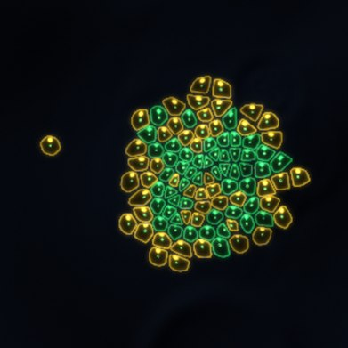 | 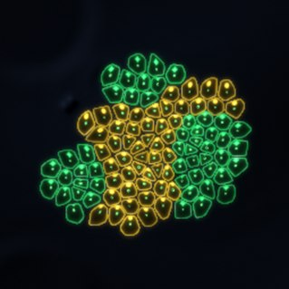 |
| **Core and shell**, `tk-dah-Bfate-100` (100 cells; 40-cell version `tq-dah-Bfate`, three seeds). Two kinds that differ only in adhesion (green 1, gold 0.3) plus a long-range pull between all cells (field B, per-fate charges, like attracts): the sticky green cells gather in the middle and the gold ones wrap round them one or two cells deep. Score 0.78; B out/in 1.24 -> 1.39 and still rising. | **Two-domain ball / stripes**, `tk-key17-Bfate-100` (40-cell `tq-key17-Bfate`: half green, half gold, three seeds). Two kinds whose keys are 17 degrees apart (they hardly stick to each other) plus the long-range pull: one ball made of single-colour domains, here green and gold bands side by side. Score 0.85; same-type contacts 0.86. |
| 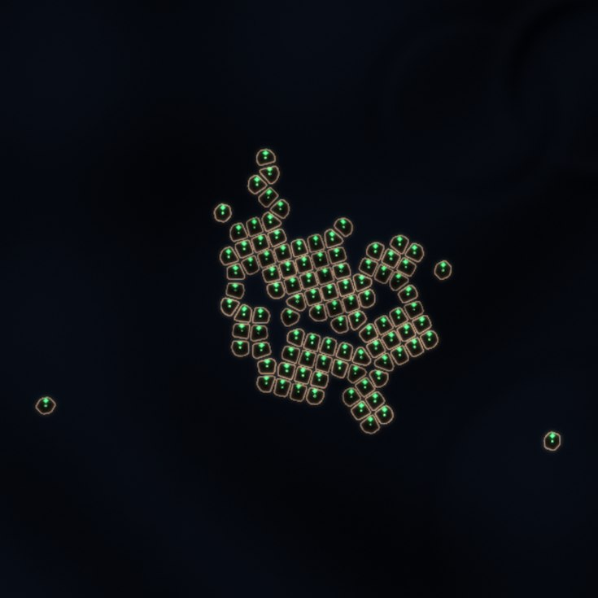 | 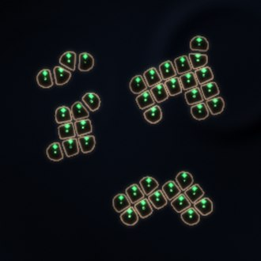 |
| **Lace sheet**, `tk-adh1-excl2-nosense-100`: adhesion 1, exclusion with 2 states, field A off, 100 cells. A net of cells in a square checkerboard packing with holes. Score 0.86, 2.6 contacts per cell. | **Ribbons**, `tq-adh1-excl2-nosense` (40 cells): the same rules make straight strips two cells wide, like ladders or brickwork, that keep every neighbour (persistence 0.98). |
| 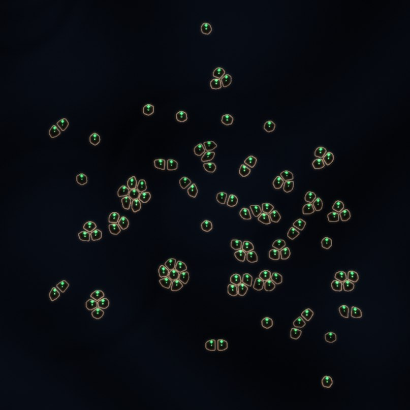 | 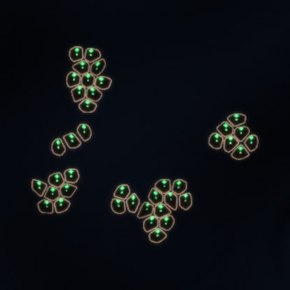 |
| **Islets of a preferred size**, `tq-adh1-Brepel-100`: adhesion 1, field B per fate with like REPELLING like, 100 cells: about 25 small rosettes and triads (3 to 7 cells), evenly spaced, each keeping its members (islands 0.86, three seeds). | **Branching bands**, `tq-adh08-excl3`: adhesion 0.8 plus exclusion with 3 states: thick ribbons that branch (islands 0.96, three seeds). |
| 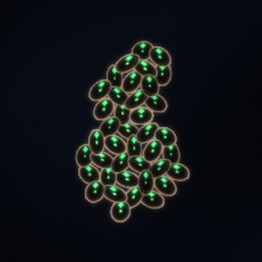 | 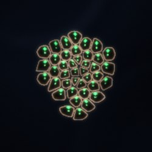 |
| **Palisade**, `tq-adh08-ellipse`: adhesion 0.8 with the ellipse cells (honeycomb off): an elongated cobblestone of oval cells all lying the same way. Score 0.96. | **Liquid ball (morula)**, `th-Bfate`: the baseline plus the long-range pull: a compact ball of pressed cells that keep swapping places and close up at once after the stir. Score 0.84 (three seeds). |
| 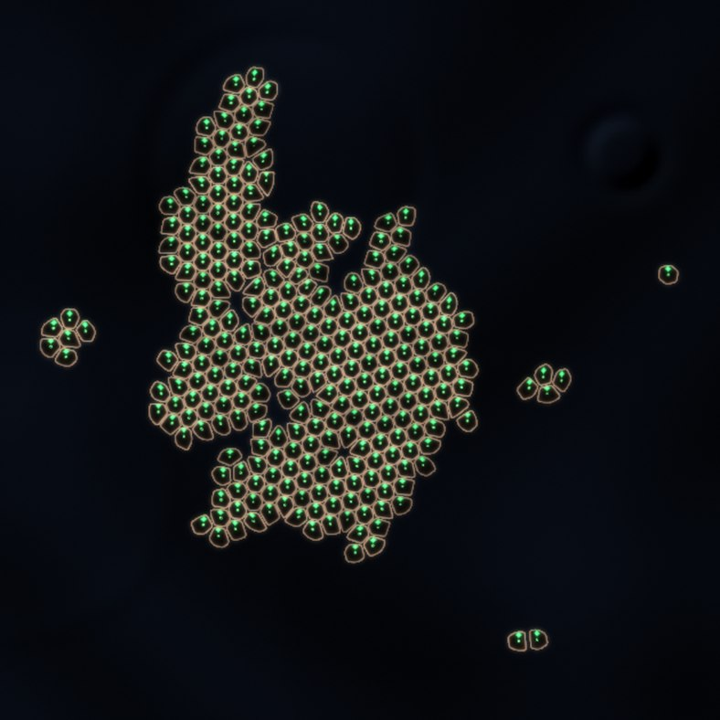 | 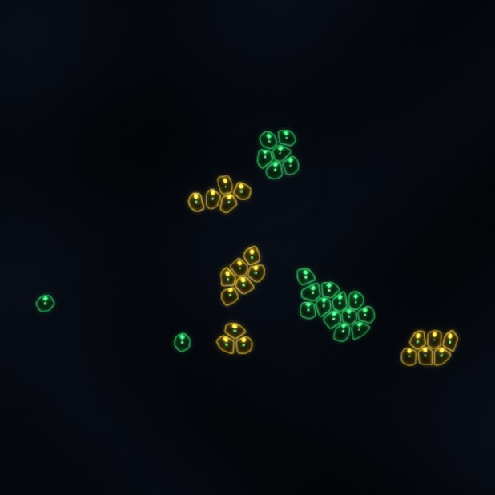 |
| **Large honeycomb sheet**, `tq-adh08-n300`: adhesion 0.8, 300 cells; still inside, a fold where the stir passed, healed. Score 0.94. The plain sheet at 40 cells: `th-adhgene-0.8`, `th-senseoff`, `th-lever-0.2` and many more below. | **Sorted islands**, `tt-key-17deg`: two kinds 17 degrees apart without the long-range pull: every island one colour (same-type 1.0). |
| 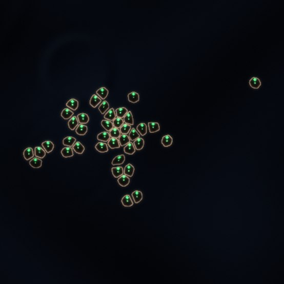 | 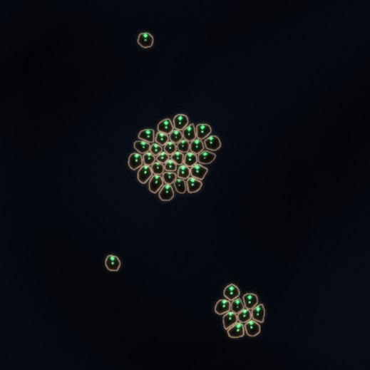 |
| **Rosettes after the stir**, `th-base`: the baseline holds as a sheet until the stir, then stays broken into rosettes of 3 to 7 that keep apart (islands 0.81). | **Assembly from single cells**, `tq-agg-Bfate`: started scattered, the long-range pull gathers them into a ball and a satellite (islands 0.82); with adhesion alone (`tq-agg-adh08`) six small sheets stay apart. |

## The maps: adhesion against agitation (score; T stable as one tissue, I as islands)

Adhesion gene against field A gain (0 = field not felt). Baseline = 0.6 / 10 (four runs: 0.23, 0.48, 0.58, 0.76).

| adhesion \ field A gain | 0 | 5 | 10 | 20 | 40 |
|---|---|---|---|---|---|
| 0.4 | 0.20 (I) | 0.17 | 0.04 | 0.03 | |
| 0.6 | 0.99 T | 0.89 T | 0.23 to 0.76 | 0.02 | 0.02 |
| 0.8 | 1.00 T | 1.00 T | 0.94 to 0.99 T | 0.68 | 0.13 |
| 1.0 | 1.00 T | 1.00 T | 1.00 T | 0.98 T | |

Adhesion gene against motility gene (field A gain 10).

| adhesion \ motility | 0.5 | 1 | 2 | 3 |
|---|---|---|---|---|
| 0.4 | | 0.04 | | |
| 0.6 | 0.81 T, 0.59 | the edge | 0.04, 0.05 (three seeds 0.04) | 0.01 |
| 0.8 | 1.00 T | 0.94 to 0.99 T | 0.54 (I), 0.22 | 0.04 |
| 1.0 | 0.99 T | 0.99 T | 0.93 T, 0.99 T | 0.20 |
| 1.2 | 1.00 T | | 1.00 T | 0.51 (I) |

## Null results (no visible effect on linking here; one line each)

- Medium drift off (0.51, the baseline's spread), jitter off (0.60: the dark dish's heat kicks are already tiny), field B
  with charges from the stock (no charge in the dark: `th-Boff` as the baseline), cell size 0.85 / 1.15 (0.67 / 0.40,
  within the noise; the larger cells a little looser).
- With the chemistry on: charge field off, screening length 1 or 9 R, cells not feeling the charge, dipoles off, strong
  dipoles, membrane chemistry off, heavy thick membranes, contact pumps stealing or sharing fuel, full-field light or no
  light: all 0.28 to 0.57, the same two clumps on the springs.
- Heavy stiff membranes in the dark (0.77) and the corners' jelly off (0.71): within the noise of the edge.
- Two kinds differing mildly in adhesion (0.9 against 0.6): one mixed sheet, no sorting (three seeds).

## Surprises

- The moiré field, the heart of the project, is what pulls these small tissues apart at the default lever; a longer beat
  (smaller lever or a key closer to the medium's) turns it into extra glue.
- Exclusion plus glue builds **square** order (ribbons, lace) out of a world of hexagons.
- Every configuration with enough glue looks alike before the stir (a round honeycomb sheet); the stir is what tells them
  apart, and re-forming after it is the rarer property.
- Adhesive cells started apart do not find each other: assembly needs a long-range signal (here field B, in a real embryo
  chemotaxis). The springs' smell does that job with the chemistry on, and splits the culture in two.
- Sorting fails when tissue is too stable: no movement, no sorting.
- The page's default squeeze (a pull to the dish centre) holds any blob together by itself (`th-squeeze`: 0.96), so it was
  off in all these runs.

## What to try next

- Longer runs for the slow sorters (the 100-cell core and shell was still improving at 120 s).
- A direct sweep of the beat length (lever 0.1 to 0.8 at adhesion 0.6) to pin the 5 to 6 R threshold, and whether
  long-beat field A can replace adhesion entirely.
- Field B charges that come from the chemistry (the stock) strongly enough to act like the per-fate charges: then
  tissue cohesion would emerge from what the cells eat.
- Three kinds of cells (two keys plus an adhesion difference): nested shells or a core with two caps.
- The aggregation assay with the long-range pull and more time, and with chemistry (springs as aggregation centres).
- Exclusion lace with a long beat instead of field off; step 8 with strong glue (curling sheets?).
- Reload a stored configuration and change one knob live (they are all saved with every knob).

## C10: patterned walls in the tissue lab

Step C10 (README, "Step C10: patterned walls") gives every side of a cell its own stickiness: a0 (the adhesion gene) + a1 cos psi
+ a2 cos 2 psi round the wall from the cell's FRONT, a contact holding by the less sticky of the two touching sides, junctions that
mature, a cost in linkers and upkeep. Here the patterns were set by hand (no evolution), with the series' method (40 cells, one
genome cloned, mutation and the life cycle off, no squeeze, dark dish, no springs, measures every 5 s, a stir through the largest
cluster at 82 s, the end at 120 s; `experiments/tissue/c10.py`, runs `experiments/runs/tissue-c10/`, table
`experiments/tissue/c10-sweep.csv`). Four patterns: **uniform** (a0 0.8), **polar** (a0 0.4, a1 0.5: front 0.9, flanks 0.4, back
0), **two-ended** (a0 0.5, a2 0.5: both ends 1, flanks 0), **sticky sides** (a0 0.5, a2 −0.5: flanks 1, ends 0); each with field A
not felt ("off") and with the long beat (lever 0.2, "lb", a glue of its own), maturation on and off, and the fronts at random
(each cell its own) or all aligned (one way, as a lineage that inherited one direction). The dark dish holds no linkers, so the
walls' **cost is off** in these runs (with it on, a cell without linkers holds no glue; tested separately below). New measures:
where the contacts sit on each cell's wall, front / flank / back (within 60 degrees of the front, of the back, or between;
random: a third each), and the glue held by the contacts (the smaller side).

**In short:** with a fixed front and no way for a cell to turn its sticky side toward a neighbour, a patterned wall **cuts a sheet
into small units of a characteristic shape**: polar cells make **front-to-front pairs and little rosettes** of 3 to 5 cells with
their sticky fronts in the middle; two-ended cells make **dumbbells and short chains** (2 to 4 cells end to end, the joints
bright in the walls view); sticky-sided cells make **side-by-side pairs and small rafts**. None of them makes a tissue on its own
(scores 0.06 to 0.15 with field A off, against 1.0 for the uniform wall), and the contacts sit exactly where the pattern says. The
long beat glues them back into one loose net (scores 0.16 to 0.55, islands up to 0.85), where the pattern shows only weakly. No
sheet with a lumen, no cyst, no bilayer and no long chain or palisade formed in 120 s: those would need cells to turn their
fronts toward their contacts (or divide along their front), which no rule here does. Maturation doubles the glue at lasting
contacts (glue 0.5 to 0.7 → 0.9 to 1.2) but hardly changes the shapes; aligned or random fronts made no consistent difference.

| pattern, field | score (one tissue) | islands | clusters | contacts per cell | chains (share of cells with ≤ 2 contacts, largest cluster) | contacts at front / flank / back | glue | matured |
|---|---|---|---|---|---|---|---|---|
| uniform, off | 1.00 | 1.00 | 1.0 | 4.6 | 0.10 | 0.34 / 0.33 / 0.33 | 0.80 (m0), 1.60 (m1) | 0 / 1.00 |
| uniform, lb | 0.99 to 1.00 | 0.99 to 1.00 | 1.0 | 4.8 to 5.5 | 0.03 to 0.05 | 0.34 / 0.33 / 0.33 | 0.80, 1.60 | 0 / 1.00 |
| polar, off | 0.10 to 0.15 | 0.58 to 0.68 | 9.4 to 11.1 | 1.1 to 1.5 | 0.33 to 0.83 | **0.56 to 0.70** / 0.23 to 0.35 / 0.06 to 0.12 | 0.53 to 1.00 | 0 / 0.79 to 0.83 |
| polar, lb | 0.16 to 0.38 | 0.61 to 0.75 | 3.3 to 3.7 | 2.8 to 3.1 | 0.32 to 0.55 | 0.47 to 0.56 / 0.26 to 0.36 / 0.08 to 0.21 | 0.34 to 0.78 | 0 / 0.54 to 0.65 |
| two-ended, off | 0.07 to 0.09 | 0.37 to 0.63 | 7.9 to 9.0 | 1.1 to 1.5 | 0.60 to 1.00 | 0.47 to 0.59 / **0.02 to 0.09** / 0.38 to 0.47 | 0.61 to 1.18 | 0 / 0.70 to 0.73 |
| two-ended, lb | 0.27 to 0.48 | 0.67 to 0.77 | 1.3 to 4.1 | 3.2 to 3.7 | 0.15 to 0.31 | 0.32 to 0.37 / 0.28 to 0.32 / 0.34 to 0.36 | 0.30 to 0.61 | 0 / 0.56 to 0.65 |
| sticky sides, off | 0.08 to 0.15 | 0.51 to 0.61 | 5.9 to 10.1 | 1.1 to 1.9 | 0.50 to 1.00 | 0.12 to 0.29 / **0.44 to 0.71** / 0.11 to 0.27 | 0.61 to 1.11 | 0 / 0.58 to 0.70 |
| sticky sides, lb | 0.24 to 0.55 | 0.69 to 0.85 | 1.3 to 3.4 | 2.9 to 4.1 | 0.19 to 0.73 | 0.31 to 0.34 / 0.33 to 0.37 / 0.29 to 0.34 | 0.29 to 0.66 | 0 / 0.39 to 0.58 |

(Ranges over maturation on / off and fronts random / aligned: four runs each, seed 3. "glue" and "matured" at 120 s: the mean
of the smaller side over the touching pairs, and the share of pairs whose both sides have matured above half.)

More runs (one each):
- **100 cells, long beat**: uniform: one round honeycomb sheet whose inner walls have all matured (bright, whitish shared walls;
  the middle cells pressed small; score 1.00). Two-ended: four to five loose islands (score 0.60 to 0.64, islands 0.78 to 0.79).
  Sticky sides: one or three rafts (0.50 to 0.71, islands 0.79 to 0.80). Polar: a lace of rosettes and triads (0.26 to 0.34,
  islands 0.70 to 0.78).
- **Polar with every front pointing in or out** (40 cells, long beat): a1 +0.5 (fronts sticky) with fronts in, 0.22; out, 0.13;
  a1 −0.5 (backs sticky) with fronts in (backs out), 0.47; out, 0.39. No hollow ball: the cells do not keep a radial order once
  they move (contacts at the sticky end 0.52 to 0.63 nevertheless).
- **Controls, the walls off** (the same genes, long beat): every pattern is one sheet again (0.99), as the old adhesion gene.
- **The cost on, with a spring of linkers under the cells** (a lab-only spring kind): the cells weave their membranes and their
  glue (linkers in adhesion 4.4 units for 40 cells, the junctions mature to 0.8), and the tissue holds while their batteries
  last; in the dark nothing refills a battery, the upkeep and the weaving's sparks empty it by about 90 s, and from then on the
  sides hold no glue (0.25 at 90 s, 0 at 120 s): the uniform sheet loosens and falls apart at the stir (score 0.46; two-ended
  0.16, sticky sides 0.69 as islands). Stickiness is paid for, and a starving tissue lets go.
- **The front from the dipole** (an ion spring of light givers and heavy takers under the cells, which polarises them; gene w 0
  or 1): with w = 1 the fronts line up with the dipoles (the mean cos between front and dipole over the polarised cells 0.49 to
  0.65, against −0.08 to 0.12 with w = 0), so the mechanism works; but the dipoles point out from the spring, so the polar
  cells' sticky fronts all point outward, away from each other, and the cells scatter more (scores 0.05 against 0.10; contacts
  per cell 0.96 against 1.31). The spring's chemistry splits the culture as in the earlier chemistry runs.

Stored (`experiments/tissue/configs/c10-<name>/`: condition, cells-only snapshot, measures, one picture; reload with `?snap=`):

| configuration | what it is | reload (after the local server's address) |
|---|---|---|
| [c10-uni-lb-100-al](experiments/tissue/configs/c10-uni-lb-100-al/) | uniform walls, 100 cells, long beat: a honeycomb sheet whose inner junctions have all matured (bright shared walls) | `?snap=experiments/tissue/configs/c10-uni-lb-100-al/snapshot.json` |
| [c10-pol-off-m0-al](experiments/tissue/configs/c10-pol-off-m0-al/) | polar walls, field A off: front-to-front pairs and rosettes of 3 to 5 | `?snap=experiments/tissue/configs/c10-pol-off-m0-al/snapshot.json` |
| [c10-end-off-m1-al](experiments/tissue/configs/c10-end-off-m1-al/) | two-ended walls, field A off, maturation: dumbbells and short chains joined end to end | `?snap=experiments/tissue/configs/c10-end-off-m1-al/snapshot.json` |
| [c10-sid-off-m0-al](experiments/tissue/configs/c10-sid-off-m0-al/) | sticky sides, field A off: side-by-side pairs and small rafts | `?snap=experiments/tissue/configs/c10-sid-off-m0-al/snapshot.json` |
| [c10-pol-lb-100-rnd](experiments/tissue/configs/c10-pol-lb-100-rnd/) | polar walls, 100 cells, long beat: a lace of rosettes (islands 0.78) | `?snap=experiments/tissue/configs/c10-pol-lb-100-rnd/snapshot.json` |
| [c10-end-lb-100-al](experiments/tissue/configs/c10-end-lb-100-al/) | two-ended walls, 100 cells, long beat: loose islands (0.79) | `?snap=experiments/tissue/configs/c10-end-lb-100-al/snapshot.json` |
| [c10-sid-lb-100-al](experiments/tissue/configs/c10-sid-lb-100-al/) | sticky sides, 100 cells, long beat: one raft and a few small ones (islands 0.80) | `?snap=experiments/tissue/configs/c10-sid-lb-100-al/snapshot.json` |
| [c10-sid-lb-m1-al](experiments/tissue/configs/c10-sid-lb-m1-al/) | sticky sides, 40 cells, long beat, maturation: a raft (islands 0.85) | `?snap=experiments/tissue/configs/c10-sid-lb-m1-al/snapshot.json` |
| [c10-uni-lb-cost](experiments/tissue/configs/c10-uni-lb-cost/) | uniform walls with the cost on and a linker spring: the sheet after its batteries ran out and it let go | `?snap=experiments/tissue/configs/c10-uni-lb-cost/snapshot.json` |

The snapshots carry every knob (the walls' too), so they reload as they ran. The tissue series' own configurations (saved before
C10) load with the walls off and run on as before (checked: core and shell B out/in 1.81 → 1.99 in 40 s, the lace 96 → 97 of 100
cells in one piece, the ball whole; runs `experiments/runs/c10/c10-tr-*`).

Next, if wanted: a rule that lets contacts set the front (the side away from all contacts becomes the "apical" back, as cells
in an epithelium polarise), or division along the front: either would let a sticky-sided lineage grow into a palisade or a cyst.

## C11: glue turns cells

Step C11 (README, "Step C11: glue turns cells") lets the glue TURN a cell: a contact's adhesion pulls harder where the wall is
stickier, off the line between the centres, so the same pull turns the cell (its front and its outline) until its sticky part
faces the neighbour; and a dividing cell puts its daughter along its front, across it or between (gene divAxis). The same lab as
C10 (40 cells, one genome cloned, mutation, the life cycle and differentiation off, no squeeze, dark dish, no springs, the walls'
cost off, crawling free; measures every 5 s, a stir through the largest cluster at 82 s, the end at 120 s; fronts at random at the
start; `experiments/tissue/c11.py`, runs `experiments/runs/tissue-c11/`, table `experiments/tissue/c11-sweep.csv`). Five hand-set
patterns: the C10 four (**uniform** a0 0.8; **polar** a0 0.4, a1 0.5: front 0.9, flanks 0.4, back 0; **two-ended** a0 0.5, a2 0.5:
ends 1, flanks 0; **sticky sides** a0 0.5, a2 −0.5: flanks 1, ends 0) and **epithelial** (a0 0.5, a1 −0.3, a2 −0.4: flanks 0.9, back
0.4, front (the apex) 0), each with field A not felt and with the long beat (lever 0.2), the glue's turning on and off
(`walls.params.turn`), maturation on, at 40 cells and (long beat only) 100. Then **growth**: ONE founder cell (`?cells=1`,
capacity 100, `?life=1`, mutation off) whose battery pays for its divisions (starter charge 0.4 of the battery, division free and
allowed from 0.003 of it, no engines, no starving, no background deaths, no bursting), so its line grows for about seven
generations (54 to 77 cells by 80 s), daughters along the front (divAxis 0) or across it (1), turning on and off, field A off.
New measures (`moire.walls.stats()`): the contacts on sticky sides against chance, the glued bonds per cell (touching pairs holding
at least 0.2 glue), chains and rings of glued bonds.

**In short:** turning makes every patterned wall link better, and the pattern now shows as SHAPE. Where C10's patterned cells broke a
sheet into small units (they could not turn their sticky side to a neighbour), with turning the cells swing their sticky parts
together: contacts per cell up by a third to double (field A off: polar 1.6 → 2.3, two-ended 1.3 → 2.7, sticky sides 1.3 → 2.9,
epithelial 1.8 → 3.0), glued bonds per cell up by half, contact persistence up (0.74 to 0.85 → 0.82 to 0.96), and with the long beat
two-ended and sticky-sided cells hold as ONE tissue (scores 0.35 → 0.87 and 0.49 → 0.77 at 40 cells; 0.63 → 0.88 and 0.61 → 0.86 at
100), where without turning they were loose islands. The turning itself is calm: 10 to 30 degrees per s on average over the touching
cells, most of it while a contact settles. What each pattern makes, in tissue words:
- **Polar** (front sticky): **rosettes**. Almost every cell ends in a trefoil of three (some four) cells whose sticky fronts meet in
  the middle, like little pinwheels; at 100 cells with the long beat the trefoils join side by side into a lace of rosettes.
  Contacts at the front 0.82 (field off; 0.64 without turning; random 0.33), on sticky sides 0.93 against 0.45 by chance. The score
  stays low (0.12 to 0.38): it makes many small units, not one sheet (islands 0.87 to 0.92, stable). No hollow ring: a rosette of
  three has no room for a lumen, and nothing pushes the fronts apart.
- **Two-ended** (both ends sticky): a **net of short chains**, cells joined end to end, the joints bright bars in the walls view,
  the chains branching and crossing into one loose tissue; at 40 cells with the long beat a compact sheet with arms of end-to-end
  cells reaching out from it.
- **Sticky sides** (flanks sticky): **stacks and palisade rows** inside one sheet: cells lie side by side with their sticky flanks
  together, so the walls view shows parallel bright lines (rows of cells like a palisade); field off, compact clumps of such rows.
- **Epithelial** (flanks sticky, back a little, apex not): **small cords and trefoils with a free apical side**: groups of 3 to 10
  cells joined by their flanks, the non-sticky apices all on the outside (contacts at the apex 0.02, against 0.10 without
  turning); stable as islands (0.91 to 0.97, the stillest contacts of all, persistence 0.92 to 0.97).
- **Uniform**: as before, one honeycomb sheet (1.00); the turning there is a few degrees per s (maturity makes the walls a little
  uneven) and changes nothing.

**Growth from one founder.** Division by the front builds the lineage's direction into the tissue: a **uniform** founder dividing
across its front grows an **elongated sheet** (elongation 2.6, against 1.3 with the turning off), because all daughters keep the
inherited front and divide the same way (with the turning off, the front is carried by the outline's 60-degree lock and wanders,
so the axis is lost; along the front: 2.1 against 1.4). A **polar** founder grows a field of trefoil **rosettes** (not a cyst:
daughters sit side by side, turn their sticky fronts together in threes and split off); a **two-ended** founder a branched **net of
end-to-end chains** (along the front: score 0.63 against 0.28 without turning); a **sticky-sided** founder dividing along its front
puts each daughter at a non-sticky end, and with turning the pair swings round flank to flank, so the line grows into one compact
**cluster of pinwheels** (0.70), while without turning it stays scattered pairs and short stacks (0.11; 10 chains of glued cells, the
longest 9); an **epithelial** founder dividing across its front grows **short cords** one to two cells thick, apices out (islands
0.92). No hollow ring, cyst or lumen formed in any run: nothing in the toy makes the inside of a ring empty (no fluid, no apical
repulsion), and growth here is fast and in the open, so daughters fill any gap. (Rings are counted as closed loops of 5 or more
glued cells with two bonds each: 0 everywhere.)

The 40- and 100-cell lab (score with the islands score in brackets; at 80 s, before the stir):

| pattern, field, cells | turning | score (islands) | contacts per cell | persistence | glued bonds per cell | contacts on sticky sides (chance) | contacts front / flank / back | turning (deg/s) |
|---|---|---|---|---|---|---|---|---|
| uniform, field A off, 40 | off | 1.00 (1.00) | 4.75 | 1.00 | 4.75 | - | 0.36 / 0.34 / 0.30 | 0.0 |
| uniform, field A off, 40 | on | 1.00 (1.00) | 4.75 | 1.00 | 4.75 | - | 0.35 / 0.31 / 0.34 | 3.9 |
| polar, field A off, 40 | off | 0.15 (0.76) | 1.64 | 0.83 | 1.40 | 0.83 (0.48) | 0.64 / 0.27 / 0.09 | 0.0 |
| polar, field A off, 40 | on | 0.12 (0.87) | 2.33 | 0.93 | 2.15 | 0.93 (0.45) | 0.82 / 0.13 / 0.04 | 9.7 |
| two-ended, field A off, 40 | off | 0.13 (0.59) | 1.27 | 0.74 | 0.90 | 0.81 (0.53) | 0.50 / 0.12 / 0.38 | 0.0 |
| two-ended, field A off, 40 | on | 0.50 (0.73) | 2.72 | 0.82 | 2.25 | 0.78 (0.56) | 0.44 / 0.10 / 0.46 | 16.3 |
| sticky sides, field A off, 40 | off | 0.13 (0.61) | 1.31 | 0.76 | 1.20 | 0.64 (0.49) | 0.31 / 0.41 / 0.28 | 0.0 |
| sticky sides, field A off, 40 | on | 0.63 (0.82) | 2.86 | 0.84 | 2.45 | 0.72 (0.56) | 0.28 / 0.46 / 0.27 | 17.5 |
| epithelial, field A off, 40 | off | 0.19 (0.70) | 1.80 | 0.85 | 1.60 | 0.82 (0.62) | 0.10 / 0.38 / 0.53 | 0.0 |
| epithelial, field A off, 40 | on | 0.31 (0.91) | 2.96 | 0.96 | 2.80 | 0.91 (0.62) | 0.02 / 0.48 / 0.50 | 9.8 |
| uniform, long beat, 40 | off | 1.00 (1.00) | 6.57 | 1.00 | 6.70 | - | 0.36 / 0.33 / 0.32 | 0.0 |
| uniform, long beat, 40 | on | 1.00 (1.00) | 6.13 | 1.00 | 6.20 | - | 0.36 / 0.33 / 0.31 | 3.5 |
| polar, long beat, 40 | off | 0.22 (0.73) | 2.76 | 0.75 | 1.65 | 0.73 (0.47) | 0.53 / 0.32 / 0.15 | 0.0 |
| polar, long beat, 40 | on | 0.38 (0.92) | 3.59 | 0.94 | 2.85 | 0.71 (0.48) | 0.50 / 0.33 / 0.17 | 21.9 |
| two-ended, long beat, 40 | off | 0.35 (0.76) | 3.73 | 0.82 | 2.10 | 0.57 (0.54) | 0.34 / 0.26 / 0.40 | 0.0 |
| two-ended, long beat, 40 | on | 0.87 (0.87) | 4.42 | 0.90 | 2.85 | 0.60 (0.50) | 0.35 / 0.22 / 0.44 | 29.7 |
| sticky sides, long beat, 40 | off | 0.49 (0.78) | 3.96 | 0.82 | 2.25 | 0.47 (0.48) | 0.34 / 0.34 / 0.32 | 0.0 |
| sticky sides, long beat, 40 | on | 0.77 (0.84) | 4.22 | 0.88 | 2.90 | 0.56 (0.50) | 0.33 / 0.40 / 0.27 | 26.0 |
| epithelial, long beat, 40 | off | 0.69 (0.84) | 3.99 | 0.87 | 2.30 | 0.68 (0.60) | 0.27 / 0.36 / 0.36 | 0.0 |
| epithelial, long beat, 40 | on | 0.69 (0.97) | 4.22 | 0.97 | 3.45 | 0.74 (0.58) | 0.17 / 0.41 / 0.42 | 17.5 |
| uniform, long beat, 100 | off | 1.00 (1.00) | 6.52 | 1.00 | 6.90 | - | 0.33 / 0.34 / 0.33 | 0.0 |
| uniform, long beat, 100 | on | 0.99 (0.99) | 6.83 | 0.99 | 6.88 | - | 0.32 / 0.33 / 0.36 | 3.6 |
| polar, long beat, 100 | off | 0.28 (0.64) | 3.18 | 0.69 | 1.74 | 0.65 (0.49) | 0.47 / 0.34 / 0.19 | 0.0 |
| polar, long beat, 100 | on | 0.38 (0.87) | 3.39 | 0.87 | 2.52 | 0.76 (0.49) | 0.58 / 0.29 / 0.13 | 23.0 |
| two-ended, long beat, 100 | off | 0.63 (0.79) | 4.13 | 0.80 | 2.52 | 0.53 (0.48) | 0.34 / 0.32 / 0.34 | 0.0 |
| two-ended, long beat, 100 | on | 0.88 (0.94) | 4.93 | 0.95 | 3.02 | 0.57 (0.51) | 0.36 / 0.27 / 0.37 | 25.0 |
| sticky sides, long beat, 100 | off | 0.61 (0.81) | 3.78 | 0.84 | 2.12 | 0.56 (0.50) | 0.31 / 0.37 / 0.32 | 0.0 |
| sticky sides, long beat, 100 | on | 0.86 (0.91) | 4.96 | 0.91 | 3.32 | 0.56 (0.50) | 0.30 / 0.39 / 0.31 | 25.2 |
| epithelial, long beat, 100 | off | 0.55 (0.83) | 3.99 | 0.84 | 2.84 | 0.69 (0.60) | 0.25 / 0.35 / 0.40 | 0.0 |
| epithelial, long beat, 100 | on | 0.66 (0.92) | 4.23 | 0.92 | 3.24 | 0.74 (0.60) | 0.18 / 0.40 / 0.42 | 19.3 |

Growth from one founder (field A off; at 80 s; the islands score is not meaningful here, as the count grows):

| founder's pattern, daughters | turning | cells at 80 s | groups (clusters) | contacts per cell | persistence | glued bonds per cell | elongation | contacts on sticky sides (chance) | score |
|---|---|---|---|---|---|---|---|---|---|
| uniform, along | off | 54 | 1.00 | 4.67 | 1.00 | 4.67 | 1.37 | - | 1.00 |
| uniform, along | on | 63 | 1.00 | 4.73 | 1.00 | 4.73 | 2.08 | - | 1.00 |
| uniform, across | off | 64 | 1.00 | 4.83 | 1.00 | 4.84 | 1.29 | - | 1.00 |
| uniform, across | on | 57 | 1.00 | 4.63 | 1.00 | 4.63 | 2.61 | - | 1.00 |
| polar, along | off | 75 | 16.14 | 1.99 | 0.79 | 1.71 | 3.04 | 0.80 (0.50) | 0.10 |
| polar, along | on | 75 | 12.86 | 2.70 | 0.91 | 2.32 | 2.04 | 0.92 (0.48) | 0.15 |
| polar, across | off | 77 | 12.00 | 2.06 | 0.76 | 1.53 | 1.67 | 0.82 (0.50) | 0.11 |
| polar, across | on | 75 | 12.43 | 2.57 | 0.91 | 2.29 | 1.93 | 0.95 (0.48) | 0.22 |
| two-ended, along | off | 75 | 5.86 | 2.58 | 0.80 | 1.87 | 1.35 | 0.83 (0.67) | 0.28 |
| two-ended, along | on | 74 | 3.00 | 2.83 | 0.81 | 2.35 | 1.36 | 0.78 (0.56) | 0.63 |
| two-ended, across | off | 75 | 6.71 | 2.22 | 0.77 | 1.55 | 1.41 | 0.86 (0.67) | 0.17 |
| two-ended, across | on | 75 | 3.14 | 3.01 | 0.83 | 2.40 | 1.89 | 0.81 (0.60) | 0.52 |
| sticky sides, along | off | 75 | 10.43 | 1.73 | 0.66 | 1.09 | 2.51 | 0.48 (0.33) | 0.11 |
| sticky sides, along | on | 75 | 3.00 | 3.28 | 0.85 | 2.53 | 1.07 | 0.70 (0.53) | 0.70 |
| sticky sides, across | off | 75 | 10.14 | 1.88 | 0.61 | 1.17 | 2.84 | 0.50 (0.33) | 0.08 |
| sticky sides, across | on | 75 | 3.14 | 2.77 | 0.80 | 2.27 | 1.11 | 0.77 (0.57) | 0.54 |
| epithelial, along | off | 75 | 8.86 | 2.56 | 0.84 | 2.05 | 2.73 | 0.94 (0.67) | 0.21 |
| epithelial, along | on | 75 | 4.57 | 3.23 | 0.95 | 3.15 | 1.81 | 0.85 (0.62) | 0.38 |
| epithelial, across | off | 75 | 9.00 | 2.50 | 0.82 | 2.00 | 2.01 | 0.90 (0.67) | 0.16 |
| epithelial, across | on | 75 | 3.43 | 3.32 | 0.92 | 3.04 | 1.19 | 0.86 (0.62) | 0.65 |

(One run each, seed 3; differences of less than about 0.3 in the score near the edge are noise, see "How the runs were made".)

Stored (`experiments/tissue/configs/c11-<name>/`: condition, cells-only snapshot at 120 s, measures, one picture at 120 s, after the
stir; reload with `?snap=`; pictures at 80 s, before the stir, in `experiments/keep/c11/`):

| configuration | what it is | reload (after the local server's address) |
|---|---|---|
| [c11-pol-lb-t1-100](experiments/tissue/configs/c11-pol-lb-t1-100/) | polar walls, 100 cells, long beat, turning: a lace of trefoil rosettes, sticky fronts in the middle | `?snap=experiments/tissue/configs/c11-pol-lb-t1-100/snapshot.json` |
| [c11-end-lb-t1-100](experiments/tissue/configs/c11-end-lb-t1-100/) | two-ended walls, 100 cells, long beat, turning: one tissue of end-to-end chains (0.88) | `?snap=experiments/tissue/configs/c11-end-lb-t1-100/snapshot.json` |
| [c11-end-lb-t1](experiments/tissue/configs/c11-end-lb-t1/) | two-ended, 40 cells: a compact sheet with arms of end-to-end cells (0.87) | `?snap=experiments/tissue/configs/c11-end-lb-t1/snapshot.json` |
| [c11-sid-lb-t1-100](experiments/tissue/configs/c11-sid-lb-t1-100/) | sticky sides, 100 cells, long beat, turning: one sheet with palisade rows (0.86) | `?snap=experiments/tissue/configs/c11-sid-lb-t1-100/snapshot.json` |
| [c11-epi-off-t1](experiments/tissue/configs/c11-epi-off-t1/) | epithelial walls, field A off: trefoils and short cords, apices out (islands 0.91) | `?snap=experiments/tissue/configs/c11-epi-off-t1/snapshot.json` |
| [c11-grow-uni-d1-t1](experiments/tissue/configs/c11-grow-uni-d1-t1/) | one uniform founder, daughters across the front: an elongated honeycomb sheet (elongation 2.6) | `?snap=experiments/tissue/configs/c11-grow-uni-d1-t1/snapshot.json` |
| [c11-grow-pol-d1-t1](experiments/tissue/configs/c11-grow-pol-d1-t1/) | one polar founder, across: a field of rosettes | `?snap=experiments/tissue/configs/c11-grow-pol-d1-t1/snapshot.json` |
| [c11-grow-sid-d0-t1](experiments/tissue/configs/c11-grow-sid-d0-t1/) | one sticky-sided founder, along: a compact cluster of pinwheels (0.70) | `?snap=experiments/tissue/configs/c11-grow-sid-d0-t1/snapshot.json` |
| [c11-grow-epi-d1-t1](experiments/tissue/configs/c11-grow-epi-d1-t1/) | one epithelial founder, across: short cords, apices out (islands 0.92) | `?snap=experiments/tissue/configs/c11-grow-epi-d1-t1/snapshot.json` |

Pictures (80 s, before the stir; walls view: grey uniform, coral polar, mint two-ended, magenta sticky sides, bright tube = sticky
side): `experiments/keep/c11/polar-rosettes-100_walls.jpg` (and `polar-noturn-100_walls.jpg`, the same without turning),
`sticky-sides-100_walls.jpg`, `two-ended-40_walls.jpg` (and `two-ended-noturn-40_walls.jpg`), `epithelial-40_clean.jpg`,
`grow-uniform-across_clean.jpg`, `grow-polar-across_walls.jpg`, `grow-epithelial-across_clean.jpg`,
`grow-sticky-sides-along_walls.jpg`.

Snapshots saved before C11 load with the turning, division by the front and the free base glue off and run on as saved (checked:
`c10-pol-off-m0-al`, `c10-uni-lb-100-al` (all 100 cells still one sheet after 40 s), and the pre-C10 `th-Bfate`; runs
`experiments/runs/c11/c11-reload-*`).

How the turning was tuned (trial runs, not kept: 40 cells, field off): at rotational drag 1 (a disc dragged over its whole
footprint) the turning, about 6 degrees per s, already raised the contacts per cell (polar 1.4 → 2.1, two-ended 1.3 → 2.0, sticky
sides 1.3 → 2.0); turning strength 5 (= drag 0.2, the default) raised them more (two-ended 3.1, score 0.29 → 0.61); 20 gave no more
(polar 2.4). A first form of the torque (r x F with the glue not anchored to the turning
cell) made cells spin and linked worse (persistence 0.60 against 0.87); see the README.

## C13: fields as guides, each gate alone

Step C13 (README, "Step C13: fields as genes and guides") lets what a cell FEELS of field A on each membrane side gate what it does,
each through its own gene: the glue per side, the pumps and engines, the division axis, the turning of the front. Here every gate
runs ALONE, its gene set by hand to +1 or -1, against the same genes with that gate switched off (the control, side by side). The lab
is C11's (one genome cloned, mutation, the life cycle and differentiation off, no squeeze, dark dish, no springs, the walls' cost off,
the glue's turning on, fronts at random at the start; measures every 5 s, a stir through the largest cluster at 82 s, the end at
120 s), but field A is always FELT (the gates read it), with the default beat (lever 0.4, "db") and with the long beat (lever 0.2,
"lb"). The other gates are off throughout. `experiments/tissue/c13.py`, conditions `experiments/conditions/c13/lab/`, runs
`experiments/runs/tissue-c13/`, table `experiments/tissue/c13-sweep.csv`. New measures (the panel's GUIDES census, `guides.*` in the
samples): **felt** (the mean |s| of the field at the cells), **contacts on felt** (the mean s of a cell's touching sides minus that of
all six: + means the contacts sit on the sides that feel the field high), **front·gradient** (mean cos between the front and the felt
gradient; 0 by chance), **divisions |cos|** (between each division's axis and the felt gradient; 0.64 by chance, 1 along, 0 across).

**In short:** every gate does what it says, and three of the four show in the shape; none breaks the tissue, and none makes stripes
along the beat rings in a cloned lab culture (every cell is alike, so they all feel the same rings). The strength of every gate depends
on the BEAT: with the default beat a packed cell feels little (felt 0.07 to 0.16: its neighbours' cores and dark rings cancel on its
sides), with the long beat about four times as much (0.34 to 0.67), so the gates act mainly with the long beat.

| gate (series) | beat | gene +1 | off (control) | gene -1 | what it looks like |
|---|---|---|---|---|---|
| **glue**, uniform walls a0 0.6, 40 cells | db | glue at contacts 1.15, contacts 4.5, score 0.96 | 1.18, 4.5, 1.00 | 0.84, 4.5, 1.00 | no difference to see (felt 0.15) |
| | lb | glue **1.74**, contacts **5.4**, score 1.00 | 1.20, 5.3, 0.98 | **0.45**, 4.5, 0.94 | +1: a rosette of wedge-shaped cells in the middle, tighter; -1: looser straight rows |
| glue, 100 cells | lb | glue **1.93**, contacts **7.3**, compact | 1.20, 6.0 | | +1: one compact sheet with a flower of narrow wedges in its middle (`lab-glue-longbeat.jpg`) |
| **turn**, polar walls (front sticky), 40 cells | db | front·gradient **0.56**, contacts 2.1, islands 0.87 | 0.44, 2.0, 0.83 | **0.30**, 1.8, 0.75 | trefoil rosettes in every case (C11's polar look) |
| | lb | 0.49, contacts **4.0**, score **0.69** (islands 0.98) | 0.46, 3.7, 0.43 | **0.04**, 3.5, 0.33 | +1: one larger packed sheet with a few trefoils; -1: a loose ring of trefoils, fronts outward (`lab-turn-longbeat.jpg`) |
| **division**, one founder grows (uniform a0 0.8) | db | divisions \|cos\| **0.89**, elongation **1.09** | 0.67, **2.86** | **0.34**, 1.49 | off: a long column (daughters by the front, which all cells inherit); +1: a round blob; -1: a sprawling sheet (`lab-division-defaultbeat.jpg`) |
| | lb | **0.93**, 2.08 | 0.60, 1.88 | **0.17**, 1.38 | a broad band (+1), a compact patch (off), a sheet with a bay (-1) (`lab-division-longbeat.jpg`) |
| **engine + pump**, lit dish, a light spring, harvest + burn + pump g IN, 40 cells | db | light caught 82, fuel made 14/s, battery 159 | 74, 13, 157 | 65, 11, 141 | the same |
| | lb | light caught **103**, fuel made **16**/s, battery 160 | 74, 13, 158 | **41**, **7**, **82** | -1: the middle cells' battery cores shrink to dark centres, the rim cells stay full (`lab-engines-longbeat.jpg`) |

(Scores and measures as in the tables above: contacts per cell and glue at the contacts t 50..80 s; the turn series' islands score where
the tissue score is low; elongation of the grown tissue at 80 s. One run each, seed 3.)

What each gate does, in plain words:
- **Glue** (+1: stickier where the field is high). In a packed lab tissue the sides that touch a neighbour feel more than the free
  sides in every run, gate or not (contacts on felt +0.06 to +0.13): a neighbour's bright core is right there. So with +1 the glue
  goes where the cells touch and the tissue packs tighter (contacts per cell 6.0 to 7.3 at 100 cells), and with -1 it goes away from
  the contacts and the tissue loosens (glue at the contacts down from 1.2 to 0.45). The middle of the +1 tissue looks different: a
  flower of narrow wedge-shaped cells round a point, the moire's rosette pressed into the honeycomb. No stripes: in a cloned culture
  every cell feels the same rings, so the gate only scales the glue.
- **Turn** (+1: the front turns up the felt gradient). The gradient a packed cell feels points toward its neighbours (field A's like
  attracts like), so even without the gate polar cells' sticky fronts already lean that way (front·gradient 0.44 to 0.46, C11's glue
  turning); +1 adds a little (0.49 to 0.56) and -1 turns them away (0.04 to 0.30). With the long beat that decides the shape: +1 makes
  one packed sheet (score 0.69), -1 a loose ring of trefoils (0.33).
- **Division** (+1: the daughter along the felt gradient). The clearest gate: the axis follows the gradient (|cos| 0.89 to 0.93
  against 0.60 to 0.67 by the inherited front alone) or lies across it (0.17 to 0.34). In a growing clump the gradient points to the
  middle, so +1 puts daughters in toward the centre and the clone grows ROUND (elongation 1.09) where by the inherited front alone it
  grows a long column (2.86); -1 puts them along the rim and the clone sprawls.
- **Engine and pump** (+1: faster where the field is high). With the long beat almost every cell feels the field high (s about +0.45),
  so +1 speeds the whole tissue's engines up (light caught 103 against 74) and -1 slows it (41), and with -1 the batteries of the
  middle cells, which feel the most, run half empty (82 against 158): a pattern of dark battery cores that follows the field. With the
  default beat (felt 0.14) the effect is a tenth of that.

Stored configurations (`experiments/tissue/configs/c13-*`, load with `?snap=experiments/tissue/configs/<name>/snapshot.json`):
`c13-glue-lb-p-100` (the compact sheet with the wedge flower), `c13-turn-lb-p` (the packed polar sheet), `c13-div-db-p` (the round
grown clone), `c13-rate-lb-m` (dark battery cores in the middle).

## How the runs were made

- **Few cells, no evolution.** 40 cells (also 20, 100, 300), one genome cloned to every cell (`?clone=1`), mutation and the
  life cycle off (`?mut=0&life=0`: nobody is born or dies), differentiation off (every cell stays a stem cell) unless a
  run says so. Two-type runs: every second cell slot gets type B's genes (drawn gold in the strategy view; type A green).
- **The baseline** (deliberately at the edge, so each factor can tip it either way): dark dish (`?light=off`), no springs
  (`?springs=0`), no pull to the dish centre (squeeze 0: the page's default squeeze holds any blob together by itself,
  run `th-squeeze`), crawling free of battery cost (in the dark a battery would empty and everyone would stop), adhesion
  gene 0.6, motility 1, size 1, key angle 0.35 rad, lever 0.4, field A gain 10, everything else as the page has it.
- **Protocol** (simulated time; `experiments/tissue/make_conditions.py`): start as the page's packed blob; tissue measures
  every 5 s; at 82 s a **stir** (a mouse drag of 12 frames, 14 px a frame, straight through the largest cluster's centre);
  run on to 120 s. Shots at 60, 80, 120 s, cells-only snapshots at 80 (before the stir) and 120 s (the end).
- **The aggregation assay** (`agg` runs): the same, but at t = 0 the cells are put at random places in a disc of 14 R,
  apart (like dissociated cells), to see whether they assemble at all.
- **Measures** (`moire.tissue.stats()` and `experiments/tissue/tissue-lab.js`): clusters of touching cells (closer than
  1.15 x the sum of the radii), the share in the largest one, contacts per cell, **persistence** (share of the touching
  pairs still touching 5 s later), compactness (about 0.9 for a packed disc, above 1 where cells press into each other,
  low for chains and lace), inner motion of the largest cluster (R/s, its drift taken out), and for two types the share of
  contacts between cells of the same type (0.5 = random) and **B out/in** (type B's mean distance from the cluster centre
  over type A's: above 1 means B sits outside, a shell).
- **Stability score** (one tissue): hold x persist x re-form, where hold = mean share of cells in the largest cluster over
  50 to 80 s, persist = mean contact persistence over 55 to 80 s, re-form = share in the largest cluster at 110 to 120 s
  (after the stir) over hold, at most 1. **Stable (tissue)** = score >= 0.75.
  **Islands score** (many small tissues): (1 - share of single cells) x persist x the same ratio after the stir; **stable
  (islands)** = islands score >= 0.75 and at least 2 contacts per cell (groups of three and more, not pairs).
  Both are in sweep.csv (`score`, `iscore`, `kind`).
- **Noise.** Runs are not bit-repeatable, and the baseline sits on the edge: three seeds gave scores 0.23, 0.58, 0.76.
  Clear results replicate (adhesion 0.8: 0.94 to 0.99 in three seeds; motility 2: 0.04 in all three; the core-and-shell
  and two-domain balls in three seeds each). Single-run differences of less than about 0.3 near the edge are noise. In the
  two-type control (types differing only in engines, which do nothing in the dark) the same-type share came out 0.45 to
  0.64, so only same-type shares well above 0.65 count as sorting.

Reproduce one: `python tools/experiment.py experiments/tissue/configs/<name>/condition.json --out experiments/runs/tissue`;
the whole sweep: `python experiments/tissue/make_conditions.py` then each `experiments/conditions/tissue/<series>/batch*.json`;
then `python experiments/tissue/analyse.py` (sweep.csv, configs) and `python experiments/tissue/tables.py` (the tables below).

## The sweeps, factor by factor

Each table: the run, what was changed from the baseline, the score (T: stable as one tissue), the islands score (I: stable
as islands), the three parts of the score, contacts per cell, compactness, inner motion, and what it looks like. Runs
ending in `_s7` / `_s11` are seed replicates. The plain-words column is from looking at the shots at 80 and 120 s.

#### Series `pilot`

| run | what changed | score | islands | hold | persist | re-form | contacts | compact | inner motion R/s | what it looks like |
|---|---|---|---|---|---|---|---|---|---|---|
| tp-adh-hi | baseline, adhesion gene 1, global adhesion x2 | 1.00 **T** | 1.00 | 1.00 | 1.00 | 1.00 | 5.2 | 1.32 | 0.31 | round packed sheet, re-forms after the stir |
| tp-base | baseline: 40 cells, no squeeze, no fates, dark, no springs | 0.54 | 0.85 **I** | 0.96 | 0.98 | 0.57 | 4.5 | 0.96 | 0.15 | honeycomb sheet until the stir, then small rosettes that stay apart |
| tp-nosense | baseline, field A not felt | 0.99 **T** | 0.99 | 1.00 | 0.99 | 1.00 | 4.5 | 0.90 | 0.07 | flat honeycomb sheet, cells barely move, re-forms |
| tp-squeeze | baseline + the default squeeze (0.25) | 0.96 **T** | 0.96 | 1.00 | 0.96 | 1.00 | 5.0 | 1.25 | 0.18 | round packed sheet, cells overlapping: held by the pull to the dish centre |

#### Series `hold`

| run | what changed | score | islands | hold | persist | re-form | contacts | compact | inner motion R/s | what it looks like |
|---|---|---|---|---|---|---|---|---|---|---|
| th-Bfate | field B charges per fate, not from the stock (charge.params.stock off): every stem cell charge +1, like attracts like | 0.84 **T** | 0.84 | 1.00 | 0.84 | 1.00 | 5.3 | 1.31 | 0.21 | a compact round MORULA-like ball, cells pressed and overlapping; neighbours keep changing (liquid drop) |
| th-Bfate-gain2 | field B per fate, like attracts, gain 2 (baseline 0.6) | 0.84 **T** | 0.84 | 1.00 | 0.84 | 1.00 | 5.7 | 1.43 | 0.20 | as Bfate, packed even tighter |
| th-Bfate-repel | field B per fate, like REPELS like (sign +1) | 0.02 | 0.01 | 0.04 | 0.67 | 0.78 | 0.1 | 0.83 | 0.08 | every cell keeps its distance: an evenly spaced lattice of single cells (a crystal of loners) |
| th-Bfate_s11 | field B charges per fate, not from the stock (charge.params.stock off): every stem cell charge +1, like attracts like | 0.84 **T** | 0.84 | 1.00 | 0.84 | 1.00 | 5.5 | 1.36 | 0.24 |  |
| th-Bfate_s7 | field B charges per fate, not from the stock (charge.params.stock off): every stem cell charge +1, like attracts like | 0.83 **T** | 0.83 | 1.00 | 0.85 | 0.97 | 5.5 | 1.39 | 0.25 |  |
| th-Boff | field B not felt (key Q) | 0.55 | 0.84 **I** | 0.85 | 0.96 | 0.67 | 4.1 | 1.01 | 0.18 | as the baseline (field B carries no charge here: stocks are empty) |
| th-adh-0.3 | global adhesion strength 0.3 (genome.params.adhesion, baseline 0.6) | 0.04 | 0.15 | 0.12 | 0.46 | 0.73 | 1.1 | 0.56 | 0.35 | single cells and pairs |
| th-adh-1.2 | global adhesion strength 1.2 (genome.params.adhesion, baseline 0.6) | 0.99 **T** | 0.99 | 1.00 | 0.99 | 1.00 | 4.8 | 1.08 | 0.16 | round honeycomb sheet |
| th-adh-2.4 | global adhesion strength 2.4 (genome.params.adhesion, baseline 0.6) | 1.00 **T** | 1.00 | 1.00 | 1.00 | 1.00 | 5.2 | 1.30 | 0.32 | round sheet packed tighter, cells overlapping a little |
| th-adhbase-0 | adhesion baseline loss 0 (genome.params.adhBase, baseline 0.25) | 0.99 **T** | 0.99 | 1.00 | 0.99 | 1.00 | 4.6 | 0.95 | 0.08 | flat honeycomb sheet, very still inside |
| th-adhbase-0.5 | adhesion baseline loss 0.5 (genome.params.adhBase, baseline 0.25) | 0.02 | 0.10 | 0.10 | 0.32 | 0.69 | 0.6 | 0.57 | 0.33 | single cells drifting apart |
| th-adhgene-0 | adhesion gene 0 (baseline 0.6) | 0.02 | 0.03 | 0.06 | 0.31 | 0.91 | 0.3 | 0.56 | 0.16 | single cells spread evenly, like a gas |
| th-adhgene-0.25 | adhesion gene 0.25 (baseline 0.6) | 0.02 | 0.08 | 0.10 | 0.32 | 0.60 | 0.4 | 0.62 | 0.37 | single cells and a few pairs |
| th-adhgene-0.4 | adhesion gene 0.4 (baseline 0.6) | 0.04 | 0.17 | 0.17 | 0.44 | 0.52 | 1.0 | 0.52 | 0.39 | single cells, pairs, a few triplets |
| th-adhgene-0.4_s11 | adhesion gene 0.4 (baseline 0.6) | 0.03 | 0.14 | 0.15 | 0.41 | 0.54 | 0.8 | 0.50 | 0.26 |  |
| th-adhgene-0.4_s7 | adhesion gene 0.4 (baseline 0.6) | 0.03 | 0.12 | 0.15 | 0.48 | 0.44 | 1.0 | 0.52 | 0.39 |  |
| th-adhgene-0.8 | adhesion gene 0.8 (baseline 0.6) | 0.95 **T** | 0.97 | 0.98 | 0.97 | 1.00 | 4.5 | 0.98 | 0.21 | round honeycomb sheet; heals after the stir |
| th-adhgene-0.8_s11 | adhesion gene 0.8 (baseline 0.6) | 0.99 **T** | 0.99 | 1.00 | 0.99 | 1.00 | 4.7 | 1.07 | 0.24 |  |
| th-adhgene-0.8_s7 | adhesion gene 0.8 (baseline 0.6) | 0.98 **T** | 0.99 | 0.99 | 0.99 | 1.00 | 4.6 | 0.99 | 0.24 |  |
| th-adhgene-1 | adhesion gene 1 (baseline 0.6) | 0.99 **T** | 0.99 | 1.00 | 0.99 | 1.00 | 4.7 | 1.09 | 0.15 | round honeycomb sheet; heals after the stir |
| th-anchor-0 | beat anchor: sliding moire (the reference; key X) | 0.14 | 0.43 | 0.23 | 0.62 | 1.00 | 1.4 | 0.55 | 0.29 | the reference's sliding moire: small groups and chains |
| th-anchor-2 | beat anchor: still in the world (key X) | 0.20 | 0.62 | 0.49 | 0.70 | 0.58 | 2.3 | 0.61 | 0.24 | beat still in the world: loose groups |
| th-base | baseline | 0.59 | 0.82 **I** | 0.86 | 0.89 | 0.76 | 3.7 | 0.82 | 0.26 | a honeycomb sheet that holds until the stir; afterwards it stays broken into rosettes of 3-7 cells a cell-width apart |
| th-base_s11 | baseline | 0.24 | 0.76 **I** | 0.79 | 0.90 | 0.34 | 3.6 | 0.81 | 0.23 |  |
| th-base_s7 | baseline | 0.76 **T** | 0.90 | 0.87 | 0.98 | 0.90 | 4.1 | 0.99 | 0.22 |  |
| th-clock | step 8 rule b: clock (change makes the partner) | 0.07 | 0.39 | 0.20 | 0.59 | 0.57 | 1.4 | 0.51 | 0.34 | pairs and short chains, wormlike |
| th-clock-side | step 8 rules b + c: clock and sideways push (the curls) | 0.05 | 0.28 | 0.16 | 0.49 | 0.69 | 0.9 | 0.51 | 0.36 | pairs and single cells, restless |
| th-clock-side-phase | step 8 rules a + b + c | 0.05 | 0.26 | 0.13 | 0.45 | 0.82 | 0.8 | 0.56 | 0.36 | pairs and single cells, restless |
| th-clock_s11 | step 8 rule b: clock (change makes the partner) | 0.15 | 0.49 | 0.34 | 0.64 | 0.72 | 1.5 | 0.47 | 0.30 |  |
| th-clock_s7 | step 8 rule b: clock (change makes the partner) | 0.12 | 0.50 | 0.19 | 0.65 | 1.00 | 1.4 | 0.66 | 0.24 |  |
| th-crawl-0 | no crawling (genome.params.crawl 0, baseline 0.6 R/s) | 0.92 **T** | 0.98 | 1.00 | 0.99 | 0.93 | 4.6 | 1.00 | 0.15 | a still honeycomb sheet; heals slowly after the stir |
| th-crawl-1.5 | fast crawling (genome.params.crawl 1.5) | 0.02 | 0.08 | 0.09 | 0.29 | 0.63 | 0.6 | 0.81 | 0.55 | single cells everywhere, the widest scatter of all |
| th-drift-0 | no medium drift (cells.params.drift 0, baseline 0.15 R/s) | 0.52 | 0.84 **I** | 0.93 | 0.91 | 0.61 | 4.3 | 0.99 | 0.16 | as the baseline |
| th-drift-0.5 | strong medium drift 0.5 R/s | 0.21 | 0.69 | 0.79 | 0.86 | 0.30 | 3.5 | 0.72 | 0.27 | the medium's flow pulls the sheet into a comet with a tail; breaks after the stir |
| th-ellipse | honeycomb off: the ellipse cells | 0.42 | 0.71 | 0.60 | 0.77 | 0.90 | 2.4 | 0.44 | 0.30 | oval cells in curved bead-chains and small clumps |
| th-emitoff | cells do not emit (key O): no field at all | 0.99 **T** | 0.99 | 1.00 | 0.99 | 1.00 | 4.5 | 0.90 | 0.07 | as field A not felt: a still honeycomb sheet |
| th-excl2 | exclusion on, 2 states, flip | 0.10 | 0.49 | 0.30 | 0.79 | 0.42 | 1.3 | 0.49 | 0.27 | short zigzag chains and 2x2 quartets |
| th-excl3 | exclusion on, 3 states, flip | 0.10 | 0.66 | 0.24 | 0.83 | 0.49 | 1.8 | 0.53 | 0.40 | rosettes and small clumps of 3-10, apart |
| th-excl3_s11 | exclusion on, 3 states, flip | 0.19 | 0.70 | 0.28 | 0.89 | 0.75 | 2.2 | 0.81 | 0.21 |  |
| th-excl3_s7 | exclusion on, 3 states, flip | 0.14 | 0.65 | 0.24 | 0.88 | 0.67 | 2.4 | 0.87 | 0.13 |  |
| th-fate-cartilage | differentiation on: the clone commits to cartilage (+ same-fate glue 0.5, the fate's size and motility) | 0.99 **T** | 0.99 | 1.00 | 0.99 | 1.00 | 4.8 | 0.96 | 0.03 | amber sheet, almost motionless inside |
| th-fate-epithelium | differentiation on: the clone commits to epithelium (+ same-fate glue 0.5, the fate's size and motility) | 0.96 **T** | 0.96 | 1.00 | 0.96 | 1.00 | 4.9 | 1.11 | 0.15 | cyan sheet (same-fate glue) |
| th-fate-muscle | differentiation on: the clone commits to muscle (+ same-fate glue 0.5, the fate's size and motility) | 0.96 **T** | 0.96 | 1.00 | 0.96 | 1.00 | 4.4 | 0.83 | 0.20 | pink sheet of slightly stretched cells |
| th-fate-neuron | differentiation on: the clone commits to neuron (+ same-fate glue 0.5, the fate's size and motility) | 0.99 **T** | 0.99 | 1.00 | 0.99 | 1.00 | 4.6 | 0.99 | 0.19 | violet sheet |
| th-jelly-0 | rigid outline (cells.shape.jelly 0, baseline 0.3) | 0.71 | 0.88 **I** | 0.97 | 0.96 | 0.77 | 4.5 | 0.97 | 0.13 | sheet; heals partly |
| th-jitter-0 | heat kicks off, no jitter | 0.61 | 0.82 **I** | 0.97 | 0.93 | 0.67 | 4.4 | 0.98 | 0.19 | as the baseline (the dark dish's heat kicks are already tiny) |
| th-jitter-0.2 | heat kicks off, constant jitter 0.2 R | 0.03 | 0.10 | 0.10 | 0.37 | 0.86 | 0.6 | 0.61 | 0.34 | strong jitter: single cells |
| th-key-0.08 | key angle 0.08 rad (baseline 0.35): how far the clone's lattice is turned from the medium's | 1.00 **T** | 1.00 | 1.00 | 1.00 | 1.00 | 4.8 | 1.11 | 0.22 | the tightest round sheet (key almost the medium's: very long beat) |
| th-key-0.8 | key angle 0.8 rad (baseline 0.35): how far the clone's lattice is turned from the medium's | 0.99 **T** | 0.99 | 0.99 | 0.99 | 1.00 | 4.7 | 1.04 | 0.31 | round sheet (46 deg is 14 deg from the hex lattice's 60: a longer beat than the baseline) |
| th-kicksoff | heat kicks off: the old constant jitter 0.05 R | 0.20 | 0.53 | 0.77 | 0.78 | 0.33 | 3.1 | 0.76 | 0.27 | a constant jitter (stronger than the dark dish's heat): loose clump, frays after the stir |
| th-lever-0.2 | lever 0.2 (baseline 0.4; smaller = longer beats) | 0.99 **T** | 0.99 | 1.00 | 0.99 | 1.00 | 4.8 | 1.17 | 0.30 | a compact rounded sheet, cells slightly overlapping (long beat: one smooth attracting bump) |
| th-lever-0.8 | lever 0.8 (baseline 0.4; smaller = longer beats) | 0.12 | 0.48 | 0.18 | 0.68 | 1.00 | 1.3 | 0.52 | 0.14 | pairs, triplets and short worms (short beat: rings at one cell spacing) |
| th-memstiff-2 | membrane stiffness gene 2, thick heavy membrane (mix 1, thickness 0.03) | 0.78 **T** | 0.88 | 0.95 | 0.93 | 0.89 | 4.3 | 0.93 | 0.17 | compact sheet; heals mostly |
| th-motgene-0.5 | motility gene 0.5 (baseline 1) | 0.59 | 0.95 **I** | 0.98 | 0.96 | 0.63 | 4.3 | 0.87 | 0.20 | sheet holds; the stir leaves two or three pieces that do not rejoin in 40 s |
| th-motgene-2 | motility gene 2 (baseline 1) | 0.04 | 0.24 | 0.14 | 0.51 | 0.58 | 1.2 | 0.57 | 0.52 | fast crawlers scatter as single cells and pairs |
| th-motgene-2_s11 | motility gene 2 (baseline 1) | 0.04 | 0.23 | 0.18 | 0.49 | 0.51 | 1.1 | 0.54 | 0.63 |  |
| th-motgene-2_s7 | motility gene 2 (baseline 1) | 0.04 | 0.21 | 0.15 | 0.55 | 0.51 | 1.1 | 0.72 | 0.44 |  |
| th-n100 | 100 cells | 0.66 | 0.91 **I** | 0.98 | 0.93 | 0.73 | 4.6 | 0.79 | 0.23 | a sheet that frays at the rim |
| th-n20 | 20 cells | 0.80 **T** | 0.88 | 0.99 | 0.96 | 0.85 | 4.2 | 1.01 | 0.15 | a small round sheet |
| th-n300 | 300 cells | 0.81 **T** | 0.90 | 0.93 | 0.93 | 0.93 | 4.8 | 0.94 | 0.16 | a large honeycomb sheet with a frayed rim budding rosettes and short chains |
| th-r0-3.5 | field A envelope range 3.5 R (cells.params.r0, baseline 2.2) | 0.09 | 0.27 | 0.29 | 0.53 | 0.60 | 1.6 | 0.60 | 0.31 | a wider field envelope: scattered pairs and triplets |
| th-sense-20 | field A gain 20 (cells.params.sense, baseline 10) | 0.04 | 0.12 | 0.31 | 0.35 | 0.38 | 1.5 | 0.55 | 0.50 | single cells and small groups |
| th-sense-3 | field A gain 3 (cells.params.sense, baseline 10) | 0.62 | 0.99 **I** | 1.00 | 0.99 | 0.62 | 4.5 | 0.91 | 0.13 | sheet holds; the stir splits it into two pieces |
| th-sense-40 | field A gain 40 (cells.params.sense, baseline 10) | 0.02 | 0.07 | 0.11 | 0.30 | 0.58 | 0.6 | 0.60 | 0.42 | single cells, some pairs |
| th-senseoff | field A not felt (key S) | 0.99 **T** | 0.99 | 1.00 | 0.99 | 1.00 | 4.5 | 0.90 | 0.07 | the stillest honeycomb sheet; heals completely |
| th-senseoff_s11 | field A not felt (key S) | 0.97 **T** | 0.97 | 1.00 | 1.00 | 0.97 | 4.7 | 0.97 | 0.05 |  |
| th-senseoff_s7 | field A not felt (key S) | 1.00 **T** | 1.00 | 1.00 | 1.00 | 1.00 | 4.5 | 0.87 | 0.06 |  |
| th-shape-soft | honeycomb corners soft (cells.shape.stiffness 0.3) | 0.37 | 0.78 **I** | 0.91 | 0.88 | 0.47 | 4.1 | 0.90 | 0.22 | sheet with a ragged rim; the stir breaks it into pieces |
| th-shape-stiff | honeycomb corners stiff (cells.shape.stiffness 3) | 0.83 **T** | 0.89 | 1.00 | 0.96 | 0.87 | 4.7 | 1.00 | 0.14 | sheet with clean straight walls; heals after the stir |
| th-size-0.85 | size gene 0.85 (baseline 1) | 0.68 | 0.81 **I** | 0.88 | 0.90 | 0.85 | 3.9 | 0.89 | 0.24 | sheet with a frayed rim |
| th-size-1.15 | size gene 1.15 (baseline 1) | 0.40 | 0.78 **I** | 0.85 | 0.82 | 0.58 | 3.4 | 0.75 | 0.30 | looser sheet, breaks into pieces after the stir |
| th-snap-1 | no wall snapping (cells.shape.snap 1: corners only stop at walls) | 0.84 **T** | 0.88 | 1.00 | 0.95 | 0.89 | 4.4 | 0.92 | 0.16 | sheet of rounder cells with small gaps between them; heals |
| th-squeeze | the page's default squeeze 0.25 (a pull to the dish centre) | 0.96 **T** | 0.96 | 1.00 | 0.96 | 1.00 | 5.0 | 1.25 | 0.16 | packed round sheet held by the pull to the centre |
| th-stiff-14 | hard contact push (cells.params.stiffness 14) | 0.99 **T** | 0.99 | 1.00 | 0.99 | 1.00 | 4.6 | 0.98 | 0.08 | hard contacts (stronger glue): a still sheet |
| th-stiff-3 | soft contact push (cells.params.stiffness 3, baseline 7) | 0.05 | 0.24 | 0.15 | 0.57 | 0.57 | 1.0 | 0.67 | 0.40 | soft contacts (and so weaker glue, which scales with the contact stiffness): single cells |
| th-warm | a warmer dish (heat.params.warmth 0.5, baseline 0.05) | 0.31 | 0.73 | 0.70 | 0.77 | 0.57 | 3.2 | 0.70 | 0.26 | a warm dish: branched loose network |

#### Series `chem`

| run | what changed | score | islands | hold | persist | re-form | contacts | compact | inner motion R/s | what it looks like |
|---|---|---|---|---|---|---|---|---|---|---|
| tc-base | chemistry baseline: the default light and heavy springs beside the culture, the spotlight (no day cycle) | 0.34 | 0.80 **I** | 0.63 | 0.86 | 0.64 | 3.5 | 0.89 | 0.20 | after the stir the culture splits in two: one clump on each spring (cells smell the fuel) |
| tc-chargeoff | charge field off (?charge=0) | 0.28 | 0.74 | 0.69 | 0.77 | 0.53 | 3.3 | 0.80 | 0.24 | two clumps on the springs |
| tc-dip-polar | dipoles: strong polarisation by the field (polar 0.6) and strong dipole push (2) | 0.50 | 0.73 | 0.72 | 0.76 | 0.91 | 3.6 | 0.74 | 0.31 | two clumps on the springs |
| tc-dipoff | dipoles off | 0.38 | 0.70 | 0.48 | 0.80 | 1.00 | 3.2 | 0.81 | 0.32 | two clumps on the springs |
| tc-full | springs, full-field light | 0.40 | 0.76 **I** | 0.69 | 0.80 | 0.73 | 3.4 | 0.82 | 0.23 | two clumps, one on each spring |
| tc-lambda-1 | charge screening length 1 R (baseline 3) | 0.41 | 0.80 **I** | 0.70 | 0.82 | 0.71 | 3.5 | 0.82 | 0.24 | two clumps on the springs |
| tc-lambda-9 | charge screening length 9 R | 0.32 | 0.73 | 0.51 | 0.77 | 0.80 | 2.9 | 0.71 | 0.37 | a loose band between the springs |
| tc-lightoff | springs, no light | 0.58 | 0.87 **I** | 0.93 | 0.94 | 0.67 | 4.2 | 0.92 | 0.21 | one clump between the two springs |
| tc-memheavy | heavy thick stiff membranes (mix 1, thickness 0.03, stiffness 2) | 0.43 | 0.76 **I** | 0.71 | 0.81 | 0.75 | 3.3 | 0.88 | 0.30 | two clumps on the springs |
| tc-memoff | membrane chemistry off | 0.39 | 0.77 **I** | 0.44 | 0.88 | 1.00 | 3.2 | 0.88 | 0.15 | two clumps on the springs |
| tc-pump-share | pumps across contact: everyone pumps fuel gt OUT (rate 1) | 0.35 | 0.72 | 0.45 | 0.79 | 1.00 | 3.2 | 0.86 | 0.28 | two clumps on the springs, the lower one tight |
| tc-pump-steal | pumps across contact: everyone pumps fuel gt IN from its neighbours (rate 1) | 0.40 | 0.79 **I** | 0.85 | 0.84 | 0.56 | 3.7 | 0.85 | 0.23 | two clumps on the springs |
| tc-qfeeloff | cells do not feel the charge field | 0.46 | 0.69 | 0.60 | 0.76 | 1.00 | 3.1 | 0.86 | 0.29 | two clumps on the springs |
| tc-qstockoff | field B charges per fate (not from the stock) | 0.84 **T** | 0.84 | 1.00 | 0.84 | 1.00 | 5.5 | 1.34 | 0.25 | one big ball sitting on a spring (field B per fate: everyone attracts) |

#### Series `types`

| run | what changed | score | islands | hold | persist | re-form | contacts | compact | inner motion R/s | same-type contacts (random) | B out/in | what it looks like |
|---|---|---|---|---|---|---|---|---|---|---|---|---|
| tt-dah | differential adhesion: A adhesion 1, B 0.3 | 0.36 | 0.71 | 0.91 | 0.89 | 0.45 | 3.8 | 0.79 | 0.21 | 0.66 (0.50) | 1.05 | green (sticky) core with a partial gold rim; the extra gold cells wander off alone |
| tt-dah-100 | differential adhesion A 1 / B 0.3, 100 cells | 0.65 | 0.73 | 0.85 | 0.89 | 0.86 | 3.9 | 0.83 | 0.21 | 0.65 (0.50) | 0.89 | a green sheet with gold cells clinging along its edges and many gold loners around it |
| tt-dah-agg | differential adhesion A 1 / B 0.3, started SCATTERED (aggregation assay) | 0.14 | 0.55 | 0.16 | 0.90 | 1.00 | 1.8 | 0.76 | 0.29 | 0.63 (0.50) | 1.63 | from scattered: small green clumps with gold cells stuck on the outside |
| tt-dah-mild | differential adhesion: A 0.9, B 0.6 | 0.99 **T** | 0.99 | 1.00 | 0.99 | 1.00 | 4.8 | 1.01 | 0.15 | 0.56 (0.50) | 1.03 | one mixed sheet |
| tt-dah-mild_s11 | differential adhesion: A 0.9, B 0.6 | 0.99 **T** | 0.99 | 1.00 | 0.99 | 1.00 | 4.8 | 1.08 | 0.15 | 0.47 (0.50) | 0.94 |  |
| tt-dah-mild_s7 | differential adhesion: A 0.9, B 0.6 | 0.97 **T** | 0.97 | 0.99 | 0.99 | 0.99 | 4.5 | 0.99 | 0.25 | 0.48 (0.50) | 0.93 |  |
| tt-dah-senseoff | differential adhesion A 1 / B 0.3, field A not felt | 0.51 | 0.97 **I** | 0.68 | 0.97 | 0.77 | 3.9 | 0.66 | 0.11 | 0.47 (0.50) | 1.23 | mixed islands, gold toward the rim; nobody moves enough to sort |
| tt-dah-senseoff_s11 | differential adhesion A 1 / B 0.3, field A not felt | 0.96 **T** | 0.96 | 1.00 | 0.99 | 0.97 | 4.5 | 0.80 | 0.07 | 0.45 (0.50) | 0.93 |  |
| tt-dah-senseoff_s7 | differential adhesion A 1 / B 0.3, field A not felt | 0.45 | 0.93 **I** | 0.82 | 0.96 | 0.58 | 3.9 | 0.72 | 0.11 | 0.46 (0.50) | 1.08 |  |
| tt-dah_s11 | differential adhesion: A adhesion 1, B 0.3 | 0.26 | 0.68 | 0.85 | 0.84 | 0.36 | 3.6 | 0.76 | 0.28 | 0.69 (0.50) | 0.76 |  |
| tt-dah_s7 | differential adhesion: A adhesion 1, B 0.3 | 0.58 | 0.60 | 0.70 | 0.86 | 0.96 | 2.7 | 0.62 | 0.25 | 0.66 (0.50) | 1.49 |  |
| tt-key-17deg | B's key turned 0.3 rad (17 deg); adhesion 0.8 both | 0.22 | 0.88 **I** | 0.26 | 0.94 | 0.90 | 2.5 | 0.73 | 0.22 | 1.00 (0.50) | - | fully sorted into separate single-type islands, green and gold apart |
| tt-key-17deg_s11 | B's key turned 0.3 rad (17 deg); adhesion 0.8 both | 0.57 | 0.92 **I** | 0.63 | 0.92 | 0.99 | 3.2 | 0.73 | 0.26 | 0.90 (0.50) | 0.71 |  |
| tt-key-17deg_s7 | B's key turned 0.3 rad (17 deg); adhesion 0.8 both | 0.18 | 0.87 **I** | 0.44 | 0.89 | 0.46 | 2.7 | 0.55 | 0.28 | 0.98 (0.50) | 0.79 |  |
| tt-key-7deg | B's key turned 0.12 rad (7 deg): cross adhesion weaker (like sticks to like); adhesion 0.8 both | 0.22 | 0.65 | 0.74 | 0.75 | 0.41 | 3.1 | 0.49 | 0.28 | 0.78 (0.50) | 0.53 | partly sorted: green and gold patches inside loose clumps |
| tt-key-7deg_s11 | B's key turned 0.12 rad (7 deg): cross adhesion weaker (like sticks to like); adhesion 0.8 both | 0.66 | 0.83 **I** | 0.95 | 0.86 | 0.80 | 3.8 | 0.67 | 0.21 | 0.81 (0.50) | 1.62 |  |
| tt-key-7deg_s7 | B's key turned 0.12 rad (7 deg): cross adhesion weaker (like sticks to like); adhesion 0.8 both | 0.24 | 0.83 **I** | 0.32 | 0.87 | 0.86 | 2.8 | 0.63 | 0.25 | 0.84 (0.50) | 0.76 |  |
| tt-key-agg | B's key turned 7 deg, adhesion 0.8, started SCATTERED | 0.13 | 0.64 | 0.19 | 0.90 | 0.78 | 1.7 | 0.75 | 0.34 | 0.74 (0.50) | 1.19 | from scattered: small mostly single-type clumps |
| tt-key-excl | B's key turned 0.35 rad (another exclusion state), exclusion on | 0.18 | 0.86 **I** | 0.26 | 0.96 | 0.71 | 2.1 | 0.68 | 0.31 | 0.96 (0.50) | 1.34 | fully sorted single-type islands (other key = other exclusion state) |
| tt-mot | B crawls 2.5x faster (motility 2.5) | 0.07 | 0.33 | 0.33 | 0.60 | 0.36 | 1.7 | 0.58 | 0.46 | 0.40 (0.50) | 1.23 | the fast gold cells scatter, green stays in small groups |
| tt-same | two types that differ only in their engines (the control: no sorting expected) | 0.33 | 0.77 **I** | 0.89 | 0.89 | 0.41 | 4.0 | 0.89 | 0.18 | 0.65 (0.50) | 0.96 | control: types differ only in engines; one mixed sheet, breaks after the stir |
| tt-same_s11 | two types that differ only in their engines (the control: no sorting expected) | 0.68 | 0.91 **I** | 0.74 | 0.94 | 0.97 | 3.6 | 0.84 | 0.17 | 0.55 (0.50) | 0.93 |  |
| tt-same_s7 | two types that differ only in their engines (the control: no sorting expected) | 0.78 **T** | 0.82 | 0.91 | 0.91 | 0.95 | 4.0 | 0.91 | 0.20 | 0.46 (0.50) | 0.97 |  |
| tt-size | A small (size 0.85), B large (1.15) | 0.53 | 0.82 **I** | 0.91 | 0.86 | 0.67 | 3.9 | 0.86 | 0.22 | 0.57 (0.50) | 1.33 | mixed sheet, the large gold cells a little toward the rim |

#### Series `pairs`

| run | what changed | score | islands | hold | persist | re-form | contacts | compact | inner motion R/s | same-type contacts (random) | B out/in | what it looks like |
|---|---|---|---|---|---|---|---|---|---|---|---|---|
| tq-Bfate-adh0 | field B per fate (like attracts), adhesion gene 0: does the long-range pull alone link? | 0.14 | 0.34 | 0.88 | 0.41 | 0.40 | 3.0 | 0.70 | 0.36 | - (-) | - | a loose cloud held only by the long-range pull: cells never keep their neighbours |
| tq-Bfate-clockside | field B per fate (like attracts) + step 8 clock and sideways push | 0.45 | 0.51 | 0.97 | 0.52 | 0.89 | 3.8 | 0.87 | 0.34 | - (-) | - | a ball whose cells keep swapping places |
| tq-Bfate-excl3 | field B per fate (like attracts) + exclusion (3 states) | 0.57 | 0.91 **I** | 0.74 | 0.91 | 0.85 | 3.6 | 0.76 | 0.35 | - (-) | - | one large clump with a few satellite rosettes |
| tq-Bfate-mot2 | field B per fate (like attracts) + motility gene 2 | 0.45 | 0.64 | 0.75 | 0.66 | 0.92 | 4.1 | 1.01 | 0.37 | - (-) | - | a ball whose cells keep swapping places (liquid) |
| tq-Bfate-senseoff | field B per fate (like attracts) + field A not felt | 0.96 **T** | 0.96 | 1.00 | 0.96 | 1.00 | 5.1 | 1.25 | 0.11 | - (-) | - | a tight ball of pressed cells, still |
| tq-adh08-Brepel-100 | adhesion gene 0.8 + field B per fate, like repels like, 100 cells | 0.03 | 0.24 | 0.07 | 0.79 | 0.59 | 1.2 | 0.84 | 0.18 | - (-) | - | single cells and pairs, evenly spaced |
| tq-adh08-clockside | adhesion gene 0.8 + step 8 clock and sideways push | 0.15 | 0.44 | 0.66 | 0.53 | 0.43 | 2.3 | 0.52 | 0.35 | - (-) | - | loose chains, restless |
| tq-adh08-ellipse | adhesion gene 0.8 + ellipse cells (honeycomb off) | 0.97 **T** | 0.97 | 1.00 | 0.97 | 1.00 | 4.3 | 0.83 | 0.10 | - (-) | - | an elongated cobblestone of oval cells, all aligned like a palisade |
| tq-adh08-excl2 | adhesion gene 0.8 + exclusion (2 states, flip) | 0.24 | 0.85 | 0.31 | 0.92 | 0.84 | 2.0 | 0.56 | 0.26 | - (-) | - | 2x2 quartets and zigzag chains |
| tq-adh08-excl3 | adhesion gene 0.8 + exclusion (3 states, flip) | 0.31 | 0.96 **I** | 0.67 | 0.96 | 0.48 | 3.4 | 0.49 | 0.21 | - (-) | - | thick branching ribbons (bands two to three cells wide) |
| tq-adh08-excl3_s11 | adhesion gene 0.8 + exclusion (3 states, flip) | 0.44 | 0.92 **I** | 0.71 | 0.92 | 0.67 | 3.4 | 0.66 | 0.25 | - (-) | - |  |
| tq-adh08-excl3_s7 | adhesion gene 0.8 + exclusion (3 states, flip) | 0.65 | 0.97 **I** | 0.79 | 0.97 | 0.84 | 3.7 | 0.75 | 0.24 | - (-) | - |  |
| tq-adh08-lever02 | adhesion gene 0.8 + lever 0.2 (long beats) | 1.00 **T** | 1.00 | 1.00 | 1.00 | 1.00 | 4.9 | 1.21 | 0.29 | - (-) | - | compact rounded sheet |
| tq-adh08-mot2 | adhesion gene 0.8 + motility gene 2 | 0.22 | 0.68 | 0.56 | 0.82 | 0.49 | 3.4 | 0.65 | 0.26 | - (-) | - | loose clumps that keep breaking |
| tq-adh08-muscle | adhesion gene 0.8 + the clone commits to muscle (built-in stretch) | 0.99 **T** | 0.99 | 1.00 | 0.99 | 1.00 | 4.6 | 1.06 | 0.23 | - (-) | - | pink sheet |
| tq-adh08-n300 | adhesion gene 0.8, 300 cells | 0.94 **T** | 0.98 | 0.97 | 0.99 | 0.99 | 5.1 | 1.00 | 0.11 | - (-) | - | a large still honeycomb sheet |
| tq-adh08-sense40 | adhesion gene 0.8 + field A gain 40 | 0.13 | 0.42 | 0.75 | 0.68 | 0.26 | 3.0 | 0.77 | 0.37 | - (-) | - | the strong field wins: clumps break, single cells |
| tq-adh1-Brepel-100 | adhesion gene 1 + field B per fate, like repels like, 100 cells | 0.09 | 0.86 **I** | 0.10 | 0.98 | 1.00 | 2.4 | 0.88 | 0.22 | - (-) | - | ISLETS: evenly spaced small rosettes and triads (3-7 cells), each a cell-width or more from the next |
| tq-adh1-Brepel-100_s11 | adhesion gene 1 + field B per fate, like repels like, 100 cells | 0.08 | 0.79 **I** | 0.12 | 0.93 | 0.71 | 2.3 | 0.55 | 0.32 | - (-) | - |  |
| tq-adh1-Brepel-100_s7 | adhesion gene 1 + field B per fate, like repels like, 100 cells | 0.10 | 0.86 **I** | 0.11 | 0.98 | 0.97 | 2.4 | 0.95 | 0.12 | - (-) | - |  |
| tq-adh1-excl2-nosense | adhesion gene 1 + exclusion (2 states), field A not felt | 0.39 | 0.97 **I** | 0.40 | 0.98 | 1.00 | 2.3 | 0.48 | 0.12 | - (-) | - | RIBBONS: straight two-cell-wide strips, like ladders or brickwork |
| tq-adh1-excl2-nosense_s11 | adhesion gene 1 + exclusion (2 states), field A not felt | 0.82 **T** | 0.87 | 0.89 | 0.92 | 1.00 | 2.3 | 0.46 | 0.16 | - (-) | - |  |
| tq-adh1-excl2-nosense_s7 | adhesion gene 1 + exclusion (2 states), field A not felt | 0.95 **T** | 1.00 | 0.95 | 1.00 | 1.00 | 2.8 | 0.59 | 0.10 | - (-) | - |  |
| tq-adh1-mot2 | adhesion gene 1 + motility gene 2 | 0.99 **T** | 0.99 | 1.00 | 0.99 | 1.00 | 4.6 | 0.95 | 0.17 | - (-) | - | round sheet: the stronger glue holds the fast crawlers |
| tq-agg-Bfate | field B per fate (like attracts), started scattered | 0.53 | 0.83 **I** | 0.61 | 0.87 | 1.00 | 3.9 | 0.96 | 0.30 | - (-) | - | from scattered: gathers into a few balls (the long-range pull brings them together) |
| tq-agg-Bfate-adh08 | field B per fate + adhesion 0.8, started scattered | 0.57 | 0.92 **I** | 0.60 | 0.94 | 1.00 | 3.9 | 1.22 | 0.18 | - (-) | - | from scattered: two or three balls |
| tq-agg-adh08 | adhesion gene 0.8, started scattered | 0.28 | 0.94 **I** | 0.28 | 0.99 | 1.00 | 2.9 | 0.80 | 0.17 | - (-) | - | from scattered: 6 small sheets of 4-12 that stay apart (no long-range pull to merge them) |
| tq-agg-adh1-nosense | adhesion gene 1, field A not felt, started scattered | 0.30 | 0.97 **I** | 0.30 | 1.00 | 1.00 | 2.6 | 0.75 | 0.11 | - (-) | - | from scattered: small still sheets that stay apart |
| tq-agg-base | baseline, started scattered | 0.11 | 0.49 | 0.15 | 0.83 | 0.89 | 1.6 | 0.70 | 0.26 | - (-) | - | from scattered: single cells, pairs, triplets |
| tq-dah-Bfate | differential adhesion A 1 / B 0.3 + field B per fate (like attracts) | 0.79 **T** | 0.80 | 1.00 | 0.83 | 0.96 | 5.5 | 1.33 | 0.26 | 0.60 (0.50) | 1.67 | CORE AND SHELL: green sticky core wrapped in a gold shell one cell thick |
| tq-dah-Bfate_s11 | differential adhesion A 1 / B 0.3 + field B per fate (like attracts) | 0.77 **T** | 0.77 | 0.99 | 0.80 | 0.98 | 5.3 | 1.23 | 0.27 | 0.67 (0.50) | 1.86 |  |
| tq-dah-Bfate_s7 | differential adhesion A 1 / B 0.3 + field B per fate (like attracts) | 0.79 **T** | 0.79 | 0.99 | 0.81 | 0.99 | 5.3 | 1.32 | 0.27 | 0.59 (0.50) | 1.61 |  |
| tq-dah-nosense-100 | differential adhesion A 1 / B 0.3, field A not felt, 100 cells | 0.96 **T** | 0.96 | 1.00 | 0.97 | 0.99 | 4.4 | 0.80 | 0.09 | 0.44 (0.50) | 0.98 | one mixed sheet, frozen: no motion to sort |
| tq-dah55-nosense-100 | differential adhesion A 1 / B 0.55 (B sticks to B a little), field A not felt, 100 cells | 0.99 **T** | 0.99 | 1.00 | 0.99 | 1.00 | 4.9 | 0.98 | 0.05 | 0.47 (0.50) | 0.96 | one mixed sheet, frozen |
| tq-key17-Bfate | B's key turned 17 deg (no cross adhesion) + field B per fate (like attracts: everyone pulls everyone) | 0.88 **T** | 0.88 | 0.97 | 0.90 | 1.00 | 4.7 | 1.05 | 0.15 | 0.80 (0.50) | 0.63 | TWO-DOMAIN tissue: one ball, half green half gold (Janus) |
| tq-key17-Bfate_s11 | B's key turned 17 deg (no cross adhesion) + field B per fate (like attracts: everyone pulls everyone) | 0.87 **T** | 0.87 | 1.00 | 0.87 | 1.00 | 4.8 | 1.14 | 0.16 | 0.76 (0.50) | 0.70 |  |
| tq-key17-Bfate_s7 | B's key turned 17 deg (no cross adhesion) + field B per fate (like attracts: everyone pulls everyone) | 0.78 **T** | 0.83 | 0.94 | 0.83 | 1.00 | 4.8 | 1.12 | 0.22 | 0.79 (0.50) | 0.70 |  |
| tq-key7-adh1 | B's key turned 7 deg, adhesion 1 both | 0.90 **T** | 0.97 | 0.97 | 1.00 | 0.92 | 4.7 | 1.07 | 0.10 | 0.54 (0.50) | 0.95 | one mixed sheet, little sorting |
| tq-key7-adh1-nosense-100 | B's key turned 7 deg, adhesion 1 both, field A not felt, 100 cells | 0.99 **T** | 0.99 | 1.00 | 0.99 | 1.00 | 4.9 | 0.98 | 0.06 | 0.50 (0.50) | 0.92 | one mixed sheet, frozen |

#### Series `map`

| run | what changed | score | islands | hold | persist | re-form | contacts | compact | inner motion R/s | what it looks like |
|---|---|---|---|---|---|---|---|---|---|---|
| tm-a0.4-s0 | adhesion gene 0.4, field A gain 0 | 0.20 | 0.77 **I** | 0.49 | 0.82 | 0.49 | 2.8 | 0.43 | 0.21 |  |
| tm-a0.4-s10 | adhesion gene 0.4, field A gain 10 | 0.04 | 0.11 | 0.14 | 0.44 | 0.66 | 0.9 | 0.57 | 0.37 |  |
| tm-a0.4-s20 | adhesion gene 0.4, field A gain 20 | 0.03 | 0.06 | 0.11 | 0.33 | 0.83 | 0.5 | 0.62 | 0.43 |  |
| tm-a0.4-s5 | adhesion gene 0.4, field A gain 5 | 0.17 | 0.65 | 0.85 | 0.87 | 0.23 | 3.5 | 0.74 | 0.18 |  |
| tm-a0.6-m0.5 | adhesion gene 0.6, motility gene 0.5 | 0.81 **T** | 0.92 | 0.95 | 0.97 | 0.89 | 4.3 | 0.92 | 0.19 |  |
| tm-a0.6-m2 | adhesion gene 0.6, motility gene 2 | 0.05 | 0.18 | 0.22 | 0.45 | 0.45 | 1.2 | 0.63 | 0.51 |  |
| tm-a0.6-m3 | adhesion gene 0.6, motility gene 3 | 0.01 | 0.02 | 0.07 | 0.25 | 0.56 | 0.4 | 0.76 | 0.78 |  |
| tm-a0.6-s0 | adhesion gene 0.6, field A gain 0 | 0.99 **T** | 0.99 | 1.00 | 0.99 | 1.00 | 4.5 | 0.90 | 0.07 |  |
| tm-a0.6-s10 | adhesion gene 0.6, field A gain 10 | 0.48 | 0.73 | 0.89 | 0.91 | 0.59 | 4.0 | 0.91 | 0.21 |  |
| tm-a0.6-s20 | adhesion gene 0.6, field A gain 20 | 0.02 | 0.13 | 0.22 | 0.37 | 0.31 | 1.1 | 0.51 | 0.46 |  |
| tm-a0.6-s5 | adhesion gene 0.6, field A gain 5 | 0.89 **T** | 0.99 | 1.00 | 0.99 | 0.90 | 4.5 | 0.83 | 0.15 |  |
| tm-a0.8-m0.5 | adhesion gene 0.8, motility gene 0.5 | 1.00 **T** | 1.00 | 1.00 | 1.00 | 1.00 | 4.7 | 1.06 | 0.23 |  |
| tm-a0.8-m2 | adhesion gene 0.8, motility gene 2 | 0.54 | 0.89 **I** | 0.88 | 0.93 | 0.66 | 4.2 | 0.90 | 0.25 |  |
| tm-a0.8-m3 | adhesion gene 0.8, motility gene 3 | 0.04 | 0.16 | 0.11 | 0.43 | 0.80 | 0.7 | 0.77 | 0.53 |  |
| tm-a0.8-s0 | adhesion gene 0.8, field A gain 0 | 1.00 **T** | 1.00 | 1.00 | 1.00 | 1.00 | 4.8 | 1.02 | 0.06 |  |
| tm-a0.8-s10 | adhesion gene 0.8, field A gain 10 | 0.99 **T** | 0.99 | 1.00 | 0.99 | 1.00 | 4.8 | 1.05 | 0.20 |  |
| tm-a0.8-s20 | adhesion gene 0.8, field A gain 20 | 0.68 | 0.70 | 0.94 | 0.86 | 0.84 | 4.1 | 0.99 | 0.27 |  |
| tm-a0.8-s5 | adhesion gene 0.8, field A gain 5 | 1.00 **T** | 1.00 | 1.00 | 1.00 | 1.00 | 4.6 | 1.01 | 0.12 |  |
| tm-a1-m0.5 | adhesion gene 1, motility gene 0.5 | 0.99 **T** | 0.99 | 1.00 | 0.99 | 1.00 | 4.9 | 1.15 | 0.24 |  |
| tm-a1-m2 | adhesion gene 1, motility gene 2 | 0.93 **T** | 0.98 | 0.96 | 0.98 | 0.99 | 4.6 | 1.03 | 0.23 |  |
| tm-a1-m3 | adhesion gene 1, motility gene 3 | 0.20 | 0.59 | 0.39 | 0.75 | 0.68 | 2.8 | 0.69 | 0.37 |  |
| tm-a1-s0 | adhesion gene 1, field A gain 0 | 1.00 **T** | 1.00 | 1.00 | 1.00 | 1.00 | 4.7 | 1.04 | 0.06 |  |
| tm-a1-s10 | adhesion gene 1, field A gain 10 | 1.00 **T** | 1.00 | 1.00 | 1.00 | 1.00 | 4.8 | 1.10 | 0.16 |  |
| tm-a1-s20 | adhesion gene 1, field A gain 20 | 0.98 **T** | 0.98 | 1.00 | 0.98 | 1.00 | 4.7 | 1.07 | 0.21 |  |
| tm-a1-s5 | adhesion gene 1, field A gain 5 | 1.00 **T** | 1.00 | 1.00 | 1.00 | 1.00 | 4.8 | 1.06 | 0.15 |  |
| tm-a1.2-m0.5 | adhesion gene 1.2, motility gene 0.5 | 1.00 **T** | 1.00 | 1.00 | 1.00 | 1.00 | 5.0 | 1.17 | 0.25 |  |
| tm-a1.2-m2 | adhesion gene 1.2, motility gene 2 | 1.00 **T** | 1.00 | 1.00 | 1.00 | 1.00 | 4.8 | 1.10 | 0.10 |  |
| tm-a1.2-m3 | adhesion gene 1.2, motility gene 3 | 0.51 | 0.89 **I** | 0.95 | 0.89 | 0.61 | 4.1 | 0.67 | 0.31 |  |

#### Series `confirm`

| run | what changed | score | islands | hold | persist | re-form | contacts | compact | inner motion R/s | same-type contacts (random) | B out/in | what it looks like |
|---|---|---|---|---|---|---|---|---|---|---|---|---|
| tk-adh1-excl2-nosense-100 | adhesion gene 1 + exclusion (2 states), field A not felt, 100 cells | 0.86 **T** | 0.90 | 0.92 | 0.94 | 1.00 | 2.6 | 0.64 | 0.12 | - (-) | - | a LACE SHEET: cells in a square checkerboard packing, with holes; ribbons joined into a net |
| tk-dah-Bfate-100 | differential adhesion A 1 / B 0.3 + field B per fate (like attracts), 100 cells | 0.79 **T** | 0.79 | 1.00 | 0.80 | 0.98 | 6.3 | 1.46 | 0.24 | 0.55 (0.50) | 1.24 | CORE AND SHELL at 100 cells: a green core wrapped in a gold rim one to two cells thick (a few gold cells still inside) |
| tk-dah-Bfate-agg | differential adhesion A 1 / B 0.3 + field B per fate, started SCATTERED | 0.44 | 0.80 **I** | 0.54 | 0.83 | 1.00 | 3.5 | 0.67 | 0.32 | 0.59 (0.50) | 1.10 | from scattered: mixed clumps with gold cells on the outside, merging slowly |
| tk-key17-Bfate-100 | B's key turned 17 deg + field B per fate (like attracts), 100 cells | 0.85 **T** | 0.85 | 1.00 | 0.85 | 1.00 | 6.0 | 1.21 | 0.19 | 0.86 (0.50) | 0.66 | STRIPED two-domain ball: green and gold bands side by side (three green patches between gold) |
| tk-key17-Bfate-agg | B's key turned 17 deg + field B per fate, started SCATTERED | 0.22 | 0.86 **I** | 0.25 | 0.90 | 1.00 | 2.9 | 0.88 | 0.28 | 0.81 (0.50) | 1.02 | from scattered: small clumps, mostly one colour each, drawing together |

## All stored configurations

Every stable run (120), with its kind and scores; open the folder for its pictures and files. Reload with `http://localhost:8000/` followed by the `?snap=` part.

| configuration | kind | score / islands | what it is | reload (after the local server's address) |
|---|---|---|---|---|
| [th-Bfate](experiments/tissue/configs/th-Bfate/) | tissue | 0.84 / 0.84 | a compact round MORULA-like ball, cells pressed and overlapping; neighbours keep changing (liquid drop) | `?snap=experiments/tissue/configs/th-Bfate/snapshot.json` |
| [th-Bfate-gain2](experiments/tissue/configs/th-Bfate-gain2/) | tissue | 0.84 / 0.84 | as Bfate, packed even tighter | `?snap=experiments/tissue/configs/th-Bfate-gain2/snapshot.json` |
| [th-Bfate_s11](experiments/tissue/configs/th-Bfate_s11/) | tissue | 0.84 / 0.84 | seed 11 replicate of th-Bfate | `?snap=experiments/tissue/configs/th-Bfate_s11/snapshot.json` |
| [th-Bfate_s7](experiments/tissue/configs/th-Bfate_s7/) | tissue | 0.83 / 0.83 | seed 7 replicate of th-Bfate | `?snap=experiments/tissue/configs/th-Bfate_s7/snapshot.json` |
| [th-Boff](experiments/tissue/configs/th-Boff/) | islands | 0.55 / 0.84 | as the baseline (field B carries no charge here: stocks are empty) | `?snap=experiments/tissue/configs/th-Boff/snapshot.json` |
| [th-adh-1.2](experiments/tissue/configs/th-adh-1.2/) | tissue | 0.99 / 0.99 | round honeycomb sheet | `?snap=experiments/tissue/configs/th-adh-1.2/snapshot.json` |
| [th-adh-2.4](experiments/tissue/configs/th-adh-2.4/) | tissue | 1.00 / 1.00 | round sheet packed tighter, cells overlapping a little | `?snap=experiments/tissue/configs/th-adh-2.4/snapshot.json` |
| [th-adhbase-0](experiments/tissue/configs/th-adhbase-0/) | tissue | 0.99 / 0.99 | flat honeycomb sheet, very still inside | `?snap=experiments/tissue/configs/th-adhbase-0/snapshot.json` |
| [th-adhgene-0.8](experiments/tissue/configs/th-adhgene-0.8/) | tissue | 0.95 / 0.97 | round honeycomb sheet; heals after the stir | `?snap=experiments/tissue/configs/th-adhgene-0.8/snapshot.json` |
| [th-adhgene-0.8_s11](experiments/tissue/configs/th-adhgene-0.8_s11/) | tissue | 0.99 / 0.99 | seed 11 replicate of th-adhgene-0.8 | `?snap=experiments/tissue/configs/th-adhgene-0.8_s11/snapshot.json` |
| [th-adhgene-0.8_s7](experiments/tissue/configs/th-adhgene-0.8_s7/) | tissue | 0.98 / 0.99 | seed 7 replicate of th-adhgene-0.8 | `?snap=experiments/tissue/configs/th-adhgene-0.8_s7/snapshot.json` |
| [th-adhgene-1](experiments/tissue/configs/th-adhgene-1/) | tissue | 0.99 / 0.99 | round honeycomb sheet; heals after the stir | `?snap=experiments/tissue/configs/th-adhgene-1/snapshot.json` |
| [th-base](experiments/tissue/configs/th-base/) | islands | 0.59 / 0.82 | a honeycomb sheet that holds until the stir; afterwards it stays broken into rosettes of 3-7 cells a cell-width apart | `?snap=experiments/tissue/configs/th-base/snapshot.json` |
| [th-base_s11](experiments/tissue/configs/th-base_s11/) | islands | 0.24 / 0.76 | seed 11 replicate of th-base | `?snap=experiments/tissue/configs/th-base_s11/snapshot.json` |
| [th-base_s7](experiments/tissue/configs/th-base_s7/) | tissue | 0.76 / 0.90 | seed 7 replicate of th-base | `?snap=experiments/tissue/configs/th-base_s7/snapshot.json` |
| [th-crawl-0](experiments/tissue/configs/th-crawl-0/) | tissue | 0.92 / 0.98 | a still honeycomb sheet; heals slowly after the stir | `?snap=experiments/tissue/configs/th-crawl-0/snapshot.json` |
| [th-drift-0](experiments/tissue/configs/th-drift-0/) | islands | 0.52 / 0.84 | as the baseline | `?snap=experiments/tissue/configs/th-drift-0/snapshot.json` |
| [th-emitoff](experiments/tissue/configs/th-emitoff/) | tissue | 0.99 / 0.99 | as field A not felt: a still honeycomb sheet | `?snap=experiments/tissue/configs/th-emitoff/snapshot.json` |
| [th-fate-cartilage](experiments/tissue/configs/th-fate-cartilage/) | tissue | 0.99 / 0.99 | amber sheet, almost motionless inside | `?snap=experiments/tissue/configs/th-fate-cartilage/snapshot.json` |
| [th-fate-epithelium](experiments/tissue/configs/th-fate-epithelium/) | tissue | 0.96 / 0.96 | cyan sheet (same-fate glue) | `?snap=experiments/tissue/configs/th-fate-epithelium/snapshot.json` |
| [th-fate-muscle](experiments/tissue/configs/th-fate-muscle/) | tissue | 0.96 / 0.96 | pink sheet of slightly stretched cells | `?snap=experiments/tissue/configs/th-fate-muscle/snapshot.json` |
| [th-fate-neuron](experiments/tissue/configs/th-fate-neuron/) | tissue | 0.99 / 0.99 | violet sheet | `?snap=experiments/tissue/configs/th-fate-neuron/snapshot.json` |
| [th-jelly-0](experiments/tissue/configs/th-jelly-0/) | islands | 0.71 / 0.88 | sheet; heals partly | `?snap=experiments/tissue/configs/th-jelly-0/snapshot.json` |
| [th-jitter-0](experiments/tissue/configs/th-jitter-0/) | islands | 0.61 / 0.82 | as the baseline (the dark dish's heat kicks are already tiny) | `?snap=experiments/tissue/configs/th-jitter-0/snapshot.json` |
| [th-key-0.08](experiments/tissue/configs/th-key-0.08/) | tissue | 1.00 / 1.00 | the tightest round sheet (key almost the medium's: very long beat) | `?snap=experiments/tissue/configs/th-key-0.08/snapshot.json` |
| [th-key-0.8](experiments/tissue/configs/th-key-0.8/) | tissue | 0.99 / 0.99 | round sheet (46 deg is 14 deg from the hex lattice's 60: a longer beat than the baseline) | `?snap=experiments/tissue/configs/th-key-0.8/snapshot.json` |
| [th-lever-0.2](experiments/tissue/configs/th-lever-0.2/) | tissue | 0.99 / 0.99 | a compact rounded sheet, cells slightly overlapping (long beat: one smooth attracting bump) | `?snap=experiments/tissue/configs/th-lever-0.2/snapshot.json` |
| [th-memstiff-2](experiments/tissue/configs/th-memstiff-2/) | tissue | 0.78 / 0.88 | compact sheet; heals mostly | `?snap=experiments/tissue/configs/th-memstiff-2/snapshot.json` |
| [th-motgene-0.5](experiments/tissue/configs/th-motgene-0.5/) | islands | 0.59 / 0.95 | sheet holds; the stir leaves two or three pieces that do not rejoin in 40 s | `?snap=experiments/tissue/configs/th-motgene-0.5/snapshot.json` |
| [th-n100](experiments/tissue/configs/th-n100/) | islands | 0.66 / 0.91 | a sheet that frays at the rim | `?snap=experiments/tissue/configs/th-n100/snapshot.json` |
| [th-n20](experiments/tissue/configs/th-n20/) | tissue | 0.80 / 0.88 | a small round sheet | `?snap=experiments/tissue/configs/th-n20/snapshot.json` |
| [th-n300](experiments/tissue/configs/th-n300/) | tissue | 0.81 / 0.90 | a large honeycomb sheet with a frayed rim budding rosettes and short chains | `?snap=experiments/tissue/configs/th-n300/snapshot.json` |
| [th-sense-3](experiments/tissue/configs/th-sense-3/) | islands | 0.62 / 0.99 | sheet holds; the stir splits it into two pieces | `?snap=experiments/tissue/configs/th-sense-3/snapshot.json` |
| [th-senseoff](experiments/tissue/configs/th-senseoff/) | tissue | 0.99 / 0.99 | the stillest honeycomb sheet; heals completely | `?snap=experiments/tissue/configs/th-senseoff/snapshot.json` |
| [th-senseoff_s11](experiments/tissue/configs/th-senseoff_s11/) | tissue | 0.97 / 0.97 | seed 11 replicate of th-senseoff | `?snap=experiments/tissue/configs/th-senseoff_s11/snapshot.json` |
| [th-senseoff_s7](experiments/tissue/configs/th-senseoff_s7/) | tissue | 1.00 / 1.00 | seed 7 replicate of th-senseoff | `?snap=experiments/tissue/configs/th-senseoff_s7/snapshot.json` |
| [th-shape-soft](experiments/tissue/configs/th-shape-soft/) | islands | 0.37 / 0.78 | sheet with a ragged rim; the stir breaks it into pieces | `?snap=experiments/tissue/configs/th-shape-soft/snapshot.json` |
| [th-shape-stiff](experiments/tissue/configs/th-shape-stiff/) | tissue | 0.83 / 0.89 | sheet with clean straight walls; heals after the stir | `?snap=experiments/tissue/configs/th-shape-stiff/snapshot.json` |
| [th-size-0.85](experiments/tissue/configs/th-size-0.85/) | islands | 0.68 / 0.81 | sheet with a frayed rim | `?snap=experiments/tissue/configs/th-size-0.85/snapshot.json` |
| [th-size-1.15](experiments/tissue/configs/th-size-1.15/) | islands | 0.40 / 0.78 | looser sheet, breaks into pieces after the stir | `?snap=experiments/tissue/configs/th-size-1.15/snapshot.json` |
| [th-snap-1](experiments/tissue/configs/th-snap-1/) | tissue | 0.84 / 0.88 | sheet of rounder cells with small gaps between them; heals | `?snap=experiments/tissue/configs/th-snap-1/snapshot.json` |
| [th-squeeze](experiments/tissue/configs/th-squeeze/) | tissue | 0.96 / 0.96 | packed round sheet held by the pull to the centre | `?snap=experiments/tissue/configs/th-squeeze/snapshot.json` |
| [th-stiff-14](experiments/tissue/configs/th-stiff-14/) | tissue | 0.99 / 0.99 | hard contacts (stronger glue): a still sheet | `?snap=experiments/tissue/configs/th-stiff-14/snapshot.json` |
| [tc-base](experiments/tissue/configs/tc-base/) | islands | 0.34 / 0.80 | after the stir the culture splits in two: one clump on each spring (cells smell the fuel) | `?snap=experiments/tissue/configs/tc-base/snapshot.json` |
| [tc-full](experiments/tissue/configs/tc-full/) | islands | 0.40 / 0.76 | two clumps, one on each spring | `?snap=experiments/tissue/configs/tc-full/snapshot.json` |
| [tc-lambda-1](experiments/tissue/configs/tc-lambda-1/) | islands | 0.41 / 0.80 | two clumps on the springs | `?snap=experiments/tissue/configs/tc-lambda-1/snapshot.json` |
| [tc-lightoff](experiments/tissue/configs/tc-lightoff/) | islands | 0.58 / 0.87 | one clump between the two springs | `?snap=experiments/tissue/configs/tc-lightoff/snapshot.json` |
| [tc-memheavy](experiments/tissue/configs/tc-memheavy/) | islands | 0.43 / 0.76 | two clumps on the springs | `?snap=experiments/tissue/configs/tc-memheavy/snapshot.json` |
| [tc-memoff](experiments/tissue/configs/tc-memoff/) | islands | 0.39 / 0.77 | two clumps on the springs | `?snap=experiments/tissue/configs/tc-memoff/snapshot.json` |
| [tc-pump-steal](experiments/tissue/configs/tc-pump-steal/) | islands | 0.40 / 0.79 | two clumps on the springs | `?snap=experiments/tissue/configs/tc-pump-steal/snapshot.json` |
| [tc-qstockoff](experiments/tissue/configs/tc-qstockoff/) | tissue | 0.84 / 0.84 | one big ball sitting on a spring (field B per fate: everyone attracts) | `?snap=experiments/tissue/configs/tc-qstockoff/snapshot.json` |
| [tt-dah-mild](experiments/tissue/configs/tt-dah-mild/) | tissue | 0.99 / 0.99 | one mixed sheet | `?snap=experiments/tissue/configs/tt-dah-mild/snapshot.json` |
| [tt-dah-mild_s11](experiments/tissue/configs/tt-dah-mild_s11/) | tissue | 0.99 / 0.99 | seed 11 replicate of tt-dah-mild | `?snap=experiments/tissue/configs/tt-dah-mild_s11/snapshot.json` |
| [tt-dah-mild_s7](experiments/tissue/configs/tt-dah-mild_s7/) | tissue | 0.97 / 0.97 | seed 7 replicate of tt-dah-mild | `?snap=experiments/tissue/configs/tt-dah-mild_s7/snapshot.json` |
| [tt-dah-senseoff](experiments/tissue/configs/tt-dah-senseoff/) | islands | 0.51 / 0.97 | mixed islands, gold toward the rim; nobody moves enough to sort | `?snap=experiments/tissue/configs/tt-dah-senseoff/snapshot.json` |
| [tt-dah-senseoff_s11](experiments/tissue/configs/tt-dah-senseoff_s11/) | tissue | 0.96 / 0.96 | seed 11 replicate of tt-dah-senseoff | `?snap=experiments/tissue/configs/tt-dah-senseoff_s11/snapshot.json` |
| [tt-dah-senseoff_s7](experiments/tissue/configs/tt-dah-senseoff_s7/) | islands | 0.45 / 0.93 | seed 7 replicate of tt-dah-senseoff | `?snap=experiments/tissue/configs/tt-dah-senseoff_s7/snapshot.json` |
| [tt-key-17deg](experiments/tissue/configs/tt-key-17deg/) | islands | 0.22 / 0.88 | fully sorted into separate single-type islands, green and gold apart | `?snap=experiments/tissue/configs/tt-key-17deg/snapshot.json` |
| [tt-key-17deg_s11](experiments/tissue/configs/tt-key-17deg_s11/) | islands | 0.57 / 0.92 | seed 11 replicate of tt-key-17deg | `?snap=experiments/tissue/configs/tt-key-17deg_s11/snapshot.json` |
| [tt-key-17deg_s7](experiments/tissue/configs/tt-key-17deg_s7/) | islands | 0.18 / 0.87 | seed 7 replicate of tt-key-17deg | `?snap=experiments/tissue/configs/tt-key-17deg_s7/snapshot.json` |
| [tt-key-7deg_s11](experiments/tissue/configs/tt-key-7deg_s11/) | islands | 0.66 / 0.83 | seed 11 replicate of tt-key-7deg | `?snap=experiments/tissue/configs/tt-key-7deg_s11/snapshot.json` |
| [tt-key-7deg_s7](experiments/tissue/configs/tt-key-7deg_s7/) | islands | 0.24 / 0.83 | seed 7 replicate of tt-key-7deg | `?snap=experiments/tissue/configs/tt-key-7deg_s7/snapshot.json` |
| [tt-key-excl](experiments/tissue/configs/tt-key-excl/) | islands | 0.18 / 0.86 | fully sorted single-type islands (other key = other exclusion state) | `?snap=experiments/tissue/configs/tt-key-excl/snapshot.json` |
| [tt-same](experiments/tissue/configs/tt-same/) | islands | 0.33 / 0.77 | control: types differ only in engines; one mixed sheet, breaks after the stir | `?snap=experiments/tissue/configs/tt-same/snapshot.json` |
| [tt-same_s11](experiments/tissue/configs/tt-same_s11/) | islands | 0.68 / 0.91 | seed 11 replicate of tt-same | `?snap=experiments/tissue/configs/tt-same_s11/snapshot.json` |
| [tt-same_s7](experiments/tissue/configs/tt-same_s7/) | tissue | 0.78 / 0.82 | seed 7 replicate of tt-same | `?snap=experiments/tissue/configs/tt-same_s7/snapshot.json` |
| [tt-size](experiments/tissue/configs/tt-size/) | islands | 0.53 / 0.82 | mixed sheet, the large gold cells a little toward the rim | `?snap=experiments/tissue/configs/tt-size/snapshot.json` |
| [tq-Bfate-excl3](experiments/tissue/configs/tq-Bfate-excl3/) | islands | 0.57 / 0.91 | one large clump with a few satellite rosettes | `?snap=experiments/tissue/configs/tq-Bfate-excl3/snapshot.json` |
| [tq-Bfate-senseoff](experiments/tissue/configs/tq-Bfate-senseoff/) | tissue | 0.96 / 0.96 | a tight ball of pressed cells, still | `?snap=experiments/tissue/configs/tq-Bfate-senseoff/snapshot.json` |
| [tq-adh08-ellipse](experiments/tissue/configs/tq-adh08-ellipse/) | tissue | 0.97 / 0.97 | an elongated cobblestone of oval cells, all aligned like a palisade | `?snap=experiments/tissue/configs/tq-adh08-ellipse/snapshot.json` |
| [tq-adh08-excl3](experiments/tissue/configs/tq-adh08-excl3/) | islands | 0.31 / 0.96 | thick branching ribbons (bands two to three cells wide) | `?snap=experiments/tissue/configs/tq-adh08-excl3/snapshot.json` |
| [tq-adh08-excl3_s11](experiments/tissue/configs/tq-adh08-excl3_s11/) | islands | 0.44 / 0.92 | seed 11 replicate of tq-adh08-excl3 | `?snap=experiments/tissue/configs/tq-adh08-excl3_s11/snapshot.json` |
| [tq-adh08-excl3_s7](experiments/tissue/configs/tq-adh08-excl3_s7/) | islands | 0.65 / 0.97 | seed 7 replicate of tq-adh08-excl3 | `?snap=experiments/tissue/configs/tq-adh08-excl3_s7/snapshot.json` |
| [tq-adh08-lever02](experiments/tissue/configs/tq-adh08-lever02/) | tissue | 1.00 / 1.00 | compact rounded sheet | `?snap=experiments/tissue/configs/tq-adh08-lever02/snapshot.json` |
| [tq-adh08-muscle](experiments/tissue/configs/tq-adh08-muscle/) | tissue | 0.99 / 0.99 | pink sheet | `?snap=experiments/tissue/configs/tq-adh08-muscle/snapshot.json` |
| [tq-adh08-n300](experiments/tissue/configs/tq-adh08-n300/) | tissue | 0.94 / 0.98 | a large still honeycomb sheet | `?snap=experiments/tissue/configs/tq-adh08-n300/snapshot.json` |
| [tq-adh1-Brepel-100](experiments/tissue/configs/tq-adh1-Brepel-100/) | islands | 0.09 / 0.86 | ISLETS: evenly spaced small rosettes and triads (3-7 cells), each a cell-width or more from the next | `?snap=experiments/tissue/configs/tq-adh1-Brepel-100/snapshot.json` |
| [tq-adh1-Brepel-100_s11](experiments/tissue/configs/tq-adh1-Brepel-100_s11/) | islands | 0.08 / 0.79 | seed 11 replicate of tq-adh1-Brepel-100 | `?snap=experiments/tissue/configs/tq-adh1-Brepel-100_s11/snapshot.json` |
| [tq-adh1-Brepel-100_s7](experiments/tissue/configs/tq-adh1-Brepel-100_s7/) | islands | 0.10 / 0.86 | seed 7 replicate of tq-adh1-Brepel-100 | `?snap=experiments/tissue/configs/tq-adh1-Brepel-100_s7/snapshot.json` |
| [tq-adh1-excl2-nosense](experiments/tissue/configs/tq-adh1-excl2-nosense/) | islands | 0.39 / 0.97 | RIBBONS: straight two-cell-wide strips, like ladders or brickwork | `?snap=experiments/tissue/configs/tq-adh1-excl2-nosense/snapshot.json` |
| [tq-adh1-excl2-nosense_s11](experiments/tissue/configs/tq-adh1-excl2-nosense_s11/) | tissue | 0.82 / 0.87 | seed 11 replicate of tq-adh1-excl2-nosense | `?snap=experiments/tissue/configs/tq-adh1-excl2-nosense_s11/snapshot.json` |
| [tq-adh1-excl2-nosense_s7](experiments/tissue/configs/tq-adh1-excl2-nosense_s7/) | tissue | 0.95 / 1.00 | seed 7 replicate of tq-adh1-excl2-nosense | `?snap=experiments/tissue/configs/tq-adh1-excl2-nosense_s7/snapshot.json` |
| [tq-adh1-mot2](experiments/tissue/configs/tq-adh1-mot2/) | tissue | 0.99 / 0.99 | round sheet: the stronger glue holds the fast crawlers | `?snap=experiments/tissue/configs/tq-adh1-mot2/snapshot.json` |
| [tq-agg-Bfate](experiments/tissue/configs/tq-agg-Bfate/) | islands | 0.53 / 0.83 | from scattered: gathers into a few balls (the long-range pull brings them together) | `?snap=experiments/tissue/configs/tq-agg-Bfate/snapshot.json` |
| [tq-agg-Bfate-adh08](experiments/tissue/configs/tq-agg-Bfate-adh08/) | islands | 0.57 / 0.92 | from scattered: two or three balls | `?snap=experiments/tissue/configs/tq-agg-Bfate-adh08/snapshot.json` |
| [tq-agg-adh08](experiments/tissue/configs/tq-agg-adh08/) | islands | 0.28 / 0.94 | from scattered: 6 small sheets of 4-12 that stay apart (no long-range pull to merge them) | `?snap=experiments/tissue/configs/tq-agg-adh08/snapshot.json` |
| [tq-agg-adh1-nosense](experiments/tissue/configs/tq-agg-adh1-nosense/) | islands | 0.30 / 0.97 | from scattered: small still sheets that stay apart | `?snap=experiments/tissue/configs/tq-agg-adh1-nosense/snapshot.json` |
| [tq-dah-Bfate](experiments/tissue/configs/tq-dah-Bfate/) | tissue | 0.79 / 0.80 | CORE AND SHELL: green sticky core wrapped in a gold shell one cell thick | `?snap=experiments/tissue/configs/tq-dah-Bfate/snapshot.json` |
| [tq-dah-Bfate_s11](experiments/tissue/configs/tq-dah-Bfate_s11/) | tissue | 0.77 / 0.77 | seed 11 replicate of tq-dah-Bfate | `?snap=experiments/tissue/configs/tq-dah-Bfate_s11/snapshot.json` |
| [tq-dah-Bfate_s7](experiments/tissue/configs/tq-dah-Bfate_s7/) | tissue | 0.79 / 0.79 | seed 7 replicate of tq-dah-Bfate | `?snap=experiments/tissue/configs/tq-dah-Bfate_s7/snapshot.json` |
| [tq-dah-nosense-100](experiments/tissue/configs/tq-dah-nosense-100/) | tissue | 0.96 / 0.96 | one mixed sheet, frozen: no motion to sort | `?snap=experiments/tissue/configs/tq-dah-nosense-100/snapshot.json` |
| [tq-dah55-nosense-100](experiments/tissue/configs/tq-dah55-nosense-100/) | tissue | 0.99 / 0.99 | one mixed sheet, frozen | `?snap=experiments/tissue/configs/tq-dah55-nosense-100/snapshot.json` |
| [tq-key17-Bfate](experiments/tissue/configs/tq-key17-Bfate/) | tissue | 0.88 / 0.88 | TWO-DOMAIN tissue: one ball, half green half gold (Janus) | `?snap=experiments/tissue/configs/tq-key17-Bfate/snapshot.json` |
| [tq-key17-Bfate_s11](experiments/tissue/configs/tq-key17-Bfate_s11/) | tissue | 0.87 / 0.87 | seed 11 replicate of tq-key17-Bfate | `?snap=experiments/tissue/configs/tq-key17-Bfate_s11/snapshot.json` |
| [tq-key17-Bfate_s7](experiments/tissue/configs/tq-key17-Bfate_s7/) | tissue | 0.78 / 0.83 | seed 7 replicate of tq-key17-Bfate | `?snap=experiments/tissue/configs/tq-key17-Bfate_s7/snapshot.json` |
| [tq-key7-adh1](experiments/tissue/configs/tq-key7-adh1/) | tissue | 0.90 / 0.97 | one mixed sheet, little sorting | `?snap=experiments/tissue/configs/tq-key7-adh1/snapshot.json` |
| [tq-key7-adh1-nosense-100](experiments/tissue/configs/tq-key7-adh1-nosense-100/) | tissue | 0.99 / 0.99 | one mixed sheet, frozen | `?snap=experiments/tissue/configs/tq-key7-adh1-nosense-100/snapshot.json` |
| [tm-a0.4-s0](experiments/tissue/configs/tm-a0.4-s0/) | islands | 0.20 / 0.77 | adhesion gene 0.4, field A gain 0 | `?snap=experiments/tissue/configs/tm-a0.4-s0/snapshot.json` |
| [tm-a0.6-m0.5](experiments/tissue/configs/tm-a0.6-m0.5/) | tissue | 0.81 / 0.92 | adhesion gene 0.6, motility gene 0.5 | `?snap=experiments/tissue/configs/tm-a0.6-m0.5/snapshot.json` |
| [tm-a0.6-s0](experiments/tissue/configs/tm-a0.6-s0/) | tissue | 0.99 / 0.99 | adhesion gene 0.6, field A gain 0 | `?snap=experiments/tissue/configs/tm-a0.6-s0/snapshot.json` |
| [tm-a0.6-s5](experiments/tissue/configs/tm-a0.6-s5/) | tissue | 0.89 / 0.99 | adhesion gene 0.6, field A gain 5 | `?snap=experiments/tissue/configs/tm-a0.6-s5/snapshot.json` |
| [tm-a0.8-m0.5](experiments/tissue/configs/tm-a0.8-m0.5/) | tissue | 1.00 / 1.00 | adhesion gene 0.8, motility gene 0.5 | `?snap=experiments/tissue/configs/tm-a0.8-m0.5/snapshot.json` |
| [tm-a0.8-m2](experiments/tissue/configs/tm-a0.8-m2/) | islands | 0.54 / 0.89 | adhesion gene 0.8, motility gene 2 | `?snap=experiments/tissue/configs/tm-a0.8-m2/snapshot.json` |
| [tm-a0.8-s0](experiments/tissue/configs/tm-a0.8-s0/) | tissue | 1.00 / 1.00 | adhesion gene 0.8, field A gain 0 | `?snap=experiments/tissue/configs/tm-a0.8-s0/snapshot.json` |
| [tm-a0.8-s10](experiments/tissue/configs/tm-a0.8-s10/) | tissue | 0.99 / 0.99 | adhesion gene 0.8, field A gain 10 | `?snap=experiments/tissue/configs/tm-a0.8-s10/snapshot.json` |
| [tm-a0.8-s5](experiments/tissue/configs/tm-a0.8-s5/) | tissue | 1.00 / 1.00 | adhesion gene 0.8, field A gain 5 | `?snap=experiments/tissue/configs/tm-a0.8-s5/snapshot.json` |
| [tm-a1-m0.5](experiments/tissue/configs/tm-a1-m0.5/) | tissue | 0.99 / 0.99 | adhesion gene 1, motility gene 0.5 | `?snap=experiments/tissue/configs/tm-a1-m0.5/snapshot.json` |
| [tm-a1-m2](experiments/tissue/configs/tm-a1-m2/) | tissue | 0.93 / 0.98 | adhesion gene 1, motility gene 2 | `?snap=experiments/tissue/configs/tm-a1-m2/snapshot.json` |
| [tm-a1-s0](experiments/tissue/configs/tm-a1-s0/) | tissue | 1.00 / 1.00 | adhesion gene 1, field A gain 0 | `?snap=experiments/tissue/configs/tm-a1-s0/snapshot.json` |
| [tm-a1-s10](experiments/tissue/configs/tm-a1-s10/) | tissue | 1.00 / 1.00 | adhesion gene 1, field A gain 10 | `?snap=experiments/tissue/configs/tm-a1-s10/snapshot.json` |
| [tm-a1-s20](experiments/tissue/configs/tm-a1-s20/) | tissue | 0.98 / 0.98 | adhesion gene 1, field A gain 20 | `?snap=experiments/tissue/configs/tm-a1-s20/snapshot.json` |
| [tm-a1-s5](experiments/tissue/configs/tm-a1-s5/) | tissue | 1.00 / 1.00 | adhesion gene 1, field A gain 5 | `?snap=experiments/tissue/configs/tm-a1-s5/snapshot.json` |
| [tm-a1.2-m0.5](experiments/tissue/configs/tm-a1.2-m0.5/) | tissue | 1.00 / 1.00 | adhesion gene 1.2, motility gene 0.5 | `?snap=experiments/tissue/configs/tm-a1.2-m0.5/snapshot.json` |
| [tm-a1.2-m2](experiments/tissue/configs/tm-a1.2-m2/) | tissue | 1.00 / 1.00 | adhesion gene 1.2, motility gene 2 | `?snap=experiments/tissue/configs/tm-a1.2-m2/snapshot.json` |
| [tm-a1.2-m3](experiments/tissue/configs/tm-a1.2-m3/) | islands | 0.51 / 0.89 | adhesion gene 1.2, motility gene 3 | `?snap=experiments/tissue/configs/tm-a1.2-m3/snapshot.json` |
| [tk-adh1-excl2-nosense-100](experiments/tissue/configs/tk-adh1-excl2-nosense-100/) | tissue | 0.86 / 0.90 | a LACE SHEET: cells in a square checkerboard packing, with holes; ribbons joined into a net | `?snap=experiments/tissue/configs/tk-adh1-excl2-nosense-100/snapshot.json` |
| [tk-dah-Bfate-100](experiments/tissue/configs/tk-dah-Bfate-100/) | tissue | 0.79 / 0.79 | CORE AND SHELL at 100 cells: a green core wrapped in a gold rim one to two cells thick (a few gold cells still inside) | `?snap=experiments/tissue/configs/tk-dah-Bfate-100/snapshot.json` |
| [tk-dah-Bfate-agg](experiments/tissue/configs/tk-dah-Bfate-agg/) | islands | 0.44 / 0.80 | from scattered: mixed clumps with gold cells on the outside, merging slowly | `?snap=experiments/tissue/configs/tk-dah-Bfate-agg/snapshot.json` |
| [tk-key17-Bfate-100](experiments/tissue/configs/tk-key17-Bfate-100/) | tissue | 0.85 / 0.85 | STRIPED two-domain ball: green and gold bands side by side (three green patches between gold) | `?snap=experiments/tissue/configs/tk-key17-Bfate-100/snapshot.json` |
| [tk-key17-Bfate-agg](experiments/tissue/configs/tk-key17-Bfate-agg/) | islands | 0.22 / 0.86 | from scattered: small clumps, mostly one colour each, drawing together | `?snap=experiments/tissue/configs/tk-key17-Bfate-agg/snapshot.json` |

## Files

- `experiments/tissue/tissue-lab.js`: page helpers the conditions load (`apply` knobs by path, `genes` for all and for type B, `measure` (extra measures and the crop box), `scatter` (the aggregation assay), `stirThrough`)
- `experiments/tissue/make_conditions.py`: writes every condition (`experiments/conditions/tissue/<series>/`) from the tables in it
- `experiments/tissue/analyse.py`: the measures, the two scores, `sweep.csv`, and `configs/` for the stable runs
- `experiments/tissue/tables.py` and `notes.json` (the plain-words column): the tables above; `crop.ps1`: crops the shots (Windows PowerShell, System.Drawing)
- `experiments/runs/tissue/<run>/`: `samples.csv`, `meta.json`, `console.log` of every run (shots and snapshots there are not kept)
- Step C13: `experiments/tissue/c13.py` (each gate alone; conditions in `experiments/conditions/c13/lab/`, runs in `experiments/runs/tissue-c13/`, table `c13-sweep.csv`) and `experiments/tissue/c13-evo.js` (how patchy the genes are in space, for the evolution runs)
- Steps C10 and C11: `experiments/tissue/c10.py`, `experiments/tissue/c11.py` (conditions and analysis), runs in `experiments/runs/tissue-c10/` and `experiments/runs/tissue-c11/`, tables `c10-sweep.csv` and `c11-sweep.csv`
- No change to `src/`: every knob used is reachable from the console (`moire.cells.params`, `.shape`, `.fields`, `.excl`, `.partner`, `moire.genome.params` / `.rules`, `moire.charge.params`, ...), and the genes through `moire.genome.setAll`.
