# Experiment summary

Runs: `experiments/runs/c12c-spot-on_s3`, `experiments/runs/c12c-spot-off_s3`, `experiments/runs/c12c-spot-on_s7`, `experiments/runs/c12c-spot-off_s7`, `experiments/runs/c12c-upswap-on_s3`, `experiments/runs/c12c-upswap-off_s3`, `experiments/runs/c12c-full-on_s3`, `experiments/runs/c12c-full-off_s3`

| run | status | seed | alive @ 600 s | alive @ 1200 s | alive @ 1800 s | alive @ 2400 s | engines.free.g+engines.free.t @ 600 s | engines.free.g+engines.free.t @ 1200 s | engines.free.g+engines.free.t @ 1800 s | engines.free.g+engines.free.t @ 2400 s | excited.inDish @ 600 s | excited.inDish @ 1200 s | excited.inDish @ 1800 s | excited.inDish @ 2400 s | cells.rate2.eSwap @ 600 s | cells.rate2.eSwap @ 1200 s | cells.rate2.eSwap @ 1800 s | cells.rate2.eSwap @ 2400 s | excited.rate.eBreath @ 600 s | excited.rate.eBreath @ 1200 s | excited.rate.eBreath @ 1800 s | excited.rate.eBreath @ 2400 s | excited.rate.eEngine @ 600 s | excited.rate.eEngine @ 1200 s | excited.rate.eEngine @ 1800 s | excited.rate.eEngine @ 2400 s | excited.rate.eBurn @ 600 s | excited.rate.eBurn @ 1200 s | excited.rate.eBurn @ 1800 s | excited.rate.eBurn @ 2400 s | membrane.rate.bursts @ 600 s | membrane.rate.bursts @ 1200 s | membrane.rate.bursts @ 1800 s | membrane.rate.bursts @ 2400 s | heat.out @ 600 s | heat.out @ 1200 s | heat.out @ 1800 s | heat.out @ 2400 s | matter.order @ 600 s | matter.order @ 1200 s | matter.order @ 1800 s | matter.order @ 2400 s |
|---|---|---|---|---|---|---|---|---|---|---|---|---|---|---|---|---|---|---|---|---|---|---|---|---|---|---|---|---|---|---|---|---|---|---|---|---|---|---|---|---|---|---|
| c12c-spot-on_s3 | ok | 3 | 1812 | 2510 | 2528 | 2598 | 1018 | 2094 | 2951 | 3367 | 1.45 | 2.03 | 1.58 | 1.67 | 0.031 | 0.0056 | 0.011 | 0.012 | 0.017 | 0.004 | 0.0055 | 0.0069 | 0.27 | 0.53 | 0.17 | 0.24 | 135 | 226 | 165 | 237 | 0.5 | 0 | 0.49 | 1.5 | 9.77 M | 21.1 M | 34.3 M | 47.5 M | 0.27 | 0.25 | 0.25 | 0.27 |
| c12c-spot-off_s3 | ok | 3 | 2243 | 2461 | 2423 | 2403 | 943 | 2094 | 2998 | 3406 | 0 | 0 | 0 | 0 | 0.024 | 0.064 | 0.0076 | 0.016 | 0.013 | 0.037 | 0.0048 | 0.0093 | 0 | 0 | 0 | 0 | 126 | 226 | 189 | 266 | 0.45 | 2.98 | 0.48 | 0.49 | 9.6 M | 21.9 M | 36.2 M | 48.5 M | 0.28 | 0.25 | 0.26 | 0.27 |
| c12c-spot-on_s7 | ok | 7 | 1801 | 2596 | 2673 | 2540 | 972 | 2092 | 2923 | 3159 | 1.3 | 1.81 | 1.16 | 1.76 | 0.021 | 0.023 | 0.039 | 0.026 | 0.012 | 0.013 | 0.019 | 0.015 | 0.18 | 0.29 | 0.23 | 0.23 | 139 | 205 | 175 | 256 | 0 | 0 | 0 | 0 | 10.5 M | 23.4 M | 37.4 M | 51 M | 0.27 | 0.25 | 0.26 | 0.27 |
| c12c-spot-off_s7 | ok | 7 | 2015 | 2232 | 2973 | 2753 | 1005 | 2055 | 2881 | 3093 | 0 | 0 | 0 | 0 | 0.065 | 0.22 | 0.035 | 0.044 | 0.036 | 0.12 | 0.019 | 0.027 | 0 | 0 | 0 | 0 | 151 | 229 | 181 | 253 | 0 | 0 | 2.46 | 1.46 | 9.65 M | 21.2 M | 35.5 M | 48.6 M | 0.26 | 0.25 | 0.25 | 0.27 |
| c12c-upswap-on_s3 | ok | 3 | 2216 | 2615 | 2497 | 2694 | 1019 | 2127 | 2966 | 3345 | 4.81 | 5.48 | 4.32 | 4.37 | 0.065 | 0.022 | 0.046 | 0.26 | 0.04 | 0.014 | 0.03 | 0.15 | 0.56 | 1.81 | 0.96 | 1.66 | 129 | 231 | 171 | 259 | 0.47 | 0.97 | 0 | 1 | 9.41 M | 21 M | 34.5 M | 48 M | 0.27 | 0.25 | 0.25 | 0.27 |
| c12c-upswap-off_s3 | ok | 3 | 2179 | 2286 | 2520 | 2279 | 996 | 2154 | 2979 | 3204 | 0 | 0 | 0 | 0 | 0.0037 | 0.14 | 0.1 | 0.0013 | 0.0019 | 0.078 | 0.059 | 0.00083 | 0 | 0 | 0 | 0 | 163 | 248 | 215 | 292 | 0 | 0.9 | 0.96 | 0 | 9.97 M | 21.9 M | 35 M | 46.5 M | 0.27 | 0.25 | 0.25 | 0.27 |
| c12c-full-on_s3 | ok | 3 | 3489 | 4937 | 5453 | 5997 | 531 | 608 | 1100 | 1247 | 3.83 | 6.75 | 8.57 | 11.9 | 0.11 | 0.14 | 0.17 | 0.081 | 0.062 | 0.08 | 0.1 | 0.048 | 0.11 | 1.58 | 1.78 | 3.36 | 284 | 502 | 505 | 833 | 0 | 0.48 | 0 | 0.98 | 25.9 M | 66.2 M | 119 M | 179 M | 0.3 | 0.3 | 0.3 | 0.3 |
| c12c-full-off_s3 | ok | 3 | 3134 | 4763 | 5934 | 6000 | 572 | 750 | 1241 | 1168 | 0 | 0 | 0 | 0 | 0.031 | 0.026 | 0.044 | 0.06 | 0.017 | 0.015 | 0.026 | 0.035 | 0 | 0 | 0 | 0 | 221 | 489 | 571 | 819 | 0 | 0.98 | 0.49 | 0.94 | 24 M | 63.5 M | 115 M | 173 M | 0.3 | 0.3 | 0.3 | 0.29 |

- c12c-spot-on_s3: ok, 2400.0 sim s in 717.96 wall s (x3.62), chrome nvidia turing, commit 
- c12c-spot-off_s3: ok, 2400.0 sim s in 547.83 wall s (x4.83), chrome nvidia turing, commit 
- c12c-spot-on_s7: ok, 2400.0 sim s in 542.7 wall s (x4.87), chrome nvidia turing, commit 
- c12c-spot-off_s7: ok, 2400.0 sim s in 524.24 wall s (x5.05), chrome nvidia turing, commit 
- c12c-upswap-on_s3: ok, 2400.0 sim s in 551.51 wall s (x4.78), chrome nvidia turing, commit 
- c12c-upswap-off_s3: ok, 2400.0 sim s in 506.77 wall s (x5.26), chrome nvidia turing, commit 
- c12c-full-on_s3: ok, 2400.0 sim s in 844.55 wall s (x3.02), chrome nvidia turing, commit 
- c12c-full-off_s3: ok, 2400.0 sim s in 808.63 wall s (x3.17), chrome nvidia turing, commit 

