# Experiment summary

Runs: `experiments/runs/c12d-default-on_s3`, `experiments/runs/c12d-default-off_s3`, `experiments/runs/c12d-default-on_s7`, `experiments/runs/c12d-default-off_s7`

| run | status | seed | alive @ 300 s | alive @ 600 s | alive @ 900 s | alive @ 1200 s | cells.rate2.eGain @ 300 s | cells.rate2.eGain @ 600 s | cells.rate2.eGain @ 900 s | cells.rate2.eGain @ 1200 s | electrons.rate.eBreath @ 300 s | electrons.rate.eBreath @ 600 s | electrons.rate.eBreath @ 900 s | electrons.rate.eBreath @ 1200 s | electrons.rate.eFerment @ 300 s | electrons.rate.eFerment @ 600 s | electrons.rate.eFerment @ 900 s | electrons.rate.eFerment @ 1200 s | dish.t @ 300 s | dish.t @ 600 s | dish.t @ 900 s | dish.t @ 1200 s | dish.Gt @ 300 s | dish.Gt @ 600 s | dish.Gt @ 900 s | dish.Gt @ 1200 s | heat.out @ 300 s | heat.out @ 600 s | heat.out @ 900 s | heat.out @ 1200 s | matter.order @ 300 s | matter.order @ 600 s | matter.order @ 900 s | matter.order @ 1200 s |
|---|---|---|---|---|---|---|---|---|---|---|---|---|---|---|---|---|---|---|---|---|---|---|---|---|---|---|---|---|---|---|---|---|---|---|
| c12d-default-on_s3 | ok | 3 | 558 | 534 | 1709 | 1135 | 114 | 42.4 | 109 | 70.2 | 114 | 30.3 | 3.1 | 0.9 | 0.18 | 11.6 | 106 | 69.5 | 59.7 | 28.5 | 7.9 | 13.4 | 77.6 | 81.2 | 89.9 | 119 | 3.52 M | 7.4 M | 12.1 M | 16.5 M | 0.27 | 0.23 | 0.21 | 0.2 |
| c12d-default-off_s3 | ok | 3 | 1343 | 1672 | 1040 | 623 | 132 | 131 | 84.3 | 50.5 | – | – | – | – | – | – | – | – | 152 | 259 | 235 | 195 | 29.2 | 24.8 | 33.2 | 31.4 | 3.97 M | 9.75 M | 13.9 M | 18.2 M | 0.34 | 0.26 | 0.22 | 0.2 |
| c12d-default-on_s7 | ok | 7 | 306 | 1176 | 1169 | 1766 | 44.1 | 97.7 | 83.1 | 132 | 44.1 | 82.9 | 45.8 | 30.1 | 0.58 | 14.9 | 36.6 | 102 | 81.3 | 18.6 | 12 | 9.19 | 83 | 77.7 | 93.5 | 109 | 3.37 M | 8.34 M | 13.1 M | 18.4 M | 0.27 | 0.22 | 0.21 | 0.2 |
| c12d-default-off_s7 | ok | 7 | 1622 | 1460 | 646 | 559 | 126 | 91.3 | 44.4 | 43.8 | – | – | – | – | – | – | – | – | 137 | 279 | 266 | 219 | 17.7 | 7.86 | 11.1 | 16.2 | 4.73 M | 12.3 M | 17.3 M | 20.4 M | 0.33 | 0.26 | 0.24 | 0.22 |

- c12d-default-on_s3: ok, 1200.0 sim s in 225.35 wall s (x6.48), chrome nvidia turing, commit 9c55eb92a
- c12d-default-off_s3: ok, 1200.0 sim s in 241.2 wall s (x5.94), chrome nvidia turing, commit 9c55eb92a (dirty)
- c12d-default-on_s7: ok, 1200.0 sim s in 234.04 wall s (x6.17), chrome nvidia turing, commit 9c55eb92a (dirty)
- c12d-default-off_s7: ok, 1200.0 sim s in 232.05 wall s (x6.24), chrome nvidia turing, commit 9c55eb92a (dirty)

