# Experiment summary

Runs: `experiments/runs/c12d-oxy-spot_s3`, `experiments/runs/c12d-oxy-spot_s7`, `experiments/runs/c12d-oxy-full_s3`, `experiments/runs/c12d-oxy-full_s7`, `experiments/runs/c12d-substrate`

| run | status | seed | alive @ 600 s | alive @ 1200 s | alive @ 1800 s | alive @ 2400 s | dish.t @ 600 s | dish.t @ 1200 s | dish.t @ 1800 s | dish.t @ 2400 s | dish.Gt @ 600 s | dish.Gt @ 1200 s | dish.Gt @ 1800 s | dish.Gt @ 2400 s | dish.G @ 600 s | dish.G @ 1200 s | dish.G @ 1800 s | dish.G @ 2400 s | dish.tlL @ 600 s | dish.tlL @ 1200 s | dish.tlL @ 1800 s | dish.tlL @ 2400 s | electrons.rate.photo @ 600 s | electrons.rate.photo @ 1200 s | electrons.rate.photo @ 1800 s | electrons.rate.photo @ 2400 s | cells.rate2.eSwap @ 600 s | cells.rate2.eSwap @ 1200 s | cells.rate2.eSwap @ 1800 s | cells.rate2.eSwap @ 2400 s | electrons.rate.eBreath @ 600 s | electrons.rate.eBreath @ 1200 s | electrons.rate.eBreath @ 1800 s | electrons.rate.eBreath @ 2400 s | electrons.rate.eFerment @ 600 s | electrons.rate.eFerment @ 1200 s | electrons.rate.eFerment @ 1800 s | electrons.rate.eFerment @ 2400 s | membrane.rate.bursts @ 600 s | membrane.rate.bursts @ 1200 s | membrane.rate.bursts @ 1800 s | membrane.rate.bursts @ 2400 s | heat.out @ 600 s | heat.out @ 1200 s | heat.out @ 1800 s | heat.out @ 2400 s | matter.order @ 600 s | matter.order @ 1200 s | matter.order @ 1800 s | matter.order @ 2400 s |
|---|---|---|---|---|---|---|---|---|---|---|---|---|---|---|---|---|---|---|---|---|---|---|---|---|---|---|---|---|---|---|---|---|---|---|---|---|---|---|---|---|---|---|---|---|---|---|---|---|---|---|
| c12d-oxy-spot_s3 | ok | 3 | 2036 | 2003 | 2248 | 2777 | 61.7 | 87 | 53.5 | 68.5 | 42.2 | 113 | 150 | 170 | 21.6 | 32.2 | 15.8 | 16 | 10.9 | 106 | 223 | 322 | 3.52 | 8.3 | 4.38 | 8.48 | 74.6 | 128 | 71.5 | 179 | 256 | 433 | 242 | 602 | 0.15 | 0.11 | 0.33 | 0.035 | 1.43 | 0.88 | 1.36 | 1.49 | 11 M | 25.8 M | 49.9 M | 71.1 M | 0.3 | 0.27 | 0.27 | 0.28 |
| c12d-oxy-spot_s7 | ok | 7 | 2060 | 2419 | 2692 | 2583 | 64.6 | 91.8 | 63.6 | 88.5 | 40.3 | 115 | 174 | 249 | 6.01 | 6.85 | 4.74 | 5.79 | 13.9 | 50.6 | 110 | 156 | 3.95 | 11 | 7.28 | 16.5 | 59.2 | 66.7 | 46.4 | 68.3 | 201 | 223 | 154 | 229 | 0.81 | 0.21 | 0.12 | 0.062 | 1.85 | 2.14 | 0.96 | 6.39 | 10.8 M | 24.7 M | 42 M | 59.1 M | 0.3 | 0.28 | 0.29 | 0.29 |
| c12d-oxy-full_s3 | ok | 3 | 4974 | 5999 | 6000 | 6000 | 115 | 223 | 340 | 522 | 31.6 | 87 | 134 | 190 | 15.5 | 15.4 | 10.1 | 13 | 4.41 | 16.3 | 42.3 | 72.4 | 7.56 | 23 | 26.8 | 53.8 | 146 | 198 | 125 | 145 | 494 | 668 | 425 | 489 | 2.71 | 1.8 | 1.37 | 1.21 | 2.48 | 1.45 | 0 | 2.44 | 27.7 M | 77.2 M | 133 M | 188 M | 0.34 | 0.34 | 0.33 | 0.33 |
| c12d-oxy-full_s7 | ok | 7 | 4869 | 6000 | 6000 | 5999 | 179 | 347 | 381 | 506 | 30.4 | 78.3 | 128 | 179 | 10.6 | 15.6 | 11.6 | 14.4 | 12.3 | 37.1 | 55.6 | 84.6 | 6.25 | 21.3 | 25.7 | 51.8 | 171 | 235 | 166 | 190 | 582 | 792 | 564 | 640 | 1.68 | 1.75 | 0.63 | 0.59 | 0 | 1.98 | 0 | 0.98 | 31.8 M | 93.1 M | 164 M | 235 M | 0.35 | 0.33 | 0.33 | 0.33 |
| c12d-substrate | ok | 3 | 3 | 3 | 3 | 3 | 207 | 207 | 207 | 207 | 148 | 148 | 148 | 148 | 146 | 146 | 146 | 146 | 1.32 | 1.32 | 1.32 | 1.32 | 94.5 | 94.5 | 94.5 | 94.5 | 0.27 | 0.27 | 0.27 | 0.27 | 0.92 | 0.92 | 0.92 | 0.92 | 0 | 0 | 0 | 0 | 0 | 0 | 0 | 0 | 10.9 M | 10.9 M | 10.9 M | 10.9 M | 0.24 | 0.24 | 0.24 | 0.24 |

- c12d-oxy-spot_s3: ok, 2400.0 sim s in 552.74 wall s (x4.81), chrome nvidia turing, commit 9c55eb92a (dirty)
- c12d-oxy-spot_s7: ok, 2400.0 sim s in 584.57 wall s (x4.51), chrome nvidia turing, commit 9c55eb92a (dirty)
- c12d-oxy-full_s3: ok, 2400.0 sim s in 1007.22 wall s (x2.52), chrome nvidia turing, commit 9c55eb92a (dirty)
- c12d-oxy-full_s7: ok, 2400.0 sim s in 1015.73 wall s (x2.5), chrome nvidia turing, commit 9c55eb92a (dirty)
- c12d-substrate: ok, 360.0 sim s in 69.99 wall s (x12.85), chrome nvidia turing, commit 9c55eb92a

