# Experiment summary

Runs: `experiments/runs/c12e-oxy-spot_s3`, `experiments/runs/c12e-oxy-spot_s7`, `experiments/runs/c12e-oxy-full_s3`, `experiments/runs/c12e-oxy-full_s7`, `experiments/runs/c12e-oxy-spot-np_s3`, `experiments/runs/c12e-oxy-spot-np_s7`, `experiments/runs/c12e-oxy-full-np_s3`, `experiments/runs/c12e-oxy-full-np_s7`

| run | status | seed | alive @ 600 s | alive @ 1200 s | alive @ 1800 s | alive @ 2400 s | dish.t @ 600 s | dish.t @ 1200 s | dish.t @ 1800 s | dish.t @ 2400 s | dish.Gt @ 600 s | dish.Gt @ 1200 s | dish.Gt @ 1800 s | dish.Gt @ 2400 s | electrons.rate.photo @ 600 s | electrons.rate.photo @ 1200 s | electrons.rate.photo @ 1800 s | electrons.rate.photo @ 2400 s | electrons.rate.eBreath @ 600 s | electrons.rate.eBreath @ 1200 s | electrons.rate.eBreath @ 1800 s | electrons.rate.eBreath @ 2400 s | waste.lostShare @ 600 s | waste.lostShare @ 1200 s | waste.lostShare @ 1800 s | waste.lostShare @ 2400 s | waste.P @ 600 s | waste.P @ 1200 s | waste.P @ 1800 s | waste.P @ 2400 s | waste.w @ 600 s | waste.w @ 1200 s | waste.w @ 1800 s | waste.w @ 2400 s | waste.outb @ 600 s | waste.outb @ 1200 s | waste.outb @ 1800 s | waste.outb @ 2400 s | waste.selfb @ 600 s | waste.selfb @ 1200 s | waste.selfb @ 1800 s | waste.selfb @ 2400 s | waste.rate.tOut @ 600 s | waste.rate.tOut @ 1200 s | waste.rate.tOut @ 1800 s | waste.rate.tOut @ 2400 s | waste.gch @ 600 s | waste.gch @ 1200 s | waste.gch @ 1800 s | waste.gch @ 2400 s | waste.gtol @ 600 s | waste.gtol @ 1200 s | waste.gtol @ 1800 s | waste.gtol @ 2400 s | heat.out @ 600 s | heat.out @ 1200 s | heat.out @ 1800 s | heat.out @ 2400 s | matter.order @ 600 s | matter.order @ 1200 s | matter.order @ 1800 s | matter.order @ 2400 s |
|---|---|---|---|---|---|---|---|---|---|---|---|---|---|---|---|---|---|---|---|---|---|---|---|---|---|---|---|---|---|---|---|---|---|---|---|---|---|---|---|---|---|---|---|---|---|---|---|---|---|---|---|---|---|---|---|---|---|---|---|---|---|---|
| c12e-oxy-spot_s3 | ok | 3 | 1811 | 1956 | 2094 | 1955 | 57.2 | 90.4 | 92.5 | 110 | 30.7 | 96.1 | 170 | 261 | 4.2 | 8.68 | 6.08 | 16.3 | 229 | 202 | 118 | 175 | 0.069 | 0.058 | 0.022 | 0.047 | -0.00043 | -7.2e-05 | -0.00056 | -0.00092 | -0.0033 | -0.0018 | -0.0021 | -0.0049 | 211 | 151 | 144 | 154 | 965 | 1084 | 1260 | 1212 | 14.4 | 27.8 | 19.2 | 34 | -0.019 | 0.22 | 0.23 | 0.47 | -0.82 | -0.46 | -0.7 | -1.07 | 10.6 M | 26.7 M | 41.2 M | 53.2 M | 0.29 | 0.27 | 0.28 | 0.29 |
| c12e-oxy-spot_s7 | ok | 7 | 1822 | 1955 | 2293 | 1924 | 56.7 | 95.5 | 74 | 114 | 41.5 | 113 | 180 | 247 | 4.18 | 10.1 | 6.01 | 12.9 | 220 | 321 | 142 | 176 | 0.059 | 0.084 | 0.043 | 0.054 | -0.00036 | 0.0018 | -0.00093 | -0.00074 | 0.00018 | 0.0062 | -0.0015 | -0.0033 | 125 | 117 | 202 | 222 | 1054 | 1171 | 1301 | 1127 | 11.6 | 23.9 | 15.2 | 33.8 | 0.34 | 0.42 | 0.34 | 0.39 | 0.24 | 0.23 | 0.031 | 0.5 | 10.3 M | 23.8 M | 38 M | 50.2 M | 0.3 | 0.28 | 0.29 | 0.29 |
| c12e-oxy-full_s3 | ok | 3 | 2409 | 5998 | 6000 | 6000 | 88.5 | 255 | 336 | 485 | 41.4 | 92.4 | 143 | 202 | 11.1 | 23.6 | 28.2 | 60.1 | 170 | 875 | 740 | 944 | 0.11 | 0.062 | 0.047 | 0.061 | -0.0016 | -0.0006 | -0.0013 | -0.0015 | -0.0093 | -0.0097 | -0.012 | -0.015 | 816 | 1144 | 664 | 614 | 679 | 4080 | 4448 | 4807 | 8.34 | 61.6 | 60.8 | 111 | 0.036 | -0.54 | -0.9 | -0.77 | -0.25 | 0.15 | 0.37 | 0.47 | 22.4 M | 72.7 M | 140 M | 211 M | 0.32 | 0.34 | 0.33 | 0.33 |
| c12e-oxy-full_s7 | ok | 7 | 5778 | 6000 | 5999 | 5999 | 130 | 302 | 395 | 503 | 33.8 | 90.7 | 146 | 211 | 5.21 | 19.8 | 24.6 | 49.4 | 481 | 531 | 383 | 430 | 0.036 | 0.03 | 0.022 | 0.031 | -0.00029 | -0.00014 | -0.00058 | -0.00095 | -0.0011 | -0.0039 | -0.0056 | -0.0066 | 421 | 401 | 235 | 254 | 3993 | 4885 | 4992 | 5123 | 25.7 | 60.3 | 57.7 | 91.4 | -0.078 | -0.32 | -0.49 | -0.58 | -0.42 | -0.52 | -0.64 | -0.68 | 30.1 M | 77.1 M | 129 M | 181 M | 0.35 | 0.34 | 0.34 | 0.33 |
| c12e-oxy-spot-np_s3 | ok | 3 | 0 | 0 | 0 | 0 | 5.08 | 3.54 | 2.98 | 2.8 | 119 | 216 | 352 | 423 | 0.79 | 10.8 | 3.5 | 24.2 | 0 | 0 | 0 | 0 | 0 | 0 | 0 | 0 | 0 | 0 | 0 | 0 | 0 | 0 | 0 | 0 | 0 | 0 | 0 | 0 | 0 | 0 | 0 | 0 | 0 | 0 | 0 | 0 | 0 | 0 | 0 | 0 | 0 | 0 | 0 | 0 | 4.34 M | 7.94 M | 12.3 M | 16.4 M | 0.27 | 0.26 | 0.27 | 0.27 |
| c12e-oxy-spot-np_s7 | ok | 7 | 1122 | 1172 | 1359 | 1198 | 62.6 | 102 | 34.9 | 54.9 | 60.3 | 145 | 179 | 238 | 1.25 | 2.74 | 1.54 | 1.92 | 210 | 414 | 104 | 191 | 0.052 | 0.079 | 0.15 | 0.089 | -0.00084 | 0.0014 | -2.6e-05 | 0.00051 | -0.0074 | 0.016 | -0.00051 | 0.0024 | 107 | 184 | 242 | 170 | 637 | 673 | 629 | 532 | 9.28 | 28 | 6.6 | 13.6 | -0.17 | 0.26 | 0.95 | 1.4 | 0.78 | 0.71 | 0.21 | 0.17 | 7.47 M | 19.4 M | 33.1 M | 44 M | 0.28 | 0.26 | 0.27 | 0.27 |
| c12e-oxy-full-np_s3 | ok | 3 | 2 | 0 | 0 | 0 | 12.5 | 4.49 | 1.91 | 0.77 | 122 | 238 | 357 | 467 | 0.66 | 3.36 | 3.68 | 8.19 | 0.082 | 0 | 0 | 0 | 0 | 0 | 0 | 0 | 0 | 0 | 0 | 0 | -0.0035 | 0 | 0 | 0 | 1 | 0 | 0 | 0 | 1 | 0 | 0 | 0 | 0.003 | 0 | 0 | 0 | -0.11 | 0 | 0 | 0 | -0.038 | 0 | 0 | 0 | 17.6 M | 33.7 M | 50.9 M | 67.6 M | 0.27 | 0.26 | 0.26 | 0.27 |
| c12e-oxy-full-np_s7 | ok | 7 | 1160 | 6000 | 5999 | 6000 | 90.7 | 333 | 420 | 495 | 95.3 | 93.4 | 158 | 202 | 1.35 | 1.76 | 2.62 | 6.51 | 299 | 1155 | 1013 | 1040 | 0.059 | 0.08 | 0.047 | 0.058 | -0.00046 | 0.0018 | 0.0015 | 0.0025 | -0.0023 | 0.0047 | 0.0071 | 0.0091 | 25 | 332 | 202 | 201 | 684 | 5010 | 4997 | 5097 | 7.91 | 68 | 74.7 | 115 | -0.021 | 0.38 | 0.47 | 0.45 | 0.15 | 0.075 | -0.19 | -0.35 | 18.6 M | 74.6 M | 144 M | 217 M | 0.29 | 0.35 | 0.34 | 0.34 |

- c12e-oxy-spot_s3: ok, 2400.0 sim s in 683.87 wall s (x3.85), chrome nvidia turing, commit 2dbb2bd71 (dirty)
- c12e-oxy-spot_s7: ok, 2400.0 sim s in 717.42 wall s (x3.66), chrome nvidia turing, commit 5822dc561 (dirty)
- c12e-oxy-full_s3: ok, 2400.0 sim s in 2861.68 wall s (x0.86), chrome nvidia turing, commit 5822dc561 (dirty)
- c12e-oxy-full_s7: ok, 2400.0 sim s in 2196.06 wall s (x1.13), chrome nvidia turing, commit 5822dc561 (dirty)
- c12e-oxy-spot-np_s3: ok, 2400.0 sim s in 314.78 wall s (x9.48), chrome nvidia turing, commit 7ec8bee06 (dirty)
- c12e-oxy-spot-np_s7: ok, 2400.0 sim s in 449.55 wall s (x6.17), chrome nvidia turing, commit 23809d475 (dirty)
- c12e-oxy-full-np_s3: ok, 2400.0 sim s in 342.31 wall s (x8.55), chrome nvidia turing, commit 23809d475 (dirty)
- c12e-oxy-full-np_s7: ok, 2400.0 sim s in 1070.25 wall s (x2.39), chrome nvidia turing, commit 23809d475 (dirty)












