# Experiment summary

Runs: `experiments/runs/c12e-oxy-full_s3`, `experiments/runs/c12e-sat-only`, `experiments/runs/c12e-osm-only`, `experiments/runs/c12d-oxy-full_s3`

| run | status | seed | alive @ 600 s | alive @ 1200 s | alive @ 1800 s | alive @ 2400 s | dish.t @ 600 s | dish.t @ 1200 s | dish.t @ 1800 s | dish.t @ 2400 s | dish.Gt @ 600 s | dish.Gt @ 1200 s | dish.Gt @ 1800 s | dish.Gt @ 2400 s | electrons.rate.photo @ 600 s | electrons.rate.photo @ 1200 s | electrons.rate.photo @ 1800 s | electrons.rate.photo @ 2400 s | electrons.rate.eBreath @ 600 s | electrons.rate.eBreath @ 1200 s | electrons.rate.eBreath @ 1800 s | electrons.rate.eBreath @ 2400 s | waste.lostShare @ 600 s | waste.lostShare @ 1200 s | waste.lostShare @ 1800 s | waste.lostShare @ 2400 s | waste.P @ 600 s | waste.P @ 1200 s | waste.P @ 1800 s | waste.P @ 2400 s | waste.w @ 600 s | waste.w @ 1200 s | waste.w @ 1800 s | waste.w @ 2400 s | waste.outb @ 600 s | waste.outb @ 1200 s | waste.outb @ 1800 s | waste.outb @ 2400 s | waste.selfb @ 600 s | waste.selfb @ 1200 s | waste.selfb @ 1800 s | waste.selfb @ 2400 s | waste.rate.tOut @ 600 s | waste.rate.tOut @ 1200 s | waste.rate.tOut @ 1800 s | waste.rate.tOut @ 2400 s | waste.gch @ 600 s | waste.gch @ 1200 s | waste.gch @ 1800 s | waste.gch @ 2400 s | waste.gtol @ 600 s | waste.gtol @ 1200 s | waste.gtol @ 1800 s | waste.gtol @ 2400 s | heat.out @ 600 s | heat.out @ 1200 s | heat.out @ 1800 s | heat.out @ 2400 s | matter.order @ 600 s | matter.order @ 1200 s | matter.order @ 1800 s | matter.order @ 2400 s |
|---|---|---|---|---|---|---|---|---|---|---|---|---|---|---|---|---|---|---|---|---|---|---|---|---|---|---|---|---|---|---|---|---|---|---|---|---|---|---|---|---|---|---|---|---|---|---|---|---|---|---|---|---|---|---|---|---|---|---|---|---|---|---|
| c12e-oxy-full_s3 | ok | 3 | 2409 | 5998 | 6000 | 6000 | 88.5 | 255 | 336 | 485 | 41.4 | 92.4 | 143 | 202 | 11.1 | 23.6 | 28.2 | 60.1 | 170 | 875 | 740 | 944 | 0.11 | 0.062 | 0.047 | 0.061 | -0.0016 | -0.0006 | -0.0013 | -0.0015 | -0.0093 | -0.0097 | -0.012 | -0.015 | 816 | 1144 | 664 | 614 | 679 | 4080 | 4448 | 4807 | 8.34 | 61.6 | 60.8 | 111 | 0.036 | -0.54 | -0.9 | -0.77 | -0.25 | 0.15 | 0.37 | 0.47 | 22.4 M | 72.7 M | 140 M | 211 M | 0.32 | 0.34 | 0.33 | 0.33 |
| c12e-sat-only | ok | 3 | 3658 | 6000 | 6000 | 6000 | 128 | 322 | 322 | 322 | 36.4 | 88.2 | 88.2 | 88.2 | 8.56 | 19.4 | 19.4 | 19.4 | 497 | 981 | 981 | 981 | 0.11 | 0.069 | 0.069 | 0.069 | -0.00071 | 0.00081 | 0.00081 | 0.00081 | 0 | 0 | 0 | 0 | 616 | 539 | 539 | 539 | 2046 | 4859 | 4859 | 4859 | 23.8 | 64.8 | 64.8 | 64.8 | 0.083 | -0.16 | -0.16 | -0.16 | 0.3 | 0.6 | 0.6 | 0.6 | 24.4 M | 82 M | 82 M | 82 M | 0.34 | 0.35 | 0.35 | 0.35 |
| c12e-osm-only | ok | 3 | 5946 | 5999 | 5999 | 5999 | 180 | 338 | 338 | 338 | 29 | 97.1 | 97.1 | 97.1 | 7.12 | 22.2 | 22.2 | 22.2 | 838 | 702 | 702 | 702 | 0 | 0 | 0 | 0 | -0.00055 | 0.00033 | 0.00033 | 0.00033 | -0.0012 | -0.0015 | -0.0015 | -0.0015 | 495 | 370 | 370 | 370 | 4289 | 5069 | 5069 | 5069 | 36.6 | 55.3 | 55.3 | 55.3 | 0.031 | -0.07 | -0.07 | -0.07 | 0.24 | 0.41 | 0.41 | 0.41 | 33.6 M | 87.9 M | 87.9 M | 87.9 M | 0.34 | 0.33 | 0.33 | 0.33 |
| c12d-oxy-full_s3 | ok | 3 | 4974 | 5999 | 6000 | 6000 | 115 | 223 | 340 | 522 | 31.6 | 87 | 134 | 190 | 7.56 | 23 | 26.8 | 53.8 | 494 | 668 | 425 | 489 | – | – | – | – | – | – | – | – | – | – | – | – | – | – | – | – | – | – | – | – | – | – | – | – | – | – | – | – | – | – | – | – | 27.7 M | 77.2 M | 133 M | 188 M | 0.34 | 0.34 | 0.33 | 0.33 |

- c12e-oxy-full_s3: ok, 2400.0 sim s in 2861.68 wall s (x0.86), chrome nvidia turing, commit 5822dc561 (dirty)
- c12e-sat-only: ok, 1200.0 sim s in 395.81 wall s (x3.41), chrome nvidia turing, commit 23809d475 (dirty)
- c12e-osm-only: ok, 1200.0 sim s in 475.6 wall s (x2.79), chrome nvidia turing, commit 23809d475 (dirty)
- c12d-oxy-full_s3: ok, 2400.0 sim s in 1007.22 wall s (x2.52), chrome nvidia turing, commit 9c55eb92a (dirty)












