# Experiment summary

Runs: `experiments/runs/c12f-default`, `experiments/runs/c12f-default-oldvent`, `experiments/runs/c12f-oldvent`, `experiments/runs/c12f-diag-dark`, `experiments/runs/c12f-diag-dim`

| run | status | seed | alive @ 60 s | alive @ 150 s | alive @ 300 s | alive @ 600 s | alive @ 1200 s | cells.bat @ 60 s | cells.bat @ 150 s | cells.bat @ 300 s | cells.bat @ 600 s | cells.bat @ 1200 s | cells.rate2.eGain @ 60 s | cells.rate2.eGain @ 150 s | cells.rate2.eGain @ 300 s | cells.rate2.eGain @ 600 s | cells.rate2.eGain @ 1200 s | vents.rate.gradE @ 60 s | vents.rate.gradE @ 150 s | vents.rate.gradE @ 300 s | vents.rate.gradE @ 600 s | vents.rate.gradE @ 1200 s | electrons.rate.eBreath @ 60 s | electrons.rate.eBreath @ 150 s | electrons.rate.eBreath @ 300 s | electrons.rate.eBreath @ 600 s | electrons.rate.eBreath @ 1200 s | heat.out @ 60 s | heat.out @ 150 s | heat.out @ 300 s | heat.out @ 600 s | heat.out @ 1200 s | matter.order @ 60 s | matter.order @ 150 s | matter.order @ 300 s | matter.order @ 600 s | matter.order @ 1200 s |
|---|---|---|---|---|---|---|---|---|---|---|---|---|---|---|---|---|---|---|---|---|---|---|---|---|---|---|---|---|---|---|---|---|---|---|---|---|---|
| c12f-default | ok | 3 | 1584 | 160 | 334 | 139 | 170 | 396 | 184 | 446 | 175 | 253 | 11.2 | 8.3 | 44.3 | 10.9 | 9.52 | 0.022 | 0.0065 | 0.071 | 0.25 | 3.75 | 11.2 | 8.27 | 44.7 | 10.8 | 5.72 | 1.02 M | 1.78 M | 3.23 M | 5.92 M | 10.4 M | 0.32 | 0.26 | 0.24 | 0.22 | 0.2 |
| c12f-default-oldvent | ok | 3 | 1595 | 251 | 484 | 1374 | 1149 | 429 | 280 | 619 | 2015 | 1793 | 15.6 | 11.1 | 59.9 | 152 | 70.6 | 0 | 0.25 | 0.89 | 7.02 | 0.34 | 15.5 | 10.9 | 58.9 | 145 | 70.7 | 1.01 M | 1.8 M | 3.46 M | 9.7 M | 21.1 M | 0.38 | 0.32 | 0.27 | 0.23 | 0.19 |
| c12f-oldvent | ok | 3 | 400 | 0 | 0 | 0 | 0 | 74.2 | 0 | 0 | 0 | 0 | 0.0075 | 0 | 0 | 0 | 0 | 0 | 0 | 0 | 0 | 0 | 0 | 0 | 0 | 0 | 0 | 439 k | 578 k | 677 k | 875 k | 875 k | 0.26 | 0.2 | 0.17 | 0.14 | 0.14 |
| c12f-diag-dark | ok | 3 | 402 | 0 | 0 | 0 | 0 | 0 | 0 | 0 | 0 | 0 | 0 | 0 | 0 | 0 | 0 | – | – | – | – | – | 0 | 0 | 0 | 0 | 0 | 357 k | 462 k | 462 k | 462 k | 462 k | 0.25 | 0.18 | 0.18 | 0.18 | 0.18 |
| c12f-diag-dim | ok | 3 | 455 | 110 | 110 | 110 | 110 | 68.5 | 143 | 143 | 143 | 143 | 7.82 | 25 | 25 | 25 | 25 | – | – | – | – | – | 7.77 | 24.6 | 24.6 | 24.6 | 24.6 | 1.62 M | 3.91 M | 3.91 M | 3.91 M | 3.91 M | 0.27 | 0.22 | 0.22 | 0.22 | 0.22 |

- c12f-default: ok, 1200.0 sim s in 290.13 wall s (x5.1), chrome nvidia turing, commit 09370a8d9 (dirty)
- c12f-default-oldvent: ok, 1200.0 sim s in 237.91 wall s (x6.48), chrome nvidia turing, commit c585dc2d6 (dirty)
- c12f-oldvent: ok, 600.0 sim s in 94.25 wall s (x12.85), chrome nvidia turing, commit 09370a8d9 (dirty)
- c12f-diag-dark: ok, 150.0 sim s in 43.97 wall s (x23.04), chrome nvidia turing, commit f4e3c9e2c
- c12f-diag-dim: ok, 150.0 sim s in 46.52 wall s (x12.69), chrome nvidia turing, commit f4e3c9e2c

