# Experiment summary

Runs: `experiments/runs/c12f-dark_s3`, `experiments/runs/c12f-dark_s7`, `experiments/runs/c12f-dark-nomemb`, `experiments/runs/c12f-dim`, `experiments/runs/c12f-late`, `experiments/runs/c12f-late-qfeel0`

| run | status | seed | alive @ 60 s | alive @ 120 s | alive @ 300 s | alive @ 600 s | alive @ 1200 s | alive @ 1800 s | alive @ 2400 s | cells.bat @ 60 s | cells.bat @ 120 s | cells.bat @ 300 s | cells.bat @ 600 s | cells.bat @ 1200 s | cells.bat @ 1800 s | cells.bat @ 2400 s | vents.rate.gradE @ 60 s | vents.rate.gradE @ 120 s | vents.rate.gradE @ 300 s | vents.rate.gradE @ 600 s | vents.rate.gradE @ 1200 s | vents.rate.gradE @ 1800 s | vents.rate.gradE @ 2400 s | cells.rate2.upkeep @ 60 s | cells.rate2.upkeep @ 120 s | cells.rate2.upkeep @ 300 s | cells.rate2.upkeep @ 600 s | cells.rate2.upkeep @ 1200 s | cells.rate2.upkeep @ 1800 s | cells.rate2.upkeep @ 2400 s | cells.rate.paid @ 60 s | cells.rate.paid @ 120 s | cells.rate.paid @ 300 s | cells.rate.paid @ 600 s | cells.rate.paid @ 1200 s | cells.rate.paid @ 1800 s | cells.rate.paid @ 2400 s | vents.G @ 60 s | vents.G @ 120 s | vents.G @ 300 s | vents.G @ 600 s | vents.G @ 1200 s | vents.G @ 1800 s | vents.G @ 2400 s | vents.g @ 60 s | vents.g @ 120 s | vents.g @ 300 s | vents.g @ 600 s | vents.g @ 1200 s | vents.g @ 1800 s | vents.g @ 2400 s | vents.T @ 60 s | vents.T @ 120 s | vents.T @ 300 s | vents.T @ 600 s | vents.T @ 1200 s | vents.T @ 1800 s | vents.T @ 2400 s | vents.GT @ 60 s | vents.GT @ 120 s | vents.GT @ 300 s | vents.GT @ 600 s | vents.GT @ 1200 s | vents.GT @ 1800 s | vents.GT @ 2400 s | inside.T @ 60 s | inside.T @ 120 s | inside.T @ 300 s | inside.T @ 600 s | inside.T @ 1200 s | inside.T @ 1800 s | inside.T @ 2400 s | inside.gT @ 60 s | inside.gT @ 120 s | inside.gT @ 300 s | inside.gT @ 600 s | inside.gT @ 1200 s | inside.gT @ 1800 s | inside.gT @ 2400 s | waste.lostShare @ 60 s | waste.lostShare @ 120 s | waste.lostShare @ 300 s | waste.lostShare @ 600 s | waste.lostShare @ 1200 s | waste.lostShare @ 1800 s | waste.lostShare @ 2400 s | catalysts.factor @ 60 s | catalysts.factor @ 120 s | catalysts.factor @ 300 s | catalysts.factor @ 600 s | catalysts.factor @ 1200 s | catalysts.factor @ 1800 s | catalysts.factor @ 2400 s | heat.out @ 60 s | heat.out @ 120 s | heat.out @ 300 s | heat.out @ 600 s | heat.out @ 1200 s | heat.out @ 1800 s | heat.out @ 2400 s | matter.order @ 60 s | matter.order @ 120 s | matter.order @ 300 s | matter.order @ 600 s | matter.order @ 1200 s | matter.order @ 1800 s | matter.order @ 2400 s |
|---|---|---|---|---|---|---|---|---|---|---|---|---|---|---|---|---|---|---|---|---|---|---|---|---|---|---|---|---|---|---|---|---|---|---|---|---|---|---|---|---|---|---|---|---|---|---|---|---|---|---|---|---|---|---|---|---|---|---|---|---|---|---|---|---|---|---|---|---|---|---|---|---|---|---|---|---|---|---|---|---|---|---|---|---|---|---|---|---|---|---|---|---|---|---|---|---|---|---|---|---|---|---|---|---|---|---|---|
| c12f-dark_s3 | ok | 3 | 462 | 193 | 10 | 3 | 0 | 0 | 0 | 233 | 249 | 2.66 | 3.66 | 0 | 0 | 0 | 8.26 | 10.7 | 0.066 | 0.096 | 0 | 0 | 0 | 4.72 | 2.64 | 0.075 | 0.047 | 0 | 0 | 0 | 3.87 | 3.5 | 0.01 | 0.023 | 0 | 0 | 0 | 543 | 1313 | 3500 | 5436 | 4405 | 2362 | 1015 | 1700 | 3598 | 5177 | 3991 | 4781 | 6146 | 6738 | 4241 | 5058 | 5459 | 5616 | 6183 | 6469 | 6418 | 2208 | 4358 | 10.4 k | 21.1 k | 45.2 k | 71.6 k | 99.5 k | 128 | 25.1 | 0.33 | 0.13 | 0 | 0 | 0 | 188 | 98.1 | 5.39 | 0.94 | 0 | 0 | 0 | 0.12 | 0.011 | 0 | 0 | 0 | 0 | 0 | 0.37 | 0.36 | 0.35 | 0.35 | 1 | 1 | 1 | 639 k | 943 k | 1.5 M | 2.07 M | 3.22 M | 4.38 M | 5.54 M | 0.13 | 0.13 | 0.13 | 0.13 | 0.13 | 0.13 | 0.13 |
| c12f-dark_s7 | ok | 7 | 454 | 196 | 18 | 8 | 0 | 0 | 0 | 250 | 250 | 11.6 | 10.1 | 0 | 0 | 0 | 8 | 7.8 | 0.36 | 0.3 | 0 | 0 | 0 | 4.61 | 2.73 | 0.21 | 0.14 | 0 | 0 | 0 | 3.86 | 3.09 | 0.052 | 0.07 | 0 | 0 | 0 | 587 | 1389 | 3582 | 5489 | 4426 | 2374 | 1020 | 1723 | 3620 | 5108 | 3951 | 4771 | 6138 | 6736 | 4279 | 5079 | 5454 | 5621 | 6190 | 6473 | 6422 | 2169 | 4287 | 10.3 k | 21 k | 45.1 k | 71.5 k | 99.4 k | 127 | 29 | 2.12 | 0.83 | 0 | 0 | 0 | 185 | 105 | 8.79 | 3.93 | 0 | 0 | 0 | 0.12 | 0.013 | 0.053 | 0 | 0 | 0 | 0 | 0.37 | 0.36 | 0.35 | 0.35 | 1 | 1 | 1 | 618 k | 931 k | 1.48 M | 2.07 M | 3.24 M | 4.39 M | 5.56 M | 0.13 | 0.13 | 0.13 | 0.14 | 0.13 | 0.13 | 0.13 |
| c12f-dark-nomemb | ok | 3 | 413 | 239 | 113 | 8 | 23 | 48 | 81 | 183 | 310 | 67.4 | 9.33 | 29.7 | 58.9 | 105 | 7.17 | 17.2 | 2.1 | 0.4 | 0.77 | 1.64 | 2.22 | 4.26 | 3.46 | 1.43 | 0.12 | 0.24 | 0.52 | 0.87 | 3.08 | 4.79 | 0.83 | 0.16 | 0.22 | 0.46 | 0.52 | 550 | 1285 | 3463 | 5418 | 4266 | 2193 | 910 | 1925 | 3670 | 4735 | 3976 | 4763 | 5987 | 6527 | 4317 | 4982 | 5342 | 5600 | 6126 | 6284 | 6239 | 2164 | 4361 | 10.4 k | 21.2 k | 45.5 k | 72 k | 99.9 k | 127 | 51.2 | 3.69 | 0.53 | 0.75 | 1.48 | 2.72 | 146 | 147 | 186 | 5.57 | 29.5 | 71.4 | 122 | 0.013 | 0 | 0.03 | 0 | 0 | 0 | 0 | 0.39 | 0.39 | 0.35 | 0.35 | 0.44 | 0.35 | 0.35 | 585 k | 880 k | 1.69 M | 2.34 M | 3.77 M | 5.42 M | 6.99 M | 0.13 | 0.13 | 0.13 | 0.13 | 0.13 | 0.13 | 0.13 |
| c12f-dim | ok | 3 | 414 | 123 | 55 | 24 | 19 | 45 | 0 | 184 | 112 | 42.6 | 28.7 | 21.7 | 45.7 | 0 | 5.3 | 5.39 | 0.66 | 0.66 | 0.71 | 1.59 | 0 | 3.99 | 1.55 | 0.58 | 0.42 | 0.29 | 0.76 | 0 | 2.88 | 1.24 | 0.27 | 0.096 | 0.046 | 0.12 | 0 | 493 | 640 | 754 | 659 | 503 | 429 | 391 | 1446 | 2937 | 4640 | 5236 | 5336 | 5155 | 4978 | 4078 | 4466 | 4605 | 4671 | 4682 | 4663 | 4638 | 2261 | 4916 | 13.4 k | 28.1 k | 57.5 k | 86.1 k | 114 k | 69.7 | 13.8 | 3.58 | 1.12 | 1.09 | 6.31 | 0 | 229 | 81.2 | 52.1 | 17 | 13.2 | 42.5 | 0 | 0.4 | 0.19 | 0.59 | 0.48 | 0.62 | 0.84 | 0 | 0.35 | 0.35 | 0.35 | 0.35 | 0.35 | 0.35 | 1 | 2.57 M | 5.29 M | 14.4 M | 31.4 M | 68.7 M | 108 M | 149 M | 0.13 | 0.12 | 0.12 | 0.11 | 0.11 | 0.12 | 0.12 |
| c12f-late | ok | 3 | 456 | 190 | 161 | 29 | 2 | 0 | 0 | 222 | 231 | 334 | 32.9 | 2.89 | 0 | 0 | 7.6 | 9.3 | 0.16 | 0.99 | 0.073 | 0 | 0 | 4.47 | 2.5 | 0.1 | 0.38 | 0.027 | 0 | 0 | 3.61 | 3.24 | 0.04 | 0.47 | 0.051 | 0 | 0 | 549 | 1349 | 3538 | 5338 | 4375 | 2348 | 2348 | 1746 | 3621 | 5143 | 3977 | 4783 | 6143 | 6143 | 4266 | 5065 | 5458 | 5577 | 6169 | 6459 | 6459 | 2198 | 4330 | 10.4 k | 21.3 k | 45.3 k | 71.7 k | 71.7 k | 128 | 25.9 | 0.25 | 0.97 | 0.045 | 0 | 0 | 184 | 107 | 8.03 | 18.5 | 1 | 0 | 0 | 0.12 | 0.00044 | 0 | 0.0019 | 0 | 0 | 0 | 0.38 | 0.36 | 0.35 | 0.35 | 0.35 | 1 | 1 | 626 k | 930 k | 1.49 M | 2.21 M | 3.41 M | 4.58 M | 4.58 M | 0.13 | 0.13 | 0.13 | 0.13 | 0.13 | 0.13 | 0.13 |
| c12f-late-qfeel0 | ok | 3 | 431 | 59 | 150 | 0 | 0 | 0 | 0 | 158 | 20.3 | 330 | 0 | 0 | 0 | 0 | 2.62 | 0.39 | 0 | 0 | 0 | 0 | 0 | 4.02 | 0.55 | 0 | 0 | 0 | 0 | 0 | 2.02 | 0.31 | 0 | 0 | 0 | 0 | 0 | 477 | 1251 | 3513 | 5381 | 4415 | 2379 | 2379 | 2088 | 4358 | 5299 | 4017 | 4771 | 6135 | 6135 | 4388 | 5277 | 5480 | 5620 | 6194 | 6484 | 6484 | 2200 | 4393 | 10.4 k | 21.3 k | 45.4 k | 71.7 k | 71.7 k | 106 | 4.35 | 0 | 0 | 0 | 0 | 0 | 123 | 25 | 0 | 0 | 0 | 0 | 0 | 0.26 | 0.13 | 0 | 0 | 0 | 0 | 0 | 0.38 | 0.39 | 0.35 | 1 | 1 | 1 | 1 | 536 k | 766 k | 1.11 M | 1.71 M | 2.86 M | 4.01 M | 4.01 M | 0.13 | 0.13 | 0.14 | 0.14 | 0.13 | 0.13 | 0.13 |

- c12f-dark_s3: ok, 2400.0 sim s in 184.35 wall s (x21.42), chrome nvidia turing, commit 425e4bf87
- c12f-dark_s7: ok, 2400.0 sim s in 188.59 wall s (x20.42), chrome nvidia turing, commit 425e4bf87
- c12f-dark-nomemb: ok, 2400.0 sim s in 233.39 wall s (x15.51), chrome nvidia turing, commit 425e4bf87
- c12f-dim: ok, 2400.0 sim s in 305.76 wall s (x10.62), chrome nvidia turing, commit 09370a8d9 (dirty)
- c12f-late: ok, 1800.0 sim s in 162.55 wall s (x17.64), chrome nvidia turing, commit c585dc2d6 (dirty)
- c12f-late-qfeel0: ok, 1800.0 sim s in 141.07 wall s (x21.82), chrome nvidia turing, commit c585dc2d6 (dirty)

















