# Experiment summary

Runs: `experiments/runs/c12g-dark_s3`, `experiments/runs/c12g-dark_s7`, `experiments/runs/c12g-dark-qfield_s3`, `experiments/runs/c12g-dark-qfield_s7`, `experiments/runs/c12g-dark-null-qfield`, `experiments/runs/c12g-dark-soap`, `experiments/runs/c12g-default`, `experiments/runs/c12g-default-qfield`

| run | status | seed | alive @ 30 s | alive @ 60 s | alive @ 120 s | alive @ 180 s | alive @ 300 s | alive @ 600 s | alive @ 1200 s | vents.rate.gradE @ 30 s | vents.rate.gradE @ 60 s | vents.rate.gradE @ 120 s | vents.rate.gradE @ 180 s | vents.rate.gradE @ 300 s | vents.rate.gradE @ 600 s | vents.rate.gradE @ 1200 s | charge.pos @ 30 s | charge.pos @ 60 s | charge.pos @ 120 s | charge.pos @ 180 s | charge.pos @ 300 s | charge.pos @ 600 s | charge.pos @ 1200 s | charge.neg @ 30 s | charge.neg @ 60 s | charge.neg @ 120 s | charge.neg @ 180 s | charge.neg @ 300 s | charge.neg @ 600 s | charge.neg @ 1200 s | membrane.integ @ 30 s | membrane.integ @ 60 s | membrane.integ @ 120 s | membrane.integ @ 180 s | membrane.integ @ 300 s | membrane.integ @ 600 s | membrane.integ @ 1200 s | ions.blockShare @ 30 s | ions.blockShare @ 60 s | ions.blockShare @ 120 s | ions.blockShare @ 180 s | ions.blockShare @ 300 s | ions.blockShare @ 600 s | ions.blockShare @ 1200 s | heat.out @ 30 s | heat.out @ 60 s | heat.out @ 120 s | heat.out @ 180 s | heat.out @ 300 s | heat.out @ 600 s | heat.out @ 1200 s | matter.order @ 30 s | matter.order @ 60 s | matter.order @ 120 s | matter.order @ 180 s | matter.order @ 300 s | matter.order @ 600 s | matter.order @ 1200 s |
|---|---|---|---|---|---|---|---|---|---|---|---|---|---|---|---|---|---|---|---|---|---|---|---|---|---|---|---|---|---|---|---|---|---|---|---|---|---|---|---|---|---|---|---|---|---|---|---|---|---|---|---|---|---|---|---|---|---|---|
| c12g-dark_s3 | ok | 3 | 512 | 396 | 41 | 7 | 0 | 0 | 0 | 2.46 | 1.83 | 0.25 | 0.012 | 0 | 0 | 0 | 186 | 188 | 36 | 7 | 0 | 0 | 0 | 324 | 208 | 5 | 0 | 0 | 0 | 0 | 0.056 | 0.11 | 0.1 | 0.039 | 0 | 0 | 0 | 0.13 | 0.22 | 0.076 | 0.02 | 0 | 0 | 0 | 181 k | 302 k | 451 k | 567 k | 792 k | 1.36 M | 2.5 M | 0.16 | 0.16 | 0.15 | 0.15 | 0.14 | 0.13 | 0.12 |
| c12g-dark_s7 | ok | 7 | 500 | 386 | 44 | 4 | 0 | 0 | 0 | 2.3 | 1.86 | 0.25 | 0.0021 | 0 | 0 | 0 | 198 | 194 | 38 | 4 | 0 | 0 | 0 | 302 | 191 | 6 | 0 | 0 | 0 | 0 | 0.072 | 0.14 | 0.094 | 0 | 0 | 0 | 0 | 0.12 | 0.2 | 0.065 | 0 | 0 | 0 | 0 | 177 k | 297 k | 445 k | 560 k | 785 k | 1.35 M | 2.49 M | 0.16 | 0.16 | 0.15 | 0.15 | 0.14 | 0.13 | 0.12 |
| c12g-dark_s3 | ok | 3 | 536 | 464 | 187 | 170 | 28 | 3 | 0 | 7.8 | 8.15 | 9.6 | 2.67 | 0.34 | 0.1 | 0 | 320 | 362 | 186 | 170 | 28 | 3 | 0 | 210 | 98 | 1 | 0 | 0 | 0 | 0 | 0.058 | 0.1 | 0.023 | 0.02 | 0.072 | 0.27 | 0 | 0.051 | 0.092 | 0.034 | 0.076 | 0.15 | 0.24 | 0 | 336 k | 619 k | 921 k | 1.15 M | 1.52 M | 2.1 M | 3.25 M | 0.13 | 0.13 | 0.13 | 0.13 | 0.13 | 0.13 | 0.13 |
| c12g-dark_s7 | ok | 7 | 534 | 456 | 197 | 163 | 9 | 0 | 0 | 9.59 | 7.89 | 9.83 | 1.73 | 0.097 | 0 | 0 | 332 | 344 | 194 | 163 | 9 | 0 | 0 | 198 | 111 | 3 | 0 | 0 | 0 | 0 | 0.056 | 0.12 | 0.036 | 0.026 | 0.15 | 0 | 0 | 0.047 | 0.098 | 0.032 | 0.058 | 0.34 | 0 | 0 | 339 k | 619 k | 924 k | 1.15 M | 1.5 M | 2.07 M | 3.22 M | 0.13 | 0.13 | 0.13 | 0.13 | 0.13 | 0.14 | 0.13 |
| c12g-dark-null | ok | 3 | 539 | 465 | 227 | 182 | 20 | 6 | 0 | 8.46 | 8.59 | 10.6 | 2.34 | 0.3 | 0.19 | 0 | 330 | 360 | 223 | 182 | 20 | 6 | 0 | 207 | 101 | 4 | 0 | 0 | 0 | 0 | 0.055 | 0.11 | 0.05 | 0.035 | 0.14 | 0.39 | 0 | 0.051 | 0.1 | 0.065 | 0.12 | 0.21 | 0.37 | 0 | 341 k | 625 k | 945 k | 1.2 M | 1.56 M | 2.15 M | 3.31 M | 0.13 | 0.13 | 0.13 | 0.13 | 0.13 | 0.13 | 0.13 |
| c12g-dark-soap | ok | 3 | 504 | 388 | 48 | 9 | 1 | 0 | 0 | 1.93 | 2.36 | 0.42 | 0.094 | 0 | 0 | 0 | 185 | 184 | 40 | 9 | 0 | 0 | 0 | 318 | 204 | 8 | 0 | 1 | 0 | 0 | 0.099 | 0.17 | 0.15 | 0.22 | 1 | 0 | 0 | 0.16 | 0.32 | 0.43 | 0.69 | 0.78 | 0 | 0 | 180 k | 302 k | 453 k | 571 k | 798 k | 1.36 M | 2.51 M | 0.18 | 0.18 | 0.18 | 0.17 | 0.16 | 0.15 | 0.14 |
| c12g-default | ok | 3 | 1745 | 1598 | 276 | 226 | 382 | 1559 | 664 | 0.097 | 0.045 | 0.11 | 0.18 | 0.26 | 5.28 | 0.36 | 183 | 289 | 239 | 219 | 380 | 1470 | 536 | 14 | 24 | 18 | 6 | 1 | 83 | 71 | 0.0091 | 0.02 | 0.21 | 0.35 | 0.29 | 0.18 | 0.12 | 0.18 | 0.17 | 0.24 | 0.34 | 0.2 | 0.18 | 0.14 | 540 k | 1.02 M | 1.66 M | 1.9 M | 3.24 M | 7.56 M | 15.4 M | 0.43 | 0.39 | 0.35 | 0.32 | 0.27 | 0.23 | 0.19 |
| c12g-default-qfield | ok | 3 | 1763 | 1589 | 250 | 195 | 689 | 1084 | 1136 | 0.0031 | 0.001 | 0.14 | 0.13 | 0.92 | 4.66 | 0.44 | 223 | 349 | 233 | 190 | 682 | 1006 | 1015 | 11 | 7 | 4 | 2 | 3 | 70 | 59 | 0.011 | 0.023 | 0.26 | 0.39 | 0.19 | 0.13 | 0.087 | 0.18 | 0.25 | 0.29 | 0.41 | 0.16 | 0.096 | 0.073 | 543 k | 1.01 M | 1.64 M | 1.94 M | 3.61 M | 9.66 M | 19.3 M | 0.42 | 0.37 | 0.33 | 0.3 | 0.27 | 0.22 | 0.19 |

- c12g-dark_s3: ok, 2400.0 sim s in 494.33 wall s (x5.96), chrome nvidia turing, commit e3a17963d (dirty)
- c12g-dark_s7: ok, 2400.0 sim s in 297.0 wall s (x11.28), chrome nvidia turing, commit e3a17963d (dirty)
- c12g-dark_s3: ok, 2400.0 sim s in 473.05 wall s (x6.41), chrome nvidia turing, commit cec9cab23
- c12g-dark_s7: ok, 2400.0 sim s in 653.35 wall s (x4.27), chrome nvidia turing, commit cec9cab23 (dirty)
- c12g-dark-null: ok, 1200.0 sim s in 701.21 wall s (x1.91), chrome nvidia turing, commit cec9cab23 (dirty)
- c12g-dark-soap: ok, 1500.0 sim s in 107.39 wall s (x26.93), chrome nvidia turing, commit e3a17963d (dirty)
- c12g-default: ok, 1200.0 sim s in 762.3 wall s (x1.74), chrome nvidia turing, commit e3a17963d (dirty)
- c12g-default-qfield: ok, 1200.0 sim s in 656.97 wall s (x2.03), chrome nvidia turing, commit e3a17963d (dirty)

