# Experiment summary

Runs: `experiments/runs/c12g-oxy-spot_s3`, `experiments/runs/c12g-oxy-spot_s7`, `experiments/runs/c12g-oxy-full_s3`, `experiments/runs/c12g-oxy-full_s7`, `experiments/runs/c12g-oxy-spot-qfield`, `experiments/runs/c12g-oxy-spot-null`, `experiments/runs/c12g-oxy-full-null_s3`, `experiments/runs/c12g-oxy-spot-np_s7`, `experiments/runs/c12g-oxy-full-np_s7`

| run | status | seed | alive @ 300 s | alive @ 600 s | alive @ 1200 s | alive @ 1800 s | alive @ 2400 s | dish.t @ 300 s | dish.t @ 600 s | dish.t @ 1200 s | dish.t @ 1800 s | dish.t @ 2400 s | electrons.rate.eBreath @ 300 s | electrons.rate.eBreath @ 600 s | electrons.rate.eBreath @ 1200 s | electrons.rate.eBreath @ 1800 s | electrons.rate.eBreath @ 2400 s | ions.blockShare @ 300 s | ions.blockShare @ 600 s | ions.blockShare @ 1200 s | ions.blockShare @ 1800 s | ions.blockShare @ 2400 s | ions.rate.cIn @ 300 s | ions.rate.cIn @ 600 s | ions.rate.cIn @ 1200 s | ions.rate.cIn @ 1800 s | ions.rate.cIn @ 2400 s | ions.rate.aIn @ 300 s | ions.rate.aIn @ 600 s | ions.rate.aIn @ 1200 s | ions.rate.aIn @ 1800 s | ions.rate.aIn @ 2400 s | ions.passC @ 300 s | ions.passC @ 600 s | ions.passC @ 1200 s | ions.passC @ 1800 s | ions.passC @ 2400 s | ions.passA @ 300 s | ions.passA @ 600 s | ions.passA @ 1200 s | ions.passA @ 1800 s | ions.passA @ 2400 s | ions.gene @ 300 s | ions.gene @ 600 s | ions.gene @ 1200 s | ions.gene @ 1800 s | ions.gene @ 2400 s | ions.bal @ 300 s | ions.bal @ 600 s | ions.bal @ 1200 s | ions.bal @ 1800 s | ions.bal @ 2400 s | ions.tight @ 300 s | ions.tight @ 600 s | ions.tight @ 1200 s | ions.tight @ 1800 s | ions.tight @ 2400 s | waste.up @ 300 s | waste.up @ 600 s | waste.up @ 1200 s | waste.up @ 1800 s | waste.up @ 2400 s | waste.down @ 300 s | waste.down @ 600 s | waste.down @ 1200 s | waste.down @ 1800 s | waste.down @ 2400 s | membrane.integ @ 300 s | membrane.integ @ 600 s | membrane.integ @ 1200 s | membrane.integ @ 1800 s | membrane.integ @ 2400 s | heat.out @ 300 s | heat.out @ 600 s | heat.out @ 1200 s | heat.out @ 1800 s | heat.out @ 2400 s | matter.order @ 300 s | matter.order @ 600 s | matter.order @ 1200 s | matter.order @ 1800 s | matter.order @ 2400 s |
|---|---|---|---|---|---|---|---|---|---|---|---|---|---|---|---|---|---|---|---|---|---|---|---|---|---|---|---|---|---|---|---|---|---|---|---|---|---|---|---|---|---|---|---|---|---|---|---|---|---|---|---|---|---|---|---|---|---|---|---|---|---|---|---|---|---|---|---|---|---|---|---|---|---|---|---|---|---|---|---|---|---|---|
| c12g-oxy-spot_s3 | ok | 3 | 1575 | 2493 | 2183 | 2344 | 2208 | 86.5 | 44.8 | 95 | 73.6 | 105 | 427 | 208 | 161 | 121 | 162 | 0.16 | 0.17 | 0.21 | 0.18 | 0.14 | 11.9 | 13.1 | 8.98 | 12.2 | 13.1 | 11.4 | 12.2 | 8.32 | 10.8 | 11.9 | 0.92 | 0.91 | 0.94 | 0.96 | 0.97 | 0.91 | 0.89 | 0.85 | 0.84 | 0.87 | 0.39 | 0.37 | 0.54 | 0.83 | 1.04 | 0.04 | 0.045 | 0.72 | 0.65 | 0.48 | 25 | 91 | 23 | 30 | 13 | 54 | 13 | 21 | 9 | 19 | 45 | 17 | 24 | 32 | 29 | 0.15 | 0.19 | 0.2 | 0.22 | 0.25 | 4.26 M | 11.4 M | 26.9 M | 39 M | 49.8 M | 0.33 | 0.28 | 0.27 | 0.28 | 0.29 |
| c12g-oxy-spot_s7 | ok | 7 | 1700 | 2096 | 2080 | 2028 | 1875 | 79.2 | 71.8 | 104 | 98.6 | 117 | 295 | 195 | 151 | 120 | 128 | 0.19 | 0.21 | 0.2 | 0.14 | 0.11 | 7.83 | 10.4 | 11.1 | 7.63 | 6.15 | 7.43 | 9.66 | 9.93 | 6.69 | 5.29 | 0.94 | 0.91 | 0.91 | 0.94 | 0.94 | 0.94 | 0.91 | 0.91 | 0.93 | 0.94 | -0.64 | -0.58 | -1.97 | -2.24 | -2.8 | 0.16 | 0.2 | 0.076 | 0.11 | 0.057 | 64 | 133 | 139 | 112 | 88 | 38 | 41 | 27 | 5 | 42 | 17 | 21 | 10 | 19 | 43 | 0.085 | 0.12 | 0.12 | 0.088 | 0.089 | 4.21 M | 9.61 M | 20.4 M | 31.6 M | 39.5 M | 0.33 | 0.29 | 0.27 | 0.28 | 0.28 |
| c12g-oxy-full_s3 | ok | 3 | 2285 | 4416 | 5998 | 5999 | 5999 | 141 | 203 | 328 | 392 | 521 | 580 | 675 | 918 | 741 | 940 | 0.2 | 0.2 | 0.16 | 0.2 | 0.2 | 11.1 | 21.6 | 36.9 | 36.6 | 41.7 | 11.3 | 22.8 | 46.7 | 43.8 | 57.5 | 0.96 | 0.95 | 0.94 | 0.92 | 0.91 | 0.96 | 0.95 | 0.94 | 0.93 | 0.93 | 0.29 | 0.53 | 0.64 | 0.61 | 0.56 | -0.02 | -0.1 | -0.13 | -0.08 | -0.013 | 42 | 144 | 141 | 241 | 209 | 21 | 15 | 56 | 23 | 47 | 10 | 40 | 259 | 321 | 448 | 0.068 | 0.094 | 0.13 | 0.14 | 0.16 | 11.6 M | 30.3 M | 75.3 M | 125 M | 177 M | 0.35 | 0.34 | 0.33 | 0.33 | 0.33 |
| c12g-oxy-full_s7 | ok | 7 | 2023 | 4679 | 6000 | 6000 | 6000 | 144 | 177 | 363 | 381 | 474 | 441 | 608 | 1038 | 702 | 715 | 0.2 | 0.21 | 0.21 | 0.3 | 0.38 | 13.8 | 22 | 27 | 19.4 | 17.7 | 13.1 | 21.6 | 27.2 | 20 | 19.4 | 0.94 | 0.94 | 0.93 | 0.9 | 0.88 | 0.93 | 0.94 | 0.92 | 0.9 | 0.88 | 0.086 | 0.15 | -0.12 | -0.6 | -0.91 | 0.021 | 0.047 | 0.00058 | -0.15 | -0.21 | 53 | 206 | 287 | 483 | 627 | 6 | 21 | 74 | 56 | 186 | 29 | 141 | 275 | 248 | 314 | 0.095 | 0.091 | 0.13 | 0.15 | 0.17 | 11.2 M | 31.4 M | 83.6 M | 142 M | 203 M | 0.33 | 0.34 | 0.33 | 0.34 | 0.33 |
| c12g-oxy-spot-qfield | ok | 3 | 1171 | 2036 | 2271 | 2655 | 2416 | 58.7 | 64 | 96.2 | 70.6 | 107 | 234 | 124 | 187 | 141 | 198 | 0.13 | 0.21 | 0.18 | 0.24 | 0.2 | 14 | 11.1 | 13.6 | 10.7 | 12.6 | 13.3 | 10.1 | 13.2 | 10 | 11.3 | 0.9 | 0.9 | 0.9 | 0.87 | 0.9 | 0.89 | 0.9 | 0.89 | 0.86 | 0.89 | 0.33 | 0.43 | 0.45 | 0.4 | 0.6 | 0.024 | -0.044 | 0.053 | 0.06 | 0.03 | 44 | 99 | 102 | 202 | 76 | 46 | 22 | 107 | 72 | 127 | 41 | 18 | 101 | 75 | 76 | 0.18 | 0.17 | 0.21 | 0.23 | 0.23 | 3.84 M | 10.6 M | 24.5 M | 40.1 M | 56.1 M | 0.32 | 0.3 | 0.27 | 0.28 | 0.29 |
| c12g-oxy-spot-null | ok | 3 | 1795 | 2511 | 3073 | 4263 | 3308 | 88.1 | 58.4 | 67.3 | 29 | 86.3 | 396 | 241 | 327 | 249 | 260 | 0.18 | 0.15 | 0.19 | 0.19 | 0.12 | 11.9 | 13.2 | 20.9 | 14 | 14.4 | 11.5 | 11.8 | 17.3 | 10.6 | 11.4 | 0.94 | 0.92 | 0.9 | 0.92 | 0.96 | 0.94 | 0.92 | 0.9 | 0.92 | 0.96 | 0.24 | 0.016 | -0.69 | -0.4 | -0.54 | -0.057 | 0.067 | 0.4 | 0.12 | 0.081 | 69 | 147 | 229 | 300 | 102 | 33 | 19 | 43 | 47 | 6 | 17 | 21 | 41 | 26 | 6 | 0.087 | 0.11 | 0.14 | 0.11 | 0.049 | 4.12 M | 9.25 M | 21.4 M | 37 M | 50.2 M | 0.34 | 0.3 | 0.27 | 0.29 | 0.31 |
| c12g-oxy-full-null_s3 | ok | 3 | 1990 | 4406 | 5898 | 5898 | 5898 | 117 | 189 | 354 | 354 | 354 | 444 | 526 | 802 | 802 | 802 | 0.13 | 0.18 | 0.32 | 0.32 | 0.32 | 11.2 | 14.3 | 21.8 | 21.8 | 21.8 | 11 | 14.8 | 21.7 | 21.7 | 21.7 | 0.95 | 0.95 | 0.92 | 0.92 | 0.92 | 0.95 | 0.95 | 0.92 | 0.92 | 0.92 | 0.18 | 0.14 | 0.0041 | 0.0041 | 0.0041 | -0.11 | -0.19 | -0.23 | -0.23 | -0.23 | 67 | 247 | 504 | 504 | 504 | 1 | 2 | 52 | 52 | 52 | 6 | 3 | 88 | 88 | 88 | 0.072 | 0.074 | 0.11 | 0.11 | 0.11 | 10.6 M | 27.1 M | 69.2 M | 69.2 M | 69.2 M | 0.35 | 0.35 | 0.34 | 0.34 | 0.34 |
| c12g-oxy-spot-np_s7 | ok | 7 | 1030 | 2097 | 2552 | 2492 | 2663 | 73.2 | 66.6 | 92.3 | 113 | 113 | 294 | 218 | 441 | 300 | 486 | 0.17 | 0.2 | 0.12 | 0.082 | 0.059 | 7.11 | 9.29 | 5.14 | 4.25 | 3.67 | 6.91 | 8.64 | 4.7 | 4.1 | 3.39 | 0.91 | 0.92 | 0.96 | 0.93 | 0.96 | 0.91 | 0.91 | 0.94 | 0.99 | 1 | -0.078 | -0.065 | 1.12 | 1.61 | 1.53 | 0.074 | 0.099 | 0.025 | -0.63 | -0.53 | 32 | 97 | 46 | 1 | 0 | 14 | 29 | 99 | 40 | 74 | 7 | 18 | 32 | 0 | 3 | 0.13 | 0.14 | 0.14 | 0.12 | 0.08 | 3.05 M | 8.51 M | 20.8 M | 34.2 M | 43.4 M | 0.33 | 0.3 | 0.27 | 0.28 | 0.29 |
| c12g-oxy-full-np_s7 | ok | 7 | 297 | 4551 | 6000 | 6000 | 6000 | 44.4 | 183 | 309 | 364 | 510 | 111 | 609 | 937 | 632 | 738 | 0.16 | 0.17 | 0.24 | 0.24 | 0.21 | 1.45 | 18.3 | 27.9 | 29.9 | 31 | 1.3 | 18 | 28.6 | 30.8 | 37.2 | 0.88 | 0.94 | 0.92 | 0.92 | 0.92 | 0.88 | 0.94 | 0.91 | 0.92 | 0.92 | 0.052 | 0.19 | 0.33 | 0.49 | 0.54 | 0.092 | 0.19 | 0.15 | 0.049 | 0.037 | 13 | 114 | 282 | 251 | 192 | 1 | 26 | 159 | 67 | 123 | 1 | 13 | 130 | 55 | 85 | 0.17 | 0.095 | 0.16 | 0.17 | 0.16 | 9.68 M | 27.8 M | 81.9 M | 140 M | 198 M | 0.3 | 0.34 | 0.34 | 0.34 | 0.33 |

- c12g-oxy-spot_s3: ok, 2400.0 sim s in 1515.44 wall s (x1.66), chrome nvidia turing, commit e3a17963d (dirty)
- c12g-oxy-spot_s7: ok, 2400.0 sim s in 1860.32 wall s (x1.34), chrome nvidia turing, commit e3a17963d (dirty)
- c12g-oxy-full_s3: ok, 2400.0 sim s in 952.31 wall s (x2.69), chrome nvidia turing, commit e3a17963d (dirty)
- c12g-oxy-full_s7: ok, 2400.0 sim s in 971.77 wall s (x2.63), chrome nvidia turing, commit e3a17963d (dirty)
- c12g-oxy-spot-qfield: ok, 2400.0 sim s in 974.64 wall s (x2.64), chrome nvidia turing, commit e3a17963d (dirty)
- c12g-oxy-spot-null: ok, 2400.0 sim s in 591.88 wall s (x4.5), chrome nvidia turing, commit e3a17963d (dirty)
- c12g-oxy-full-null_s3: ok, 1200.0 sim s in 385.26 wall s (x3.5), chrome nvidia turing, commit e3a17963d (dirty)
- c12g-oxy-spot-np_s7: ok, 2400.0 sim s in 481.4 wall s (x5.64), chrome nvidia turing, commit e3a17963d (dirty)
- c12g-oxy-full-np_s7: ok, 2400.0 sim s in 924.42 wall s (x2.78), chrome nvidia turing, commit e3a17963d (dirty)




















