# Experiment summary

Runs: `experiments/runs/c13/c13-evo-fgenes_s3`, `experiments/runs/c13/c13-evo-fgenes_s7`, `experiments/runs/c13/c13-evo-fgenes-off_s3`, `experiments/runs/c13/c13-evo-fgenes-off_s7`

| run | status | seed | alive @ 0 s | alive @ 300 s | alive @ 600 s | alive @ 900 s | alive @ 1200 s | heat.out @ 0 s | heat.out @ 300 s | heat.out @ 600 s | heat.out @ 900 s | heat.out @ 1200 s | matter.order @ 0 s | matter.order @ 300 s | matter.order @ 600 s | matter.order @ 900 s | matter.order @ 1200 s | guides.genes.leverA.mean @ 0 s | guides.genes.leverA.mean @ 300 s | guides.genes.leverA.mean @ 600 s | guides.genes.leverA.mean @ 900 s | guides.genes.leverA.mean @ 1200 s | guides.genes.leverA.sd @ 0 s | guides.genes.leverA.sd @ 300 s | guides.genes.leverA.sd @ 600 s | guides.genes.leverA.sd @ 900 s | guides.genes.leverA.sd @ 1200 s | guides.period.median @ 0 s | guides.period.median @ 300 s | guides.period.median @ 600 s | guides.period.median @ 900 s | guides.period.median @ 1200 s |
|---|---|---|---|---|---|---|---|---|---|---|---|---|---|---|---|---|---|---|---|---|---|---|---|---|---|---|---|---|---|---|---|---|
| c13-evo-fgenes_s3 | ok | 3 | 1984 | 1404 | 1561 | 718 | 401 | 45.7 k | 3.93 M | 9.1 M | 13.1 M | 15.9 M | – | 0.34 | 0.27 | 0.23 | 0.21 | 1 | 1.36 | 1.13 | 0.98 | 0.91 | 0 | 0.48 | 0.74 | 0.77 | 0.72 | 4 | 2 | 3 | 3 | 3 |
| c13-evo-fgenes_s7 | ok | 7 | 1978 | 1321 | 1685 | 733 | 510 | 45.2 k | 4.15 M | 10.1 M | 14.5 M | 18 M | – | 0.34 | 0.26 | 0.23 | 0.22 | 1 | 0.8 | 0.99 | 0.94 | 1.03 | 0 | 0.38 | 0.67 | 0.52 | 0.42 | 3 | 3 | 3 | 3 | 3 |
| c13-evo-fgenes-off_s3 | ok | 3 | 1984 | 1430 | 1509 | 473 | 445 | 45.7 k | 3.89 M | 9.04 M | 12.9 M | 16.1 M | – | 0.34 | 0.27 | 0.23 | 0.22 | 1 | 1.2 | 1.32 | 0.96 | 0.89 | 0 | 0.52 | 0.74 | 0.53 | 0.43 | 4 | 3 | 3 | 3 | 3 |
| c13-evo-fgenes-off_s7 | ok | 7 | 1978 | 1128 | 601 | 1273 | 1519 | 45.2 k | 3.82 M | 7.75 M | 11.5 M | 16.6 M | – | 0.34 | 0.26 | 0.25 | 0.23 | 1 | 0.59 | 0.66 | 0.96 | 1.01 | 0 | 0.24 | 0.32 | 0.29 | 0.31 | 3 | 2 | 2 | 3 | 3 |

- c13-evo-fgenes_s3: ok, 1200.0 sim s in 233.57 wall s (x6.26), chrome nvidia turing, commit a61a4564c (dirty)
- c13-evo-fgenes_s7: ok, 1200.0 sim s in 233.54 wall s (x6.16), chrome nvidia turing, commit 7844ec1ee (dirty)
- c13-evo-fgenes-off_s3: ok, 1200.0 sim s in 229.14 wall s (x6.3), chrome nvidia turing, commit 7844ec1ee (dirty)
- c13-evo-fgenes-off_s7: ok, 1200.0 sim s in 230.83 wall s (x6.24), chrome nvidia turing, commit 59afcd2c1 (dirty)

