# Experiment summary

Runs: `experiments/runs/c13/c13-evo-full_s3`, `experiments/runs/c13/c13-evo-full_s7`, `experiments/runs/c13/c13-evo-null_s3`, `experiments/runs/c13/c13-evo-null_s7`

| run | status | seed | alive @ 0 s | alive @ 300 s | alive @ 600 s | alive @ 900 s | alive @ 1200 s | alive @ 1500 s | heat.out @ 0 s | heat.out @ 300 s | heat.out @ 600 s | heat.out @ 900 s | heat.out @ 1200 s | heat.out @ 1500 s | heat.rate.out @ 0 s | heat.rate.out @ 300 s | heat.rate.out @ 600 s | heat.rate.out @ 900 s | heat.rate.out @ 1200 s | heat.rate.out @ 1500 s | matter.order @ 0 s | matter.order @ 300 s | matter.order @ 600 s | matter.order @ 900 s | matter.order @ 1200 s | matter.order @ 1500 s | guides.genes.gateTurn.mean @ 0 s | guides.genes.gateTurn.mean @ 300 s | guides.genes.gateTurn.mean @ 600 s | guides.genes.gateTurn.mean @ 900 s | guides.genes.gateTurn.mean @ 1200 s | guides.genes.gateTurn.mean @ 1500 s | guides.genes.gateEngine.mean @ 0 s | guides.genes.gateEngine.mean @ 300 s | guides.genes.gateEngine.mean @ 600 s | guides.genes.gateEngine.mean @ 900 s | guides.genes.gateEngine.mean @ 1200 s | guides.genes.gateEngine.mean @ 1500 s | guides.genes.push.mean @ 0 s | guides.genes.push.mean @ 300 s | guides.genes.push.mean @ 600 s | guides.genes.push.mean @ 900 s | guides.genes.push.mean @ 1200 s | guides.genes.push.mean @ 1500 s |
|---|---|---|---|---|---|---|---|---|---|---|---|---|---|---|---|---|---|---|---|---|---|---|---|---|---|---|---|---|---|---|---|---|---|---|---|---|---|---|---|---|---|---|---|---|
| c13-evo-full_s3 | ok | 3 | 1984 | 1573 | 2105 | 1168 | 965 | 591 | 45.7 k | 4.57 M | 11.6 M | 17.1 M | 21.6 M | 26.2 M | 0 | 28.3 k | 20.3 k | 9573 | 18.6 k | 17.4 k | – | 0.34 | 0.27 | 0.23 | 0.22 | 0.21 | 0.017 | 0.03 | 0.35 | 0.58 | 0.54 | 0.45 | -0.012 | 0.28 | 0.035 | -0.15 | -0.39 | -0.34 | 1 | 1.09 | 1.26 | 0.92 | 1.01 | 1.15 |
| c13-evo-full_s7 | ok | 7 | 1978 | 1372 | 1510 | 871 | 516 | 362 | 45.2 k | 4.28 M | 10 M | 14.3 M | 17.7 M | 20.6 M | 0 | 24.8 k | 13.1 k | 7405 | 12.4 k | 12 k | – | 0.34 | 0.27 | 0.24 | 0.22 | 0.21 | -0.011 | 0.16 | 0.54 | 0.52 | 0.54 | 0.62 | 7.9e-05 | 0.14 | 0.36 | 0.32 | 0.33 | 0.4 | 1 | 0.8 | 0.65 | 0.6 | 0.46 | 0.36 |
| c13-evo-null_s3 | ok | 3 | 1984 | 1487 | 1369 | 544 | 439 | 320 | 45.7 k | 3.92 M | 8.98 M | 12.9 M | 16 M | 19.4 M | 0 | 22.6 k | 12.2 k | 6541 | 13.4 k | 13.3 k | – | 0.34 | 0.27 | 0.23 | 0.21 | 0.2 | 0.017 | 0.07 | 0.36 | 0.37 | 0.36 | 0.54 | -0.012 | -0.12 | 0.16 | 0.28 | 0.42 | 0.58 | 1 | 0.98 | 0.7 | 0.47 | 0.4 | 0.33 |
| c13-evo-null_s7 | ok | 7 | 1978 | 1342 | 1342 | 731 | 524 | 436 | 45.2 k | 4.71 M | 10.7 M | 15 M | 19.1 M | 22.9 M | 0 | 27.2 k | 14.2 k | 8930 | 15.5 k | 15 k | – | 0.34 | 0.26 | 0.23 | 0.21 | 0.2 | -0.011 | -0.35 | -0.43 | -0.45 | -0.53 | -0.62 | 7.9e-05 | 0.32 | 0.27 | -0.068 | -0.2 | -0.19 | 1 | 1.24 | 1.19 | 1.35 | 1.53 | 1.45 |

- c13-evo-full_s3: ok, 1500.0 sim s in 306.35 wall s (x5.62), chrome nvidia turing, commit 59afcd2c1 (dirty)
- c13-evo-full_s7: ok, 1500.0 sim s in 281.89 wall s (x6.18), chrome nvidia turing, commit 59afcd2c1 (dirty)
- c13-evo-null_s3: ok, 1500.0 sim s in 272.39 wall s (x6.44), chrome nvidia turing, commit 59afcd2c1 (dirty)
- c13-evo-null_s7: ok, 1500.0 sim s in 270.33 wall s (x6.51), chrome nvidia turing, commit 59afcd2c1 (dirty)

