# Experiment summary

Runs: `experiments/runs/g-light-spot_s3`, `experiments/runs/g-div-crowdloose_s3`, `experiments/runs/g-div-crowdtight_s3`, `experiments/runs/g-div-thrlow_s3`, `experiments/runs/g-div-starvelong_s3`

| run | status | seed | alive @ 60 s | alive @ 120 s | alive @ 300 s | alive @ 600 s | alive @ 1200 s | heat.out @ 60 s | heat.out @ 120 s | heat.out @ 300 s | heat.out @ 600 s | heat.out @ 1200 s |
|---|---|---|---|---|---|---|---|---|---|---|---|---|
| g-light-spot_s3 | ok | 3 | 1660 | 822 | 1406 | 1268 | 538 | 1 M | 1.66 M | 3.76 M | 7.6 M | 15.4 M |
| g-div-crowdloose_s3 | ok | 3 | 1726 | 1141 | 1965 | 1481 | 357 | 1.01 M | 1.78 M | 4.71 M | 10.5 M | 16.7 M |
| g-div-crowdtight_s3 | ok | 3 | 1605 | 658 | 719 | 1040 | 778 | 1 M | 1.61 M | 3.33 M | 7.29 M | 14.8 M |
| g-div-thrlow_s3 | ok | 3 | 1537 | 585 | 1253 | 1434 | 778 | 1.22 M | 1.81 M | 4.29 M | 9.42 M | 17.6 M |
| g-div-starvelong_s3 | ok | 3 | 1655 | 1532 | 1310 | 2146 | 1387 | 999 k | 1.68 M | 3.93 M | 9.05 M | 18.9 M |

- g-light-spot_s3: ok, 1200.0 sim s in 442.3 wall s (x3.1), chrome nvidia turing, commit e82e84d5c
- g-div-crowdloose_s3: ok, 1200.0 sim s in 374.27 wall s (x3.52), chrome nvidia turing, commit 39448ce92
- g-div-crowdtight_s3: ok, 1200.0 sim s in 340.71 wall s (x3.9), chrome nvidia turing, commit 39448ce92
- g-div-thrlow_s3: ok, 1200.0 sim s in 365.4 wall s (x3.63), chrome nvidia turing, commit cdd5ad246 (dirty)
- g-div-starvelong_s3: ok, 1200.0 sim s in 385.17 wall s (x3.41), chrome nvidia turing, commit 39448ce92

