# Experiment summary

Runs: `experiments/runs/g-light-spot_s3`, `experiments/runs/g-div-turnover_s3`, `experiments/runs/g-div-cheap_s3`, `experiments/runs/g-div-costly_s3`, `experiments/runs/g-div-thrlow_s3`, `experiments/runs/g-div-thrhigh_s3`, `experiments/runs/g-div-starveshort_s3`, `experiments/runs/g-div-starvelong_s3`

| run | status | seed | alive @ 120 s | alive @ 300 s | alive @ 600 s | alive @ 1200 s | heat.out @ 120 s | heat.out @ 300 s | heat.out @ 600 s | heat.out @ 1200 s | heat.rate.out @ 120 s | heat.rate.out @ 300 s | heat.rate.out @ 600 s | heat.rate.out @ 1200 s | matter.order @ 120 s | matter.order @ 300 s | matter.order @ 600 s | matter.order @ 1200 s | division.rate.births @ 120 s | division.rate.births @ 300 s | division.rate.births @ 600 s | division.rate.births @ 1200 s |
|---|---|---|---|---|---|---|---|---|---|---|---|---|---|---|---|---|---|---|---|---|---|---|
| g-light-spot_s3 | ok | 3 | 822 | 1406 | 1268 | 538 | 1.66 M | 3.76 M | 7.6 M | 15.4 M | 7420 | 20 k | 10.8 k | 13.7 k | 0.39 | 0.34 | 0.27 | 0.21 | 6.19 | 19.1 | 9.79 | 6.47 |
| g-div-turnover_s3 | ok | 3 | 2000 | 2000 | 2000 | 2000 | 1.97 M | 4.26 M | 8.34 M | 16.6 M | 9742 | 18.7 k | 10.5 k | 18.5 k | 0.39 | 0.33 | 0.29 | 0.25 | 0 | 0 | 0 | 0 |
| g-div-cheap_s3 | ok | 3 | 846 | 1304 | 1757 | 572 | 1.66 M | 3.8 M | 8.22 M | 15.4 M | 7369 | 20.7 k | 11.1 k | 12.7 k | 0.4 | 0.34 | 0.28 | 0.22 | 6.48 | 19 | 16.9 | 4.94 |
| g-div-costly_s3 | ok | 3 | 740 | 1009 | 1264 | 611 | 1.64 M | 3.56 M | 7.93 M | 15.5 M | 6762 | 19.3 k | 11.1 k | 13.9 k | 0.39 | 0.35 | 0.28 | 0.22 | 3.74 | 17.9 | 14.1 | 5.02 |
| g-div-thrlow_s3 | ok | 3 | 585 | 1253 | 1434 | 778 | 1.81 M | 4.29 M | 9.42 M | 17.6 M | 6990 | 23.2 k | 12.3 k | 14.3 k | 0.4 | 0.35 | 0.27 | 0.23 | 12.8 | 30.6 | 15.4 | 6.82 |
| g-div-thrhigh_s3 | ok | 3 | 750 | 920 | 1285 | 734 | 1.62 M | 3.6 M | 8.15 M | 15.7 M | 6818 | 19.2 k | 11.2 k | 13.6 k | 0.39 | 0.35 | 0.29 | 0.23 | 4.85 | 22.3 | 11.7 | 4.53 |
| g-div-starveshort_s3 | ok | 3 | 489 | 1240 | 1246 | 785 | 1.61 M | 3.59 M | 7.12 M | 15.1 M | 6639 | 19 k | 8772 | 15.5 k | 0.39 | 0.34 | 0.27 | 0.22 | 5.88 | 14.7 | 8.29 | 6.39 |
| g-div-starvelong_s3 | ok | 3 | 1532 | 1310 | 2146 | 1387 | 1.68 M | 3.93 M | 9.05 M | 18.9 M | 7972 | 21.9 k | 12.7 k | 19.2 k | 0.4 | 0.34 | 0.28 | 0.23 | 4.77 | 15.9 | 9.65 | 7.45 |

- g-light-spot_s3: ok, 1200.0 sim s in 442.3 wall s (x3.1), chrome nvidia turing, commit e82e84d5c
- g-div-turnover_s3: ok, 1200.0 sim s in 414.8 wall s (x3.27), chrome nvidia turing, commit 6dd356e54 (dirty)
- g-div-cheap_s3: ok, 1200.0 sim s in 367.5 wall s (x3.63), chrome nvidia turing, commit 6dd356e54 (dirty)
- g-div-costly_s3: ok, 1200.0 sim s in 350.5 wall s (x3.85), chrome nvidia turing, commit 6dd356e54 (dirty)
- g-div-thrlow_s3: ok, 1200.0 sim s in 365.4 wall s (x3.63), chrome nvidia turing, commit cdd5ad246 (dirty)
- g-div-thrhigh_s3: ok, 1200.0 sim s in 358.29 wall s (x3.7), chrome nvidia turing, commit 39448ce92
- g-div-starveshort_s3: ok, 1200.0 sim s in 356.4 wall s (x3.71), chrome nvidia turing, commit 39448ce92
- g-div-starvelong_s3: ok, 1200.0 sim s in 385.17 wall s (x3.41), chrome nvidia turing, commit 39448ce92

