# Experiment summary

Runs: `experiments/runs/g-light-spot_s3`, `experiments/runs/g-light-spot_s7`, `experiments/runs/g-found-burners_s3`, `experiments/runs/g-found-burners_s7`, `experiments/runs/g-found-harvesters_s3`, `experiments/runs/g-found-harvesters_s7`

| run | status | seed | alive @ 120 s | alive @ 300 s | alive @ 600 s | alive @ 1200 s | heat.out @ 120 s | heat.out @ 300 s | heat.out @ 600 s | heat.out @ 1200 s | engines.all.1.n @ 120 s | engines.all.1.n @ 300 s | engines.all.1.n @ 600 s | engines.all.1.n @ 1200 s | engines.all.2.n @ 120 s | engines.all.2.n @ 300 s | engines.all.2.n @ 600 s | engines.all.2.n @ 1200 s |
|---|---|---|---|---|---|---|---|---|---|---|---|---|---|---|---|---|---|---|
| g-light-spot_s3 | ok | 3 | 822 | 1406 | 1268 | 538 | 1.66 M | 3.76 M | 7.6 M | 15.4 M | 258 | 941 | 572 | 21 | 436 | 462 | 693 | 516 |
| g-light-spot_s7 | ok | 7 | 623 | 1306 | 1659 | 434 | 1.69 M | 3.96 M | 9.06 M | 16.9 M | 181 | 603 | 197 | 8 | 439 | 696 | 1439 | 424 |
| g-found-burners_s3 | ok | 3 | 378 | 1132 | 1661 | 662 | 1.6 M | 3.4 M | 8.12 M | 15.7 M | 369 | 907 | 155 | 17 | 9 | 223 | 1471 | 641 |
| g-found-burners_s7 | ok | 7 | 476 | 1153 | 1181 | 428 | 1.69 M | 3.71 M | 7.66 M | 15.2 M | 461 | 1047 | 582 | 8 | 14 | 104 | 594 | 419 |
| g-found-harvesters_s3 | ok | 3 | 726 | 1100 | 1519 | 590 | 1.69 M | 3.87 M | 9.16 M | 17.1 M | 0 | 27 | 47 | 8 | 726 | 1050 | 1445 | 574 |
| g-found-harvesters_s7 | ok | 7 | 614 | 1023 | 1729 | 586 | 1.7 M | 3.59 M | 8.9 M | 16.5 M | 0 | 3 | 8 | 1 | 611 | 987 | 1683 | 576 |

- g-light-spot_s3: ok, 1200.0 sim s in 442.3 wall s (x3.1), chrome nvidia turing, commit e82e84d5c
- g-light-spot_s7: ok, 1200.0 sim s in 610.96 wall s (x2.26), chrome nvidia turing, commit f4fff5a5c (dirty)
- g-found-burners_s3: ok, 1200.0 sim s in 574.28 wall s (x2.35), chrome nvidia turing, commit 6dd356e54 (dirty)
- g-found-burners_s7: ok, 1200.0 sim s in 414.9 wall s (x3.29), chrome nvidia turing, commit 6dd356e54 (dirty)
- g-found-harvesters_s3: ok, 1200.0 sim s in 369.98 wall s (x3.62), chrome nvidia turing, commit 6dd356e54 (dirty)
- g-found-harvesters_s7: ok, 1200.0 sim s in 348.8 wall s (x3.84), chrome nvidia turing, commit 6dd356e54 (dirty)

