# Experiment summary

Runs: `experiments/runs/g-light-spot_s3`, `experiments/runs/g-light-spot_s7`, `experiments/runs/g-light-full_s3`, `experiments/runs/g-light-full_s7`, `experiments/runs/g-light-dark_s3`, `experiments/runs/g-light-noday_s3`, `experiments/runs/g-light-noday_s7`

| run | status | seed | alive @ 120 s | alive @ 300 s | alive @ 600 s | alive @ 1200 s | heat.out @ 120 s | heat.out @ 300 s | heat.out @ 600 s | heat.out @ 1200 s | heat.rate.out @ 120 s | heat.rate.out @ 300 s | heat.rate.out @ 600 s | heat.rate.out @ 1200 s | matter.order @ 120 s | matter.order @ 300 s | matter.order @ 600 s | matter.order @ 1200 s |
|---|---|---|---|---|---|---|---|---|---|---|---|---|---|---|---|---|---|---|
| g-light-spot_s3 | ok | 3 | 822 | 1406 | 1268 | 538 | 1.66 M | 3.76 M | 7.6 M | 15.4 M | 7420 | 20 k | 10.8 k | 13.7 k | 0.39 | 0.34 | 0.27 | 0.21 |
| g-light-spot_s7 | ok | 7 | 623 | 1306 | 1659 | 434 | 1.69 M | 3.96 M | 9.06 M | 16.9 M | 7089 | 21.7 k | 14.2 k | 11.4 k | 0.39 | 0.35 | 0.28 | 0.21 |
| g-light-full_s3 | ok | 3 | 819 | 1279 | 2425 | 3558 | 5.56 M | 10.7 M | 23.3 M | 54.7 M | 20.3 k | 52.5 k | 31.7 k | 61.5 k | 0.4 | 0.35 | 0.31 | 0.27 |
| g-light-full_s7 | ok | 7 | 635 | 1049 | 2048 | 3626 | 5.62 M | 10.7 M | 23 M | 54.8 M | 20 k | 51.4 k | 32 k | 64.7 k | 0.39 | 0.35 | 0.31 | 0.27 |
| g-light-dark_s3 | ok | 3 | 493 | 0 | 0 | 0 | 429 k | 668 k | 1.04 M | 1.04 M | 2265 | 1223 | 1223 | 1223 | 0.34 | 0.25 | 0.21 | 0.21 |
| g-light-noday_s3 | ok | 3 | 783 | 1486 | 2316 | 659 | 1.93 M | 5.3 M | 12.8 M | 25.5 M | 14.7 k | 23.5 k | 25.8 k | 16.6 k | 0.4 | 0.34 | 0.27 | 0.19 |
| g-light-noday_s7 | ok | 7 | 666 | 1419 | 1636 | 693 | 2.02 M | 5.68 M | 13.3 M | 25.9 M | 15.7 k | 24.5 k | 24.9 k | 16.4 k | 0.39 | 0.35 | 0.28 | 0.21 |

- g-light-spot_s3: ok, 1200.0 sim s in 442.3 wall s (x3.1), chrome nvidia turing, commit e82e84d5c
- g-light-spot_s7: ok, 1200.0 sim s in 610.96 wall s (x2.26), chrome nvidia turing, commit f4fff5a5c (dirty)
- g-light-full_s3: ok, 1200.0 sim s in 859.27 wall s (x1.58), chrome nvidia turing, commit f4fff5a5c (dirty)
- g-light-full_s7: ok, 1200.0 sim s in 1145.28 wall s (x1.15), chrome nvidia turing, commit f4fff5a5c (dirty)
- g-light-dark_s3: ok, 600.0 sim s in 209.08 wall s (x4.13), chrome nvidia turing, commit f4fff5a5c (dirty)
- g-light-noday_s3: ok, 1200.0 sim s in 737.02 wall s (x1.84), chrome nvidia turing, commit f4fff5a5c (dirty)
- g-light-noday_s7: ok, 1200.0 sim s in 606.64 wall s (x2.28), chrome nvidia turing, commit 6dd356e54 (dirty)

