# Experiment summary

Runs: `experiments/runs/g-light-spot_s3`, `experiments/runs/g-pump-on_s3`, `experiments/runs/g-pump-nocontact_s3`, `experiments/runs/g-charge-off_s3`, `experiments/runs/g-dipoles-off_s3`, `experiments/runs/g-bites-high_s3`, `experiments/runs/g-cells-800_s3`, `experiments/runs/g-cells-6000_s3`

| run | status | seed | alive @ 300 s | alive @ 600 s | alive @ 1200 s | heat.out @ 300 s | heat.out @ 600 s | heat.out @ 1200 s | heat.rate.out @ 300 s | heat.rate.out @ 600 s | heat.rate.out @ 1200 s | matter.order @ 300 s | matter.order @ 600 s | matter.order @ 1200 s | pumps.act @ 300 s | pumps.act @ 600 s | pumps.act @ 1200 s | membrane.heavy @ 300 s | membrane.heavy @ 600 s | membrane.heavy @ 1200 s |
|---|---|---|---|---|---|---|---|---|---|---|---|---|---|---|---|---|---|---|---|---|
| g-light-spot_s3 | ok | 3 | 1406 | 1268 | 538 | 3.76 M | 7.6 M | 15.4 M | 20 k | 10.8 k | 13.7 k | 0.34 | 0.27 | 0.21 | 868 | 1053 | 537 | 700 | 847 | 444 |
| g-pump-on_s3 | ok | 3 | 1193 | 1397 | 663 | 3.82 M | 8.34 M | 16.5 M | 21.1 k | 10.7 k | 14.5 k | 0.35 | 0.28 | 0.22 | 480 | 765 | 565 | 220 | 386 | 60 |
| g-pump-nocontact_s3 | ok | 3 | 1171 | 1532 | 762 | 3.94 M | 8.94 M | 17.2 M | 22.2 k | 11.8 k | 16.1 k | 0.35 | 0.28 | 0.22 | 482 | 755 | 525 | 263 | 868 | 331 |
| g-charge-off_s3 | ok | 3 | 1266 | 1650 | 563 | 3.76 M | 8.8 M | 16.5 M | 21.9 k | 12.8 k | 12.9 k | 0.36 | 0.27 | 0.22 | 208 | 360 | 320 | 138 | 754 | 358 |
| g-dipoles-off_s3 | ok | 3 | 1047 | 1463 | 525 | 3.63 M | 8.39 M | 15.9 M | 19.6 k | 11.5 k | 12.8 k | 0.35 | 0.27 | 0.22 | 225 | 782 | 517 | 115 | 311 | 349 |
| g-bites-high_s3 | ok | 3 | 1230 | 1623 | 674 | 3.49 M | 8.68 M | 16.5 M | 21.4 k | 12.6 k | 13.2 k | 0.34 | 0.28 | 0.22 | 220 | 469 | 474 | 763 | 1494 | 559 |
| g-cells-800_s3 | ok | 3 | 554 | 493 | 255 | 4.41 M | 9.7 M | 17.8 M | 24.6 k | 13.3 k | 12.8 k | 0.31 | 0.24 | 0.21 | 252 | 413 | 229 | 41 | 76 | 106 |
| g-cells-6000_s3 | ok | 3 | 990 | 2112 | 2485 | 3.4 M | 6.79 M | 14.9 M | 13.4 k | 9313 | 18.2 k | 0.4 | 0.36 | 0.29 | 76 | 241 | 734 | 239 | 546 | 2173 |

- g-light-spot_s3: ok, 1200.0 sim s in 442.3 wall s (x3.1), chrome nvidia turing, commit e82e84d5c
- g-pump-on_s3: ok, 1200.0 sim s in 1555.12 wall s (x0.8), chrome nvidia turing, commit adf3d6c97 (dirty)
- g-pump-nocontact_s3: ok, 1200.0 sim s in 688.7 wall s (x1.86), chrome nvidia turing, commit 87bc0ef64
- g-charge-off_s3: ok, 1200.0 sim s in 279.52 wall s (x4.9), chrome nvidia turing, commit 39448ce92
- g-dipoles-off_s3: ok, 1200.0 sim s in 449.66 wall s (x2.91), chrome nvidia turing, commit adf3d6c97
- g-bites-high_s3: ok, 1200.0 sim s in 546.69 wall s (x2.35), chrome nvidia turing, commit adf3d6c97
- g-cells-800_s3: ok, 1200.0 sim s in 457.31 wall s (x2.87), chrome nvidia turing, commit adf3d6c97
- g-cells-6000_s3: ok, 1200.0 sim s in 1915.25 wall s (x0.65), chrome nvidia turing, commit adf3d6c97

