# Experiment summary

Runs: `experiments/runs/g-light-spot_s3`, `experiments/runs/g-pump-on_s3`, `experiments/runs/g-mut-off_s3`, `experiments/runs/g-mut-high_s3`, `experiments/runs/g-mut-nohard_s3`, `experiments/runs/g-trace-none_s3`, `experiments/runs/g-trace-nocofactor_s3`, `experiments/runs/g-tol-low_s3`

| run | status | seed | alive @ 300 s | alive @ 600 s | alive @ 1200 s | heat.out @ 300 s | heat.out @ 600 s | heat.out @ 1200 s | heat.rate.out @ 300 s | heat.rate.out @ 600 s | heat.rate.out @ 1200 s | matter.order @ 300 s | matter.order @ 600 s | matter.order @ 1200 s |
|---|---|---|---|---|---|---|---|---|---|---|---|---|---|---|
| g-light-spot_s3 | ok | 3 | 1406 | 1268 | 538 | 3.76 M | 7.6 M | 15.4 M | 20 k | 10.8 k | 13.7 k | 0.34 | 0.27 | 0.21 |
| g-pump-on_s3 | ok | 3 | 1193 | 1397 | 663 | 3.82 M | 8.34 M | 16.5 M | 21.1 k | 10.7 k | 14.5 k | 0.35 | 0.28 | 0.22 |
| g-mut-off_s3 | ok | 3 | 1173 | 1503 | 653 | 3.62 M | 7.89 M | 15.3 M | 20 k | 10.5 k | 13.1 k | 0.35 | 0.28 | 0.23 |
| g-mut-high_s3 | ok | 3 | 1001 | 1102 | 516 | 3.88 M | 9.02 M | 16.4 M | 21.4 k | 12.5 k | 13.4 k | 0.34 | 0.26 | 0.21 |
| g-mut-nohard_s3 | ok | 3 | 929 | 1385 | 1071 | 3.44 M | 7.35 M | 15.2 M | 18 k | 9883 | 17.3 k | 0.35 | 0.3 | 0.24 |
| g-trace-none_s3 | ok | 3 | 970 | 992 | 395 | 3.61 M | 7.35 M | 14.5 M | 18.2 k | 9426 | 11.6 k | 0.34 | 0.28 | 0.21 |
| g-trace-nocofactor_s3 | ok | 3 | 1320 | 1878 | 1084 | 4.1 M | 9.46 M | 18.6 M | 23 k | 13.8 k | 17.2 k | 0.35 | 0.29 | 0.23 |
| g-tol-low_s3 | ok | 3 | 737 | 1147 | 756 | 3.32 M | 7.77 M | 16.3 M | 17.7 k | 12.6 k | 16.1 k | 0.34 | 0.27 | 0.22 |

- g-light-spot_s3: ok, 1200.0 sim s in 442.3 wall s (x3.1), chrome nvidia turing, commit e82e84d5c
- g-pump-on_s3: ok, 1200.0 sim s in 1555.12 wall s (x0.8), chrome nvidia turing, commit adf3d6c97 (dirty)
- g-mut-off_s3: ok, 1200.0 sim s in 354.75 wall s (x3.76), chrome nvidia turing, commit 6dd356e54 (dirty)
- g-mut-high_s3: ok, 1200.0 sim s in 352.22 wall s (x3.77), chrome nvidia turing, commit 39448ce92
- g-mut-nohard_s3: ok, 1200.0 sim s in 353.31 wall s (x3.76), chrome nvidia turing, commit 39448ce92
- g-trace-none_s3: ok, 1200.0 sim s in 334.14 wall s (x3.99), chrome nvidia turing, commit 39448ce92
- g-trace-nocofactor_s3: ok, 1200.0 sim s in 404.95 wall s (x3.23), chrome nvidia turing, commit 39448ce92
- g-tol-low_s3: ok, 1200.0 sim s in 345.63 wall s (x3.85), chrome nvidia turing, commit 39448ce92

