# Experiment summary

Runs: `experiments/runs/g-oxy-control_s3`, `experiments/runs/g-oxy-upswap_s3`, `experiments/runs/g-oxy-upswap_s7`, `experiments/runs/g-oxy-lightsprings_s3`, `experiments/runs/g-oxy-lightsprings_s7`, `experiments/runs/g-light-spot_s3`

| run | status | seed | alive @ 300 s | alive @ 600 s | alive @ 1200 s | alive @ 2400 s | heat.out @ 300 s | heat.out @ 600 s | heat.out @ 1200 s | heat.out @ 2400 s | engines.free.g @ 300 s | engines.free.g @ 600 s | engines.free.g @ 1200 s | engines.free.g @ 2400 s | engines.breath.lit @ 300 s | engines.breath.lit @ 600 s | engines.breath.lit @ 1200 s | engines.breath.lit @ 2400 s | engines.breath.dark @ 300 s | engines.breath.dark @ 600 s | engines.breath.dark @ 1200 s | engines.breath.dark @ 2400 s | membrane.integ @ 300 s | membrane.integ @ 600 s | membrane.integ @ 1200 s | membrane.integ @ 2400 s | cells.rate.inSwap @ 300 s | cells.rate.inSwap @ 600 s | cells.rate.inSwap @ 1200 s | cells.rate.inSwap @ 2400 s |
|---|---|---|---|---|---|---|---|---|---|---|---|---|---|---|---|---|---|---|---|---|---|---|---|---|---|---|---|---|---|---|
| g-oxy-control_s3 | ok | 3 | 1203 | 2363 | 3925 | 4393 | 10.8 M | 24 M | 57.7 M | 133 M | 44.4 | 42.4 | 37.1 | 37.3 | 18 | 102 | 187 | 140 | 0 | 0 | 0 | 0 | 0.46 | 0.57 | 0.65 | 0.71 | 0.31 | 0.25 | 0.18 | 0.19 |
| g-oxy-upswap_s3 | ok | 3 | 1282 | 2435 | 3612 | 4215 | 10.9 M | 23.9 M | 55.4 M | 127 M | 60.3 | 51 | 39.3 | 41.2 | 36 | 183 | 171 | 101 | 0 | 0 | 0 | 0 | 0.48 | 0.54 | 0.51 | 0.44 | 0.97 | 0.4 | 0.49 | 0.31 |
| g-oxy-upswap_s7 | ok | 7 | 1138 | 2238 | 3790 | 4671 | 10.6 M | 23.7 M | 56.9 M | 135 M | 75.2 | 54.8 | 39.4 | 41.9 | 37 | 55 | 110 | 331 | 0 | 0 | 0 | 0 | 0.42 | 0.37 | 0.27 | 0.23 | 1.7 | 1.29 | 0.8 | 0.47 |
| g-oxy-lightsprings_s3 | ok | 3 | 923 | 2159 | 2272 | 2432 | 4.06 M | 9 M | 19 M | 43.5 M | 351 | 1048 | 2317 | 3664 | 12 | 93 | 47 | 609 | 3 | 21 | 29 | 374 | 0.48 | 0.24 | 0.12 | 0.3 | 0 | 0 | 0 | 0 |
| g-oxy-lightsprings_s7 | ok | 7 | 1572 | 2150 | 2199 | 2134 | 4.44 M | 10.5 M | 23.1 M | 51.3 M | 304 | 1023 | 2147 | 3440 | 28 | 43 | 28 | 30 | 7 | 41 | 26 | 18 | 0.33 | 0.15 | 0.11 | 0.048 | 0 | 0 | 0 | 0 |
| g-light-spot_s3 | ok | 3 | 1406 | 1268 | 538 | 538 | 3.76 M | 7.6 M | 15.4 M | 15.4 M | 169 | 240 | 253 | 253 | 33 | 24 | 35 | 35 | 4 | 22 | 1 | 1 | 0.31 | 0.31 | 0.47 | 0.47 | 1.55 | 0.29 | 0.055 | 0.055 |

- g-oxy-control_s3: ok, 2400.0 sim s in 3281.47 wall s (x0.75), chrome nvidia turing, commit adf3d6c97
- g-oxy-upswap_s3: ok, 2400.0 sim s in 1182.8 wall s (x2.12), chrome nvidia turing, commit 39448ce92
- g-oxy-upswap_s7: ok, 2400.0 sim s in 2963.5 wall s (x0.83), chrome nvidia turing, commit adf3d6c97
- g-oxy-lightsprings_s3: ok, 2400.0 sim s in 1189.79 wall s (x2.12), chrome nvidia turing, commit 2ae878988
- g-oxy-lightsprings_s7: ok, 2400.0 sim s in 1202.51 wall s (x2.1), chrome nvidia turing, commit 2ae878988
- g-light-spot_s3: ok, 1200.0 sim s in 442.3 wall s (x3.1), chrome nvidia turing, commit e82e84d5c

