# Experiment summary

Runs: `experiments/runs/g-oxy-control_s3`, `experiments/runs/g-oxy-upswap_s3`, `experiments/runs/g-oxy-upswap_s7`, `experiments/runs/g-spr-light_s3`, `experiments/runs/g-spr-many_s3`, `experiments/runs/g-light-spot_s3`

| run | status | seed | alive @ 300 s | alive @ 600 s | alive @ 1200 s | alive @ 2400 s | heat.out @ 300 s | heat.out @ 600 s | heat.out @ 1200 s | heat.out @ 2400 s | engines.free.g @ 300 s | engines.free.g @ 600 s | engines.free.g @ 1200 s | engines.free.g @ 2400 s | engines.breath.lit @ 300 s | engines.breath.lit @ 600 s | engines.breath.lit @ 1200 s | engines.breath.lit @ 2400 s | matter.chem.rate.swap @ 300 s | matter.chem.rate.swap @ 600 s | matter.chem.rate.swap @ 1200 s | matter.chem.rate.swap @ 2400 s |
|---|---|---|---|---|---|---|---|---|---|---|---|---|---|---|---|---|---|---|---|---|---|---|
| g-oxy-control_s3 | ok | 3 | 1203 | 2363 | 3925 | 4393 | 10.8 M | 24 M | 57.7 M | 133 M | 44.4 | 42.4 | 37.1 | 37.3 | 18 | 102 | 187 | 140 | 4.35 | 1.02 | 1.41 | 1.54 |
| g-oxy-upswap_s3 | ok | 3 | 1282 | 2435 | 3612 | 4215 | 10.9 M | 23.9 M | 55.4 M | 127 M | 60.3 | 51 | 39.3 | 41.2 | 36 | 183 | 171 | 101 | 25.4 | 8.77 | 15.9 | 17.2 |
| g-oxy-upswap_s7 | ok | 7 | 1138 | 2238 | 3790 | 4671 | 10.6 M | 23.7 M | 56.9 M | 135 M | 75.2 | 54.8 | 39.4 | 41.9 | 37 | 55 | 110 | 331 | 29 | 8.53 | 13.5 | 19 |
| g-spr-light_s3 | ok | 3 | 1459 | 2710 | 2457 | 2457 | 4.32 M | 10.1 M | 21.4 M | 21.4 M | 344 | 1002 | 2259 | 2259 | 22 | 24 | 134 | 134 | 0 | 0 | 0 | 0 |
| g-spr-many_s3 | ok | 3 | 1332 | 2581 | 5138 | 5138 | 4.5 M | 10.5 M | 27.5 M | 27.5 M | 560 | 1411 | 3156 | 3156 | 35 | 48 | 21 | 21 | 58.7 | 87.1 | 99.1 | 99.1 |
| g-light-spot_s3 | ok | 3 | 1406 | 1268 | 538 | 538 | 3.76 M | 7.6 M | 15.4 M | 15.4 M | 169 | 240 | 253 | 253 | 33 | 24 | 35 | 35 | 7.41 | 0.74 | 0.29 | 0.29 |

- g-oxy-control_s3: ok, 2400.0 sim s in 3281.47 wall s (x0.75), chrome nvidia turing, commit adf3d6c97
- g-oxy-upswap_s3: ok, 2400.0 sim s in 1182.8 wall s (x2.12), chrome nvidia turing, commit 39448ce92
- g-oxy-upswap_s7: ok, 2400.0 sim s in 2963.5 wall s (x0.83), chrome nvidia turing, commit adf3d6c97
- g-spr-light_s3: ok, 1200.0 sim s in 638.6 wall s (x2.24), chrome nvidia turing, commit f4fff5a5c (dirty)
- g-spr-many_s3: ok, 1200.0 sim s in 1242.45 wall s (x1.05), chrome nvidia turing, commit f4fff5a5c (dirty)
- g-light-spot_s3: ok, 1200.0 sim s in 442.3 wall s (x3.1), chrome nvidia turing, commit e82e84d5c

