# Experiment summary

Runs: `experiments/runs/g-light-spot_s3`, `experiments/runs/g-spr-both_s3`, `experiments/runs/g-spr-light_s3`, `experiments/runs/g-spr-heavy_s3`, `experiments/runs/g-spr-many_s3`, `experiments/runs/g-spr-spread_s3`

| run | status | seed | alive @ 120 s | alive @ 300 s | alive @ 600 s | alive @ 1200 s | heat.out @ 120 s | heat.out @ 300 s | heat.out @ 600 s | heat.out @ 1200 s | heat.rate.out @ 120 s | heat.rate.out @ 300 s | heat.rate.out @ 600 s | heat.rate.out @ 1200 s | matter.order @ 120 s | matter.order @ 300 s | matter.order @ 600 s | matter.order @ 1200 s | engines.free.g @ 120 s | engines.free.g @ 300 s | engines.free.g @ 600 s | engines.free.g @ 1200 s | membrane.mix @ 120 s | membrane.mix @ 300 s | membrane.mix @ 600 s | membrane.mix @ 1200 s |
|---|---|---|---|---|---|---|---|---|---|---|---|---|---|---|---|---|---|---|---|---|---|---|---|---|---|---|
| g-light-spot_s3 | ok | 3 | 822 | 1406 | 1268 | 538 | 1.66 M | 3.76 M | 7.6 M | 15.4 M | 7420 | 20 k | 10.8 k | 13.7 k | 0.39 | 0.34 | 0.27 | 0.21 | 71.7 | 169 | 240 | 253 | 0.34 | 0.46 | 0.62 | 0.72 |
| g-spr-both_s3 | ok | 3 | 779 | 1119 | 1786 | 2243 | 1.64 M | 3.68 M | 8.24 M | 17.7 M | 6941 | 19.3 k | 11.7 k | 22.8 k | 0.39 | 0.36 | 0.32 | 0.28 | 67.3 | 157 | 534 | 1076 | 0.36 | 0.34 | 0.49 | 0.75 |
| g-spr-light_s3 | ok | 3 | 1155 | 1459 | 2710 | 2457 | 1.77 M | 4.32 M | 10.1 M | 21.4 M | 8950 | 23 k | 13.5 k | 26.8 k | 0.31 | 0.27 | 0.24 | 0.22 | 142 | 344 | 1002 | 2259 | 0.33 | 0.46 | 0.79 | 0.7 |
| g-spr-heavy_s3 | ok | 3 | 496 | 216 | 767 | 2858 | 1.56 M | 2.67 M | 5.57 M | 17.4 M | 5125 | 10.2 k | 7907 | 31.7 k | 0.4 | 0.37 | 0.35 | 0.3 | 0 | 0 | 0 | 0 | 0.43 | 0.21 | 0.21 | 0.25 |
| g-spr-many_s3 | ok | 3 | 1042 | 1332 | 2581 | 5138 | 1.76 M | 4.5 M | 10.5 M | 27.5 M | 8318 | 24.7 k | 16.8 k | 42.4 k | 0.31 | 0.28 | 0.25 | 0.21 | 178 | 560 | 1411 | 3156 | 0.27 | 0.15 | 0.6 | 0.79 |
| g-spr-spread_s3 | ok | 3 | 979 | 2359 | 4849 | 6000 | 5.64 M | 11.6 M | 29.9 M | 78.6 M | 21.7 k | 63.7 k | 49.6 k | 91.8 k | 0.29 | 0.27 | 0.28 | 0.25 | 150 | 349 | 812 | 1116 | 0.34 | 0.47 | 0.45 | 0.59 |

- g-light-spot_s3: ok, 1200.0 sim s in 442.3 wall s (x3.1), chrome nvidia turing, commit e82e84d5c
- g-spr-both_s3: ok, 1200.0 sim s in 482.73 wall s (x2.85), chrome nvidia turing, commit e82e84d5c
- g-spr-light_s3: ok, 1200.0 sim s in 638.6 wall s (x2.24), chrome nvidia turing, commit f4fff5a5c (dirty)
- g-spr-heavy_s3: ok, 1200.0 sim s in 666.35 wall s (x2.04), chrome nvidia turing, commit f4fff5a5c (dirty)
- g-spr-many_s3: ok, 1200.0 sim s in 1242.45 wall s (x1.05), chrome nvidia turing, commit f4fff5a5c (dirty)
- g-spr-spread_s3: ok, 1200.0 sim s in 1159.49 wall s (x1.12), chrome nvidia turing, commit f4fff5a5c (dirty)

