# Experiment summary

Runs: `experiments/runs/m1-final-oxy-spot_s3`, `experiments/runs/m1-off-oxy-spot_s3`, `experiments/runs/m1-final-oxy-full_s3`, `experiments/runs/m1-off-oxy-full_s3`, `experiments/runs/m1-final-default_s3`, `experiments/runs/m1-off-default_s3`

| run | status | seed | alive @ 300 s | alive @ 600 s | alive @ 1200 s | alive @ 2400 s | whole.integ @ 300 s | whole.integ @ 600 s | whole.integ @ 1200 s | whole.integ @ 2400 s | whole.whole @ 300 s | whole.whole @ 600 s | whole.whole @ 1200 s | whole.whole @ 2400 s | ions.blockShare @ 300 s | ions.blockShare @ 600 s | ions.blockShare @ 1200 s | ions.blockShare @ 2400 s | membrane.thick @ 300 s | membrane.thick @ 600 s | membrane.thick @ 1200 s | membrane.thick @ 2400 s | waste.selfb @ 300 s | waste.selfb @ 600 s | waste.selfb @ 1200 s | waste.selfb @ 2400 s | waste.outb @ 300 s | waste.outb @ 600 s | waste.outb @ 1200 s | waste.outb @ 2400 s |
|---|---|---|---|---|---|---|---|---|---|---|---|---|---|---|---|---|---|---|---|---|---|---|---|---|---|---|---|---|---|---|
| m1-final-oxy-spot_s3 | ok | 3 | 397 | 803 | 791 | 872 | 0.59 | 0.79 | 0.86 | 0.97 | 0.45 | 0.74 | 0.85 | 0.99 | 0.36 | 0.51 | 0.4 | 0.4 | 0.032 | 0.018 | 0.0091 | 0.0047 | 0 | 12 | 20 | 9 | 212 | 418 | 336 | 362 |
| m1-off-oxy-spot_s3 | ok | 3 | 355 | 1178 | 1088 | 1148 | 0.49 | 0.41 | 0.56 | 0.77 | 0.36 | 0.31 | 0.48 | 0.74 | 0.4 | 0.39 | 0.59 | 0.57 | 0.028 | 0.018 | 0.01 | 0.0055 | 3 | 328 | 448 | 400 | 177 | 346 | 110 | 159 |
| m1-final-oxy-full_s3 | ok | 3 | 188 | 1063 | 3484 | 6000 | 0.75 | 0.6 | 0.74 | 0.86 | 0.65 | 0.44 | 0.67 | 0.82 | 0.55 | 0.39 | 0.4 | 0.62 | 0.019 | 0.019 | 0.01 | 0.0058 | 12 | 308 | 2055 | 4324 | 101 | 351 | 400 | 798 |
| m1-off-oxy-full_s3 | ok | 3 | 199 | 1145 | 5422 | 5492 | 0.47 | 0.45 | 0.25 | 0.25 | 0.39 | 0.34 | 0.19 | 0.19 | 0.35 | 0.42 | 0.26 | 0.26 | 0.022 | 0.014 | 0.03 | 0.031 | 2 | 235 | 3823 | 3893 | 116 | 426 | 276 | 281 |
| m1-final-default_s3 | ok | 3 | 1003 | 892 | 623 | 640 | 0.44 | 0.36 | 0.24 | 0.24 | 0.35 | 0.28 | 0.16 | 0.16 | 0.43 | 0.24 | 0.23 | 0.22 | 0.014 | 0.024 | 0.018 | 0.017 | 612 | 545 | 398 | 405 | 30 | 3 | 1 | 1 |
| m1-off-default_s3 | ok | 3 | 679 | 989 | 586 | 603 | 0.4 | 0.29 | 0.21 | 0.21 | 0.21 | 0.15 | 0.12 | 0.12 | 0.35 | 0.25 | 0.19 | 0.17 | 0.014 | 0.022 | 0.033 | 0.033 | 387 | 614 | 375 | 384 | 32 | 13 | 0 | 0 |

- m1-final-oxy-spot_s3: ok, 2403.0 sim s in 389.3 wall s (x7.24), chrome nvidia turing, commit 52d5b9407 (dirty)
- m1-off-oxy-spot_s3: ok, 2403.0 sim s in 402.25 wall s (x6.97), chrome nvidia turing, commit 52d5b9407 (dirty)
- m1-final-oxy-full_s3: ok, 2403.0 sim s in 829.91 wall s (x3.12), chrome nvidia turing, commit 52d5b9407 (dirty)
- m1-off-oxy-full_s3: ok, 1203.0 sim s in 322.46 wall s (x4.41), chrome nvidia turing, commit 52d5b9407 (dirty)
- m1-final-default_s3: ok, 1203.0 sim s in 214.15 wall s (x7.24), chrome nvidia turing, commit 52d5b9407 (dirty)
- m1-off-default_s3: ok, 1203.0 sim s in 215.92 wall s (x7.24), chrome nvidia turing, commit 52d5b9407 (dirty)

