# Experiment summary

Runs: `experiments/runs/o-spot_s3`, `experiments/runs/o-spot-hold`, `experiments/runs/o-full-hold`, `experiments/runs/o-spot-upswap`, `experiments/runs/o-spot-heavyfast`

| run | status | seed | alive @ 600 s | alive @ 1200 s | alive @ 1800 s | alive @ 2400 s | engines.free.g+engines.free.t @ 600 s | engines.free.g+engines.free.t @ 1200 s | engines.free.g+engines.free.t @ 1800 s | engines.free.g+engines.free.t @ 2400 s | dish.G+dish.T @ 600 s | dish.G+dish.T @ 1200 s | dish.G+dish.T @ 1800 s | dish.G+dish.T @ 2400 s | membrane.rate.bursts @ 600 s | membrane.rate.bursts @ 1200 s | membrane.rate.bursts @ 1800 s | membrane.rate.bursts @ 2400 s | membrane.whole @ 600 s | membrane.whole @ 1200 s | membrane.whole @ 1800 s | membrane.whole @ 2400 s | engines.breath.lit+engines.breath.dark @ 600 s | engines.breath.lit+engines.breath.dark @ 1200 s | engines.breath.lit+engines.breath.dark @ 1800 s | engines.breath.lit+engines.breath.dark @ 2400 s | cells.rate2.eSwap @ 600 s | cells.rate2.eSwap @ 1200 s | cells.rate2.eSwap @ 1800 s | cells.rate2.eSwap @ 2400 s | cells.rate.inSwap @ 600 s | cells.rate.inSwap @ 1200 s | cells.rate.inSwap @ 1800 s | cells.rate.inSwap @ 2400 s | cells.rate2.eBurn @ 600 s | cells.rate2.eBurn @ 1200 s | cells.rate2.eBurn @ 1800 s | cells.rate2.eBurn @ 2400 s | heat.out @ 600 s | heat.out @ 1200 s | heat.out @ 1800 s | heat.out @ 2400 s | heat.rate.out @ 600 s | heat.rate.out @ 1200 s | heat.rate.out @ 1800 s | heat.rate.out @ 2400 s | matter.order @ 600 s | matter.order @ 1200 s | matter.order @ 1800 s | matter.order @ 2400 s |
|---|---|---|---|---|---|---|---|---|---|---|---|---|---|---|---|---|---|---|---|---|---|---|---|---|---|---|---|---|---|---|---|---|---|---|---|---|---|---|---|---|---|---|---|---|---|---|---|---|---|---|
| o-spot_s3 | ok | 3 | 1278 | 1108 | 1176 | 1787 | 1143 | 1983 | 3198 | 3573 | 94.7 | 246 | 472 | 563 | 21.1 | 47.1 | 42.9 | 53.6 | 1278 | 1108 | 1176 | 1787 | 63 | 113 | 88 | 464 | 0.02 | 0.02 | 0.043 | 0.26 | 0.36 | 0.85 | 1.39 | 4.91 | 125 | 195 | 157 | 306 | 9.74 M | 20.4 M | 33.2 M | 45.7 M | 13.6 k | 23.5 k | 16.6 k | 30.6 k | 0.26 | 0.25 | 0.24 | 0.24 |
| o-spot-hold | ok | 3 | 1082 | 2150 | 2785 | 2578 | 1076 | 2101 | 3283 | 3589 | 93.5 | 246 | 474 | 680 | 20.7 | 14.8 | 16 | 15.9 | 1065 | 1312 | 2057 | 1232 | 28 | 33 | 222 | 1140 | 0.12 | 0.0031 | 0.093 | 0.16 | 0.54 | 1.59 | 0.8 | 0.39 | 123 | 245 | 192 | 232 | 9.19 M | 21.8 M | 37.6 M | 51.6 M | 12.4 k | 30 k | 18.8 k | 30.6 k | 0.26 | 0.24 | 0.24 | 0.25 |
| o-full-hold | ok | 3 | 1829 | 2922 | 5805 | 5999 | 733 | 1343 | 1978 | 2250 | 85.2 | 248 | 407 | 514 | 37.2 | 25.3 | 3.41 | 1.5 | 1822 | 1989 | 1070 | 369 | 76 | 154 | 203 | 239 | 0.072 | 0.057 | 0.06 | 0.041 | 0.71 | 0.58 | 1.46 | 1.07 | 192 | 362 | 382 | 422 | 23.8 M | 52.5 M | 104 M | 165 M | 31.9 k | 61.9 k | 76.2 k | 125 k | 0.28 | 0.26 | 0.24 | 0.23 |
| o-spot-upswap | ok | 3 | 2033 | 2682 | 3050 | 2918 | 1091 | 2218 | 3118 | 3279 | 82 | 233 | 429 | 595 | 4.46 | 1.48 | 0.99 | 1.5 | 1594 | 383 | 125 | 56 | 53 | 64 | 41 | 26 | 0.024 | 0.0055 | 0.0086 | 0.0012 | 0.55 | 0.35 | 0.39 | 0.3 | 111 | 229 | 197 | 284 | 9.9 M | 22.7 M | 38.5 M | 53.1 M | 14.9 k | 30.2 k | 20.2 k | 31.3 k | 0.26 | 0.24 | 0.25 | 0.27 |
| o-spot-heavyfast | ok | 3 | 1813 | 1273 | 1015 | 732 | 1014 | 1781 | 2754 | 2586 | 1650 | 3752 | 5955 | 7177 | 24.8 | 31.7 | 31.5 | 47.2 | 1813 | 1273 | 1015 | 732 | 83 | 62 | 156 | 38 | 0.11 | 0.0095 | 0.082 | 0.18 | 1.71 | 3.4 | 3.27 | 5.15 | 124 | 192 | 140 | 172 | 9.9 M | 20.7 M | 32.9 M | 42.7 M | 14.8 k | 23.2 k | 14 k | 22.3 k | 0.33 | 0.3 | 0.29 | 0.28 |

- o-spot_s3: ok, 3000.0 sim s in 1680.58 wall s (x1.87), chrome nvidia turing, commit 8e51206a9
- o-spot-hold: ok, 2400.0 sim s in 6157.68 wall s (x0.4), chrome nvidia turing, commit 6c9f0d274
- o-full-hold: ok, 2400.0 sim s in 7238.55 wall s (x0.34), chrome nvidia turing, commit 6c9f0d274
- o-spot-upswap: ok, 2400.0 sim s in 2936.98 wall s (x0.84), chrome nvidia turing, commit 4b3301574
- o-spot-heavyfast: ok, 2400.0 sim s in 1980.7 wall s (x1.25), chrome nvidia turing, commit 2e60c45b1













