# Experiment summary

Runs: `experiments/runs/o-spot_s3`, `experiments/runs/o-spot_s7`, `experiments/runs/o-full_s3`, `experiments/runs/o-full_s7`

| run | status | seed | alive @ 600 s | alive @ 1200 s | alive @ 1800 s | alive @ 2400 s | alive @ 3000 s | engines.free.g+engines.free.t @ 600 s | engines.free.g+engines.free.t @ 1200 s | engines.free.g+engines.free.t @ 1800 s | engines.free.g+engines.free.t @ 2400 s | engines.free.g+engines.free.t @ 3000 s | dish.G+dish.T @ 600 s | dish.G+dish.T @ 1200 s | dish.G+dish.T @ 1800 s | dish.G+dish.T @ 2400 s | dish.G+dish.T @ 3000 s | membrane.rate.bursts @ 600 s | membrane.rate.bursts @ 1200 s | membrane.rate.bursts @ 1800 s | membrane.rate.bursts @ 2400 s | membrane.rate.bursts @ 3000 s | membrane.whole @ 600 s | membrane.whole @ 1200 s | membrane.whole @ 1800 s | membrane.whole @ 2400 s | membrane.whole @ 3000 s | engines.breath.lit+engines.breath.dark @ 600 s | engines.breath.lit+engines.breath.dark @ 1200 s | engines.breath.lit+engines.breath.dark @ 1800 s | engines.breath.lit+engines.breath.dark @ 2400 s | engines.breath.lit+engines.breath.dark @ 3000 s | cells.rate2.eSwap @ 600 s | cells.rate2.eSwap @ 1200 s | cells.rate2.eSwap @ 1800 s | cells.rate2.eSwap @ 2400 s | cells.rate2.eSwap @ 3000 s | cells.rate.inSwap @ 600 s | cells.rate.inSwap @ 1200 s | cells.rate.inSwap @ 1800 s | cells.rate.inSwap @ 2400 s | cells.rate.inSwap @ 3000 s | cells.rate2.eBurn @ 600 s | cells.rate2.eBurn @ 1200 s | cells.rate2.eBurn @ 1800 s | cells.rate2.eBurn @ 2400 s | cells.rate2.eBurn @ 3000 s | heat.out @ 600 s | heat.out @ 1200 s | heat.out @ 1800 s | heat.out @ 2400 s | heat.out @ 3000 s | heat.rate.out @ 600 s | heat.rate.out @ 1200 s | heat.rate.out @ 1800 s | heat.rate.out @ 2400 s | heat.rate.out @ 3000 s | matter.order @ 600 s | matter.order @ 1200 s | matter.order @ 1800 s | matter.order @ 2400 s | matter.order @ 3000 s |
|---|---|---|---|---|---|---|---|---|---|---|---|---|---|---|---|---|---|---|---|---|---|---|---|---|---|---|---|---|---|---|---|---|---|---|---|---|---|---|---|---|---|---|---|---|---|---|---|---|---|---|---|---|---|---|---|---|---|---|---|---|---|---|
| o-spot_s3 | ok | 3 | 1278 | 1108 | 1176 | 1787 | 2266 | 1143 | 1983 | 3198 | 3573 | 4631 | 94.7 | 246 | 472 | 563 | 790 | 21.1 | 47.1 | 42.9 | 53.6 | 32.7 | 1278 | 1108 | 1176 | 1787 | 2266 | 63 | 113 | 88 | 464 | 85 | 0.02 | 0.02 | 0.043 | 0.26 | 0.041 | 0.36 | 0.85 | 1.39 | 4.91 | 4.53 | 125 | 195 | 157 | 306 | 181 | 9.74 M | 20.4 M | 33.2 M | 45.7 M | 60.7 M | 13.6 k | 23.5 k | 16.6 k | 30.6 k | 17.7 k | 0.26 | 0.25 | 0.24 | 0.24 | 0.25 |
| o-spot_s7 | ok | 7 | 1196 | 1041 | 970 | 1266 | 2022 | 1075 | 2023 | 3038 | 3448 | 4370 | 80.6 | 257 | 446 | 607 | 825 | 19.8 | 49.7 | 34.7 | 66 | 45 | 1191 | 1041 | 970 | 1266 | 2022 | 23 | 35 | 60 | 113 | 120 | 0.003 | 0.036 | 0.017 | 0.031 | 0.016 | 0.45 | 0.86 | 0.98 | 1.76 | 3.52 | 100 | 189 | 132 | 249 | 211 | 9.52 M | 20.6 M | 31.4 M | 41.1 M | 55.4 M | 13.2 k | 22.3 k | 12.3 k | 24.3 k | 19.5 k | 0.26 | 0.24 | 0.24 | 0.24 | 0.25 |
| o-full_s3 | ok | 3 | 2947 | 3184 | 2674 | 5317 | 6000 | 679 | 1150 | 1916 | 1454 | 2349 | 68.7 | 169 | 371 | 443 | 572 | 58.5 | 65 | 55.5 | 8 | 1.98 | 2929 | 3170 | 2652 | 1752 | 614 | 57 | 64 | 90 | 96 | 188 | 0.022 | 0.036 | 0.041 | 0.013 | 0.005 | 0.45 | 0.71 | 1.53 | 2.83 | 2.4 | 249 | 343 | 265 | 499 | 513 | 27 M | 60.4 M | 93.7 M | 135 M | 191 M | 40.2 k | 59.9 k | 40.2 k | 107 k | 75 k | 0.29 | 0.26 | 0.26 | 0.27 | 0.27 |
| o-full_s7 | ok | 7 | 3019 | 4809 | 5513 | 6000 | 6000 | 401 | 631 | 1402 | 1406 | 2105 | 65.4 | 122 | 284 | 355 | 479 | 13.4 | 0 | 2.46 | 0 | 0.5 | 2172 | 1040 | 350 | 86 | 64 | 115 | 184 | 161 | 125 | 308 | 0.04 | 0.081 | 0.076 | 0.034 | 0.02 | 0.69 | 2.65 | 4.65 | 2.98 | 2.93 | 248 | 404 | 392 | 688 | 629 | 26.8 M | 71.6 M | 126 M | 185 M | 253 M | 45.7 k | 91.7 k | 71.8 k | 128 k | 90.5 k | 0.3 | 0.29 | 0.28 | 0.28 | 0.28 |

- o-spot_s3: ok, 3000.0 sim s in 1680.58 wall s (x1.87), chrome nvidia turing, commit 8e51206a9
- o-spot_s7: ok, 3000.0 sim s in 5694.21 wall s (x0.54), chrome nvidia turing, commit 6c9f0d274
- o-full_s3: ok, 3000.0 sim s in 3268.01 wall s (x0.94), chrome nvidia turing, commit 8e51206a9
- o-full_s7: ok, 3000.0 sim s in 8597.34 wall s (x0.36), chrome nvidia turing, commit 6c9f0d274













