# Experiment summary

Runs: `experiments/runs/default-2min`, `experiments/runs/snap-a`, `experiments/runs/snap-b`

| run | status | seed | alive @ 0 s | alive @ 30 s | alive @ 60 s | alive @ 120 s | heat.out @ 0 s | heat.out @ 30 s | heat.out @ 60 s | heat.out @ 120 s | heat.rate.out @ 0 s | heat.rate.out @ 30 s | heat.rate.out @ 60 s | heat.rate.out @ 120 s | matter.order @ 0 s | matter.order @ 30 s | matter.order @ 60 s | matter.order @ 120 s | matter.rounding @ 0 s | matter.rounding @ 30 s | matter.rounding @ 60 s | matter.rounding @ 120 s | charge.qRound @ 0 s | charge.qRound @ 30 s | charge.qRound @ 60 s | charge.qRound @ 120 s |
|---|---|---|---|---|---|---|---|---|---|---|---|---|---|---|---|---|---|---|---|---|---|---|---|---|---|---|
| default-2min | ok | 3 | 1984 | 1786 | 1665 | 813 | 46 k | 528 k | 993 k | 1.65 M | 0 | 15.8 k | 14.7 k | 7418 | – | 0.46 | 0.42 | 0.39 | 0 | 0 | 0 | 0 | 0 | 0 | 0 | 0 |
| snap-a | ok | 3 | 1984 | 1781 | 1781 | 1781 | 46 k | 531 k | 531 k | 531 k | 0 | 15.9 k | 15.9 k | 15.9 k | – | 0.46 | 0.46 | 0.46 | 0 | 0 | 0 | 0 | 0 | 0 | 0 | 0 |
| snap-b | ok |  | 1781 | 1649 | 972 | 972 | 531 k | 996 k | 1.38 M | 1.38 M | 0 | 14.7 k | 10.9 k | 10.9 k | – | 0.43 | 0.41 | 0.41 | 0 | 0 | 0 | 0 | 0 | 0 | 0 | 0 |

- default-2min: ok, 120.0 sim s in 34.32 wall s (x11.83), chrome nvidia turing, commit ae493ae0e
- snap-a: ok, 30.0 sim s in 20.83 wall s (x11.12), chrome nvidia turing, commit ae493ae0e
- snap-b: ok, 60.0 sim s in 25.71 wall s (x10.88), chrome nvidia turing, commit ae493ae0e

