# Experiment summary

Runs: `experiments/runs/t1a-col-blank-default_s3`, `experiments/runs/t1a-col-blank-default_s7`, `experiments/runs/t1a-col-blank-oases_s3`, `experiments/runs/t1a-col-blank-oases_s7`, `experiments/runs/t1a-col-wild-default_s3`, `experiments/runs/t1a-col-wild-default_s7`, `experiments/runs/t1a-col-wild-oases_s3`, `experiments/runs/t1a-col-wild-oases_s7`, `experiments/runs/t1a-null-blank-default_s3`, `experiments/runs/t1a-null-blank-default_s7`, `experiments/runs/t1a-null-blank-oases_s3`, `experiments/runs/t1a-null-blank-oases_s7`, `experiments/runs/t1a-null-wild-default_s3`, `experiments/runs/t1a-null-wild-default_s7`, `experiments/runs/t1a-null-wild-oases_s3`, `experiments/runs/t1a-null-wild-oases_s7`

| run | status | seed | alive @ 300 s | alive @ 600 s | alive @ 1200 s | alive @ 1800 s | kin.genes.kin @ 300 s | kin.genes.kin @ 600 s | kin.genes.kin @ 1200 s | kin.genes.kin @ 1800 s | kin.genes.display @ 300 s | kin.genes.display @ 600 s | kin.genes.display @ 1200 s | kin.genes.display @ 1800 s | kin.kinship @ 300 s | kin.kinship @ 600 s | kin.kinship @ 1200 s | kin.kinship @ 1800 s | kin.bins.0.share @ 300 s | kin.bins.0.share @ 600 s | kin.bins.0.share @ 1200 s | kin.bins.0.share @ 1800 s | membrane.integ @ 300 s | membrane.integ @ 600 s | membrane.integ @ 1200 s | membrane.integ @ 1800 s |
|---|---|---|---|---|---|---|---|---|---|---|---|---|---|---|---|---|---|---|---|---|---|---|---|---|---|---|
| t1a-col-blank-default_s3 | ok | 3 | 574 | 1319 | 1413 | 1479 | 0.13 | 0.33 | 0.27 | 0.31 | 0.84 | 0.75 | 0.8 | 0.75 | 0.56 | 0.33 | 0.46 | 0.38 | 0.12 | 0.09 | 0.2 | 0.18 | 0.53 | 0.57 | 0.65 | 0.75 |
| t1a-col-blank-default_s7 | ok | 7 | 584 | 1144 | 1253 | 1224 | 0.18 | 0.24 | 0.42 | 0.28 | 0.88 | 0.7 | 0.35 | 0.44 | 0.7 | 0.37 | 0.099 | 0.13 | 0.062 | 0.019 | 0.094 | 0.012 | 0.59 | 0.64 | 0.66 | 0.67 |
| t1a-col-blank-oases_s3 | ok | 3 | 23 | 36 | 2443 | 5999 | 0.031 | 0.099 | 0.22 | 0.27 | 0.97 | 0.92 | 0.87 | 0.81 | 0.87 | 0.79 | 0.54 | 0.37 | 0.087 | 0.028 | 0.027 | 0.17 | 0.58 | 0.96 | 0.67 | 0.7 |
| t1a-col-blank-oases_s7 | ok | 7 | 25 | 433 | 3579 | 6000 | 0.092 | 0.14 | 0.18 | 0.23 | 0.94 | 0.89 | 0.83 | 0.84 | 0.84 | 0.75 | 0.59 | 0.58 | 0 | 0.016 | 0.1 | 0.21 | 0.64 | 0.71 | 0.7 | 0.75 |
| t1a-col-wild-default_s3 | ok | 3 | 698 | 1117 | 1948 | 1979 | 0.24 | 0.3 | 0.22 | 0.23 | 0.82 | 0.68 | 0.4 | 0.47 | 0.56 | 0.37 | 0.16 | 0.22 | 0.11 | 0.051 | 0.27 | 0.2 | 0.59 | 0.7 | 0.76 | 0.88 |
| t1a-col-wild-default_s7 | ok | 7 | 70 | 963 | 1413 | 1324 | 0.5 | 0.4 | 0.44 | 0.57 | 0.41 | 0.73 | 0.75 | 0.72 | 0.19 | 0.5 | 0.48 | 0.45 | 0 | 0.034 | 0.17 | 0.016 | 0.5 | 0.16 | 0.39 | 0.83 |
| t1a-col-wild-oases_s3 | ok | 3 | 103 | 2224 | 5084 | 5998 | 0.52 | 0.6 | 0.55 | 0.49 | 0.82 | 0.7 | 0.68 | 0.69 | 0.63 | 0.37 | 0.27 | 0.23 | 0 | 0 | 0.098 | 0.15 | 0.82 | 0.67 | 0.62 | 0.64 |
| t1a-col-wild-oases_s7 | ok | 7 | 4 | 164 | 1852 | 6000 | 0.34 | 0.54 | 0.51 | 0.37 | 0.47 | 0.44 | 0.45 | 0.37 | 0.21 | 0.2 | 0.22 | 0.16 | 0 | 0 | 0.025 | 0.5 | 0.2 | 0.17 | 0.25 | 0.17 |
| t1a-null-blank-default_s3 | ok | 3 | 558 | 1156 | 1499 | 1536 | 0.14 | 0.28 | 0.3 | 0.24 | 0.89 | 0.72 | 0.6 | 0.62 | 0.67 | 0.34 | 0.23 | 0.26 | 0.23 | 0.058 | 0.11 | 0.087 | 0.49 | 0.59 | 0.69 | 0.75 |
| t1a-null-blank-default_s7 | ok | 7 | 960 | 1029 | 1629 | 1441 | 0.24 | 0.27 | 0.22 | 0.29 | 0.86 | 0.85 | 0.78 | 0.88 | 0.63 | 0.51 | 0.57 | 0.7 | 0.025 | 0.017 | 0.2 | 0.048 | 0.75 | 0.84 | 0.84 | 0.79 |
| t1a-null-blank-oases_s3 | ok | 3 | 11 | 34 | 3024 | 6000 | 0.029 | 0.21 | 0.2 | 0.21 | 0.99 | 0.91 | 0.86 | 0.79 | 0.95 | 0.75 | 0.58 | 0.42 | 0 | 0 | 0.14 | 0.32 | 0.97 | 0.9 | 0.69 | 0.72 |
| t1a-null-blank-oases_s7 | ok | 7 | 40 | 1032 | 3713 | 6000 | 0.087 | 0.24 | 0.29 | 0.29 | 0.97 | 0.87 | 0.82 | 0.8 | 0.92 | 0.68 | 0.57 | 0.52 | 0 | 0.014 | 0.029 | 0.12 | 0.86 | 0.67 | 0.77 | 0.77 |
| t1a-null-wild-default_s3 | ok | 3 | 700 | 1036 | 1427 | 1460 | 0.22 | 0.28 | 0.43 | 0.31 | 0.84 | 0.78 | 0.83 | 0.71 | 0.58 | 0.48 | 0.52 | 0.34 | 0.13 | 0.04 | 0.21 | 0.085 | 0.55 | 0.7 | 0.74 | 0.7 |
| t1a-null-wild-default_s7 | ok | 7 | 130 | 954 | 1209 | 1417 | 0.42 | 0.33 | 0.43 | 0.36 | 0.29 | 0.48 | 0.5 | 0.56 | 0.1 | 0.22 | 0.25 | 0.26 | 0 | 0.079 | 0.22 | 0.1 | 0.31 | 0.47 | 0.7 | 0.86 |
| t1a-null-wild-oases_s3 | ok | 3 | 189 | 1831 | 4999 | 5997 | 0.22 | 0.25 | 0.31 | 0.35 | 0.84 | 0.76 | 0.7 | 0.64 | 0.69 | 0.4 | 0.29 | 0.22 | 0 | 0 | 0.055 | 0.11 | 0.8 | 0.59 | 0.62 | 0.62 |
| t1a-null-wild-oases_s7 | ok | 7 | 4 | 70 | 1679 | 5999 | 0.46 | 0.39 | 0.33 | 0.45 | 0.47 | 0.62 | 0.47 | 0.35 | – | 0.37 | 0.25 | 0.14 | 0 | 0 | 0.013 | 0.42 | 0.64 | 0.15 | 0.27 | 0.27 |

- t1a-col-blank-default_s3: ok, 1803.0 sim s in 347.19 wall s (x6.18), chrome nvidia turing, commit 501bdd8f5 (dirty)
- t1a-col-blank-default_s7: ok, 1803.0 sim s in 329.23 wall s (x6.54), chrome nvidia turing, commit 501bdd8f5 (dirty)
- t1a-col-blank-oases_s3: ok, 1803.0 sim s in 466.4 wall s (x4.38), chrome nvidia turing, commit 501bdd8f5 (dirty)
- t1a-col-blank-oases_s7: ok, 1803.0 sim s in 545.03 wall s (x3.69), chrome nvidia turing, commit 501bdd8f5 (dirty)
- t1a-col-wild-default_s3: ok, 1803.0 sim s in 535.63 wall s (x3.84), chrome nvidia turing, commit 501bdd8f5
- t1a-col-wild-default_s7: ok, 1803.0 sim s in 335.3 wall s (x6.48), chrome nvidia turing, commit 501bdd8f5 (dirty)
- t1a-col-wild-oases_s3: ok, 1803.0 sim s in 637.15 wall s (x3.11), chrome nvidia turing, commit 501bdd8f5 (dirty)
- t1a-col-wild-oases_s7: ok, 1803.0 sim s in 477.86 wall s (x4.3), chrome nvidia turing, commit 501bdd8f5 (dirty)
- t1a-null-blank-default_s3: ok, 1803.0 sim s in 342.55 wall s (x6.18), chrome nvidia turing, commit 501bdd8f5 (dirty)
- t1a-null-blank-default_s7: ok, 1803.0 sim s in 337.99 wall s (x6.28), chrome nvidia turing, commit 501bdd8f5 (dirty)
- t1a-null-blank-oases_s3: ok, 1803.0 sim s in 489.42 wall s (x4.14), chrome nvidia turing, commit 501bdd8f5 (dirty)
- t1a-null-blank-oases_s7: ok, 1803.0 sim s in 580.99 wall s (x3.42), chrome nvidia turing, commit 501bdd8f5 (dirty)
- t1a-null-wild-default_s3: ok, 1803.0 sim s in 334.52 wall s (x6.39), chrome nvidia turing, commit 501bdd8f5 (dirty)
- t1a-null-wild-default_s7: ok, 1803.0 sim s in 315.03 wall s (x6.8), chrome nvidia turing, commit 501bdd8f5 (dirty)
- t1a-null-wild-oases_s3: ok, 1803.0 sim s in 628.38 wall s (x3.14), chrome nvidia turing, commit 501bdd8f5 (dirty)
- t1a-null-wild-oases_s7: ok, 1803.0 sim s in 447.28 wall s (x4.59), chrome nvidia turing, commit 501bdd8f5 (dirty)

