# Experiment summary

Runs: `experiments/runs/tissue-40`, `experiments/runs/tissue-reload`

| run | status | seed | tissue.clusters @ 5 s | tissue.clusters @ 30 s | tissue.clusters @ 60 s | tissue.largest @ 5 s | tissue.largest @ 30 s | tissue.largest @ 60 s | tissue.contacts @ 5 s | tissue.contacts @ 30 s | tissue.contacts @ 60 s | tissue.persistence @ 5 s | tissue.persistence @ 30 s | tissue.persistence @ 60 s | tissue.ageMean @ 5 s | tissue.ageMean @ 30 s | tissue.ageMean @ 60 s | tissue.internal @ 5 s | tissue.internal @ 30 s | tissue.internal @ 60 s | tissue.compactLargest @ 5 s | tissue.compactLargest @ 30 s | tissue.compactLargest @ 60 s |
|---|---|---|---|---|---|---|---|---|---|---|---|---|---|---|---|---|---|---|---|---|---|---|---|
| tissue-40 | ok | 3 | 1 | 1 | 1 | 40 | 40 | 40 | 5.45 | 8 | 8.3 | 0.97 | 0.99 | 0.97 | 4.13 | 23.4 | 48 | 0.2 | 0.031 | 0.15 | 1.41 | 2.02 | 2.1 |
| tissue-reload | ok |  | 1 | 1 | 1 | 40 | 40 | 40 | 8.3 | 8.7 | 8.7 | – | 0.98 | 0.98 | 0 | 26.7 | 26.7 | – | 0.037 | 0.037 | 2.1 | 2.15 | 2.15 |

- tissue-40: ok, 60.0 sim s in 23.99 wall s (x25.64), chrome nvidia turing, commit ae493ae0e
- tissue-reload: ok, 30.0 sim s in 20.19 wall s (x19.56), chrome nvidia turing, commit ae493ae0e

